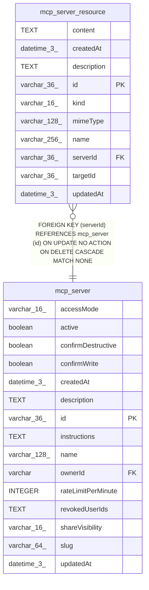

# mcp_server_resource

## Description

<details>
<summary><strong>Table Definition</strong></summary>

```sql
CREATE TABLE "mcp_server_resource" ("id" varchar(36) PRIMARY KEY NOT NULL, "serverId" varchar(36) NOT NULL, "kind" varchar(16) NOT NULL, "targetId" varchar(36), "name" varchar(256) NOT NULL, "description" text NOT NULL, "content" text, "mimeType" varchar(128) NOT NULL DEFAULT ('text/plain'), "createdAt" datetime(3) NOT NULL DEFAULT (STRFTIME('%Y-%m-%d %H:%M:%f', 'NOW')), "updatedAt" datetime(3) NOT NULL DEFAULT (STRFTIME('%Y-%m-%d %H:%M:%f', 'NOW')), CONSTRAINT "FK_mcp_server_resource_serverId" FOREIGN KEY ("serverId") REFERENCES "mcp_server" ("id") ON DELETE CASCADE)
```

</details>

## Columns

| Name | Type | Default | Nullable | Children | Parents | Comment |
| ---- | ---- | ------- | -------- | -------- | ------- | ------- |
| content | TEXT |  | true |  |  |  |
| createdAt | datetime(3) | STRFTIME('%Y-%m-%d %H:%M:%f', 'NOW') | false |  |  |  |
| description | TEXT |  | false |  |  |  |
| id | varchar(36) |  | false |  |  |  |
| kind | varchar(16) |  | false |  |  |  |
| mimeType | varchar(128) | 'text/plain' | false |  |  |  |
| name | varchar(256) |  | false |  |  |  |
| serverId | varchar(36) |  | false |  | [mcp_server](mcp_server.md) |  |
| targetId | varchar(36) |  | true |  |  |  |
| updatedAt | datetime(3) | STRFTIME('%Y-%m-%d %H:%M:%f', 'NOW') | false |  |  |  |

## Constraints

| Name | Type | Definition |
| ---- | ---- | ---------- |
| - (Foreign key ID: 0) | FOREIGN KEY | FOREIGN KEY (serverId) REFERENCES mcp_server (id) ON UPDATE NO ACTION ON DELETE CASCADE MATCH NONE |
| id | PRIMARY KEY | PRIMARY KEY (id) |
| sqlite_autoindex_mcp_server_resource_1 | PRIMARY KEY | PRIMARY KEY (id) |

## Indexes

| Name | Definition |
| ---- | ---------- |
| IDX_bd381d0f1ef8b0c1d75bc261cf | CREATE INDEX "IDX_bd381d0f1ef8b0c1d75bc261cf" ON "mcp_server_resource" ("serverId")  |
| sqlite_autoindex_mcp_server_resource_1 | PRIMARY KEY (id) |

## Relations



---

> Generated by [tbls](https://github.com/k1LoW/tbls)
