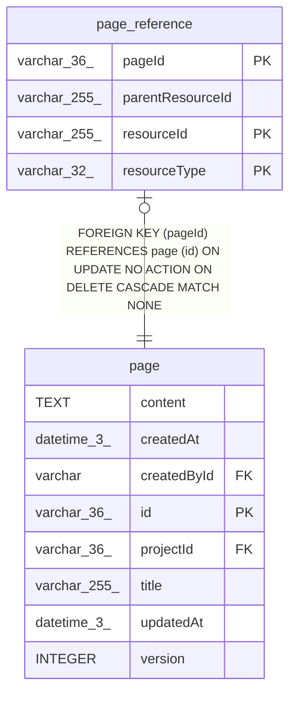

# page_reference

## Description

<details>
<summary><strong>Table Definition</strong></summary>

```sql
CREATE TABLE "page_reference" ("pageId" varchar(36) NOT NULL, "resourceType" varchar(32) NOT NULL, "resourceId" varchar(255) NOT NULL, "parentResourceId" varchar(255), CONSTRAINT "CHK_page_reference_resourceType" CHECK ("resourceType" IN ('workflow', 'node', 'page', 'credential', 'dataTable')), CONSTRAINT "FK_615bcbf6620b1cffa1dcfcebed8" FOREIGN KEY ("pageId") REFERENCES "page" ("id") ON DELETE CASCADE, PRIMARY KEY ("pageId", "resourceType", "resourceId"))
```

</details>

## Columns

| Name | Type | Default | Nullable | Children | Parents | Comment |
| ---- | ---- | ------- | -------- | -------- | ------- | ------- |
| pageId | varchar(36) |  | false |  | [page](page.md) |  |
| parentResourceId | varchar(255) |  | true |  |  |  |
| resourceId | varchar(255) |  | false |  |  |  |
| resourceType | varchar(32) |  | false |  |  |  |

## Constraints

| Name | Type | Definition |
| ---- | ---- | ---------- |
| - | CHECK | CHECK ("resourceType" IN ('workflow', 'node', 'page', 'credential', 'dataTable')) |
| - (Foreign key ID: 0) | FOREIGN KEY | FOREIGN KEY (pageId) REFERENCES page (id) ON UPDATE NO ACTION ON DELETE CASCADE MATCH NONE |
| pageId | PRIMARY KEY | PRIMARY KEY (pageId) |
| resourceId | PRIMARY KEY | PRIMARY KEY (resourceId) |
| resourceType | PRIMARY KEY | PRIMARY KEY (resourceType) |
| sqlite_autoindex_page_reference_1 | PRIMARY KEY | PRIMARY KEY (pageId, resourceType, resourceId) |

## Indexes

| Name | Definition |
| ---- | ---------- |
| IDX_7a19a989b40f9fda7193b3dbc5 | CREATE INDEX "IDX_7a19a989b40f9fda7193b3dbc5" ON "page_reference" ("resourceType", "resourceId")  |
| IDX_ac8ac0cf97d54a70983cd2b628 | CREATE INDEX "IDX_ac8ac0cf97d54a70983cd2b628" ON "page_reference" ("parentResourceId")  |
| sqlite_autoindex_page_reference_1 | PRIMARY KEY (pageId, resourceType, resourceId) |

## Relations



---

> Generated by [tbls](https://github.com/k1LoW/tbls)
