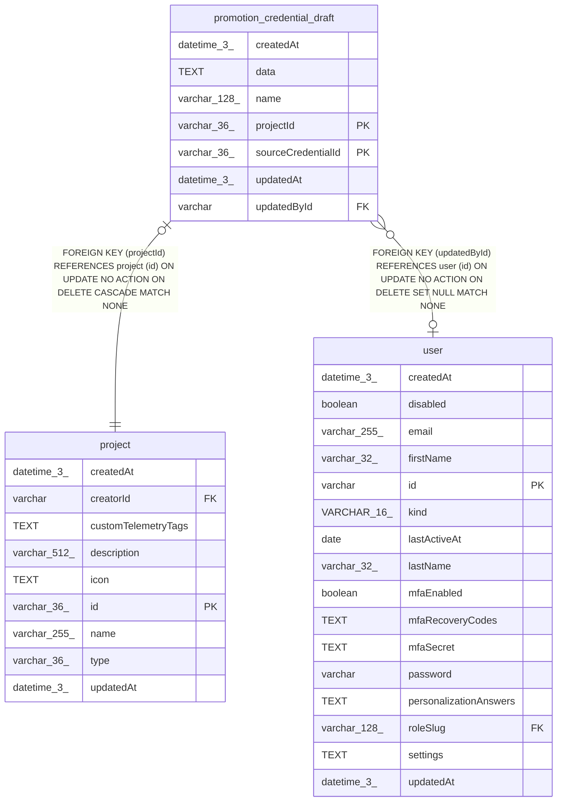

# promotion_credential_draft

## Description

<details>
<summary><strong>Table Definition</strong></summary>

```sql
CREATE TABLE "promotion_credential_draft" ("projectId" varchar(36) NOT NULL, "sourceCredentialId" varchar(36) NOT NULL, "name" varchar(128) NOT NULL, "data" text NOT NULL, "updatedById" varchar, "createdAt" datetime(3) NOT NULL DEFAULT (STRFTIME('%Y-%m-%d %H:%M:%f', 'NOW')), "updatedAt" datetime(3) NOT NULL DEFAULT (STRFTIME('%Y-%m-%d %H:%M:%f', 'NOW')), CONSTRAINT "FK_promotion_credential_draft_projectId" FOREIGN KEY ("projectId") REFERENCES "project" ("id") ON DELETE CASCADE, CONSTRAINT "FK_promotion_credential_draft_updatedById" FOREIGN KEY ("updatedById") REFERENCES "user" ("id") ON DELETE SET NULL, PRIMARY KEY ("projectId", "sourceCredentialId"))
```

</details>

## Columns

| Name | Type | Default | Nullable | Children | Parents | Comment |
| ---- | ---- | ------- | -------- | -------- | ------- | ------- |
| createdAt | datetime(3) | STRFTIME('%Y-%m-%d %H:%M:%f', 'NOW') | false |  |  |  |
| data | TEXT |  | false |  |  |  |
| name | varchar(128) |  | false |  |  |  |
| projectId | varchar(36) |  | false |  | [project](project.md) |  |
| sourceCredentialId | varchar(36) |  | false |  |  |  |
| updatedAt | datetime(3) | STRFTIME('%Y-%m-%d %H:%M:%f', 'NOW') | false |  |  |  |
| updatedById | varchar |  | true |  | [user](user.md) |  |

## Constraints

| Name | Type | Definition |
| ---- | ---- | ---------- |
| - (Foreign key ID: 0) | FOREIGN KEY | FOREIGN KEY (updatedById) REFERENCES user (id) ON UPDATE NO ACTION ON DELETE SET NULL MATCH NONE |
| - (Foreign key ID: 1) | FOREIGN KEY | FOREIGN KEY (projectId) REFERENCES project (id) ON UPDATE NO ACTION ON DELETE CASCADE MATCH NONE |
| projectId | PRIMARY KEY | PRIMARY KEY (projectId) |
| sourceCredentialId | PRIMARY KEY | PRIMARY KEY (sourceCredentialId) |
| sqlite_autoindex_promotion_credential_draft_1 | PRIMARY KEY | PRIMARY KEY (projectId, sourceCredentialId) |

## Indexes

| Name | Definition |
| ---- | ---------- |
| sqlite_autoindex_promotion_credential_draft_1 | PRIMARY KEY (projectId, sourceCredentialId) |

## Relations



---

> Generated by [tbls](https://github.com/k1LoW/tbls)
