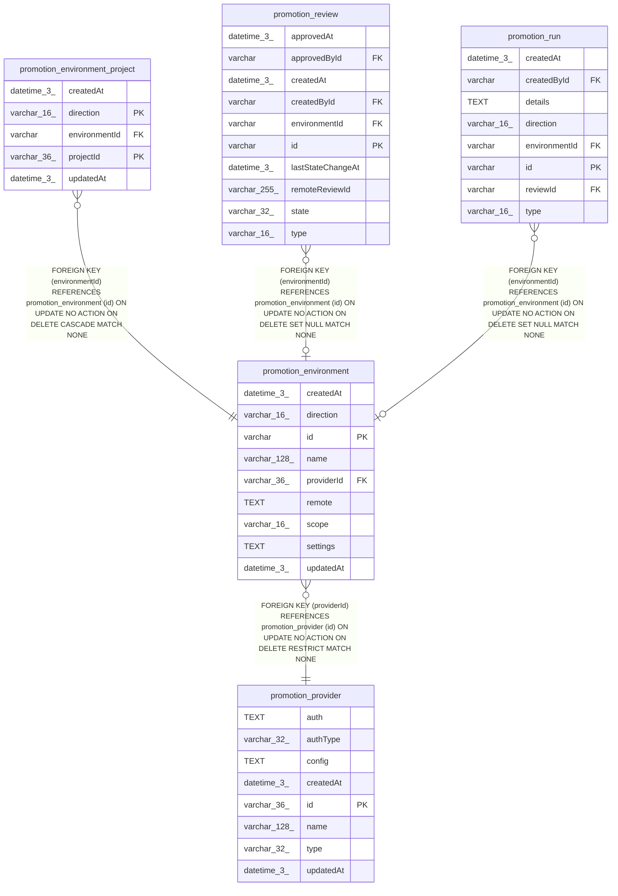

# promotion_environment

## Description

<details>
<summary><strong>Table Definition</strong></summary>

```sql
CREATE TABLE "promotion_environment" ("id" varchar PRIMARY KEY NOT NULL, "name" varchar(128) NOT NULL, "providerId" varchar(36) NOT NULL, "direction" varchar(16) NOT NULL, "scope" varchar(16) NOT NULL, "remote" text NOT NULL, "settings" text NOT NULL, "createdAt" datetime(3) NOT NULL DEFAULT (STRFTIME('%Y-%m-%d %H:%M:%f', 'NOW')), "updatedAt" datetime(3) NOT NULL DEFAULT (STRFTIME('%Y-%m-%d %H:%M:%f', 'NOW')), CONSTRAINT "CHK_promotion_environment_direction" CHECK ("direction" IN ('apply', 'promote')), CONSTRAINT "CHK_promotion_environment_scope" CHECK ("scope" IN ('instance', 'projects')), CONSTRAINT "FK_promotion_environment_providerId" FOREIGN KEY ("providerId") REFERENCES "promotion_provider" ("id") ON DELETE RESTRICT)
```

</details>

## Columns

| Name | Type | Default | Nullable | Children | Parents | Comment |
| ---- | ---- | ------- | -------- | -------- | ------- | ------- |
| createdAt | datetime(3) | STRFTIME('%Y-%m-%d %H:%M:%f', 'NOW') | false |  |  |  |
| direction | varchar(16) |  | false |  |  |  |
| id | varchar |  | false | [promotion_environment_project](promotion_environment_project.md) [promotion_review](promotion_review.md) [promotion_run](promotion_run.md) |  |  |
| name | varchar(128) |  | false |  |  |  |
| providerId | varchar(36) |  | false |  | [promotion_provider](promotion_provider.md) |  |
| remote | TEXT |  | false |  |  |  |
| scope | varchar(16) |  | false |  |  |  |
| settings | TEXT |  | false |  |  |  |
| updatedAt | datetime(3) | STRFTIME('%Y-%m-%d %H:%M:%f', 'NOW') | false |  |  |  |

## Constraints

| Name | Type | Definition |
| ---- | ---- | ---------- |
| - | CHECK | CHECK ("direction" IN ('apply', 'promote')) |
| - | CHECK | CHECK ("scope" IN ('instance', 'projects')) |
| - (Foreign key ID: 0) | FOREIGN KEY | FOREIGN KEY (providerId) REFERENCES promotion_provider (id) ON UPDATE NO ACTION ON DELETE RESTRICT MATCH NONE |
| id | PRIMARY KEY | PRIMARY KEY (id) |
| sqlite_autoindex_promotion_environment_1 | PRIMARY KEY | PRIMARY KEY (id) |

## Indexes

| Name | Definition |
| ---- | ---------- |
| IDX_5246e9ee176a2e10dc9977e521 | CREATE INDEX "IDX_5246e9ee176a2e10dc9977e521" ON "promotion_environment" ("providerId")  |
| IDX_promotion_environment_direction | CREATE UNIQUE INDEX "IDX_promotion_environment_direction" ON "promotion_environment" ("direction") WHERE "scope" = 'instance' |
| sqlite_autoindex_promotion_environment_1 | PRIMARY KEY (id) |

## Relations



---

> Generated by [tbls](https://github.com/k1LoW/tbls)
