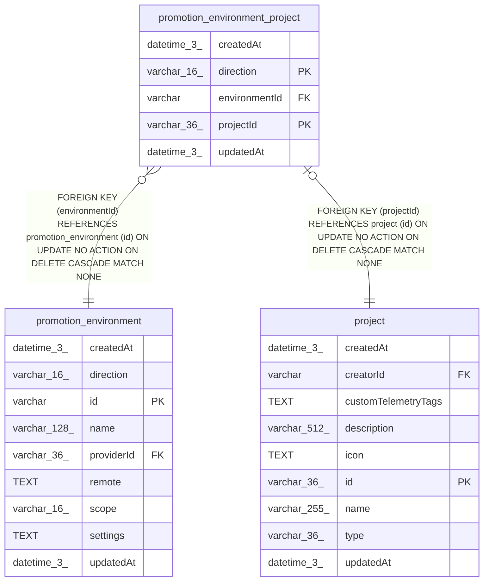

# promotion_environment_project

## Description

<details>
<summary><strong>Table Definition</strong></summary>

```sql
CREATE TABLE "promotion_environment_project" ("projectId" varchar(36) NOT NULL, "direction" varchar(16) NOT NULL, "environmentId" varchar NOT NULL, "createdAt" datetime(3) NOT NULL DEFAULT (STRFTIME('%Y-%m-%d %H:%M:%f', 'NOW')), "updatedAt" datetime(3) NOT NULL DEFAULT (STRFTIME('%Y-%m-%d %H:%M:%f', 'NOW')), CONSTRAINT "CHK_promotion_environment_project_direction" CHECK ("direction" IN ('apply', 'promote')), CONSTRAINT "FK_promotion_environment_project_projectId" FOREIGN KEY ("projectId") REFERENCES "project" ("id") ON DELETE CASCADE, CONSTRAINT "FK_promotion_environment_project_environmentId" FOREIGN KEY ("environmentId") REFERENCES "promotion_environment" ("id") ON DELETE CASCADE, PRIMARY KEY ("projectId", "direction"))
```

</details>

## Columns

| Name | Type | Default | Nullable | Children | Parents | Comment |
| ---- | ---- | ------- | -------- | -------- | ------- | ------- |
| createdAt | datetime(3) | STRFTIME('%Y-%m-%d %H:%M:%f', 'NOW') | false |  |  |  |
| direction | varchar(16) |  | false |  |  |  |
| environmentId | varchar |  | false |  | [promotion_environment](promotion_environment.md) |  |
| projectId | varchar(36) |  | false |  | [project](project.md) |  |
| updatedAt | datetime(3) | STRFTIME('%Y-%m-%d %H:%M:%f', 'NOW') | false |  |  |  |

## Constraints

| Name | Type | Definition |
| ---- | ---- | ---------- |
| - | CHECK | CHECK ("direction" IN ('apply', 'promote')) |
| - (Foreign key ID: 0) | FOREIGN KEY | FOREIGN KEY (environmentId) REFERENCES promotion_environment (id) ON UPDATE NO ACTION ON DELETE CASCADE MATCH NONE |
| - (Foreign key ID: 1) | FOREIGN KEY | FOREIGN KEY (projectId) REFERENCES project (id) ON UPDATE NO ACTION ON DELETE CASCADE MATCH NONE |
| direction | PRIMARY KEY | PRIMARY KEY (direction) |
| projectId | PRIMARY KEY | PRIMARY KEY (projectId) |
| sqlite_autoindex_promotion_environment_project_1 | PRIMARY KEY | PRIMARY KEY (projectId, direction) |

## Indexes

| Name | Definition |
| ---- | ---------- |
| IDX_7e9db6a9fc5e58a6ed613387aa | CREATE INDEX "IDX_7e9db6a9fc5e58a6ed613387aa" ON "promotion_environment_project" ("environmentId")  |
| sqlite_autoindex_promotion_environment_project_1 | PRIMARY KEY (projectId, direction) |

## Relations



---

> Generated by [tbls](https://github.com/k1LoW/tbls)
