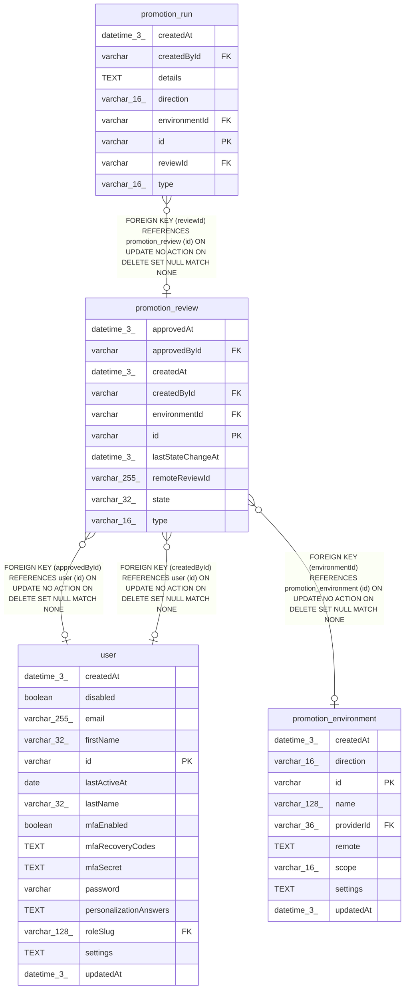

# promotion_review

## Description

<details>
<summary><strong>Table Definition</strong></summary>

```sql
CREATE TABLE "promotion_review" ("id" varchar PRIMARY KEY NOT NULL, "environmentId" varchar, "type" varchar(16) NOT NULL, "remoteReviewId" varchar(255), "state" varchar(32) NOT NULL DEFAULT ('open'), "lastStateChangeAt" datetime(3), "createdById" varchar, "approvedById" varchar, "approvedAt" datetime(3), "createdAt" datetime(3) NOT NULL DEFAULT (STRFTIME('%Y-%m-%d %H:%M:%f', 'NOW')), CONSTRAINT "CHK_promotion_review_type" CHECK ("type" IN ('gitlab')), CONSTRAINT "CHK_promotion_review_state" CHECK ("state" IN ('open', 'changes_requested', 'merged', 'closed')), CONSTRAINT "FK_promotion_review_environmentId" FOREIGN KEY ("environmentId") REFERENCES "promotion_environment" ("id") ON DELETE SET NULL, CONSTRAINT "FK_promotion_review_createdById" FOREIGN KEY ("createdById") REFERENCES "user" ("id") ON DELETE SET NULL, CONSTRAINT "FK_promotion_review_approvedById" FOREIGN KEY ("approvedById") REFERENCES "user" ("id") ON DELETE SET NULL)
```

</details>

## Columns

| Name | Type | Default | Nullable | Children | Parents | Comment |
| ---- | ---- | ------- | -------- | -------- | ------- | ------- |
| approvedAt | datetime(3) |  | true |  |  |  |
| approvedById | varchar |  | true |  | [user](user.md) |  |
| createdAt | datetime(3) | STRFTIME('%Y-%m-%d %H:%M:%f', 'NOW') | false |  |  |  |
| createdById | varchar |  | true |  | [user](user.md) |  |
| environmentId | varchar |  | true |  | [promotion_environment](promotion_environment.md) |  |
| id | varchar |  | false | [promotion_run](promotion_run.md) |  |  |
| lastStateChangeAt | datetime(3) |  | true |  |  |  |
| remoteReviewId | varchar(255) |  | true |  |  |  |
| state | varchar(32) | 'open' | false |  |  |  |
| type | varchar(16) |  | false |  |  |  |

## Constraints

| Name | Type | Definition |
| ---- | ---- | ---------- |
| - | CHECK | CHECK ("type" IN ('gitlab')) |
| - | CHECK | CHECK ("state" IN ('open', 'changes_requested', 'merged', 'closed')) |
| - (Foreign key ID: 0) | FOREIGN KEY | FOREIGN KEY (approvedById) REFERENCES user (id) ON UPDATE NO ACTION ON DELETE SET NULL MATCH NONE |
| - (Foreign key ID: 1) | FOREIGN KEY | FOREIGN KEY (createdById) REFERENCES user (id) ON UPDATE NO ACTION ON DELETE SET NULL MATCH NONE |
| - (Foreign key ID: 2) | FOREIGN KEY | FOREIGN KEY (environmentId) REFERENCES promotion_environment (id) ON UPDATE NO ACTION ON DELETE SET NULL MATCH NONE |
| id | PRIMARY KEY | PRIMARY KEY (id) |
| sqlite_autoindex_promotion_review_1 | PRIMARY KEY | PRIMARY KEY (id) |

## Indexes

| Name | Definition |
| ---- | ---------- |
| IDX_5fe8a74722bbd043487ab35a97 | CREATE INDEX "IDX_5fe8a74722bbd043487ab35a97" ON "promotion_review" ("environmentId")  |
| IDX_82d6930410e9e6c7d04c515079 | CREATE INDEX "IDX_82d6930410e9e6c7d04c515079" ON "promotion_review" ("state", "createdAt")  |
| IDX_promotion_review_environmentId_remoteReviewId | CREATE UNIQUE INDEX "IDX_promotion_review_environmentId_remoteReviewId" ON "promotion_review" ("environmentId", "remoteReviewId") WHERE "remoteReviewId" IS NOT NULL |
| sqlite_autoindex_promotion_review_1 | PRIMARY KEY (id) |

## Relations



---

> Generated by [tbls](https://github.com/k1LoW/tbls)
