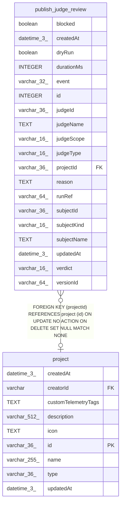

# publish_judge_review

## Description

<details>
<summary><strong>Table Definition</strong></summary>

```sql
CREATE TABLE "publish_judge_review" ("id" integer PRIMARY KEY NOT NULL, "event" varchar(32) NOT NULL, "subjectKind" varchar(16) NOT NULL, "subjectId" varchar(36), "subjectName" text NOT NULL, "versionId" varchar(64) NOT NULL, "projectId" varchar(36), "judgeScope" varchar(16) NOT NULL, "judgeType" varchar(16) NOT NULL, "judgeId" varchar(36) NOT NULL, "judgeName" text NOT NULL, "verdict" varchar(16) NOT NULL, "reason" text, "durationMs" integer NOT NULL, "runRef" varchar(64), "dryRun" boolean NOT NULL DEFAULT (false), "blocked" boolean NOT NULL DEFAULT (false), "createdAt" datetime(3) NOT NULL DEFAULT (STRFTIME('%Y-%m-%d %H:%M:%f', 'NOW')), "updatedAt" datetime(3) NOT NULL DEFAULT (STRFTIME('%Y-%m-%d %H:%M:%f', 'NOW')), CONSTRAINT "CHK_publish_judge_review_event" CHECK ("event" IN ('workflowPublish', 'workflowSave', 'agentPublish', 'agentSave')), CONSTRAINT "CHK_publish_judge_review_subjectKind" CHECK ("subjectKind" IN ('workflow', 'agent')), CONSTRAINT "CHK_publish_judge_review_judgeScope" CHECK ("judgeScope" IN ('instance', 'project')), CONSTRAINT "CHK_publish_judge_review_judgeType" CHECK ("judgeType" IN ('workflow', 'agent')), CONSTRAINT "CHK_publish_judge_review_verdict" CHECK ("verdict" IN ('allowed', 'refused', 'noAnswer')), CONSTRAINT "FK_7f69aca01a59aa32ed17cb893b2" FOREIGN KEY ("projectId") REFERENCES "project" ("id") ON DELETE SET NULL)
```

</details>

## Columns

| Name | Type | Default | Nullable | Children | Parents | Comment |
| ---- | ---- | ------- | -------- | -------- | ------- | ------- |
| blocked | boolean | false | false |  |  |  |
| createdAt | datetime(3) | STRFTIME('%Y-%m-%d %H:%M:%f', 'NOW') | false |  |  |  |
| dryRun | boolean | false | false |  |  |  |
| durationMs | INTEGER |  | false |  |  |  |
| event | varchar(32) |  | false |  |  |  |
| id | INTEGER |  | false |  |  |  |
| judgeId | varchar(36) |  | false |  |  |  |
| judgeName | TEXT |  | false |  |  |  |
| judgeScope | varchar(16) |  | false |  |  |  |
| judgeType | varchar(16) |  | false |  |  |  |
| projectId | varchar(36) |  | true |  | [project](project.md) |  |
| reason | TEXT |  | true |  |  |  |
| runRef | varchar(64) |  | true |  |  |  |
| subjectId | varchar(36) |  | true |  |  |  |
| subjectKind | varchar(16) |  | false |  |  |  |
| subjectName | TEXT |  | false |  |  |  |
| updatedAt | datetime(3) | STRFTIME('%Y-%m-%d %H:%M:%f', 'NOW') | false |  |  |  |
| verdict | varchar(16) |  | false |  |  |  |
| versionId | varchar(64) |  | false |  |  |  |

## Constraints

| Name | Type | Definition |
| ---- | ---- | ---------- |
| - | CHECK | CHECK ("event" IN ('workflowPublish', 'workflowSave', 'agentPublish', 'agentSave')) |
| - | CHECK | CHECK ("subjectKind" IN ('workflow', 'agent')) |
| - | CHECK | CHECK ("judgeScope" IN ('instance', 'project')) |
| - | CHECK | CHECK ("judgeType" IN ('workflow', 'agent')) |
| - | CHECK | CHECK ("verdict" IN ('allowed', 'refused', 'noAnswer')) |
| - (Foreign key ID: 0) | FOREIGN KEY | FOREIGN KEY (projectId) REFERENCES project (id) ON UPDATE NO ACTION ON DELETE SET NULL MATCH NONE |
| id | PRIMARY KEY | PRIMARY KEY (id) |

## Indexes

| Name | Definition |
| ---- | ---------- |
| IDX_6f21b1e565bbea512374527c1b | CREATE INDEX "IDX_6f21b1e565bbea512374527c1b" ON "publish_judge_review" ("createdAt")  |

## Relations



---

> Generated by [tbls](https://github.com/k1LoW/tbls)
