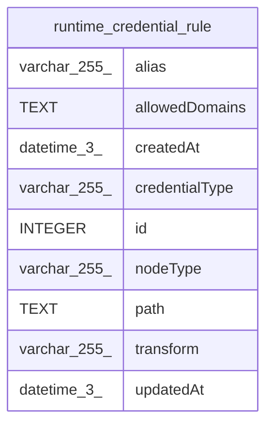

# runtime_credential_rule

## Description

<details>
<summary><strong>Table Definition</strong></summary>

```sql
CREATE TABLE "runtime_credential_rule" ("id" integer PRIMARY KEY NOT NULL, "alias" varchar(255) NOT NULL, "nodeType" varchar(255) NOT NULL, "path" text NOT NULL, "credentialType" varchar(255) NOT NULL, "transform" varchar(255), "createdAt" datetime(3) NOT NULL DEFAULT (STRFTIME('%Y-%m-%d %H:%M:%f', 'NOW')), "updatedAt" datetime(3) NOT NULL DEFAULT (STRFTIME('%Y-%m-%d %H:%M:%f', 'NOW')), "allowedDomains" text, CONSTRAINT "UQ_d2556ced6bc60720cf1b334a5ca" UNIQUE ("alias"))
```

</details>

## Columns

| Name | Type | Default | Nullable | Children | Parents | Comment |
| ---- | ---- | ------- | -------- | -------- | ------- | ------- |
| alias | varchar(255) |  | false |  |  |  |
| allowedDomains | TEXT |  | true |  |  |  |
| createdAt | datetime(3) | STRFTIME('%Y-%m-%d %H:%M:%f', 'NOW') | false |  |  |  |
| credentialType | varchar(255) |  | false |  |  |  |
| id | INTEGER |  | false |  |  |  |
| nodeType | varchar(255) |  | false |  |  |  |
| path | TEXT |  | false |  |  |  |
| transform | varchar(255) |  | true |  |  |  |
| updatedAt | datetime(3) | STRFTIME('%Y-%m-%d %H:%M:%f', 'NOW') | false |  |  |  |

## Constraints

| Name | Type | Definition |
| ---- | ---- | ---------- |
| id | PRIMARY KEY | PRIMARY KEY (id) |
| sqlite_autoindex_runtime_credential_rule_1 | UNIQUE | UNIQUE (alias) |

## Indexes

| Name | Definition |
| ---- | ---------- |
| sqlite_autoindex_runtime_credential_rule_1 | UNIQUE (alias) |

## Relations



---

> Generated by [tbls](https://github.com/k1LoW/tbls)
