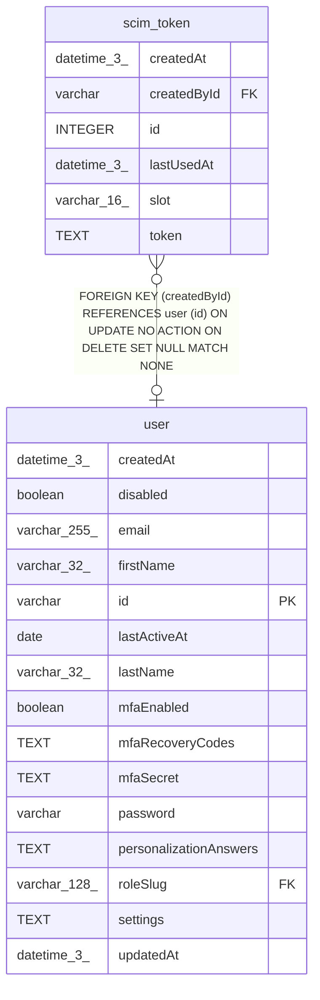

# scim_token

## Description

<details>
<summary><strong>Table Definition</strong></summary>

```sql
CREATE TABLE "scim_token" ("id" integer PRIMARY KEY NOT NULL, "slot" varchar(16) NOT NULL DEFAULT ('instance'), "token" text NOT NULL, "createdById" varchar, "lastUsedAt" datetime(3), "createdAt" datetime(3) NOT NULL DEFAULT (STRFTIME('%Y-%m-%d %H:%M:%f', 'NOW')), CONSTRAINT "CHK_scim_token_slot" CHECK ("slot" IN ('instance')), CONSTRAINT "FK_scim_token_createdById" FOREIGN KEY ("createdById") REFERENCES "user" ("id") ON DELETE SET NULL)
```

</details>

## Columns

| Name | Type | Default | Nullable | Children | Parents | Comment |
| ---- | ---- | ------- | -------- | -------- | ------- | ------- |
| createdAt | datetime(3) | STRFTIME('%Y-%m-%d %H:%M:%f', 'NOW') | false |  |  |  |
| createdById | varchar |  | true |  | [user](user.md) |  |
| id | INTEGER |  | false |  |  |  |
| lastUsedAt | datetime(3) |  | true |  |  |  |
| slot | varchar(16) | 'instance' | false |  |  |  |
| token | TEXT |  | false |  |  |  |

## Constraints

| Name | Type | Definition |
| ---- | ---- | ---------- |
| - | CHECK | CHECK ("slot" IN ('instance')) |
| - (Foreign key ID: 0) | FOREIGN KEY | FOREIGN KEY (createdById) REFERENCES user (id) ON UPDATE NO ACTION ON DELETE SET NULL MATCH NONE |
| id | PRIMARY KEY | PRIMARY KEY (id) |

## Indexes

| Name | Definition |
| ---- | ---------- |
| IDX_ed7fc072bfa05d0fb605da572a | CREATE UNIQUE INDEX "IDX_ed7fc072bfa05d0fb605da572a" ON "scim_token" ("slot")  |

## Relations



---

> Generated by [tbls](https://github.com/k1LoW/tbls)
