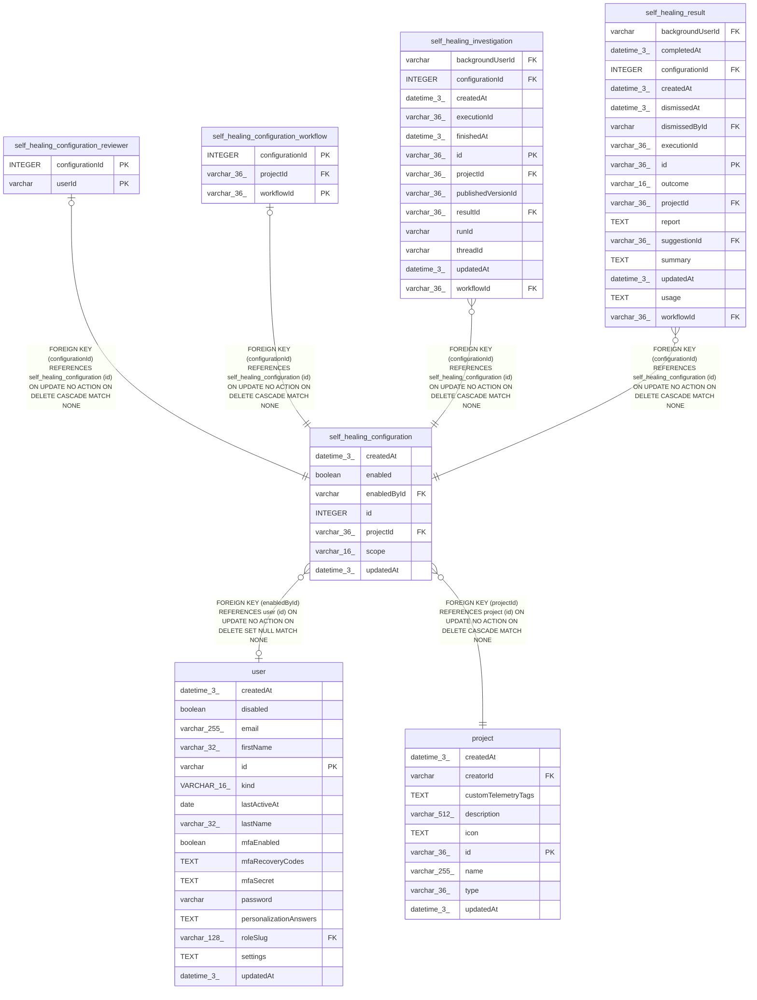

# self_healing_configuration

## Description

<details>
<summary><strong>Table Definition</strong></summary>

```sql
CREATE TABLE "self_healing_configuration" ("id" integer PRIMARY KEY AUTOINCREMENT NOT NULL, "projectId" varchar(36) NOT NULL, "scope" varchar(16) NOT NULL, "enabled" boolean NOT NULL DEFAULT (false), "enabledById" varchar, "createdAt" datetime(3) NOT NULL DEFAULT (STRFTIME('%Y-%m-%d %H:%M:%f', 'NOW')), "updatedAt" datetime(3) NOT NULL DEFAULT (STRFTIME('%Y-%m-%d %H:%M:%f', 'NOW')), CONSTRAINT "CHK_self_healing_configuration_scope" CHECK ("scope" IN ('all', 'selected')), CONSTRAINT "FK_0a8f9425ffdc01cce5876bc6247" FOREIGN KEY ("projectId") REFERENCES "project" ("id") ON DELETE CASCADE, CONSTRAINT "FK_2b04620d7af4060ba89412123ea" FOREIGN KEY ("enabledById") REFERENCES "user" ("id") ON DELETE SET NULL)
```

</details>

## Columns

| Name | Type | Default | Nullable | Children | Parents | Comment |
| ---- | ---- | ------- | -------- | -------- | ------- | ------- |
| createdAt | datetime(3) | STRFTIME('%Y-%m-%d %H:%M:%f', 'NOW') | false |  |  |  |
| enabled | boolean | false | false |  |  |  |
| enabledById | varchar |  | true |  | [user](user.md) |  |
| id | INTEGER |  | false | [self_healing_configuration_reviewer](self_healing_configuration_reviewer.md) [self_healing_configuration_workflow](self_healing_configuration_workflow.md) [self_healing_investigation](self_healing_investigation.md) [self_healing_result](self_healing_result.md) |  |  |
| projectId | varchar(36) |  | false |  | [project](project.md) |  |
| scope | varchar(16) |  | false |  |  |  |
| updatedAt | datetime(3) | STRFTIME('%Y-%m-%d %H:%M:%f', 'NOW') | false |  |  |  |

## Constraints

| Name | Type | Definition |
| ---- | ---- | ---------- |
| - | CHECK | CHECK ("scope" IN ('all', 'selected')) |
| - (Foreign key ID: 0) | FOREIGN KEY | FOREIGN KEY (enabledById) REFERENCES user (id) ON UPDATE NO ACTION ON DELETE SET NULL MATCH NONE |
| - (Foreign key ID: 1) | FOREIGN KEY | FOREIGN KEY (projectId) REFERENCES project (id) ON UPDATE NO ACTION ON DELETE CASCADE MATCH NONE |
| id | PRIMARY KEY | PRIMARY KEY (id) |

## Indexes

| Name | Definition |
| ---- | ---------- |
| IDX_0a8f9425ffdc01cce5876bc624 | CREATE INDEX "IDX_0a8f9425ffdc01cce5876bc624" ON "self_healing_configuration" ("projectId")  |
| IDX_2b04620d7af4060ba89412123e | CREATE INDEX "IDX_2b04620d7af4060ba89412123e" ON "self_healing_configuration" ("enabledById")  |
| IDX_self_healing_configuration_projectId | CREATE UNIQUE INDEX "IDX_self_healing_configuration_projectId" ON "self_healing_configuration" ("projectId") WHERE "scope" = 'all' |

## Relations



---

> Generated by [tbls](https://github.com/k1LoW/tbls)
