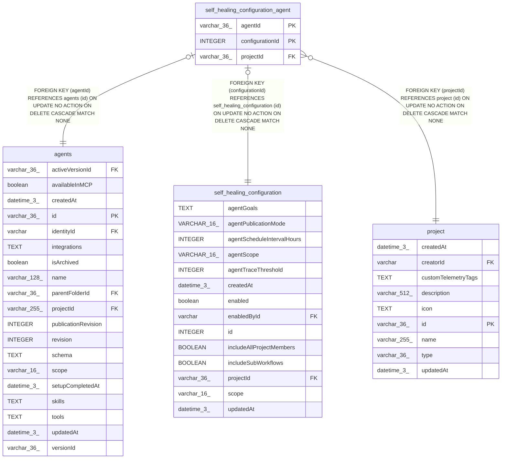

# self_healing_configuration_agent

## Description

<details>
<summary><strong>Table Definition</strong></summary>

```sql
CREATE TABLE "self_healing_configuration_agent" ("configurationId" integer NOT NULL, "agentId" varchar(36) NOT NULL, "projectId" varchar(36) NOT NULL, CONSTRAINT "FK_3e2e714456f9f0d42967eacc18d" FOREIGN KEY ("configurationId") REFERENCES "self_healing_configuration" ("id") ON DELETE CASCADE, CONSTRAINT "FK_95785fecd5e12c4af15bfaa49cf" FOREIGN KEY ("agentId") REFERENCES "agents" ("id") ON DELETE CASCADE, CONSTRAINT "FK_72974a6df948f4cdb7f6d21ddb0" FOREIGN KEY ("projectId") REFERENCES "project" ("id") ON DELETE CASCADE, PRIMARY KEY ("configurationId", "agentId"))
```

</details>

## Columns

| Name | Type | Default | Nullable | Children | Parents | Comment |
| ---- | ---- | ------- | -------- | -------- | ------- | ------- |
| agentId | varchar(36) |  | false |  | [agents](agents.md) |  |
| configurationId | INTEGER |  | false |  | [self_healing_configuration](self_healing_configuration.md) |  |
| projectId | varchar(36) |  | false |  | [project](project.md) |  |

## Constraints

| Name | Type | Definition |
| ---- | ---- | ---------- |
| - (Foreign key ID: 0) | FOREIGN KEY | FOREIGN KEY (projectId) REFERENCES project (id) ON UPDATE NO ACTION ON DELETE CASCADE MATCH NONE |
| - (Foreign key ID: 1) | FOREIGN KEY | FOREIGN KEY (agentId) REFERENCES agents (id) ON UPDATE NO ACTION ON DELETE CASCADE MATCH NONE |
| - (Foreign key ID: 2) | FOREIGN KEY | FOREIGN KEY (configurationId) REFERENCES self_healing_configuration (id) ON UPDATE NO ACTION ON DELETE CASCADE MATCH NONE |
| agentId | PRIMARY KEY | PRIMARY KEY (agentId) |
| configurationId | PRIMARY KEY | PRIMARY KEY (configurationId) |
| sqlite_autoindex_self_healing_configuration_agent_1 | PRIMARY KEY | PRIMARY KEY (configurationId, agentId) |

## Indexes

| Name | Definition |
| ---- | ---------- |
| IDX_761e991dafae6fa18ea79a5f25 | CREATE UNIQUE INDEX "IDX_761e991dafae6fa18ea79a5f25" ON "self_healing_configuration_agent" ("projectId", "agentId")  |
| IDX_95785fecd5e12c4af15bfaa49c | CREATE INDEX "IDX_95785fecd5e12c4af15bfaa49c" ON "self_healing_configuration_agent" ("agentId")  |
| sqlite_autoindex_self_healing_configuration_agent_1 | PRIMARY KEY (configurationId, agentId) |

## Relations



---

> Generated by [tbls](https://github.com/k1LoW/tbls)
