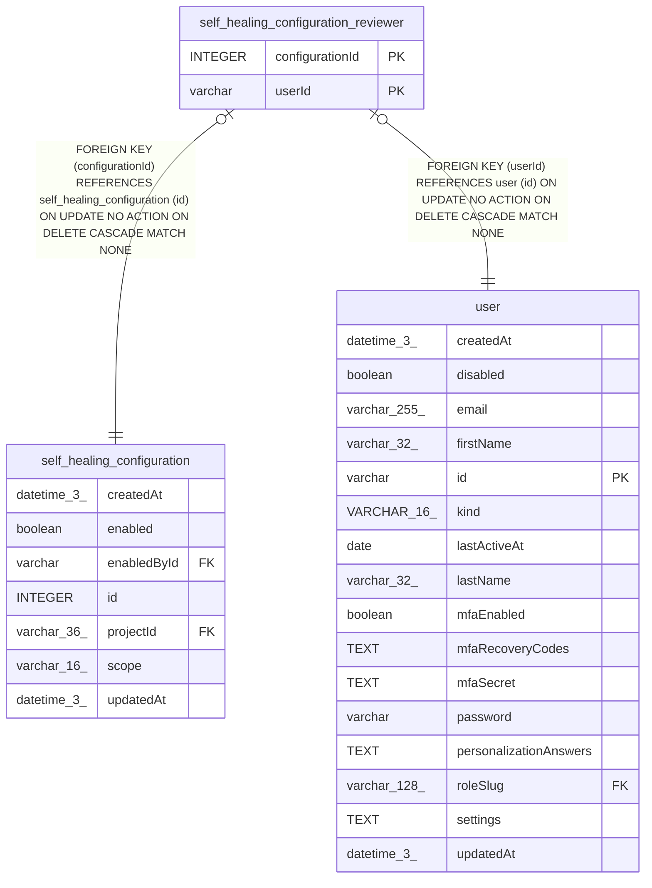

# self_healing_configuration_reviewer

## Description

<details>
<summary><strong>Table Definition</strong></summary>

```sql
CREATE TABLE "self_healing_configuration_reviewer" ("configurationId" integer NOT NULL, "userId" varchar NOT NULL, CONSTRAINT "FK_75fdd60d4d2a7d8129107853a51" FOREIGN KEY ("configurationId") REFERENCES "self_healing_configuration" ("id") ON DELETE CASCADE, CONSTRAINT "FK_e87386774ef62c6aac38fd3e99b" FOREIGN KEY ("userId") REFERENCES "user" ("id") ON DELETE CASCADE, PRIMARY KEY ("configurationId", "userId"))
```

</details>

## Columns

| Name | Type | Default | Nullable | Children | Parents | Comment |
| ---- | ---- | ------- | -------- | -------- | ------- | ------- |
| configurationId | INTEGER |  | false |  | [self_healing_configuration](self_healing_configuration.md) |  |
| userId | varchar |  | false |  | [user](user.md) |  |

## Constraints

| Name | Type | Definition |
| ---- | ---- | ---------- |
| - (Foreign key ID: 0) | FOREIGN KEY | FOREIGN KEY (userId) REFERENCES user (id) ON UPDATE NO ACTION ON DELETE CASCADE MATCH NONE |
| - (Foreign key ID: 1) | FOREIGN KEY | FOREIGN KEY (configurationId) REFERENCES self_healing_configuration (id) ON UPDATE NO ACTION ON DELETE CASCADE MATCH NONE |
| configurationId | PRIMARY KEY | PRIMARY KEY (configurationId) |
| sqlite_autoindex_self_healing_configuration_reviewer_1 | PRIMARY KEY | PRIMARY KEY (configurationId, userId) |
| userId | PRIMARY KEY | PRIMARY KEY (userId) |

## Indexes

| Name | Definition |
| ---- | ---------- |
| IDX_e87386774ef62c6aac38fd3e99 | CREATE INDEX "IDX_e87386774ef62c6aac38fd3e99" ON "self_healing_configuration_reviewer" ("userId")  |
| sqlite_autoindex_self_healing_configuration_reviewer_1 | PRIMARY KEY (configurationId, userId) |

## Relations



---

> Generated by [tbls](https://github.com/k1LoW/tbls)
