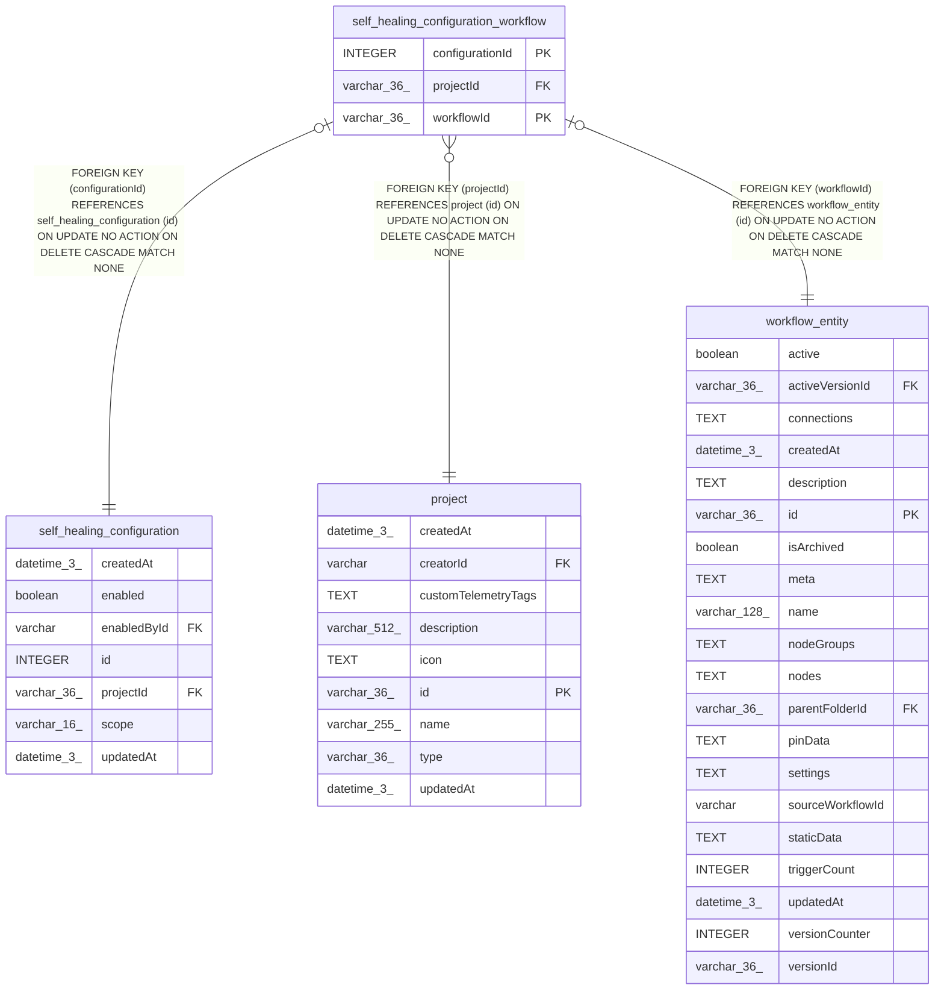

# self_healing_configuration_workflow

## Description

<details>
<summary><strong>Table Definition</strong></summary>

```sql
CREATE TABLE "self_healing_configuration_workflow" ("configurationId" integer NOT NULL, "workflowId" varchar(36) NOT NULL, "projectId" varchar(36) NOT NULL, CONSTRAINT "FK_355ef48520a7881610954fed7be" FOREIGN KEY ("configurationId") REFERENCES "self_healing_configuration" ("id") ON DELETE CASCADE, CONSTRAINT "FK_bfd82d710c4ea7de5c38a64dd76" FOREIGN KEY ("workflowId") REFERENCES "workflow_entity" ("id") ON DELETE CASCADE, CONSTRAINT "FK_1892b567be91ed445357f104043" FOREIGN KEY ("projectId") REFERENCES "project" ("id") ON DELETE CASCADE, PRIMARY KEY ("configurationId", "workflowId"))
```

</details>

## Columns

| Name | Type | Default | Nullable | Children | Parents | Comment |
| ---- | ---- | ------- | -------- | -------- | ------- | ------- |
| configurationId | INTEGER |  | false |  | [self_healing_configuration](self_healing_configuration.md) |  |
| projectId | varchar(36) |  | false |  | [project](project.md) |  |
| workflowId | varchar(36) |  | false |  | [workflow_entity](workflow_entity.md) |  |

## Constraints

| Name | Type | Definition |
| ---- | ---- | ---------- |
| - (Foreign key ID: 0) | FOREIGN KEY | FOREIGN KEY (projectId) REFERENCES project (id) ON UPDATE NO ACTION ON DELETE CASCADE MATCH NONE |
| - (Foreign key ID: 1) | FOREIGN KEY | FOREIGN KEY (workflowId) REFERENCES workflow_entity (id) ON UPDATE NO ACTION ON DELETE CASCADE MATCH NONE |
| - (Foreign key ID: 2) | FOREIGN KEY | FOREIGN KEY (configurationId) REFERENCES self_healing_configuration (id) ON UPDATE NO ACTION ON DELETE CASCADE MATCH NONE |
| configurationId | PRIMARY KEY | PRIMARY KEY (configurationId) |
| sqlite_autoindex_self_healing_configuration_workflow_1 | PRIMARY KEY | PRIMARY KEY (configurationId, workflowId) |
| workflowId | PRIMARY KEY | PRIMARY KEY (workflowId) |

## Indexes

| Name | Definition |
| ---- | ---------- |
| IDX_271ca62ab23c15694161fbfe70 | CREATE UNIQUE INDEX "IDX_271ca62ab23c15694161fbfe70" ON "self_healing_configuration_workflow" ("projectId", "workflowId")  |
| IDX_bfd82d710c4ea7de5c38a64dd7 | CREATE INDEX "IDX_bfd82d710c4ea7de5c38a64dd7" ON "self_healing_configuration_workflow" ("workflowId")  |
| sqlite_autoindex_self_healing_configuration_workflow_1 | PRIMARY KEY (configurationId, workflowId) |

## Relations



---

> Generated by [tbls](https://github.com/k1LoW/tbls)
