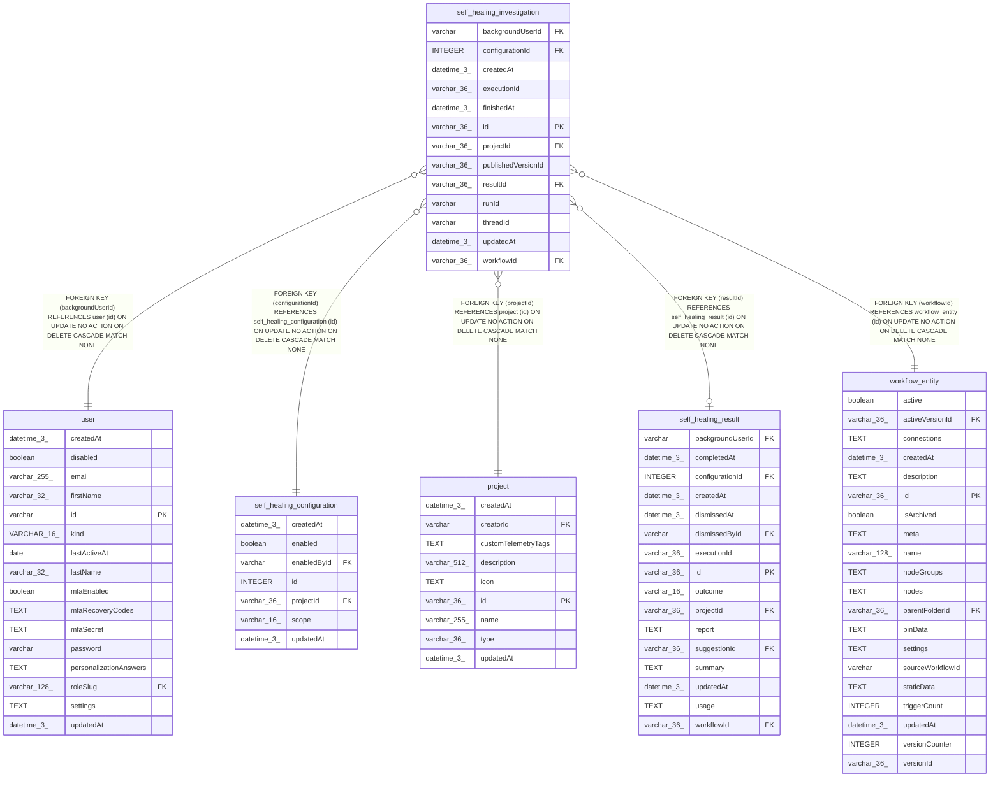

# self_healing_investigation

## Description

<details>
<summary><strong>Table Definition</strong></summary>

```sql
CREATE TABLE "self_healing_investigation" ("id" varchar(36) PRIMARY KEY NOT NULL, "workflowId" varchar(36) NOT NULL, "projectId" varchar(36) NOT NULL, "backgroundUserId" varchar NOT NULL, "executionId" varchar(36) NOT NULL, "threadId" varchar NOT NULL, "runId" varchar NOT NULL, "resultId" varchar(36), "finishedAt" datetime(3), "createdAt" datetime(3) NOT NULL DEFAULT (STRFTIME('%Y-%m-%d %H:%M:%f', 'NOW')), "updatedAt" datetime(3) NOT NULL DEFAULT (STRFTIME('%Y-%m-%d %H:%M:%f', 'NOW')), "configurationId" integer NOT NULL, "publishedVersionId" varchar(36) NOT NULL, CONSTRAINT "FK_39a928c9ea7b7afce4bdd1c6dae" FOREIGN KEY ("resultId") REFERENCES "self_healing_result" ("id") ON DELETE CASCADE ON UPDATE NO ACTION, CONSTRAINT "FK_24923f35caa34c1f264576a7914" FOREIGN KEY ("backgroundUserId") REFERENCES "user" ("id") ON DELETE CASCADE ON UPDATE NO ACTION, CONSTRAINT "FK_eb5b7d44599bd9a34f02f071b23" FOREIGN KEY ("projectId") REFERENCES "project" ("id") ON DELETE CASCADE ON UPDATE NO ACTION, CONSTRAINT "FK_7fa67c33c27bcc5d745c75a7eab" FOREIGN KEY ("workflowId") REFERENCES "workflow_entity" ("id") ON DELETE CASCADE ON UPDATE NO ACTION, CONSTRAINT "FK_self_healing_investigation_configuration" FOREIGN KEY ("configurationId") REFERENCES "self_healing_configuration" ("id") ON DELETE CASCADE)
```

</details>

## Columns

| Name | Type | Default | Nullable | Children | Parents | Comment |
| ---- | ---- | ------- | -------- | -------- | ------- | ------- |
| backgroundUserId | varchar |  | false |  | [user](user.md) |  |
| configurationId | INTEGER |  | false |  | [self_healing_configuration](self_healing_configuration.md) |  |
| createdAt | datetime(3) | STRFTIME('%Y-%m-%d %H:%M:%f', 'NOW') | false |  |  |  |
| executionId | varchar(36) |  | false |  |  |  |
| finishedAt | datetime(3) |  | true |  |  |  |
| id | varchar(36) |  | false |  |  |  |
| projectId | varchar(36) |  | false |  | [project](project.md) |  |
| publishedVersionId | varchar(36) |  | false |  |  |  |
| resultId | varchar(36) |  | true |  | [self_healing_result](self_healing_result.md) |  |
| runId | varchar |  | false |  |  |  |
| threadId | varchar |  | false |  |  |  |
| updatedAt | datetime(3) | STRFTIME('%Y-%m-%d %H:%M:%f', 'NOW') | false |  |  |  |
| workflowId | varchar(36) |  | false |  | [workflow_entity](workflow_entity.md) |  |

## Constraints

| Name | Type | Definition |
| ---- | ---- | ---------- |
| - (Foreign key ID: 0) | FOREIGN KEY | FOREIGN KEY (configurationId) REFERENCES self_healing_configuration (id) ON UPDATE NO ACTION ON DELETE CASCADE MATCH NONE |
| - (Foreign key ID: 1) | FOREIGN KEY | FOREIGN KEY (workflowId) REFERENCES workflow_entity (id) ON UPDATE NO ACTION ON DELETE CASCADE MATCH NONE |
| - (Foreign key ID: 2) | FOREIGN KEY | FOREIGN KEY (projectId) REFERENCES project (id) ON UPDATE NO ACTION ON DELETE CASCADE MATCH NONE |
| - (Foreign key ID: 3) | FOREIGN KEY | FOREIGN KEY (backgroundUserId) REFERENCES user (id) ON UPDATE NO ACTION ON DELETE CASCADE MATCH NONE |
| - (Foreign key ID: 4) | FOREIGN KEY | FOREIGN KEY (resultId) REFERENCES self_healing_result (id) ON UPDATE NO ACTION ON DELETE CASCADE MATCH NONE |
| id | PRIMARY KEY | PRIMARY KEY (id) |
| sqlite_autoindex_self_healing_investigation_1 | PRIMARY KEY | PRIMARY KEY (id) |

## Indexes

| Name | Definition |
| ---- | ---------- |
| IDX_24923f35caa34c1f264576a791 | CREATE INDEX "IDX_24923f35caa34c1f264576a791" ON "self_healing_investigation" ("backgroundUserId")  |
| IDX_bfdc789961ad0537486e0e2d29 | CREATE UNIQUE INDEX "IDX_bfdc789961ad0537486e0e2d29" ON "self_healing_investigation" ("workflowId", "executionId")  |
| IDX_eb5b7d44599bd9a34f02f071b2 | CREATE INDEX "IDX_eb5b7d44599bd9a34f02f071b2" ON "self_healing_investigation" ("projectId")  |
| IDX_self_healing_investigation_configurationId | CREATE INDEX "IDX_self_healing_investigation_configurationId" ON "self_healing_investigation" ("configurationId")  |
| IDX_self_healing_investigation_resultId | CREATE UNIQUE INDEX "IDX_self_healing_investigation_resultId" ON "self_healing_investigation" ("resultId") WHERE "resultId" IS NOT NULL |
| IDX_self_healing_investigation_workflowId | CREATE UNIQUE INDEX "IDX_self_healing_investigation_workflowId" ON "self_healing_investigation" ("workflowId") WHERE "finishedAt" IS NULL |
| sqlite_autoindex_self_healing_investigation_1 | PRIMARY KEY (id) |

## Relations



---

> Generated by [tbls](https://github.com/k1LoW/tbls)
