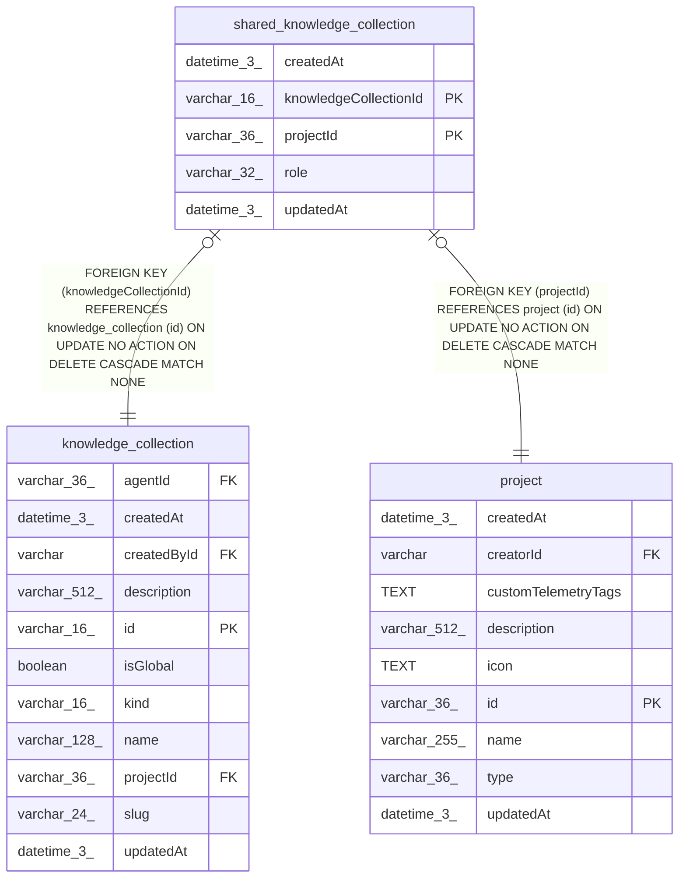

# shared_knowledge_collection

## Description

<details>
<summary><strong>Table Definition</strong></summary>

```sql
CREATE TABLE "shared_knowledge_collection" ("knowledgeCollectionId" varchar(16) NOT NULL, "projectId" varchar(36) NOT NULL, "role" varchar(32) NOT NULL, "createdAt" datetime(3) NOT NULL DEFAULT (STRFTIME('%Y-%m-%d %H:%M:%f', 'NOW')), "updatedAt" datetime(3) NOT NULL DEFAULT (STRFTIME('%Y-%m-%d %H:%M:%f', 'NOW')), CONSTRAINT "FK_453e7baab9b2d4f7a02569cca80" FOREIGN KEY ("knowledgeCollectionId") REFERENCES "knowledge_collection" ("id") ON DELETE CASCADE, CONSTRAINT "FK_86b015e85d35453e6a5d653c41c" FOREIGN KEY ("projectId") REFERENCES "project" ("id") ON DELETE CASCADE, PRIMARY KEY ("knowledgeCollectionId", "projectId"))
```

</details>

## Columns

| Name | Type | Default | Nullable | Children | Parents | Comment |
| ---- | ---- | ------- | -------- | -------- | ------- | ------- |
| createdAt | datetime(3) | STRFTIME('%Y-%m-%d %H:%M:%f', 'NOW') | false |  |  |  |
| knowledgeCollectionId | varchar(16) |  | false |  | [knowledge_collection](knowledge_collection.md) |  |
| projectId | varchar(36) |  | false |  | [project](project.md) |  |
| role | varchar(32) |  | false |  |  |  |
| updatedAt | datetime(3) | STRFTIME('%Y-%m-%d %H:%M:%f', 'NOW') | false |  |  |  |

## Constraints

| Name | Type | Definition |
| ---- | ---- | ---------- |
| - (Foreign key ID: 0) | FOREIGN KEY | FOREIGN KEY (projectId) REFERENCES project (id) ON UPDATE NO ACTION ON DELETE CASCADE MATCH NONE |
| - (Foreign key ID: 1) | FOREIGN KEY | FOREIGN KEY (knowledgeCollectionId) REFERENCES knowledge_collection (id) ON UPDATE NO ACTION ON DELETE CASCADE MATCH NONE |
| knowledgeCollectionId | PRIMARY KEY | PRIMARY KEY (knowledgeCollectionId) |
| projectId | PRIMARY KEY | PRIMARY KEY (projectId) |
| sqlite_autoindex_shared_knowledge_collection_1 | PRIMARY KEY | PRIMARY KEY (knowledgeCollectionId, projectId) |

## Indexes

| Name | Definition |
| ---- | ---------- |
| IDX_86b015e85d35453e6a5d653c41 | CREATE INDEX "IDX_86b015e85d35453e6a5d653c41" ON "shared_knowledge_collection" ("projectId")  |
| IDX_shared_knowledge_collection_owner | CREATE UNIQUE INDEX "IDX_shared_knowledge_collection_owner" ON "shared_knowledge_collection" ("knowledgeCollectionId") WHERE "role" = 'knowledgeCollection:owner' |
| sqlite_autoindex_shared_knowledge_collection_1 | PRIMARY KEY (knowledgeCollectionId, projectId) |

## Relations



---

> Generated by [tbls](https://github.com/k1LoW/tbls)
