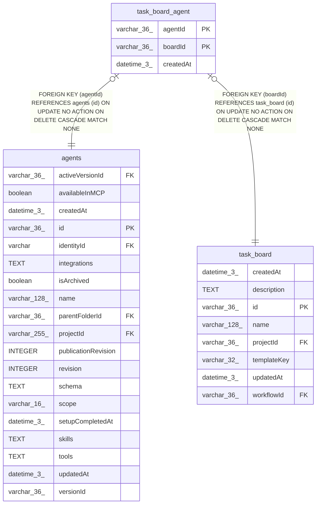

# task_board_agent

## Description

<details>
<summary><strong>Table Definition</strong></summary>

```sql
CREATE TABLE "task_board_agent" ("boardId" varchar(36) NOT NULL, "agentId" varchar(36) NOT NULL, "createdAt" datetime(3) NOT NULL DEFAULT (STRFTIME('%Y-%m-%d %H:%M:%f', 'NOW')), CONSTRAINT "FK_67ed692e161efe137f8b26f0e06" FOREIGN KEY ("boardId") REFERENCES "task_board" ("id") ON DELETE CASCADE, CONSTRAINT "FK_5dce1b2fbbdaacf3c189a64c0bb" FOREIGN KEY ("agentId") REFERENCES "agents" ("id") ON DELETE CASCADE, PRIMARY KEY ("boardId", "agentId"))
```

</details>

## Columns

| Name | Type | Default | Nullable | Children | Parents | Comment |
| ---- | ---- | ------- | -------- | -------- | ------- | ------- |
| agentId | varchar(36) |  | false |  | [agents](agents.md) |  |
| boardId | varchar(36) |  | false |  | [task_board](task_board.md) |  |
| createdAt | datetime(3) | STRFTIME('%Y-%m-%d %H:%M:%f', 'NOW') | false |  |  |  |

## Constraints

| Name | Type | Definition |
| ---- | ---- | ---------- |
| - (Foreign key ID: 0) | FOREIGN KEY | FOREIGN KEY (agentId) REFERENCES agents (id) ON UPDATE NO ACTION ON DELETE CASCADE MATCH NONE |
| - (Foreign key ID: 1) | FOREIGN KEY | FOREIGN KEY (boardId) REFERENCES task_board (id) ON UPDATE NO ACTION ON DELETE CASCADE MATCH NONE |
| agentId | PRIMARY KEY | PRIMARY KEY (agentId) |
| boardId | PRIMARY KEY | PRIMARY KEY (boardId) |
| sqlite_autoindex_task_board_agent_1 | PRIMARY KEY | PRIMARY KEY (boardId, agentId) |

## Indexes

| Name | Definition |
| ---- | ---------- |
| IDX_5dce1b2fbbdaacf3c189a64c0b | CREATE INDEX "IDX_5dce1b2fbbdaacf3c189a64c0b" ON "task_board_agent" ("agentId")  |
| sqlite_autoindex_task_board_agent_1 | PRIMARY KEY (boardId, agentId) |

## Relations



---

> Generated by [tbls](https://github.com/k1LoW/tbls)
