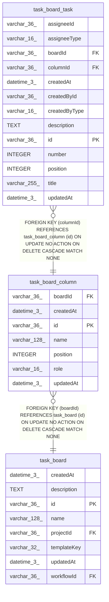

# task_board_column

## Description

<details>
<summary><strong>Table Definition</strong></summary>

```sql
CREATE TABLE "task_board_column" ("id" varchar(36) PRIMARY KEY NOT NULL, "boardId" varchar(36) NOT NULL, "name" varchar(128) NOT NULL, "position" integer NOT NULL, "role" varchar(16), "createdAt" datetime(3) NOT NULL DEFAULT (STRFTIME('%Y-%m-%d %H:%M:%f', 'NOW')), "updatedAt" datetime(3) NOT NULL DEFAULT (STRFTIME('%Y-%m-%d %H:%M:%f', 'NOW')), CONSTRAINT "CHK_task_board_column_role" CHECK ("role" IN ('backlog', 'todo', 'in_progress', 'needs_input', 'done')), CONSTRAINT "FK_4339642715fd7781af01776fcaa" FOREIGN KEY ("boardId") REFERENCES "task_board" ("id") ON DELETE CASCADE)
```

</details>

## Columns

| Name | Type | Default | Nullable | Children | Parents | Comment |
| ---- | ---- | ------- | -------- | -------- | ------- | ------- |
| boardId | varchar(36) |  | false |  | [task_board](task_board.md) |  |
| createdAt | datetime(3) | STRFTIME('%Y-%m-%d %H:%M:%f', 'NOW') | false |  |  |  |
| id | varchar(36) |  | false | [task_board_task](task_board_task.md) |  |  |
| name | varchar(128) |  | false |  |  |  |
| position | INTEGER |  | false |  |  |  |
| role | varchar(16) |  | true |  |  |  |
| updatedAt | datetime(3) | STRFTIME('%Y-%m-%d %H:%M:%f', 'NOW') | false |  |  |  |

## Constraints

| Name | Type | Definition |
| ---- | ---- | ---------- |
| - | CHECK | CHECK ("role" IN ('backlog', 'todo', 'in_progress', 'needs_input', 'done')) |
| - (Foreign key ID: 0) | FOREIGN KEY | FOREIGN KEY (boardId) REFERENCES task_board (id) ON UPDATE NO ACTION ON DELETE CASCADE MATCH NONE |
| id | PRIMARY KEY | PRIMARY KEY (id) |
| sqlite_autoindex_task_board_column_1 | PRIMARY KEY | PRIMARY KEY (id) |

## Indexes

| Name | Definition |
| ---- | ---------- |
| IDX_b34c4e6317b22b3af16af58144 | CREATE UNIQUE INDEX "IDX_b34c4e6317b22b3af16af58144" ON "task_board_column" ("boardId", "role")  |
| sqlite_autoindex_task_board_column_1 | PRIMARY KEY (id) |

## Relations



---

> Generated by [tbls](https://github.com/k1LoW/tbls)
