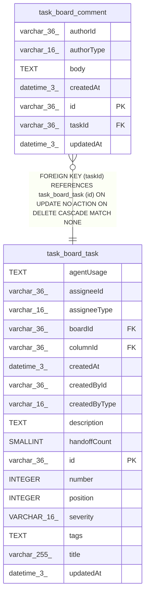

# task_board_comment

## Description

<details>
<summary><strong>Table Definition</strong></summary>

```sql
CREATE TABLE "task_board_comment" ("id" varchar(36) PRIMARY KEY NOT NULL, "taskId" varchar(36) NOT NULL, "authorType" varchar(16) NOT NULL, "authorId" varchar(36) NOT NULL, "body" text NOT NULL, "createdAt" datetime(3) NOT NULL DEFAULT (STRFTIME('%Y-%m-%d %H:%M:%f', 'NOW')), "updatedAt" datetime(3) NOT NULL DEFAULT (STRFTIME('%Y-%m-%d %H:%M:%f', 'NOW')), CONSTRAINT "CHK_task_board_comment_authorType" CHECK ("authorType" IN ('user', 'agent', 'workflow')), CONSTRAINT "FK_49af02f0149d0eb23f18c07b7d4" FOREIGN KEY ("taskId") REFERENCES "task_board_task" ("id") ON DELETE CASCADE)
```

</details>

## Columns

| Name | Type | Default | Nullable | Children | Parents | Comment |
| ---- | ---- | ------- | -------- | -------- | ------- | ------- |
| authorId | varchar(36) |  | false |  |  |  |
| authorType | varchar(16) |  | false |  |  |  |
| body | TEXT |  | false |  |  |  |
| createdAt | datetime(3) | STRFTIME('%Y-%m-%d %H:%M:%f', 'NOW') | false |  |  |  |
| id | varchar(36) |  | false |  |  |  |
| taskId | varchar(36) |  | false |  | [task_board_task](task_board_task.md) |  |
| updatedAt | datetime(3) | STRFTIME('%Y-%m-%d %H:%M:%f', 'NOW') | false |  |  |  |

## Constraints

| Name | Type | Definition |
| ---- | ---- | ---------- |
| - | CHECK | CHECK ("authorType" IN ('user', 'agent', 'workflow')) |
| - (Foreign key ID: 0) | FOREIGN KEY | FOREIGN KEY (taskId) REFERENCES task_board_task (id) ON UPDATE NO ACTION ON DELETE CASCADE MATCH NONE |
| id | PRIMARY KEY | PRIMARY KEY (id) |
| sqlite_autoindex_task_board_comment_1 | PRIMARY KEY | PRIMARY KEY (id) |

## Indexes

| Name | Definition |
| ---- | ---------- |
| IDX_49af02f0149d0eb23f18c07b7d | CREATE INDEX "IDX_49af02f0149d0eb23f18c07b7d" ON "task_board_comment" ("taskId")  |
| sqlite_autoindex_task_board_comment_1 | PRIMARY KEY (id) |

## Relations



---

> Generated by [tbls](https://github.com/k1LoW/tbls)
