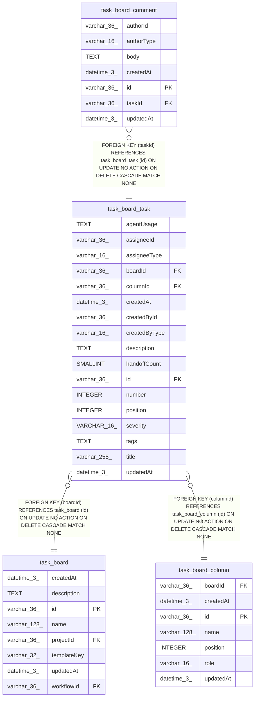

# task_board_task

## Description

<details>
<summary><strong>Table Definition</strong></summary>

```sql
CREATE TABLE "task_board_task" ("id" varchar(36) PRIMARY KEY NOT NULL, "boardId" varchar(36) NOT NULL, "columnId" varchar(36) NOT NULL, "number" integer NOT NULL, "title" varchar(255) NOT NULL, "description" text NOT NULL DEFAULT (''), "assigneeType" varchar(16), "assigneeId" varchar(36), "createdByType" varchar(16) NOT NULL, "createdById" varchar(36) NOT NULL, "position" integer NOT NULL, "createdAt" datetime(3) NOT NULL DEFAULT (STRFTIME('%Y-%m-%d %H:%M:%f', 'NOW')), "updatedAt" datetime(3) NOT NULL DEFAULT (STRFTIME('%Y-%m-%d %H:%M:%f', 'NOW')), "severity" VARCHAR(16) CONSTRAINT "CHK_task_board_task_severity" CHECK ("severity" IN ('low', 'medium', 'high', 'critical')), "tags" TEXT NOT NULL DEFAULT '[]', "handoffCount" SMALLINT NOT NULL DEFAULT 0, "agentUsage" TEXT NOT NULL DEFAULT '[]', CONSTRAINT "CHK_task_board_task_assigneeType" CHECK ("assigneeType" IN ('user', 'agent')), CONSTRAINT "CHK_task_board_task_createdByType" CHECK ("createdByType" IN ('user', 'agent', 'workflow')), CONSTRAINT "FK_89cb150ce8f73eb95950c1f62b8" FOREIGN KEY ("boardId") REFERENCES "task_board" ("id") ON DELETE CASCADE, CONSTRAINT "FK_36d6cbd2aa4767b580dab4125e5" FOREIGN KEY ("columnId") REFERENCES "task_board_column" ("id") ON DELETE CASCADE)
```

</details>

## Columns

| Name | Type | Default | Nullable | Children | Parents | Comment |
| ---- | ---- | ------- | -------- | -------- | ------- | ------- |
| agentUsage | TEXT | '[]' | false |  |  |  |
| assigneeId | varchar(36) |  | true |  |  |  |
| assigneeType | varchar(16) |  | true |  |  |  |
| boardId | varchar(36) |  | false |  | [task_board](task_board.md) |  |
| columnId | varchar(36) |  | false |  | [task_board_column](task_board_column.md) |  |
| createdAt | datetime(3) | STRFTIME('%Y-%m-%d %H:%M:%f', 'NOW') | false |  |  |  |
| createdById | varchar(36) |  | false |  |  |  |
| createdByType | varchar(16) |  | false |  |  |  |
| description | TEXT | '' | false |  |  |  |
| handoffCount | SMALLINT | 0 | false |  |  |  |
| id | varchar(36) |  | false | [task_board_comment](task_board_comment.md) |  |  |
| number | INTEGER |  | false |  |  |  |
| position | INTEGER |  | false |  |  |  |
| severity | VARCHAR(16) |  | true |  |  |  |
| tags | TEXT | '[]' | false |  |  |  |
| title | varchar(255) |  | false |  |  |  |
| updatedAt | datetime(3) | STRFTIME('%Y-%m-%d %H:%M:%f', 'NOW') | false |  |  |  |

## Constraints

| Name | Type | Definition |
| ---- | ---- | ---------- |
| - | CHECK | CHECK ("severity" IN ('low', 'medium', 'high', 'critical')) |
| - | CHECK | CHECK ("assigneeType" IN ('user', 'agent')) |
| - | CHECK | CHECK ("createdByType" IN ('user', 'agent', 'workflow')) |
| - (Foreign key ID: 0) | FOREIGN KEY | FOREIGN KEY (columnId) REFERENCES task_board_column (id) ON UPDATE NO ACTION ON DELETE CASCADE MATCH NONE |
| - (Foreign key ID: 1) | FOREIGN KEY | FOREIGN KEY (boardId) REFERENCES task_board (id) ON UPDATE NO ACTION ON DELETE CASCADE MATCH NONE |
| id | PRIMARY KEY | PRIMARY KEY (id) |
| sqlite_autoindex_task_board_task_1 | PRIMARY KEY | PRIMARY KEY (id) |

## Indexes

| Name | Definition |
| ---- | ---------- |
| IDX_2bd3311b8ca9896d7e4addab0d | CREATE UNIQUE INDEX "IDX_2bd3311b8ca9896d7e4addab0d" ON "task_board_task" ("boardId", "number")  |
| IDX_36d6cbd2aa4767b580dab4125e | CREATE INDEX "IDX_36d6cbd2aa4767b580dab4125e" ON "task_board_task" ("columnId")  |
| IDX_86521abe67595bc9bad8396edc | CREATE INDEX "IDX_86521abe67595bc9bad8396edc" ON "task_board_task" ("boardId", "columnId")  |
| sqlite_autoindex_task_board_task_1 | PRIMARY KEY (id) |

## Relations



---

> Generated by [tbls](https://github.com/k1LoW/tbls)
