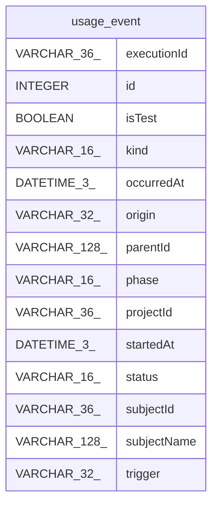

# usage_event

## Description

<details>
<summary><strong>Table Definition</strong></summary>

```sql
CREATE TABLE "usage_event" (
					"id" INTEGER PRIMARY KEY AUTOINCREMENT,
					
			"kind" VARCHAR(16) NOT NULL,
			"executionId" VARCHAR(36) NOT NULL,
			"phase" VARCHAR(16) NOT NULL,
			"subjectId" VARCHAR(36) NOT NULL,
			"subjectName" VARCHAR(128),
			"projectId" VARCHAR(36),
			"trigger" VARCHAR(32) NOT NULL,
			"status" VARCHAR(16) NOT NULL,
			"origin" VARCHAR(32),
			"isTest" BOOLEAN NOT NULL,
			"parentId" VARCHAR(128),
			"startedAt" DATETIME(3),
			"occurredAt" DATETIME(3) NOT NULL
				)
```

</details>

## Columns

| Name | Type | Default | Nullable | Children | Parents | Comment |
| ---- | ---- | ------- | -------- | -------- | ------- | ------- |
| executionId | VARCHAR(36) |  | false |  |  |  |
| id | INTEGER |  | true |  |  |  |
| isTest | BOOLEAN |  | false |  |  |  |
| kind | VARCHAR(16) |  | false |  |  |  |
| occurredAt | DATETIME(3) |  | false |  |  |  |
| origin | VARCHAR(32) |  | true |  |  |  |
| parentId | VARCHAR(128) |  | true |  |  |  |
| phase | VARCHAR(16) |  | false |  |  |  |
| projectId | VARCHAR(36) |  | true |  |  |  |
| startedAt | DATETIME(3) |  | true |  |  |  |
| status | VARCHAR(16) |  | false |  |  |  |
| subjectId | VARCHAR(36) |  | false |  |  |  |
| subjectName | VARCHAR(128) |  | true |  |  |  |
| trigger | VARCHAR(32) |  | false |  |  |  |

## Constraints

| Name | Type | Definition |
| ---- | ---- | ---------- |
| id | PRIMARY KEY | PRIMARY KEY (id) |

## Relations



---

> Generated by [tbls](https://github.com/k1LoW/tbls)
