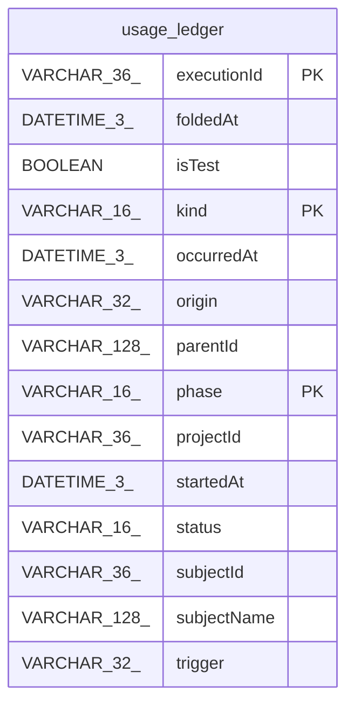

# usage_ledger

## Description

<details>
<summary><strong>Table Definition</strong></summary>

```sql
CREATE TABLE "usage_ledger" (
				
			"kind" VARCHAR(16) NOT NULL,
			"executionId" VARCHAR(36) NOT NULL,
			"phase" VARCHAR(16) NOT NULL,
			"subjectId" VARCHAR(36) NOT NULL,
			"subjectName" VARCHAR(128),
			"projectId" VARCHAR(36),
			"trigger" VARCHAR(32) NOT NULL,
			"status" VARCHAR(16) NOT NULL,
			"origin" VARCHAR(32),
			"isTest" BOOLEAN NOT NULL,
			"parentId" VARCHAR(128),
			"startedAt" DATETIME(3),
			"occurredAt" DATETIME(3) NOT NULL,
				"foldedAt" DATETIME(3) NOT NULL DEFAULT (STRFTIME('%Y-%m-%d %H:%M:%f', 'NOW')),
				PRIMARY KEY ("kind", "executionId", "phase")
			)
```

</details>

## Columns

| Name | Type | Default | Nullable | Children | Parents | Comment |
| ---- | ---- | ------- | -------- | -------- | ------- | ------- |
| executionId | VARCHAR(36) |  | false |  |  |  |
| foldedAt | DATETIME(3) | STRFTIME('%Y-%m-%d %H:%M:%f', 'NOW') | false |  |  |  |
| isTest | BOOLEAN |  | false |  |  |  |
| kind | VARCHAR(16) |  | false |  |  |  |
| occurredAt | DATETIME(3) |  | false |  |  |  |
| origin | VARCHAR(32) |  | true |  |  |  |
| parentId | VARCHAR(128) |  | true |  |  |  |
| phase | VARCHAR(16) |  | false |  |  |  |
| projectId | VARCHAR(36) |  | true |  |  |  |
| startedAt | DATETIME(3) |  | true |  |  |  |
| status | VARCHAR(16) |  | false |  |  |  |
| subjectId | VARCHAR(36) |  | false |  |  |  |
| subjectName | VARCHAR(128) |  | true |  |  |  |
| trigger | VARCHAR(32) |  | false |  |  |  |

## Constraints

| Name | Type | Definition |
| ---- | ---- | ---------- |
| executionId | PRIMARY KEY | PRIMARY KEY (executionId) |
| kind | PRIMARY KEY | PRIMARY KEY (kind) |
| phase | PRIMARY KEY | PRIMARY KEY (phase) |
| sqlite_autoindex_usage_ledger_1 | PRIMARY KEY | PRIMARY KEY (kind, executionId, phase) |

## Indexes

| Name | Definition |
| ---- | ---------- |
| IDX_usage_ledger_occurred_at | CREATE INDEX "IDX_usage_ledger_occurred_at" ON "usage_ledger" ("occurredAt") |
| sqlite_autoindex_usage_ledger_1 | PRIMARY KEY (kind, executionId, phase) |

## Relations



---

> Generated by [tbls](https://github.com/k1LoW/tbls)
