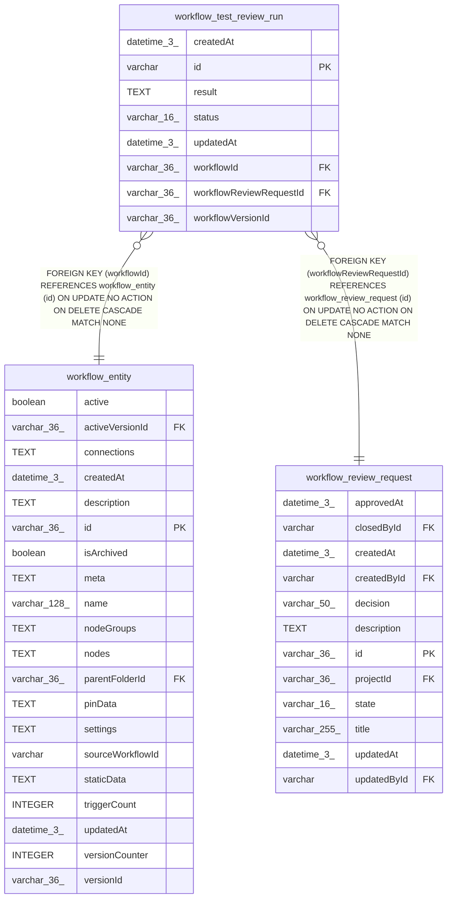

# workflow_test_review_run

## Description

<details>
<summary><strong>Table Definition</strong></summary>

```sql
CREATE TABLE "workflow_test_review_run" ("id" varchar PRIMARY KEY NOT NULL, "workflowReviewRequestId" varchar(36) NOT NULL, "workflowId" varchar(36) NOT NULL, "workflowVersionId" varchar(36) NOT NULL, "status" varchar(16) NOT NULL, "result" text, "createdAt" datetime(3) NOT NULL DEFAULT (STRFTIME('%Y-%m-%d %H:%M:%f', 'NOW')), "updatedAt" datetime(3) NOT NULL DEFAULT (STRFTIME('%Y-%m-%d %H:%M:%f', 'NOW')), CONSTRAINT "FK_workflow_test_review_run_workflowReviewRequestId" FOREIGN KEY ("workflowReviewRequestId") REFERENCES "workflow_review_request" ("id") ON DELETE CASCADE, CONSTRAINT "FK_workflow_test_review_run_workflowId" FOREIGN KEY ("workflowId") REFERENCES "workflow_entity" ("id") ON DELETE CASCADE)
```

</details>

## Columns

| Name | Type | Default | Nullable | Children | Parents | Comment |
| ---- | ---- | ------- | -------- | -------- | ------- | ------- |
| createdAt | datetime(3) | STRFTIME('%Y-%m-%d %H:%M:%f', 'NOW') | false |  |  |  |
| id | varchar |  | false |  |  |  |
| result | TEXT |  | true |  |  |  |
| status | varchar(16) |  | false |  |  |  |
| updatedAt | datetime(3) | STRFTIME('%Y-%m-%d %H:%M:%f', 'NOW') | false |  |  |  |
| workflowId | varchar(36) |  | false |  | [workflow_entity](workflow_entity.md) |  |
| workflowReviewRequestId | varchar(36) |  | false |  | [workflow_review_request](workflow_review_request.md) |  |
| workflowVersionId | varchar(36) |  | false |  |  |  |

## Constraints

| Name | Type | Definition |
| ---- | ---- | ---------- |
| - (Foreign key ID: 0) | FOREIGN KEY | FOREIGN KEY (workflowId) REFERENCES workflow_entity (id) ON UPDATE NO ACTION ON DELETE CASCADE MATCH NONE |
| - (Foreign key ID: 1) | FOREIGN KEY | FOREIGN KEY (workflowReviewRequestId) REFERENCES workflow_review_request (id) ON UPDATE NO ACTION ON DELETE CASCADE MATCH NONE |
| id | PRIMARY KEY | PRIMARY KEY (id) |
| sqlite_autoindex_workflow_test_review_run_1 | PRIMARY KEY | PRIMARY KEY (id) |

## Indexes

| Name | Definition |
| ---- | ---------- |
| IDX_b29d300dcc5bdedfcc0d4dad37 | CREATE INDEX "IDX_b29d300dcc5bdedfcc0d4dad37" ON "workflow_test_review_run" ("workflowReviewRequestId", "workflowId")  |
| sqlite_autoindex_workflow_test_review_run_1 | PRIMARY KEY (id) |

## Relations



---

> Generated by [tbls](https://github.com/k1LoW/tbls)
