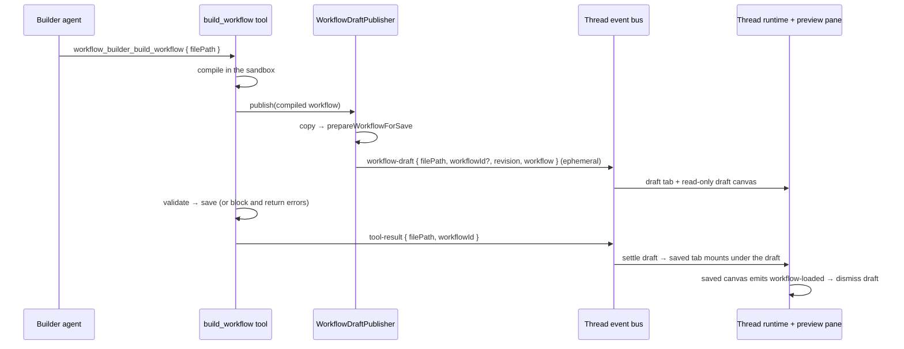

# Instance AI: draft workflow preview

## Goal

Make workflow builds in the n8n Assistant feel faster. Show the workflow on the
canvas as soon as the sandbox compiles its source file. Do not wait for
validation and the save. Validation often blocks the save for several build
attempts: in one traced build, the first canvas came 18s after the first
compile.

## Current behavior

1. The builder agent writes `src/workflows/<name>.workflow.ts` in the sandbox
   with `workspace_write_file` or `workspace_str_replace_file`. It can also
   send `sourceCode` inline to `workflow_builder_build_workflow`.
2. `workflow_builder_build_workflow` compiles the file in the sandbox
   (`sandbox-tsx` in `workflow-source-compiler.ts`), validates it, and saves
   it.
3. The preview pane renders `InstanceAiWorkflowPreview` only when a saved
   `workflowId` exists (`InstanceAiThreadView.vue`, the
   `preview.activeWorkflowId` slot). A new workflow shows no canvas until the
   first save. An edit shows the old saved canvas until the next save.

## Decisions

| Topic | Decision |
|---|---|
| Trigger | Each successful sandbox compile in `workflow_builder_build_workflow`, before validation. Validation and the save do not change. |
| Draft source | The sandbox build output. A second parser on the host would differ from it (node groups, layout, source that the AST interpreter rejects), so no parser is used. |
| UI | A read-only draft canvas (no iframe) in the workflow artifact tab, with a draft badge. The saved workflow replaces the draft when its canvas has loaded. |
| Edits to saved workflows | The draft replaces the saved canvas. Node positions stay the same where node names match. No diff highlights. |
| Failures | If the compile fails, keep the last good draft and show nothing to the user. If validation blocks the save, keep the draft and use the current error flow. |
| Rollout | PostHog experiment flag. Telemetry for exposure, first canvas render, and abandon. |
| Abandon | (a) The user presses stop while the agent is responding. (b) The user leaves the thread while the agent is responding. |

The existing `111_instance_ai_progressive_building` flag is a prompt profile
(`progressive@1`). It changes how the agent builds. It does not change the UI.
This feature is independent of it, and the two can run at the same time.

## Architecture

### Backend

- **Event** (`@n8n/api-types`): `workflow-draft` with `filePath`, an optional
  `workflowId`, a monotonic `revision` and the workflow. The event type is in
  `INSTANCE_AI_EPHEMERAL_EVENT_TYPES`, so it is never persisted or replayed.
- **Flag**: `137_instance_ai_draft_workflow_preview`, resolved in
  `resolveExperimentGates` as `draftWorkflowPreviewEnabled`.
- **Publisher** (`workflow-draft-publisher.ts`): `publish({ filePath,
  workflowId?, workflow })`. It copies the compiled workflow and runs
  `prepareWorkflowForSave` on the copy. This applies the same node ID, group
  and position passes as the save, so the saved workflow matches the draft. It
  numbers the drafts of each file and validates the payload. Any error
  produces no draft and a debug log only. It never throws.
- **Hook point**: the cli sets `InstanceAiContext.workflowDraftPublisher` only
  when the flag is on. The build tool calls it right after a successful
  compile, before validation.

### Frontend

- **State** (`instanceAi.workflowDrafts.ts`, thread runtime): drafts by file
  path. A lower revision is dropped. A successful build result with the same
  `filePath` sets `savedWorkflowId`. `dismissWorkflowDrafts(workflowId)`
  removes saved drafts.
- **Tabs, with several workflows open** (`useCanvasPreview`):
  - Each new workflow gets its own `draft:<filePath>` tab, marked `building`.
  - A draft of a saved workflow shows on that workflow's tab. It does not
    open a second tab.
  - Each new draft revision shows its tab through `showAgentArtifact`, so a
    tab that the user picked during the run stays on screen.
  - When the build saves a draft, an active draft tab (and the user's pick)
    moves to the saved workflow ID. A saved draft that is not on screen is
    dismissed at once.
  - Draft tabs are never stored with the thread's tabs and never stored as
    the active tab.
- **Draft canvas** (`InstanceAiWorkflowDraftPreview.vue`): no iframe and no
  editor `NodeView`. Each revision hydrates a throwaway workflow document
  store in its own namespace (`instance-ai-draft:<filePath>@draft-<revision>`),
  maps it with `useCanvasMapping`, and renders the read-only `Canvas`. This is
  the same approach as the workflow diff view. It fits the view only when a
  revision adds nodes. The badge reads "Draft · building…" while the agent
  works, and "Draft · not saved" after the agent stops.
- **Swap**: the draft canvas covers the preview slot. On a saved tab, the
  saved canvas mounts under it. When the saved canvas emits `workflow-loaded`,
  the thread view dismisses the saved draft, so the user never sees a loading
  spinner between the draft and the saved workflow.

### Telemetry

Three events in `@n8n/telemetry` (`INSTANCE_AI` domain). Each carries
`thread_id`, `run_id`, `variant` and `$feature/137_…`. Both arms emit them, so
the arms share a denominator.

| Event | When |
|---|---|
| `AI Assistant draft workflow preview exposed` | The first workflow build step of a run: a workflow builder target, a build call, or a workflow source write. Has `is_new_workflow`. |
| `AI Assistant workflow canvas first rendered` | Once for each run and `canvas_kind` (`draft` or `saved`), with `ms_since_message`. |
| `AI Assistant run abandoned` | Once for each exposed run. `reason: stopped` when the run root ends `cancelled` (stop button or amend). `reason: left` when the thread view unmounts or the page hides while the run is active. Has `canvas_state` and `ms_since_message`. |

## Edge cases

- **Source that does not compile:** no draft. The user sees the current
  loading behavior.
- **Many files in one run:** each `filePath` has its own draft and tab.
- **Out-of-order drafts:** the frontend drops a draft with a lower revision.
- **Reload during a build:** drafts are ephemeral, so none are replayed. The
  next compile sends a new draft.
- **Large workflows:** a draft with all node parameters can be large. Log the
  payload size at debug level. If it is a problem, remove large parameters
  (for example, Code node source) from the draft payload. The canvas does not
  need them.
- **Agent artifacts and other builder types:** not in scope. Only workflow
  source files make drafts.

## Implementation status

All tasks are implemented with tests. Manual verification in a running instance
is still open: force the flag to `variant`, build a new workflow, then edit it,
and check the events with `pnpm telemetry:sink`.

The [staging canvas](2026-10-30-instance-ai-draft-staging-canvas.md) extends
this feature. It opens the canvas of a new workflow before the first compile,
and it marks the draft nodes that block the save.

## Out of scope

- A preview while the agent streams the source file. In the traced build the
  write took 48s. A draft needs a complete file, so this needs another
  approach.
- Diff highlights between the draft and the saved workflow.
- Drafts for agent, data table, or skill artifacts.

## Evals

This change does not touch prompts or tool descriptions. The tool results that
the LLM sees do not change. No eval is necessary. The PostHog experiment
measures the effect.
