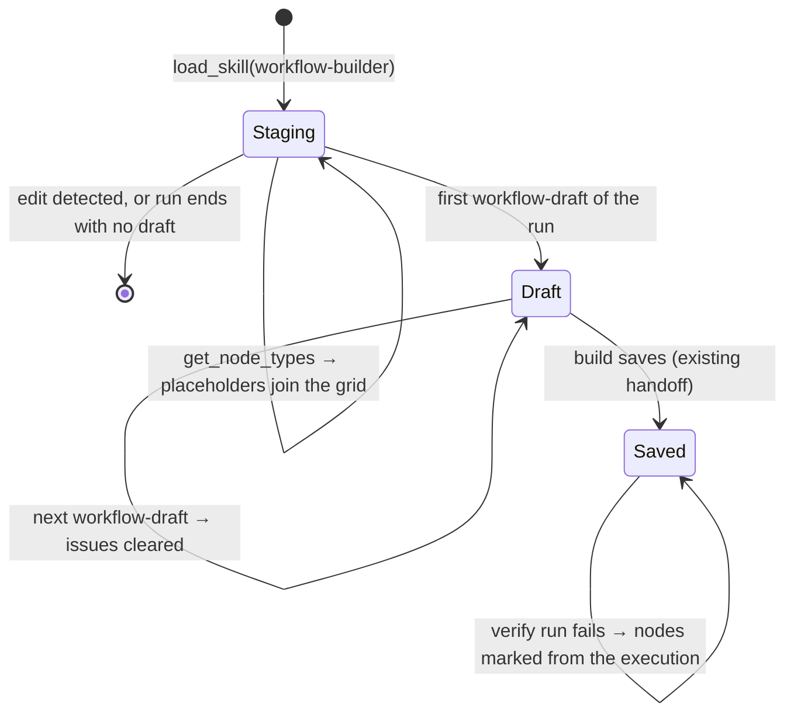

# Instance AI: staging canvas for new workflows

Follows [the draft workflow preview](2026-10-29-instance-ai-draft-workflow-preview.md).
It uses the same flag: `137_instance_ai_draft_workflow_preview`.

## Goal

Make a new workflow build feel faster. Open the canvas at the start of the
build, not at the first compile. Show the agent's progress on that canvas:

1. Open the draft canvas when the agent loads the `workflow-builder` skill.
2. While the agent searches for nodes, show "Searching for Gmail, Slack, HTTP"
   in the loading state.
3. While the agent reads node schemas, add each node type to the canvas in a
   grid. Nodes appear one at a time with an animation. They do not appear all
   together.
4. While the agent loads another skill or a skill file, show "Referencing X".
5. Show error states. A build attempt that fails validation marks the draft
   nodes that it names. A verification run that fails marks its nodes on the
   saved canvas.

## Scope

- New workflows only. An edit to a saved workflow keeps the current behavior.
- The frontend works out all progress from the tool calls that the thread
  already receives. It needs no backend event, except for the build
  validation errors (see [Build validation errors](#build-validation-errors)).
- The tool results that the LLM sees do not change.

## Current behavior

- `load_skill`, `search_nodes`, `get_node_types` and
  `workflow_builder_build_workflow` arrive as tool calls in the agent tree
  (`InstanceAiToolCallState`: `toolName`, `args`, `result`, `isLoading`).
- The first canvas of a new workflow shows at the first successful sandbox
  compile (`workflow-draft` event). Before that, the preview pane shows
  nothing. In the traced build, the write of the source file alone took 48s.
- A failed build returns `errors: string[]`, for example
  `[SET_INVALID_ASSIGNMENT] (Set): ...`. The structured `{ code, nodeName,
  message }` list exists only inside the build tool.
- Verification runs after the save. `getExecutionResultsByWorkflow` maps a
  `workflow_builder_verify_built_workflow` result to the saved workflow, and
  `InstanceAiWorkflowPreview` restores that execution on the saved canvas.

## Decisions

| Topic | Decision |
|---|---|
| Source of progress | The tool calls of the active run, from the agent tree. They replay after a reload, and they need no protocol change. |
| When staging starts | The first `load_skill` call with `name` or `skillId` `workflow-builder` in the active run. |
| New or edit | Staging stops, with no trace, when the run shows that it edits a saved workflow. See [New or edit](#new-or-edit). |
| Staging canvas | The existing read-only draft canvas (`InstanceAiWorkflowDraftPreview`). It renders a synthetic draft with placeholder nodes and no connections. |
| Placeholder nodes | One for each node type (with its discriminators) that `get_node_types` requested, in a grid of 4 columns. Triggers first, at the top left, then the other types in the order they were read. |
| Animation | Placeholders join the canvas one at a time, 80 ms apart. Each node fades and scales in over 240 ms. `prefers-reduced-motion` turns off the animation and the delay. |
| Handoff to the real draft | The first `workflow-draft` of the run replaces the staging canvas. The real nodes use the same entrance animation. The placeholders go away with the staging canvas. |
| Status line | The draft badge shows the current step of the run. See [Status line](#status-line). |
| Build validation errors | A new ephemeral event, `workflow-draft-issues`, from the build tool. The draft canvas sets them as node issues. |
| Verification errors | Use the existing restore of the verification execution on the saved canvas. Check it end to end, and fix gaps. |
| Telemetry | Add `staging` to `canvas_kind` of `AI Assistant workflow canvas first rendered`. |

## Design



### Staging state

A pure function derives the staging state from the agent tree of the active
run. It walks the orchestrator and its children, in call order.

New file: `features/ai/instanceAi/instanceAi.workflowStaging.ts`

```ts
export interface WorkflowStagingNode {
	/** `staging:<nodeType>[:resource:operation:mode]`, stable across updates. */
	id: string;
	nodeType: string;
	version?: number;
	resource?: string;
	operation?: string;
	mode?: string;
}

export interface WorkflowStaging {
	runId: string;
	nodes: WorkflowStagingNode[];
}

/** Undefined when the run is not staging a new workflow. */
export function getWorkflowStaging(
	tree: InstanceAiAgentNode,
	options: { hasNodeType: (nodeType: string) => boolean },
): WorkflowStaging | undefined;
```

`useWorkflowStaging` (`composables/useWorkflowStaging.ts`) applies the rules
of the turn: the experiment arm, the running message, the attachments of the
user message, and the first draft of the run. It returns the staging canvas as
a `WorkflowDraft` (`stagingDraft`).

Rules:

- **Start:** a `load_skill` call (any state) with `workflow-builder` as its
  `name` or `skillId`. Without one, the result is `undefined`.
- **Nodes:** each `get_node_types` call adds its `nodeTypes` entries. A string
  entry is a node type. An object entry uses `nodeType`, `version`,
  `resource`, `operation` and `mode`. Duplicate ids are skipped. Calls that
  are still loading count, so a node appears when the agent asks for it, not
  when the read completes. Calls with an `error` count too: the agent asked
  for that node.
- **Unknown types:** skip an entry whose `nodeType` is not in the node types
  store, so the canvas never shows an unknown node. The view passes a
  `hasNodeType` callback. The pure function does not read a store.

### New or edit

Staging ends, and the result is `undefined`, when any of these is true in the
active run:

- A call to `get_workflow` or `get_workflow_as_code`.
- A `workflow_builder_build_workflow` call with `args.workflowId`.
- A `workflow-draft` of the run that has a `workflowId`.
- The user message of the run attaches a workflow.

Staging also ends when the first `workflow-draft` of the run arrives, because
the draft takes over. It stays ended after a build of the run saves the
workflow (`success: true` with a `workflowId`). The saved canvas dismisses the
run's draft when it loads, so the draft alone cannot keep staging ended while
the run verifies and sets up the workflow. When the run ends with no draft, the staging tab closes.

Risk: an edit that loads the skill before it reads the workflow shows the
staging canvas for about one tool call. The attachment rule removes the common
case. The telemetry can show how often staging ends with no draft. If the
flash is a problem, wait for the first `search_nodes` or `get_node_types`
call before opening the tab.

### Status line

The draft canvas shows the same text as the chat status bar, so the two never
disagree. `useRunActivity` (moved out of `InstanceAiStatusBar.vue`) finds the
active sub-agent or the running tool. Both the status bar and the canvas use
it. The text comes from `useToolLabel`, as in the rest of the chat.

- **Detail:** `useToolLabel` now names what a node lookup looks up:
  - `search_nodes`: "Searching for gmail, slack"
  - `get_node_types`: "Reading Slack, Gmail", with the display names from the
    node types store

  A list shows 3 items and "and {count} more". Without arguments, the labels
  stay "Searching nodes" and "Reading node schema". Skill loads already had
  details ("Opening skill: data-table-manager", "Reading ai agents").
- **Workflow source:** labels name the workflow, never the file: "Writing
  daily invoice processing", "Editing …", "Building …". Other files keep
  "Writing file".
- **Long source writes:** a source write or an edit can run for many
  seconds. While one runs, the status rotates every 3 s through the node
  types that the run read with `get_node_types`: "Configuring Gmail nodes" →
  "Configuring Slack nodes". Accuracy is not important in a loading state;
  the status must keep moving. Without read node types, the tool label shows.
  Verification keeps its tool label: the canvas shows the node that runs, so
  a rotating node name could contradict it.

  A first version streamed the node names from the tool arguments
  (`tool-input-delta`) as an ephemeral event. It did not show in a manual run,
  and it needed a parser and a new event. The rotation needs neither, so the
  streaming version was removed.
- **Between calls:** the step after the last finished call, not "Thinking":
  - after a node search: "Choosing nodes"
  - after a schema read or a skill load: "Planning the workflow"
  - after a write or a saved build: "Reviewing the workflow"
  - after a build blocked by validation: "Fixing Set Fields", rotating every
    3 s through the nodes that the build errors name ("Fixing the workflow" if
    they name none)
  - after a failed test: "Fixing HTTP Request", rotating through the nodes
    that failed
  - otherwise: "Thinking"
- **Waiting on the user:** a pending question, approval or credential request
  in the run gives "Waiting on your answer", "Waiting on your approval",
  "Waiting on your choice", "Waiting for you to continue" or "Waiting on
  credentials". On the canvas, the status turns transparent red, stops the
  shimmer, and shows a left arrow that points to the chat.
- **No flashing:** `useSteadyRunActivity` holds the status steady for both
  the chat status bar and the canvas. A new status shows once it has held for
  400 ms, and a shown status stays for at least 1.5 s. Statuses in between are
  skipped. A change never waits longer than 3 s. A waiting status, and the
  status after it, show at once. The text changes in place, with no
  crossfade.
- **Look:** while the agent works, the status is in the middle of the canvas,
  over the nodes. It uses a larger font, a semi-transparent blurred
  background, and the chat's shimmer. When the agent stops, it goes, and the
  small "Draft · not saved" badge shows at the top. So the status never covers
  a finished workflow.

### Staging tab and canvas

- `useCanvasPreview` gets a `workflowStaging` option, a getter for the staging
  state of the active run.
- Staging adds one tab: id `staging:<runId>`, type `workflow`, `draft: true`,
  `building: true`, name "New workflow" (i18n). The tab is never stored, like
  the draft tabs.
- When staging starts, `showAgentArtifact('staging:<runId>')` shows it. This
  keeps a tab that the user picked during the run on screen, as the draft tabs
  do.
- When the first draft of the run arrives, the existing draft watcher shows
  the `draft:<filePath>` tab. If the staging tab was active (or the user's
  pick), it moves to the draft tab. Then the staging tab goes away.
- `activeWorkflowDraft` returns a synthetic draft for the staging tab:

  ```ts
  {
    filePath: `staging:${runId}`,
    revision: staging.nodes.length,
    workflow: { name: '', nodes: placeholders, connections: {} },
  }
  ```

- `toStagingWorkflowNodes(staging, nodeTypes)` makes the placeholders:
  - `name`: the display name. Add " 2", " 3" when two placeholders share it.
  - `typeVersion`: the requested version, or the latest version of the type.
  - `parameters`: `resource`, `operation` and `mode` when they were requested,
    so the canvas subtitle shows them.
  - Order: trigger types first (`group` includes `trigger`), then the other
    types in the order they were read. Unknown types take no cell.
  - `position`: column `i % 4`, row `floor(i / 4)`. Use a step of 20 × 14 grid
    units (`GRID_SIZE`), so the nodes are on the canvas grid. The step has
    room for a wide configurable node and a label with a two-line subtitle.
- The staging canvas fits the view after each new node. The draft canvas
  already does this when nodes are added.

### Entrance animation

- **Stagger:** `useStaggeredList(items, { intervalMs: 80 })` in
  `features/ai/instanceAi/composables/`. It returns a ref that adds the new
  items one at a time and drops removed items at once. With
  `prefers-reduced-motion: reduce` (`useMediaQuery`), it returns the items with
  no delay. The staging canvas passes its placeholders through it. A real
  draft has its full node list at once, so the draft canvas passes the new
  nodes of each revision through it too. Nodes that the previous revision had
  stay in place.
- **Fade and scale:** the draft preview sets a CSS animation on
  `:deep(.vue-flow__node)`: `opacity` 0 → 1 and `scale` 0.92 → 1, over 240 ms,
  `ease-out`. A node element animates when it mounts. Node ids are stable
  between revisions, so a node that stays does not animate again. The
  animation is off under `prefers-reduced-motion`. Use the transition duration
  tokens of the design system if they exist. If they do not, add one CSS
  variable in the component.
- Edges have no animation. The staging canvas has none, and real edges come
  with the draft.

### Build validation errors

The build tool has the structured errors (`blocking: { code, nodeName?,
message }[]`) only before it formats them as strings for the LLM. Parsing the
strings on the frontend would couple the UI to a format that is made for the
model. So the build tool also sends them as an ephemeral event.

- **Event** (`@n8n/api-types`): `workflow-draft-issues`:

  ```ts
  {
    filePath: string;
    revision: number; // the draft revision that the build validated
    issues: Array<{ code: string; message: string; nodeName?: string }>;
  }
  ```

  Add it to `INSTANCE_AI_EPHEMERAL_EVENT_TYPES`. Limit `issues` to 50 and each
  message to 500 characters.
- **Publisher:** `WorkflowDraftPublisher.publishIssues({ filePath, issues })`.
  It uses the last revision that it published for `filePath`. If there is
  none, it publishes nothing. It never throws.
- **Hook point:** the validation failure path of the build tool (the function
  that formats `blocking`) calls `publishIssues` with `blocking`. A build that
  saves needs no call: the save replaces the draft.
- **Frontend state:** `applyWorkflowDraftIssues(drafts, payload)` in
  `instanceAi.workflowDrafts.ts` sets `issues` on the draft with the same
  `filePath` and `revision`. It drops issues for another revision. A new
  revision replaces the draft object, so its issues clear.
- **Canvas:** `toDraftWorkflowDb` sets `issues.parameters` on each node that
  an issue names, keyed by the issue code, with the message as the value. The
  canvas then shows the issue icon, the red border, and the message in the
  tooltip. It uses the existing `validationErrorsByNodeId` path, so no canvas
  change is necessary. Issues with no node name, or with a name that is not on
  the canvas, mark no node.

### Verification errors

Verification runs on the saved workflow, after the draft is gone.

1. Check end to end in a running instance that a failed
   `workflow_builder_verify_built_workflow` marks its nodes on the saved
   canvas: error border, issue icon, error in the tooltip.
2. Add a unit test for `getExecutionResultsByWorkflow`: a verification result
   with `status: 'error'` maps to its `args.workflowId`.
3. Fix the gaps that step 1 finds. A known risk: the restored execution
   applies only when the saved canvas loads. A verification that finishes
   while the canvas is open must also apply. Check that
   `useInstanceAiWorkflowPreviewExecution` watches `executionResult`.

### Telemetry

- `AI Assistant workflow canvas first rendered`: `canvas_kind` becomes
  `staging | draft | saved`. The staging canvas fires it once for each run,
  when it first renders. Update the description of the property.
- `AI Assistant run abandoned`: `canvas_state` becomes
  `none | staging | draft | saved`.
- The control arm has no staging canvas, so it never sends `staging`. Compare
  the arms on the first `canvas_kind` of each run.

## Implementation tasks

Follow TDD for each task. Run only the changed test files.

1. **Staging state** (`instanceAi.workflowStaging.ts`):
   `getWorkflowStaging`: start rule, nodes from loading, done and failed
   calls, dedupe, unknown types skipped, each edit rule, the end at the first
   draft.
2. **Placeholders** (`toStagingWorkflowNodes`, in the same file or in
   `instanceAi.workflowDraftCanvas.ts`): grid positions, names with suffixes,
   versions, discriminator parameters.
3. **`useStaggeredList`**: adds one item each interval, drops removed items
   at once, no delay under reduced motion (fake timers).
4. **Staging tab** (`useCanvasPreview`): opens when staging starts, respects
   the user's pick, moves to the draft tab, closes when staging ends, never
   stored.
5. **Draft preview** (`InstanceAiWorkflowDraftPreview.vue`): renders the
   status text, staggers new nodes, has the entrance class. The thread view
   passes the run activity text (`useRunActivity`).
6. **i18n**: "New workflow", "Searching for {list}", "Reading {list}",
   "{items} and {count} more".
7. **Issue event** (`@n8n/api-types`): schema, ephemeral type, schema tests.
8. **Publisher** (`workflow-draft-publisher.ts`): `publishIssues` uses the last
   revision, publishes nothing with no revision, caps sizes, never throws.
9. **Build tool**: a blocked build calls `publishIssues` with the structured
   errors. A saved build does not call it.
10. **Draft issues** (frontend): `applyWorkflowDraftIssues` in the drafts
    module and the thread runtime. `toDraftWorkflowDb` maps issues to
    `issues.parameters`.
11. **Verification errors**: the test and the check above. Fix the gaps.
12. **Telemetry**: the new enum values, the staging render, the abandon state.
13. Update the 2026-10-29 plan: link to this plan and remove "Parse errors
    shown to the user" from the out-of-scope list.

Rebuild `@n8n/instance-ai` and `@n8n/api-types` before the cli and frontend
tests (`pnpm build` in each package).

## Verification

- Unit tests for each task, as listed above.
- `tsc --noEmit` for `@n8n/api-types` and `@n8n/instance-ai`. No full
  frontend typecheck. CI runs it.
- Manual, with the flag forced to `variant`:
  - Ask for a new workflow. The canvas opens when the skill loads. The status
    line follows the searches and skill reads. Nodes join the grid one at a
    time. The real draft replaces the staging canvas.
  - Make the first build fail validation (for example, an invalid Set
    assignment). The named node shows the issue. The next draft clears it.
  - Make verification fail. The saved canvas marks the failed node.
  - Edit a saved workflow. No staging tab opens, or it closes after one call.
  - Turn on reduced motion. Nodes appear with no animation and no delay.

## Edge cases

- **Reload during staging:** tool calls replay, so staging comes back with
  its placeholders. The animation runs again for all of them, staggered. A
  `workflow-draft-issues` event is ephemeral and does not replay. The next
  build sends new issues.
- **More than one workflow in a run:** staging covers only the first. Each
  later workflow uses its own draft tab, as now.
- **Sub-agents:** the walk includes child agents, so a builder sub-agent's
  calls count.
- **Many node types:** the grid grows down. The canvas fits the view after
  each new node.
- **Run stopped during staging:** the run is no longer active, so staging
  ends and its tab closes. The abandon event records `canvas_state: staging`.

## Implementation status

All 13 tasks are implemented with tests. Differences from the design above:

- **Stagger limit:** a long queue of nodes uses a shorter interval, so the
  nodes of one batch all show within 1.2s.
- **Entrance animation:** it uses `--duration--snappy` (200ms) and
  `--easing--ease-out-quart`, and the `scale` property, so it does not
  conflict with the node position transform.
- **Staging telemetry:** the staging canvas opens before exposure. A staging
  render before exposure is held and sent at exposure, with the time of the
  render. The exposure rule does not change.
- **Verification errors:** the saved canvas already applies a verification
  run when its result arrives, also while the canvas is open. A unit test now
  covers a failed verification result. No code change was necessary.

Manual verification in a running instance is still open. See
[Verification](#verification).

## Out of scope

- A read-only node search panel on the draft canvas. It was built and then
  removed: the agent usually reads the node schemas right after the search, so
  the panel closed soon after the query finished typing.
- A progressive preview while the agent streams the source file.
- Connections between placeholders, or a guess at the final layout.
- A placeholder that moves to the matching real node.
- Staging for edits to saved workflows, or for agent artifacts.

## Evals

This change does not touch prompts, tool descriptions or the tool results
that the LLM sees. The new event is ephemeral and only the frontend reads it.
No eval is necessary. The PostHog experiment measures the effect, with
`canvas_kind: staging`.
