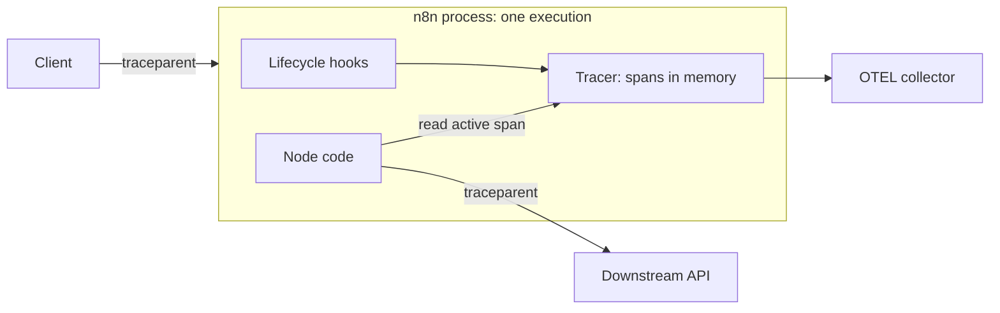
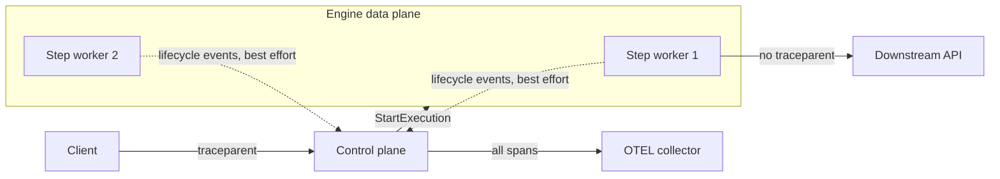
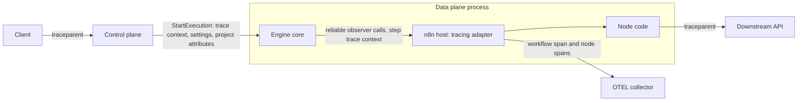
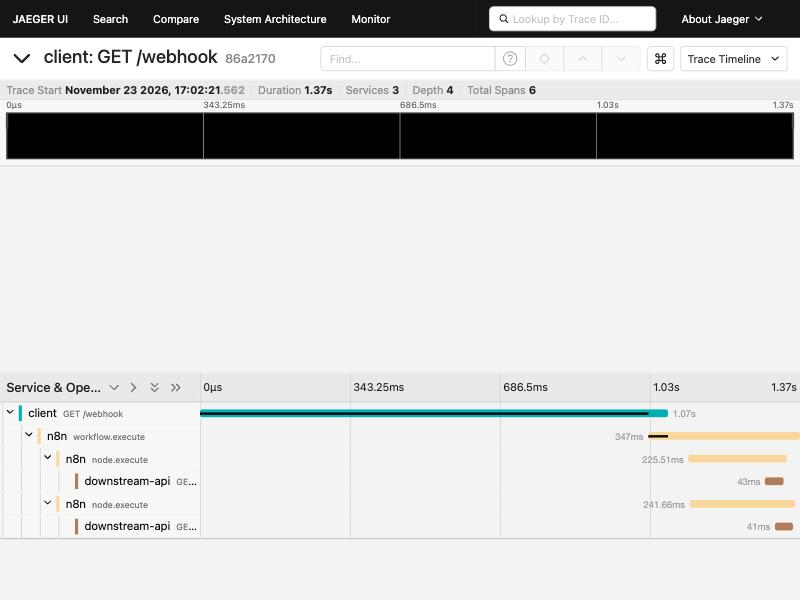
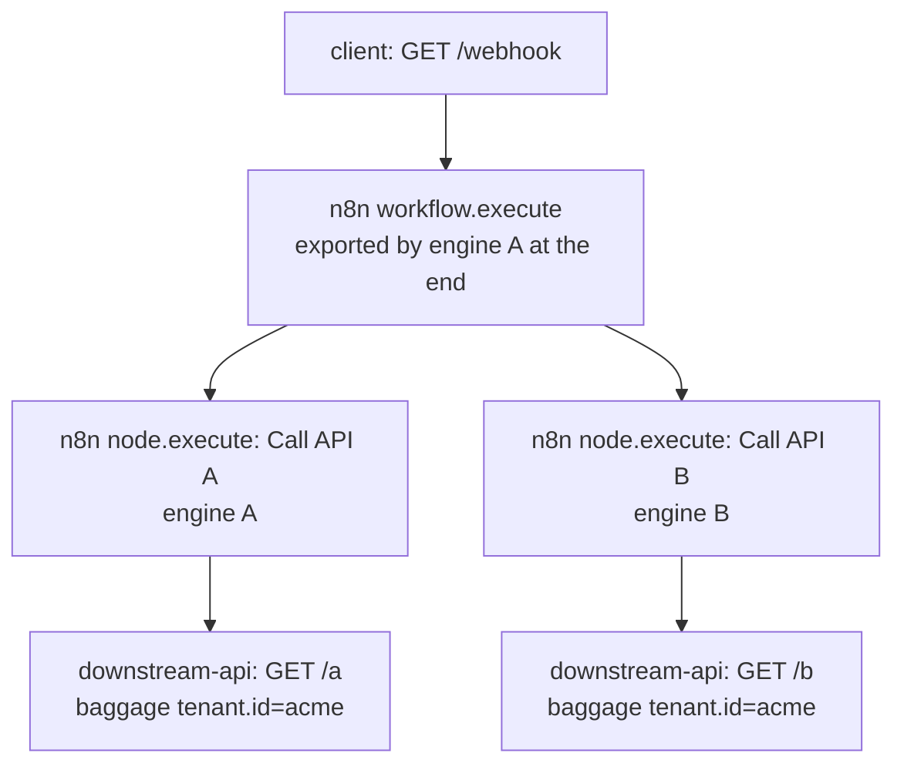

# GOV-397: Spike: Tracing on engine v2

https://linear.app/n8n/issue/GOV-397/spike-tracing-on-engine-v2

## Goal

Select one span model for engine v2. Tell the Core Execution Team (CET) which contract the engine must give, so that a v2 execution makes a full trace.

## Acceptance criteria

| Criterion | Covered by | Status |
|-----------|------------|--------|
| A trace in Jaeger: inbound request, workflow span, node spans from two workers, downstream call | Spike proof | Covered |
| A decision record for the span model, with the reasons | Recommendation | Covered |
| A list of changes that CET must make | CET contract | Covered |
| A span specification for retries, parallel branches, loops and waits | Span specification | Covered |
| A note on agent spans on v2 | Agent spans | Covered |

## How it works today

On v1, one process runs the full execution. Lifecycle hooks in that process start and end the workflow span and the node spans. The spans stay in process memory. An outbound HTTP request reads the node span from that memory and adds a `traceparent` header (the W3C header that links a call to its trace). The inbound `traceparent` from a webhook becomes the parent of the workflow span.

On v2, the control plane (the n8n main process) sends a start request to the engine. The engine (the data plane) splits the execution into steps. Different step workers run the steps, in parallel or one after the other. No v1 hook runs, so v2 makes no spans.

### v1 flow

## Facts from the code

- The control plane drops the inbound trace context at dispatch. The start request has no field for it.
- The v2 lifecycle events do not fit tracing:
  - Delivery is at-most-once. The engine drops a failed batch, and drops new events when too many wait.
  - The engine sends events only for editor runs. Production runs send no events.
  - Events carry IDs, node name, iteration and time. They have no project, custom tags, item counts or GenAI data.
  - Each worker sets the event time with its own clock.
- The step workers run node code in an n8n host process. They use the same request helpers as v1. These helpers already ask for trace headers, but the v2 host does not supply them.
- The engine core has no OpenTelemetry (OTEL) dependency. Its rules say that the core gets effects only through injected interfaces.
- The engine has no retry today. A resumed step (after a wait) keeps its step ID and starts again. Each loop pass is a new step with a new iteration number. Parallel branches are different steps.
- The v2 host does not support agents yet.
- The OTel module runs only on main, worker and webhook processes. The engine process (`n8n engine`) has no database, and the OTel module does not load there.

## Current OTel features and their place on v2

The table shows what each recent OTel feature needs, and where it runs with the recommended option D.

| Feature | What it needs | On v2 with option D |
|---------|---------------|---------------------|
| Inbound `traceparent` | The webhook headers | The control plane reads it and sends it in the start request. |
| Caller baggage | The webhook `baggage` header, filtered (no `n8n.` keys), stored on the execution, given to sub-workflows and error workflows | The control plane reads and filters it, then sends it in the start request. The engine stores it with the execution and gives it to sub-executions. The worker puts it on outbound requests. |
| Execution identity (execution, workflow, project ID and name on each span) | The workflow and the project from the database | The control plane builds it and sends it in the start request. The worker puts it on the parent context, so the existing identity span processor adds it to each span. |
| Project and workflow custom tags | The database and a license | The control plane reads them and sends them in the start request. |
| Node custom tags and GenAI attributes | The node result metadata, the workflow connections | The worker reads them locally after the node runs. No contract change. |
| Custom attribute prefixes, start marker spans | Environment variables | The same environment variables on the engine process. |
| `otel.configure` hook (resource mappers, outbound baggage mapper, overrides) | Runs at startup in each process that exports spans | The hook must also run in the engine process. |
| Settings: enabled, production only, node spans, outbound headers | The settings row in the database | The control plane reads them for each execution and sends them in the start request. A settings change then applies to the next execution, as on v1. |
| Settings: exporter endpoint, headers, protocol, sample rate | The settings row in the database, reloaded through pub/sub | The engine process has no database. Governance must give these values to the engine process. This is a Governance task, not a CET task. |
| Sampling | The sample rate | The control plane decides one time. The sampled flag in `traceparent` carries the decision to each worker. |
| Agent spans | The node span as the active context | The worker runs the agent inside the node span context. |

Option A keeps all of these features in the control plane, but it cannot support caller baggage, the outbound baggage mapper or outbound `traceparent`, because these features act on the outbound request in the worker.

## Candidate options on v2

### A. The control plane makes all spans from lifecycle events

- Advantages:
  - No engine change. The control plane has the settings, the project data and the exporter.
  - The settings page, the `otel.configure` hook, the execution identity and the custom tags work with no change.
- Disadvantages:
  - Production runs send no events. Today the engine sends events only when an editor session watches the run. To use A, CET must change this for all production runs and make delivery reliable. That is the same CET work as D, plus a reliable cross-process channel.
  - A goes against the CET design of the events. The engine code says that the events are "a freshness signal, not a replication stream", and that a consumer that needs certainty must query the data plane again.
  - A lost event gives a broken trace. The engine drops a batch that fails or that takes more than 10 seconds, and drops new events when 10,000 wait. A busy instance thus loses spans at the time when operators need them most.
  - Spans have no GenAI or custom data.
  - A is a maintenance problem for Governance. The control plane must rebuild the execution state from events: put events in order, remove duplicates, and close spans for end events that never arrive. Each new engine feature (retries, resume, agents) needs a change in the event schema and in this state rebuild. Two teams must change together each time.
  - Outbound calls cannot get `traceparent`, because no span exists in the worker. Without that link, the trace cannot connect to downstream services, which is the main value of distributed tracing for customers.
  - Caller baggage and the outbound baggage mapper of the `otel.configure` hook stop on v2. We built these features for customers who forward a tenant ID to downstream services. A v2 migration then removes a feature that they use.
- Risks: worker clock skew changes span times.

### D. A tracing adapter in the n8n host of the data plane (recommended)

The engine core stays free of OTEL. The n8n host code that runs around the engine in the same process makes the spans. The control plane gives the trace context and the attributes at start.

- Advantages:
  - One owner for all spans. Node spans, outbound headers and agent spans stay in the process that runs the node.
  - Outbound `traceparent` works with no node change. The step workers already run node code through the v1 node context, and the v1 request helpers already ask the host for trace headers on each outbound call. On v2 the host returns nothing, because no tracer is connected. D connects one.
  - The core stays clean. The engine core rules say that the core gets effects only through injected interfaces. D asks CET for one more injected interface, one optional field in the existing caller context, and a dispatch number for each step run. CET does not own or run any OTEL code.
  - No new runtime dependency. The data plane process already starts the OTEL SDK at boot, as every n8n process does.
  - The CET work is small and neutral: carry an opaque map, give it to each step, and call an observer. Other Governance needs (audit, cost, policy) can use the same observer later, so CET builds it one time.
  - The v1 span and attribute logic can run again here. Customers keep the same span shape and their dashboards when they move to v2.
- Disadvantages:
  - The engine contract changes.
  - Settings and attributes must travel in the start request.
  - The exporter settings and the `otel.configure` hook must also reach the engine process, which has no database.
  - A rename of a workflow or project during a wait does not show on the spans after the resume, because the engine process cannot read the current name. v1 reads it again on each resume.
- Risks: the workflow span starts and ends in different processes, so its span ID must be minted in advance. The spike must prove that the OTEL SDK can export such a span. Exporter settings must reach the engine process.

### Other options

The ticket also lists B (the engine core makes all spans) and C (the control plane makes the workflow span, step workers make node spans). We do not propose them:

- B: CET must not own the tracing code.
- C: two processes own parts of one trace, which is a poor separation of concerns.

## Recommendation

Select option D.

- Only the data plane sees every step reliably. Thus the data plane must make the spans.
- Only the control plane has the database with settings, project and custom tags. Thus the control plane must send these facts at start.
- Option D keeps OTEL out of the engine core. CET keeps one small, neutral contract, and Governance keeps the tracing code.
- Option D reuses the v1 request helpers for outbound headers, and the v1 attribute logic.

## Contract that CET must provide

1. **Trace context in the caller context.** One optional, opaque, size-limited field in the existing caller context. Governance owns its content: `traceparent` with the sampled flag, `tracestate`, the filtered caller baggage, the execution identity, the project and workflow custom tags, and the tracing settings for this execution. The engine also gives it to sub-executions and error workflows. This is a wire contract and a stored format, so it is hard to undo.
   - Why the caller context: CET designed the caller context for this job. The engine code describes it as facts about the caller that the host supplies at start, that the engine stores with the execution, never reads, and gives to the step executor. It is already stored with the execution, and each step already gets it. Thus no tracing column, no migration and no tracing concept goes into the engine.
   - Why the data must stay with the execution: the start request arrives one time, at one engine process. Each step runs later, on any worker, and the work queue message holds only the execution ID and the step ID. A step after a wait can run days later. On v2 the control plane has no execution row, so the engine is the only place that holds the execution.
2. **Trace context for each step.** The engine gives the step trace context and a dispatch number to the host for each step run. The dispatch number changes on each resume. A future retry attempt must use the same field.
3. **An observer interface.** The engine calls it in process for execution start, execution end, and the steps that the engine settles itself. It is not opt-in, it is not batched, and it must never throw. The host gives it at construction, as the host gives the lifecycle event publisher today. The lifecycle events cannot do this job.
4. **The reconciliation layer calls the observer too.** A process can crash between a write and the observer call. The CET answer to a crash is reconciliation, not a transaction. When reconciliation closes a stalled execution, it must call the observer, so that the workflow span ends with an error. v1 does the same for a crashed execution.
5. **No duplicate node runs.** A written guarantee that a repeated step message runs no node code. The engine does this today.

## Fit with the engine rules

We checked option D against the rules that CET wrote for the engine. D follows them:

- **The core reaches for nothing.** The core gets one more injected interface and one more opaque field in the caller context. It gets no OTel dependency, no `n8n-workflow` type and no environment read.
- **Dependencies point one way.** The tracing adapter lives in the n8n host and depends on the engine. The engine never imports the adapter.
- **No new storage.** The trace context goes in the existing caller context, so the engine database needs no new column and no migration.
- **Execution path and read path have their own types.** The trace context goes on the execution path only. The read API must not return it, because it holds caller baggage. The v1 public API also does not return baggage.
- **The caller context stays strict.** The engine rejects unknown keys in the caller context. CET adds one named, optional field to the schema. The strict check stays.
- **Crash recovery through reconciliation.** Contract item 4 uses the reconciliation layer. It asks for no cross-store transaction.

Two points need agreement on the n8n side:

- The OTel module does not run in the engine process today. The tracing adapter stays in the OTel module, and the engine v2 host gives it a seam. The engine v2 module must not hold tracing logic.
- The engine database then stores caller baggage, which can hold customer data such as a tenant ID. The data retention of the engine database must cover it.

## Span specification (draft)

- A node span identifies a step by step ID, iteration and dispatch number. The node name alone is not unique on v2.
- **Parallel branches:** sibling node spans under the workflow span. They can come from different workers.
- **Loops:** one node span for each iteration, with the iteration number as an attribute.
- **Waits:** the node span ends when the step goes into the wait. The resumed step gets a new node span with a new dispatch number and a link to the first span.
- **Retries:** none on v2 today. When CET adds retries, each attempt gets its own node span with the attempt number.

## Agent spans

The agent span must be a child of the node span that runs the agent. The tracing adapter sets the node span as the active context before it runs the agent, as v1 does. This depends on the CET work package for agent support on v2. No change to the contract above is necessary for agents.

## Spike proof

Run the engine as a separate service with two step workers. Add the trace context to the start request by hand, and add a minimal adapter. Show one trace in Jaeger with the inbound request, the workflow span, node spans from two workers, and the downstream call.

## Risks and open questions

- The OTEL SDK cannot start a span with a given span ID. The spike must prove an export path for the workflow span, or the control plane must make the workflow span with a reliable end signal from CET.
- Clock skew between workers can make child spans start before the parent span.
- The size limit and the stored format of the trace context need agreement with CET. Caller baggage alone can be 8192 bytes.
- Governance must select how the exporter settings reach the engine process: environment variables only, or a read from the control plane. The UI settings page must then show which values apply to the engine.

## Follow-ups

- GOV-402: observability strategy for engine v2 (metrics and logs).
- GOV-404: collect the CET contract items from all spikes into one plan.

## Spike result (2026-11-23)

Trace in Jaeger (trace `86a2170da3ee9a2ab09c2e75e31d73e5`):

The code is in the commit before this document on this branch.

Setup: one control plane (`n8n start`, `N8N_ENGINE_MODE=remote`), two `n8n engine` processes on one engine database and one Redis, and a downstream API. The workflow is a webhook with two parallel HTTP Request nodes.

What the spike proves:

- The trace context fits in the existing caller context. The engine stored it and gave it to each step. The engine needed no new column and no migration.
- Node spans from two workers join one workflow span. Each node span has the execution identity (execution, workflow and project ID, workflow name), the step ID, the iteration and the engine host ID.
- The step worker sends `traceparent` and the caller baggage on outbound requests through the existing v1 request helpers. No node changed. The control plane dropped the forged `n8n.forged` baggage entry.
- The workflow span works with a span ID that the control plane mints in advance. The process that wins the final transition builds the span and gives it to the span processor directly. This closes the main risk of option D.

The engine change for the spike is about 40 lines: one optional field in the caller context and its schema, one `ExecutionObserver` type in `ExternalDependencies`, and a call to the observer in the lifecycle event publisher factory.

What the spike does not cover:

- The webhook trigger has no node span. The engine records the trigger outputs at start and does not run the trigger through the step executor.
- The workflow span starts on the control plane clock and ends on the engine clock.
- Not tested: waits and resumes, loops, sub-executions, a failed execution, the dispatch number, and reconciliation after a crash.
- The engine process reads the export settings from the environment only. The `otel.configure` hook does not run there.

Unrelated issues found:

- Two engine processes that start at the same time on a new engine database both run the migrations, and one crashes with a duplicate key error.
- The built `@n8n/engine` output in this worktree had a `CallerTraceContext` type that no commit has. It may come from a local prototype in another checkout.
