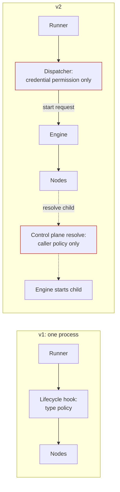
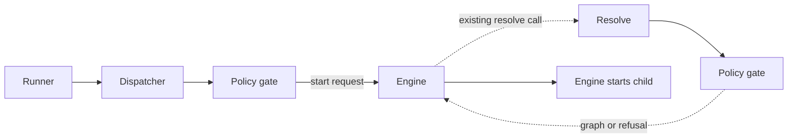
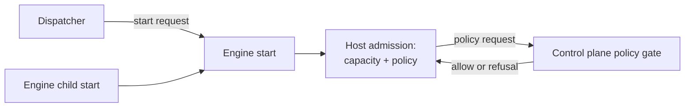
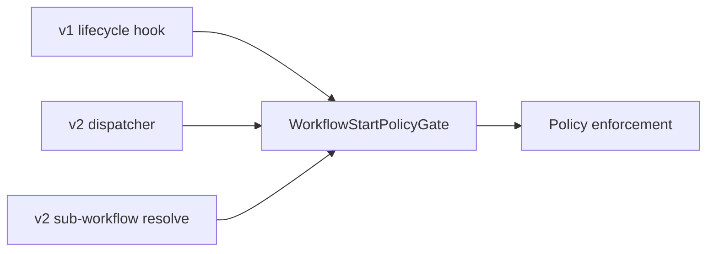

# GOV-398: Spike: Checks before a v2 execution starts

https://linear.app/n8n/issue/GOV-398/spike-checks-before-a-v2-execution-starts

## Goal

Make node type and credential type policies stop a v2 execution before it starts. Select where the check runs, and tell the Core Execution Team (CET) which contract the engine must give. Execution limits are out of scope: GOV-405 owns them.

## Acceptance criteria

| Criterion | Covered by | Status |
|-----------|------------|--------|
| A repro of the policy gap, sent to CET and the team | Spike proof | Covered |
| A design for the policy check, with the check location | Recommendation | Covered |
| A table of execution paths with a status for each | Recommendation: execution paths | Covered |
| Select A (control plane only) or B (control plane and engine, before each step) | Recommendation | Covered: control plane only |
| An owner for each open question | Risks and open questions | Covered |
| A list of tickets for the policy projects | Follow-ups | Covered |
| A design and a tested approach for execution limits (GOV-325) | GOV-405 | Moved |

## How it works today

On v1, one process runs the full execution. A lifecycle hook runs the policy check immediately before the first node. The check reads the node types and the credential types of the workflow, and the project of the workflow. If a type is blocked, the execution stops before any node runs. Each credential decrypt also runs a policy check.

On v2, the control plane (the n8n main process) sends a start request to the engine (the data plane). The v1 hook does not run. Before the start, the control plane runs the credential permission check only. Thus a blocked node type runs. The engine starts each sub-workflow itself, after it asks the control plane to resolve the child workflow. That resolve step runs the caller policy, but not the type policy.

## Facts from the code

- The runner sends a v2 execution to the dispatcher before the v1 steps. No v1 hook, no extension pre-execute hook and no policy check run for it.
- Only manual, webhook and trigger runs go to v2. Error, retry, evaluation and chat runs of a v2 workflow run on v1, with all v1 checks.
- The engine has an admission step before each start. The control plane gives it an "allow all" admission today. The admission request has the workflow ID only.
- The engine starts each child execution itself. The child gets the mode and the project of its parent.
- The engine resumes timed waits and repairs stuck runs on its own timers. These start no new execution. v1 does no policy check on resume.
- The data plane calls the control plane today, on three routes: credential resolve, data tables, and sub-workflow resolve.
  - The caller is the n8n host code around the engine (the v1 step executor), not the engine core.
  - Each call is a network call: HTTP with mutual TLS and a scoped token, to a separate control plane server. When the engine runs in the n8n process, the call goes to the loopback address.
  - The CET decision record for sub-workflows decides this call. It says that the control plane resolves the child, applies the caller policy and the credential checks, and returns the graph.
- The engine rule is about the core: the core never imports host code and gets each effect through an injected interface. Host code can call the control plane.
- The admission step is one of these injected interfaces. The host gives the admission at construction.
- Each credential use on v2 goes through the credential resolve route. That route runs the credential decrypt policy check. Thus v2 already has the policy check on credential use.
- The engine has no error workflow path and no retry today.
- AI tool runs (an agent calls a workflow as a tool) are refused on v2 today.

## Current policy features and their place on v2

| Feature | What it needs | On v2 with option A |
|---------|---------------|---------------------|
| Type policy at workflow start | The node types, the requested credential types, the project | The dispatcher runs it before the start request. No change on the engine side. |
| Type policy at sub-workflow start | The child node types and credential types, the child project | The control plane runs it in the existing sub-workflow resolve step, beside the caller policy. |
| Inline agent tool nodes in the start check | The agent node parameters | The same evaluator, so it applies with no extra work. |
| Credential decrypt policy | The credential type, the consumer node type, the project | Already runs on v2, through the credential resolve route. |
| Sub-workflow caller policy | The caller and the child workflow | Already runs on v2, in the sub-workflow resolve step. |
| Save, publish, transfer and import policies | Workflow and credential data at write time | They do not use the engine. No change. |
| Policy decision audit | The decision and the actor | The check stays on the control plane, so the audit stays the same. |

## Candidate options

### A. Control plane checks before it hands a start to the engine (recommended)

The control plane runs the type policy at the two points where it already takes part in a start: the dispatch of a top-level run, and the resolve step of a child.

- Advantages:
  - One evaluator for v1 and v2. The control plane keeps the rules, the projects and the audit.
  - It adds no call from the data plane to the control plane, and no engine contract.
  - A refusal at dispatch comes before the start request, so the engine writes no row. A refusal at resolve fails the parent step, the same as a caller policy refusal today.
  - It matches v1: one check at start, and the existing check on each credential use.
- Disadvantages:
  - The check location is not one point. It is two points that call one shared gate.
  - Each new start path needs a new call site.
- Risks:
  - If CET adds an engine-only start (error workflow, retry, trigger in the engine), that start skips the check until we add a call site.
  - A policy change during a long run applies only to children that start later. v1 has the same behaviour.

### B. Host admission that asks the control plane

The host gives the engine an admission that runs before each start, top-level and child. The admission keeps the CET capacity check, and it also asks the control plane for the policy decision.

- Advantages:
  - One point for all starts, also future engine-only starts. No new call site per start path.
  - The core stays pure. It calls the injected admission and knows nothing about policies.
- Disadvantages:
  - The admission request has the workflow ID only. CET must add the graph, the project, the mode and the parent link. This is a contract change, hard to undo.
  - A refusal is a free-text reason today. CET must add a typed refusal, or the user loses the list of blocked types.
  - A top-level run makes one more round trip: the control plane sends the start, and the host asks the control plane again.
  - The host must combine two owners in one admission: CET for capacity and Governance for policy.
- Risks: the child gets the parent project today, so the admission checks the child against the wrong project until CET fixes it.

## Other options

- Control plane sends a list of blocked types with the start request: a second check point in another process, with the wrong project for some children and an old list after a long wait.
- Engine core evaluates a full policy snapshot: a second policy evaluator in the engine core, with old data. CET does not want domain rules in the core.
- Engine checks before each step (ticket option B): it adds a call for each step and stops a run after side effects. v1 has no such check.
- One shared gate in the runner before the v2 branch: it changes v1 behaviour and does not cover children.

## Recommendation

Select option A.

- The control plane owns the rules, the projects and the audit, and it already takes part in each v2 start today. Thus it can decide with no engine change.
- Option A needs no engine contract change. Option B needs a new admission request and a typed refusal.
- The child check goes into the resolve step that CET designed for policy checks. The caller policy and the credential checks are there today. The type policy joins them.
- Option A keeps the v1 error shape, so the user sees the same policy error on v1 and v2.
- Move to option B if CET adds starts that do not go through the control plane. Then one admission point is better than one call site for each path.

### Execution paths

| Path | Status with option A |
|------|----------------------|
| Manual run, partial run | Covered |
| Webhook | Covered |
| Trigger, schedule | Covered |
| Sub-workflow, v2 parent and v2 child | Covered |
| Sub-workflow, v1 parent | Covered (runs on v1) |
| Error workflow | Covered (runs on v1). Needs CET if v2 gets an error path |
| Retry of a v2 execution | Needs CET (no path in the engine today) |
| Resume after a wait | Covered (no check, the same as v1) |
| Evaluation, chat | Covered (runs on v1) |
| AI tool run | Not applicable (refused on v2 today) |

## Contract that CET must provide

1. **Each new execution goes through the control plane, or CET tells us first.** A top-level run starts from the dispatcher. A child starts only after the control plane resolve step.
   - Why: the control plane can check only the starts that it sees. If CET plans an engine-only start (error workflow, retry), we move to option B before it ships.
2. **The resolve refusal fails the parent step with the reason.** The user must see the policy message and the blocked types, not a general error.
   - Why: on v1 the user sees which types are blocked. With a general error, the user must ask an admin and has no data to give.
3. **The child keeps its own project for policy.** The resolve response gives the child project, and the engine uses it for the child, not the parent project.
   - Why: on v1 a child is checked against its own project. Today the child gets the parent project, so the credential decrypt check uses the wrong project.

## Fit with the engine rules

- **The core is pure.** Option A adds nothing to the engine core: no new interface, no new field and no policy code.
- **The core never imports host code.** The policy code stays in the control plane. The host code keeps its existing resolve call.
- **Host code can call the control plane.** Option A uses the existing resolve call from the host. It adds no new call.
- **The engine runs with no control plane.** Standalone mode keeps working. With no control plane, no policy applies, the same as today.
- **Admission is a host choice.** Option A leaves the admission as a CET capacity control. Option B would use the same seam, with no core change.

## Spike proof

- Repro: a workflow with a Manual Trigger and a Code node, set to v2. Add an instance rule that blocks the Code node type. Run it: the Code node runs. Set the workflow to v1 and run it again: the run fails with a policy error.
- Proof: add a temporary gate at dispatch and in the resolve step. The same repro fails on v2. A parent that calls a child with a blocked type fails at the sub-workflow step.

## Risks and open questions

- CET: will v2 get engine-only starts (error workflows, retries, triggers in the engine)? Owner: CET.
- Product: a refusal at dispatch writes no execution row. Must the execution list show it? Owner: product.
- Product: must the policy check be ready for early access? Recommendation: yes, because the gap lets blocked nodes run. Owner: product.
- The extension pre-execute hook also does not run on v2. Owner: the hooks API owners.

## Follow-ups

- Policy: one shared policy gate for a workflow start, called by the v1 hook, the v2 dispatcher and the resolve step.
- GOV-404: send the three CET contract items.
- GOV-405: execution limits on v2, including GOV-325.
- Redaction hooks on v2 stay with IAM (CAT-2880).

## Spike result (2026-11-23)

The code is in the commit before this document on this branch. The test output is in [test-output.txt](./test-output.txt).

Setup: an integration test with an instance policy that blocks the Set node type. The data plane is a mock that records each start request. The resolve step runs against the real control plane services and the test database.

What the spike proves:

- Before the gate, the policy gap is real. A v2 manual run with a blocked node type sends a start request to the data plane. The resolve step returns the graph of a child with a blocked node type.
- With the gate, the v2 manual run fails with the policy message, and the data plane gets no start request. The resolve step refuses the child.
- The v1 start policy tests and the existing resolve tests still pass. The v1 hook now calls the same gate.
- The engine needs no change. The spike changes only control plane code: one new gate service and three call sites.

What the spike does not cover:

- The resolve step changes the policy error to a general "forbidden" error with the message only. The list of blocked types does not reach the engine. Our team must fix this on the control plane before CET can show the list (contract item 2).
- The child uses the parent project for the credential decrypt check. The spike does not change this (contract item 3).
- Not tested: a real data plane, a webhook or trigger run, a project-level rule, a partial run.
