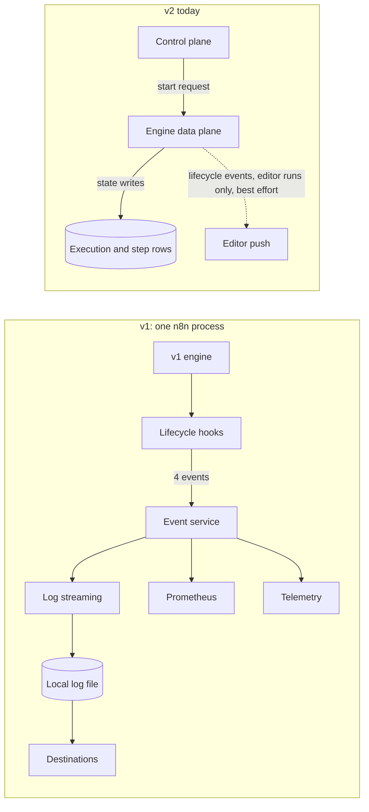
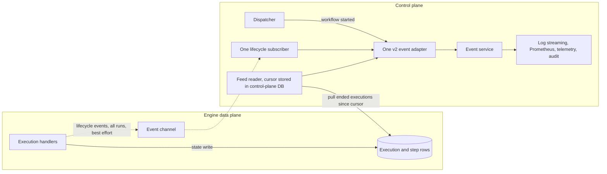
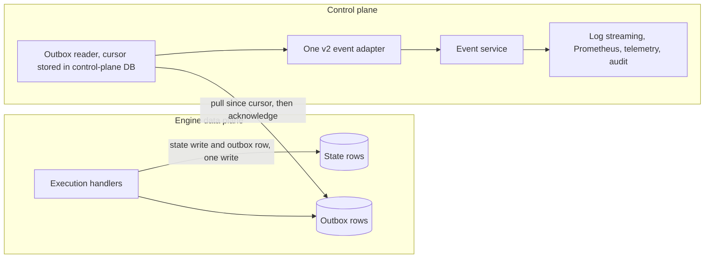
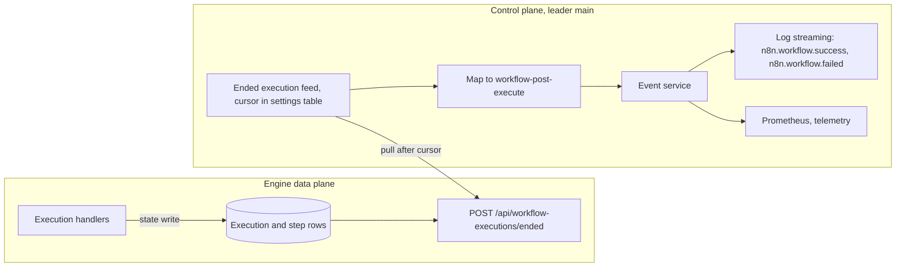
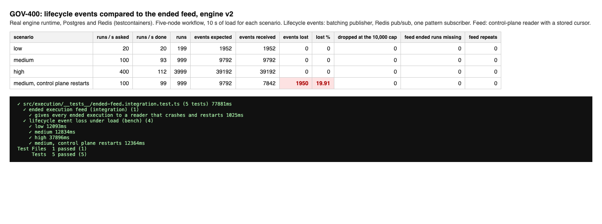

# GOV-400: Spike: Replace the v1 execution events on engine v2

https://linear.app/n8n/issue/GOV-400/spike-replace-the-v1-execution-events-on-engine-v2

## Goal

Select a reliable source of execution events for v2 runs, for each consumer of the v1 events. Tell the Core Execution Team (CET) which contract the engine must give, so that audit loses no event.

## Acceptance criteria

| Criterion | Covered by | Status |
|-----------|------------|--------|
| A table that compares the v1 event fields to the v2 event fields, for each consumer | Facts from the code, Current features | Covered |
| A measurement of event loss under load | Spike proof | Covered |
| A decision record for the event source | Recommendation | Covered |
| A list of changes that CET must make | Contract that CET must provide | Covered |

## How it works today

On v1, one process runs the full execution. Lifecycle hooks in that process emit four events: `workflow-pre-execute`, `workflow-post-execute`, `node-pre-execute` and `node-post-execute`. An in-process event service gives them to the relays. The log streaming relay writes each message to a local log file first, then sends it to the destinations (the customer systems that receive the log stream). This gives at-least-once delivery on each host. Prometheus and telemetry read the same events in memory, with no guarantee.

On v2, the control plane (the n8n main process) sends a start request to the engine. The engine (the data plane) runs the steps and writes the state of the execution and of each step to its own database. No v1 hook runs. The engine also has lifecycle events, but they are a live signal for the editor only.

## Facts from the code

- **Production v2 runs emit no lifecycle events.** The control plane asks for events only when an editor session watches the run. Webhook and trigger runs get none. So for production runs, the loss is 100%, not partial.
- **Only the editor reads v2 lifecycle events.** No log streaming, Prometheus, telemetry or audit code subscribes. The subscription is one for each execution, on the main that dispatched the run, and it ends with the editor session.
- **The engine states that the events are at-most-once.** The engine code calls them "a freshness signal, not a replication stream". The publisher drops a failed batch, a batch that takes more than 10 seconds, and new events when 10,000 wait. The transport is Redis pub/sub, which has no persistence and no acknowledgement.
- **The publish is not in the same write as the state change.** A crash between the state write and the publish loses the event.
- **The v2 events carry little data.** Execution events carry the execution ID, the workflow ID and a time. Step events add the step ID, node ID, node name and iteration. A failed step adds an error. There is no workflow name, user, project, node type, or error on the execution event.
- **The data plane holds the durable truth.** The execution row holds the status, the start and end time, the mode, the workflow snapshot (name, nodes, settings) and the caller context (user, project). The step rows hold the node, the status and the error. An index on the end time already exists for retention.
- **Audit already works for the start of a run.** The audit event `n8n.audit.workflow.executed` comes from the control plane when it dispatches the run, also for v2. Audit does not use the four events. No audit record holds the outcome of a run, on v1 or v2.
- **The control plane does not learn when a production v2 run ends.** The control plane has no execution row for v2. It reads executions from the data plane on request.
- **A control-plane ledger exists, but it serves counts.** The execution ledger is an outbox in the control-plane database. Its row shape already has an `origin: 'v2'` value, but nothing writes v2 rows. Its fold deletes rows to count them. It does not send events to destinations.
- **CET already rejected durable lifecycle events once.** An engine decision record (deletion of binary files) rejected an event for a reliable job. The reason: the event channel needs a durable outbox and acknowledgements first, and that changes the guarantee of every other event.

### Fields for each consumer

| Field | v2 event | Data-plane rows | Needed by |
|-------|----------|-----------------|-----------|
| Execution ID, workflow ID | Yes | Yes | All |
| Workflow name | No | Yes, in the snapshot | Log streaming, event bus metrics |
| User, project | No | Yes, in the caller context | Log streaming, telemetry |
| Project name | No | No, control-plane lookup | Log streaming |
| Mode | Start event only | Yes | All |
| Status | Yes, by event type | Yes | Log streaming, Prometheus, telemetry |
| Start and end time | One time on each event, not matched | Yes | Prometheus |
| Error message, error node, last node | Failed step only | Yes, step error and snapshot | Log streaming, telemetry |
| Node type | No | Yes, in the snapshot | Log streaming node events |
| Workflow settings for redaction | No | Yes, in the snapshot | Log streaming, telemetry |
| Retry-of, source, agent run, queue job | No | No | Log streaming, telemetry |
| Full run data (node graph, credentials for each node) | No | Can be rebuilt from the step rows | Telemetry |

## Current features of this area and their place on v2

The table shows what each consumer needs, and where it gets its data with the recommended option 1.

| Feature | What it needs | On v2 with option 1 |
|---------|---------------|---------------------|
| Audit: `n8n.audit.workflow.executed` | Who started which workflow | No change. It already fires at dispatch. |
| Audit: outcome of a run (open question) | Status and error of each ended run, no loss | The terminal-execution feed. |
| Log streaming: `n8n.workflow.started` | Workflow name, user, project, mode, at the start | The control plane emits it at dispatch, with data it already has. |
| Log streaming: `n8n.workflow.success` and `n8n.workflow.failed` | Status, error, error node, settings for redaction, no loss | The terminal-execution feed. |
| Log streaming: `n8n.node.started` and `n8n.node.finished` | Node name, node type, each step | Lifecycle events for all runs, best effort. |
| Log streaming: queue job events | The v1 queue job ID | Not on v2. v2 has no v1 queue job. |
| Prometheus: workflow duration | Start and end time, status, mode | The terminal-execution feed. |
| Prometheus: event bus counters | Each `n8n.*` message | They follow the messages above, with no change. |
| Telemetry: workflow executed | Full run data | The telemetry team decides: the feed plus a step read, or no change. |
| v1 crash recovery from the event log | The local log file | Not on v2. The engine recovers through its reconciliation layer. |
| Insights, OpenTelemetry, execution ledger, policy, self-healing triggers, chat hub | The end of a run | Same gap. They can use the same feed later. |

## Candidate options

### 1. A terminal-execution feed for workflow events, lifecycle events for node events (recommended)

The control plane pulls ended executions from the data plane with a durable cursor. One adapter in the control plane turns each item into the v1 workflow events. Node events come from the lifecycle events, opted in for all runs and read by one subscriber, with the best-effort guarantee that the engine already states.

- Advantages:
  - Workflow events cannot be lost. The feed reads the state that the engine already writes durably. The cursor moves only after the control plane stores the events.
  - The engine event contract does not change. The lifecycle events stay at-most-once.
  - No new data-plane table. The feed is a new read on rows and an index that exist.
  - Reconciliation closes crashed executions with an end status. The feed then sees them with no extra work.
  - One adapter holds all the v2-to-v1 mapping. The existing relays do not change, and the `n8n.workflow.*` names stay stable for customers.
  - Each consumer gets the guarantee it needs, and pays only for that.
- Disadvantages:
  - Two sources. Order between node events and workflow events is not guaranteed.
  - Workflow end events arrive after the poll interval, not at once.
  - Node events can still be lost under load.
- Risks:
  - The end time is not in strict commit order. The cursor needs a lag window and duplicate removal by a stable event key.
  - Data-plane retention can delete a row before the feed reads it.
  - Log-streaming customers must know that node events are best effort on v2.

### 2. An outbox in the data plane for all events (the ledger pattern)

The engine writes one outbox row for each execution and step transition, in the same database write as the state change. The control plane pulls the outbox with a cursor and acknowledges what it stored. One source serves all consumers.

- Advantages:
  - One source with one guarantee for workflow and node events. Order is clear.
  - Node events also cannot be lost.
  - The outbox can hold exactly the fields that the consumers need, so the control plane reads less.
- Disadvantages:
  - A new table, a new pull API and an acknowledgement contract. These are stored formats and wire contracts, and they are hard to undo.
  - One more write for each step on the hot path of every production run. On v1, node events cost an in-memory call.
  - The outbox repeats data that the execution and step rows already hold.
  - The engine must prune the outbox. That adds work to retention (CAT-2939).
- Risks:
  - Write volume grows with steps, not with executions. Loops with many iterations multiply it.
  - CET must accept an outbox inside the engine, which is the change that their binary-file decision avoided.

### Other options

- **Make the lifecycle events durable and push them to the control plane:** it reverses the at-most-once contract that CET documented, and it changes the guarantee of the editor events too.
- **The data plane writes v2 rows into the control-plane execution ledger:** the data plane must not call the control plane, and the ledger fold counts rows, it does not send events.
- **The data-plane host sends to log streaming destinations itself:** the engine process has no control-plane database, so it has no destination settings, no audit file and no project data.
- **A different source for each consumer, with no shared adapter:** the v2-to-v1 mapping goes into several places, and audit and log streaming can disagree. Option 1 keeps the per-consumer guarantee with one adapter.

## Recommendation

Select option 1.

- Only the data plane knows reliably that a run ended, and it already stores that fact durably. A pull from the control plane uses that fact without a new table or a new guarantee in the engine.
- Audit and workflow-level log streaming need no loss. Node events, Prometheus and telemetry do not. Option 1 gives each consumer the guarantee it needs. Option 2 makes every step pay for a guarantee that only some consumers need.
- Option 1 keeps the engine event contract as CET wrote it. CET adds one read, not an outbox.
- One adapter in the control plane holds all the mapping. The relays and the customer-facing event names do not change.
- If a later decision requires no loss for node events, option 1 can grow into option 2 for step rows only. The control-plane adapter stays the same.

## Contract that CET must provide

1. **A terminal-execution feed.** A read API that returns ended executions after an opaque cursor, in pages, at-least-once.
   - Why: the control plane has no other durable way to learn that a v2 run ended. The existing search API pages by creation time, not by end time, so it cannot return runs that ended after the last read.
2. **A stable event key for each item.** The same execution and transition always give the same key.
   - Why: an at-least-once pull returns some items twice. The control plane removes duplicates by this key, so a destination does not receive one end event twice.
3. **The fields that the consumers need in each item.** Execution ID, workflow ID and name, mode, status, start and end time, user and project from the caller context, the error (message, node name, node type), retry-of, and the workflow settings that redaction needs.
   - Why: the control plane must not read the full snapshot and every step for each run. A full read on each run is the cost that the v1 in-memory events did not have.
4. **A retention guard.** The data plane keeps an ended execution until the feed passed it, or the feed reports a gap that the control plane can log.
   - Why: if retention (CAT-2939) deletes a row before the pull, the end event is lost with no trace. A reported gap at least makes the loss visible.
5. **Lifecycle events for all runs, with one subscriber.** The control plane can opt in every production run and read all events through one subscription, not one for each execution.
   - Why: node events and live metrics need them for production runs. One subscription for each run does not scale to production load.
6. **Node type on step events.** Add the node type to step events, or confirm that the control plane must read it from the snapshot.
   - Why: `n8n.node.*` messages carry the node type, and customers filter on it.

## Fit with the engine rules

We checked option 1 against the rules that CET wrote for the engine. Option 1 follows them:

- **The data plane never calls the control plane.** The control plane pulls the feed. The lifecycle events go to a channel that the control plane reads. The engine calls nothing in the control plane.
- **The core reaches for nothing.** The feed is a new read in the read path. The core gets no new dependency and no new injected interface.
- **Read path and execution path have their own types.** The feed is a read-path view with its own type. It goes through the existing read seam, so it cannot change execution state.
- **Crash recovery through reconciliation, not transactions.** Option 1 asks for no cross-store transaction. A crashed run gets its end status from reconciliation, and the feed then reads it.
- **Migrations are additive.** The feed needs at most one new index. Option 2 needs a new table.
- **No `n8n-workflow` in the engine.** The v2-to-v1 mapping lives in the control-plane adapter. The engine returns its own types.
- **The lifecycle event contract stays at-most-once.** Option 1 uses the events only where best effort is acceptable.

Option 2 also follows the rule that the data plane never calls the control plane. But it adds a write for each step on the execution path, and it adds a durable outbox, which CET avoided in its binary-file decision.

## Spike proof

- Run the engine as a separate service. Run a webhook workflow at a fixed rate for a fixed time.
- Feed: show that every ended execution gives exactly one `n8n.workflow.success` or `n8n.workflow.failed` message at a log streaming destination. Stop the control plane main during the run and start it again. Show that no end event is lost and no end event comes twice.
- Lifecycle events: opt in all runs, and count the node events that arrive compared to the step rows in the data plane. Report the loss at three load levels. This is the loss measurement that the ticket asks for.
- Today's number for production runs is 100% loss, because the engine emits no events for them.

## Risks and open questions

- Must `n8n.node.*` events also have no loss? If yes, option 2 for step rows becomes necessary.
- Does audit need the outcome of a run? No audit record holds it today, on v1 or v2. If yes, the feed is the source.
- The end time is not in strict commit order. The feed design (cursor on end time with a lag window, or a sequence number) needs agreement with CET.
- v2 has no v1 queue job, so the queue job events in log streaming stop on v2. Customers who filter on them must be told.
- Some fields have no v2 source: retry-of, source, agent run. Confirm with CET which of them v2 will have.

## Follow-ups

- GOV-402: observability strategy for engine v2. It can use the same feed for metrics.
- GOV-404: collect the CET contract items from all spikes into one plan.
- Telemetry team: decide the source for the workflow-executed telemetry event on v2.
- Owners of insights, OpenTelemetry, execution ledger, policy, self-healing triggers and chat hub: confirm that they can use the same feed for the end of a v2 run.

## Spike result

The spike selects option 1. Workflow end events come from a feed of ended executions that the control plane pulls from the data plane. Node events stay on the best-effort lifecycle events.

What the spike built:

- **Engine:** one read API that returns ended executions after a cursor on `(finished_at, id)`. It uses the index that retention already has. A settle window skips rows that ended less than five seconds ago, because `finished_at` is set before the row commits. Each item has a stable event key, the workflow name, the user and project from the caller context, and the first failed step with its node name and node type.
- **Control plane:** a feed reader on the leader main. It emits `workflow-post-execute` for each item, then stores the cursor in the settings table. The existing log streaming relay sends `n8n.workflow.success` and `n8n.workflow.failed` with no change.

Engine change: about 190 lines in eight files, all on the read path. No migration, no new table, no change to the execution path. Control-plane change: about 170 lines in four files.

### Proof

The proof runs the real engine runtime with Postgres and Redis in test containers. The workflow has a trigger and four nodes. Every tenth run fails at the third node. Each load scenario runs for 10 seconds. The lifecycle events go through the real batching publisher, then Redis pub/sub, to one pattern subscriber. The full results are in `event-loss-result.json`.

| Scenario | Runs per second (asked, done) | Lifecycle events lost | Ended runs that the feed missed |
|----------|-------------------------------|-----------------------|---------------------------------|
| Low | 20, 20 | 0 of 1,952 | 0 of 199 |
| Medium | 100, 93 | 0 of 9,792 | 0 of 999 |
| High | 400, 112 | 0 of 39,192 | 0 of 3,999 |
| Medium, the control plane is down for 2 seconds | 100, 99 | 1,950 of 9,792 (19.9%) | 0 of 999 |
| Production runs today (no subscription) | any | 100% | not applicable |

What the proof shows:

- **Under load alone, the lifecycle events lose nothing.** The engine is the bottleneck at about 110 runs per second in one process. The publisher never reached the 10,000 cap, because the Redis sender does not wait for the publish.
- **A control-plane restart loses every event of that time.** Redis pub/sub keeps no message for a subscriber that is not connected. A two-second outage lost 19.9% of the events of a ten-second run.
- **The feed loses nothing and repeats nothing in the same restart.** The new reader continued from the stored cursor.
- **A crash between the emit and the cursor store repeats one page.** The integration test crashes the reader at that point. Every ended execution arrived, and only the items of the unstored page came twice. The event key lets a consumer drop them.
- **The control-plane mapping works with the existing relay.** A unit test sends two feed items through the real log streaming relay. It gets `n8n.workflow.success` with the workflow name, user, project and mode, and `n8n.workflow.failed` with the error message, the last node and the node type.

### Not done or not tested

- Node events for production runs. The spike did not opt in all runs or add one subscriber for all executions.
- `workflow-pre-execute` at dispatch.
- The feed against a separate engine process over HTTP. The proof calls the engine HTTP API in the same process.
- Commit order under clock skew between engine hosts, and the settle window under a slow database.
- Retention that deletes a row before the feed reads it.
- Telemetry now receives `workflow-post-execute` for v2 runs with an empty node list. The telemetry team must decide if that is correct.
- The workflow settings for redaction are not in the feed yet.
