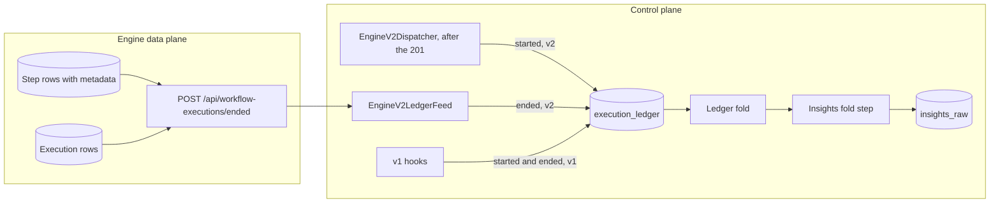

# GOV-401 · Insights on engine v2 · Plan

## 1. Problem

Insights counts executions in `InsightsCollectionService`, on the v1 hook `workflowExecuteAfter`. The data stays in memory, and a flush writes it to `insights_raw`. On v2, no v1 hook runs. Thus Insights does not count v2 runs. Also, v2 writes no `execution_ledger` rows today.

## 2. Facts from the code (master and the GOV-400 branch)

- The ledger writer is in the control plane. It looks up the owner project from the workflow ID when the caller gives no project (`RunFacts.projectId`).
- An `ended` row has `outcome`, `runtimeMs` and `timeSavedMin`. v1 computes them in `toEndedFactsFromRun`.
- The ledger mapper sets `origin: 'v1'` for each row. The `origin` column already accepts `v2`.
- No Insights fold step exists. The fold steps today are workflow statistics and execution limit usage.
- The GOV-400 feed of ended executions gives: `id`, `workflowId`, `workflowName`, `status`, `mode`, `hostMode`, `userId`, `projectId`, `parent`, `createdAt`, `finishedAt`, `failedStep`, `eventKey`.
- The engine stores no start time. It has only `created_at` and `finished_at`. It has no `crashed` status: the reconciliation sweep ends a stalled run as `failed`. It has no retry-of field.
- The engine stores the workflow snapshot with each run. The snapshot has the time saved settings.

## 3. Options

| | A. Data-plane ledger and pull (GOV-301, RFC 3.9) | B. The control plane writes the v2 rows |
|---|---|---|
| How | The data plane writes `started` and `ended` rows in its own table, in the transaction of the state change. The control plane pulls them and copies them into `execution_ledger`. | `started`: the control plane writes it after the `201`, as v1 does (already agreed). `ended`: the control plane writes it from the GOV-400 feed of ended executions. |
| Engine change | A new table, a migration, two endpoints (pull and acknowledge), metrics and an alert. About 2 to 3 engineer days (GOV-301). | Some new fields on the feed item. No new table and no migration. The feed reader comes from GOV-400. |
| Mechanisms | Two pulls from the data plane: the ledger pull and the feed of GOV-400. | One pull: the feed. |
| Project | The data plane must know it. GOV-300 makes it required. | The writer looks it up from the workflow ID. |
| Counting rules | Stay in the control plane. The data plane stores facts only. | Stay in the control plane. |
| Failure modes | Two copies of the same facts. A pull that stops lets the data-plane table grow. | If the feed reader stops, the `ended` rows come late but none are lost: the cursor keeps the position. The `started` row needs a start that is safe to repeat (see the limits page). |
| Fit with the engine rules | Good. The engine stays free of counting logic. | Good. The engine only exposes facts on a read endpoint. |

Both options need the same new fields from the engine (see section 5).

## 4. Recommendation

**Option B.**

- The team already agreed that the control plane writes the `started` row after the `201`. Option A writes the same `started` row a second time in the data plane.
- GOV-400 already needs the feed of ended executions for log streaming and audit. Option B uses the same feed for the `ended` row, so n8n has one pull, not two.
- Option B needs no new table, no migration and no acknowledge contract in the engine.

**Insights reads the ledger through a new fold step, for v1 and v2.** The fold step reads the `ended` rows and writes `insights_raw`. It replaces the in-memory collector for v1 too. Then Insights has one source for both engines, and a crash no longer loses the data that waits in the memory buffer. The fold step must be ready before v2 runs count in Insights, so it is the first item of this work. This change does not depend on the engine.

## 5. Contract that CET must provide

Each item of the GOV-400 feed needs these extra fields:

1. **The start time**: when the first step started to run. Without it, the runtime includes the time in the queue.
2. **The time saved settings** from the workflow snapshot: `timeSavedMode` and `timeSavedPerExecution`.
3. **The sum of the dynamic time saved**: the sum of `metadata.timeSaved.minutes` of all node runs. Only the data plane has the node results.
4. **The source of the run**, for the counting rules (`WorkflowExecutionSource`).
5. **The retry-of execution ID**, if the run is a retry.
6. **A marker for a run that the reconciliation sweep ended**, so the ledger can write `crashed` and not `error`.

## 6. GOV-401 questions

| # | Question | Status | Answer |
|---|---|---|---|
| 1 | Do we put the v2 puller (GOV-301) and GOV-300 in Q1? | 🟡 Partly | With option B, GOV-301 is not necessary. GOV-300 is less urgent: the writer looks up the project. The conflict in section 8 stays. |
| 2 | When does the Insights fold step replace the in-memory collector? | 🟡 Partly | Recommendation: first, before v2 counts in Insights, for v1 and v2 together. The date is open. |
| 3 | Do v2 runs give all the fields that Insights needs? | ✅ Answered | No. The project and the runtime end are there. The start time, the time saved, the source and the retry-of are missing (section 5). |
| 4 | How does Insights count a v2 retry, a crash and a wait? | 🟡 Partly | A wait: the run counts when it ends, as on v1. A crash: today it shows as `error`, because the engine has no `crashed` status. A retry: no field today, so it counts as a new run. |
| 5 | Must Insights show the engine version? | ⚪ Open | The ledger can carry it (`origin: 'v2'`). Showing it in the UI is a product decision. |

## 7. PoC

Goal: a v2 production run shows in the Insights numbers (count, failures, runtime, time saved).

1. Use the GOV-400 branch as the base. It has the feed and the feed reader.
2. Add the fields of section 5 to the feed item. Use the snapshot for the settings, and the step outputs for the dynamic time saved.
3. In the control plane, write the `started` row after the `201`, and the `ended` row from each feed item, with `origin: 'v2'`.
4. Add an Insights fold step that reads the `ended` rows and writes `insights_raw`.
5. Proof: one test with the real engine runtime, Postgres and Redis. Run v2 workflows with fixed and with dynamic time saved, and with some failures. Then compare the `insights_raw` rows and the Insights summary endpoint with a v1 run of the same workflows.

## 8. Open questions

| Question | Owner |
|---|---|
| GOV-300 says that a sub-workflow takes the project of its parent. The policy page recommends that the child gets its own caller context, as on v1. Which rule is correct for the ledger and Insights? | G&O and CET |
| How do sub-workflow runs reach the ledger? (Open on the limits page.) | G&O and CET |
| Must Insights show the engine version? | Product |
| Does a crashed v2 run count as `crashed` or `error` in Insights and billing? | Product |
| When does the Insights fold step replace the collector for v1? | G&O |

## Result

The PoC follows option B. It is stacked on the GOV-400 PoC (branch `gov-400-spike-execution-events`).

What the PoC built:

- **Engine, feed item fields (section 5):**
  - `startedAt`: the `created_at` of the first step after the trigger. The engine stores no start time, so this is the best available value. It includes the time that the first step waited in the queue.
  - `timeSavedMode` and `timeSavedPerExecution`: from the settings of the workflow snapshot.
  - `dynamicTimeSavedMin`: the sum of `metadata.timeSaved.minutes` over all step rows. The engine did not keep the node metadata before. The PoC adds a `metadata` column to `workflow_step_execution` (one migration), and the v1 step executor returns the metadata that the node set.
  - `source`: the control plane now sends `callerContext.source`, and the feed returns it.
  - `endedBySweep`: true when a step of the run failed with `StaleRunningStepError`, which only the reconciliation sweep writes. The control plane writes `crashed` for such a run.
  - Retry-of: **not added.** v2 has no retry and no field. A retry counts as a new run.
- **Control plane:** the dispatcher writes the `started` row of a top-level run after the `201`, with `origin: 'v2'`. The ledger feed of GOV-400 writes the `ended` row with the outcome, `runtimeMs` (end minus `startedAt`) and `timeSavedMin`. It uses `computeTimeSavedMinutes`, the same counting rules as v1.
- **Insights fold step (`insights_raw`):** it reads the `ended` rows and writes `insights_metadata` and `insights_raw` in the fold transaction. It uses the same rules as the collector: `isInsightsProduction`, `isBillableExecution` and `savesTime`. It works for v1 and v2 rows. It is on only with `N8N_INSIGHTS_FROM_LEDGER=true`, which also stops the in-memory collector. Thus a v1 run never counts twice.

Engine change in this step: 114 lines in 12 files, with one migration. With the two GOV-400 steps, the engine change is 436 lines in 16 files. Control-plane change in this step: about 290 lines in 9 files, with test helpers.

### Proof

The proof (`packages/cli/test/integration/engine-v2-insights.integration.test.ts`) starts the real `engine-v2` module in in-process mode, with the real v1 step executor and real nodes. The engine database and the control-plane database are in one Postgres test container. Three workflows run on v1 and on v2, each in its own project. All runs are webhook runs through `WorkflowRunner`.

- Fixed time saved, 5 minutes: 4 runs.
- Dynamic time saved, two Time Saved nodes (3 and 2 minutes): 3 runs.
- A Stop and Error node, fixed time saved of 5 minutes: 2 runs, which fail.

The collector and the fold step are both on for the test. The test compares three paths: v1 through the collector, v1 through the fold step, and v2 through the ledger feed and the fold step. The full output is in `insights-result.json`.

| Value | v1, collector | v1, fold step | v2, fold step |
|---|---|---|---|
| Ledger rows (started + ended) | not applicable | 9 + 9 | 9 + 9 |
| Success rows (fixed, dynamic) | 4, 3 | 4, 3 | 4, 3 |
| Failure rows | 2 | 2 | 2 |
| Billable rows | 9 | 9 | 9 |
| Time saved, fixed | 20 min | 20 min | 20 min |
| Time saved, dynamic | 15 min | 15 min | 15 min |
| Time saved, failed runs | none | none | none |
| Summary: total, failed, failure rate | 9, 2, 0.222 | 9, 2, 0.222 | 9, 2, 0.222 |
| Summary: time saved | 35 min | 35 min | 35 min |
| Summary: average run time | 1.56 ms | 1.56 ms | 43.22 ms |

What the proof shows:

- **The fold step gives the same numbers as the collector for v1.** All counts, all time saved values and the summary are equal.
- **v2 runs give the same counts and the same time saved as v1 runs.** This includes the dynamic time saved from the node metadata.
- **The collector does not see v2 runs.** The `insights_raw` rows of the collector have no v2 workflow.
- **Only the run time differs.** A v2 run is slower in this setup, because each step goes through the work queue. The value also depends on the start time gap.

### Gaps and differences

- **The start time.** The engine has no start time. `startedAt` is the creation of the first step after the trigger. A real start time column is a CET contract item.
- **Retry-of.** No field. A v2 retry counts as a new run.
- **The crash marker** is derived from the error name of the sweep. The proof does not run the sweep, so the `crashed` path is not tested.
- **The source** is sent and read, but the proof runs no Instance AI run, so the `instance_ai` exclusion is not tested on v2.
- **The timestamp of an Insights row.** The collector uses the time of the flush. The fold step uses `occurredAt`, the end of the run. The hourly bucket can differ for a run near the end of an hour.
- **The `started` row of a top-level v2 run** is written after the `201` and outside the start. A crash between the two loses the row. A start that is safe to repeat is a CET contract item.
- **Sub-workflow runs** do not count in Insights (`integrated` mode), the same as on v1. The project rule for the ledger is in the GOV-400 result.
- **Redis.** The in-process engine uses in-memory work queues, so the proof does not use Redis.
- **The flag** is read from `InsightsConfig`. A real change must also decide how existing v1 data moves from the collector to the fold step without a gap or a double count at the switch.
