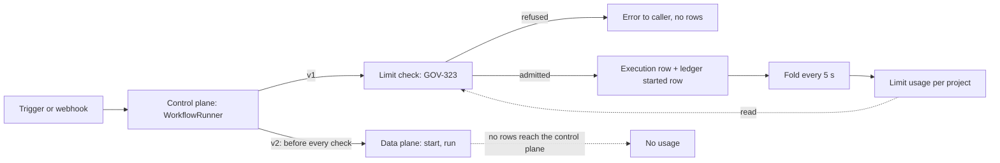
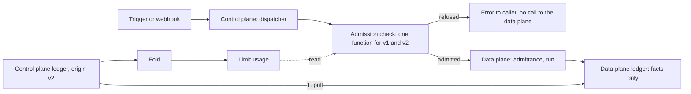
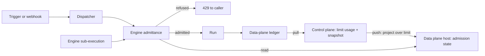
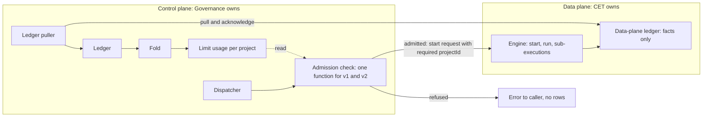

# GOV-405: Spike: Execution limits on engine v2

https://linear.app/n8n/issue/GOV-405/spike-execution-limits-on-engine-v2

## Goal

Select where the execution limit check runs for v2 executions, and who keeps the limit counts. Tell the Core Execution Team (CET) which contract the engine must give, so that v2 runs obey the same limits as v1 runs.

## Acceptance criteria

| Criterion | Covered by | Status |
|-----------|------------|--------|
| Select the location of the limit check, with the GOV-398 decision | Recommendation | Covered. Assumption on GOV-398 below |
| Divide the limits between our team and CET | Recommendation, CET contract | Covered |
| Give each open question an owner | Risks and open questions | Covered |
| A tested approach for GOV-325 | Moved to GOV-325 | Not in this spike. The v1 admission function (GOV-323) does not exist yet, so a PoC now tests nothing that stays |
| A table of edge cases with "covered", "needs CET" or "needs product decision" | Risks and open questions | Covered |
| A list of tickets for the execution limits project | Follow-ups | Covered |

**Assumption on GOV-398:** checks before a v2 start run on the control plane, before the control plane calls the data plane. If GOV-398 selects a check in the data plane, option B becomes the recommendation.

## How it works today

On v1, the control plane (the n8n main process) runs all checks before it writes the execution row. The limit check will run there too (GOV-323). The execution row and the ledger `started` row commit in one transaction. A fold job adds the ledger rows to the limit usage of each project every 5 s. The limit check reads that usage. A refused run writes no execution row and no ledger row.

On v2, the control plane sends a start request to the engine (the data plane) before any v1 check. The engine has its own database, so the control plane cannot see the v2 execution rows. No limit check runs, and v2 runs do not reach the usage.

## Facts from the code

- No admission function exists yet, for v1 or v2. The limit snapshot (limits in memory, reloaded through pub/sub) and the usage fold step exist. No code reads the usage yet.
- The limit is a soft count for each period: about 5 s late, and fail open. It is not a limit on active runs.
- The counting rules count `started` events for the modes `trigger`, `webhook`, `cli`, `retry`, `evaluation` and `agent`. They do not count sub-workflows (`integrated`), error workflows, `manual` or `internal`. A counted run that ends `blocked` gives its count back.
- The control plane creates the v2 execution id. The start call is synchronous. A refusal before save (429) means that no v2 run exists.
- The engine has an admittance interface in the core. It runs before the engine writes the execution row, for top-level runs and for sub-executions. The default allows all runs. Its request carries only the workflow id: no project, no mode, no parent.
- The engine starts a sub-execution itself (sub-workflow ADR). Before that, the n8n host in the data plane asks the control plane to resolve the sub-workflow.
- A sub-execution takes `hostMode` from its parent, for example `webhook`. A ledger that sets the mode from `hostMode` alone counts sub-executions by mistake.
- v2 does not run error workflows today.
- `callerContext.projectId` is optional on the start request.
- The engine has no `crashed` status. Reconciliation fails a stuck step, and then the execution fails.
- The control plane gets an end event only for editor runs. Webhook and trigger runs send no end event.
- The control plane ledger already has the `origin` and `eventId` columns for v2 rows. No data-plane ledger and no puller exist yet (GOV-301, GOV-302).

## Facts from the ledger RFC and its discussions

- **Section 3.9 decision:** two ledgers, one fold. The data plane keeps a ledger of facts, and the control plane pulls it. The control plane runs the limit check before it calls the data plane. A run that the data plane starts by itself is not billable, so the data plane needs no limit check.
- **Tomi (CET), on the ledger location:** the planes cannot read the database of the other plane, and v1 and v2 run in parallel. Thus the ledger and the counts must live on the control plane. Guillaume agreed. Option A follows this.
- **Tomi, on the data-plane ledger design:** he wrote it quickly, and he asks us to challenge and validate it. GOV-301 must do this before it is final.
- **Guillaume, on the check location:** run the check on the control plane before the call to the data plane, because the counter lives there. The engine admittance matters only for runs that the data plane starts by itself.
- **Tomi, open thread:** the admittance step runs for every start request. When CET adds sub-workflows and error workflows, he expects admittance to apply to them too. A check on the control plane cannot apply to runs that the data plane starts by itself. This thread is not resolved. Option B is the answer to this thread, and the Recommendation says when to select it.
- **Martin, on failures:** Redis is only a cache for the limit, and the check fails open. A database rollback is out of scope. Option A keeps this: the check reads the fold totals on the control plane.
- **Period:** Tomi asked for a rolling 24 h period. The RFC lists the period as still open. The data-plane ledger carries the event time, so any period works without a CET change.
- **Still open in the RFC:** do sub-workflows and error workflows count toward a limit? The counting rules in the code do not count them today. Product must confirm.

## Current features of execution limits and their place on v2

| Feature | What it needs | On v2 with option A |
|---------|---------------|---------------------|
| Instance limit and project limit | The limit snapshot on the control plane | The control plane checks before it calls the data plane. No change on the data plane. |
| Period (UTC day) | The event time | The data-plane ledger row carries the event time. The fold puts it in the correct period. |
| Counting rules (which modes count) | The mode and the entity type of each run | The control plane applies the rules in the fold. The data plane sends facts only, with the v1 mode and a sub-execution marker. |
| A blocked run gives its count back | An `ended` row with the outcome `blocked` | The data-plane ledger writes `blocked` for a run that fails before its first node (GOV-301). |
| A refused run writes no rows | A check before the execution row exists | The check runs before the control plane calls the data plane. |
| Usage per project | A project on every row | `projectId` becomes required (GOV-300). A sub-execution takes the parent project. |
| Fail open | The check can read the usage | The same on v2. The check runs on the control plane. |
| Limit change applies at once | Pub/sub reload of the snapshot | The same on v2. The snapshot stays on the control plane. |
| Agent messages | Agent ledger rows | Not applicable. The v2 host does not support agents yet. |

## Candidate options on v2

### A. The control plane checks, the data plane records facts (recommended)

- Advantages:
  - One decision in one place for v1 and v2. The rules cannot drift.
  - The control plane already has every input: limits, project, mode.
  - The data plane stores facts only, as the RFC and the CET ledger design agreed.
  - The data plane makes no new call to the control plane. The control plane pulls the ledger rows.
  - The work for GOV-325 is small, because it reuses the v1 admission function.
- Disadvantages:
  - Runs that the engine starts itself are not checked. Today these are only sub-executions, and the counting rules do not count them.
  - If Product decides that sub-executions must count, the check needs a second location.
- Risks:
  - Until GOV-301 and GOV-302 ship, v2 runs do not reach the usage. A builder can avoid a limit with v2.
  - If the data-plane ledger sets the mode from `hostMode` alone, sub-executions count by mistake.

### B. The control plane decides, the data plane admittance enforces

The control plane computes one fact for each project: "over the limit" or "under the limit". It sends this state to the data plane when it changes. The n8n host gives the engine an admittance adapter that reads this state. The engine refuses each start, also a sub-execution, for a project that is over the limit.

- Advantages:
  - One gate for every start path, also the paths that the engine adds later (error workflows, retries).
  - The engine core does not change. The admittance interface is already an injected seam.
  - The data plane gets a result, not the counting rules.
- Disadvantages:
  - A second place that holds limit state, and a new push channel from the control plane to the data plane.
  - The admission state is late by one push. A new limit takes effect a little later than on v1.
  - The admittance request must carry the project, the mode and the parent.
  - The control plane must still check top-level runs to write no rows for a refused run, or accept that the 429 is the refusal.
- Risks:
  - A lost push leaves stale state. The data plane must fail open, or must refresh the state on a timer.
  - It solves a problem that we do not have today: sub-executions do not count.

### Other options

- **C. The engine admittance asks the control plane for each start.** It breaks the rule that the data plane does not call the control plane for its own decisions, and it makes every v2 start depend on the control plane.
- **D. A shared atomic counter (Redis) for both planes.** Product accepted a soft limit (RFC decision 4). It needs shared infrastructure across the planes and the counting rules in both.
- **E. The engine owns the counting rules and its own counter.** It reverses the RFC decision that the data plane stores facts only, and it makes two counts that disagree.

## Recommendation

Select option A.

- The limit is a soft count for each period, and the control plane already has every input. Thus the control plane must decide.
- One admission function serves v1 and v2, so a rule change applies to both.
- The data plane stores facts only, and the control plane pulls them. This adds no call from the data plane to the control plane.
- The only runs that the engine starts itself are sub-executions, and the counting rules do not count them. Thus a gate in the data plane gives no value today.
- Option B stays the upgrade path. Select it if GOV-398 moves checks into the data plane, or if Product decides that sub-executions or error workflows count.

Ownership:

- **Governance & Observability:** the admission check before the v2 start (GOV-325), the usage and the fold for v1 and v2 rows, and the puller (GOV-302).
- **CET:** the data-plane ledger with facts (GOV-301), the required project (GOV-300), the sub-execution marker, and the `ended` row for a run that reconciliation fails.
- **CET limits stay with CET:** work queue concurrency and the engine admittance protect the engine capacity. Our limits are a quota for each project. The two do not replace each other.

## Contract that CET must provide

1. **`callerContext.projectId` is required on each start.** A sub-execution takes the project of its parent.
   - Why: the usage counts by project. A row with no project cannot count toward a project limit.
2. **A refusal before save is a written guarantee.** A 429 from the engine means that no v2 run and no ledger row exist.
   - Why: our check admits a run and does not reserve a slot. An engine refusal after our check must not count, and the user must not see a run that does not exist.
3. **The data-plane ledger stores facts only (GOV-301).** Each row has the execution id, `eventId`, project, workflow id, the v1 mode, event, outcome, `blockedBy` and the event time. It commits in the same transaction as the state change that wins.
   - Why: the counting rules stay in one file on the control plane. A rule change then does not need a CET release.
4. **Each ledger row marks a sub-execution by its parent link, not by `hostMode`.**
   - Why: a sub-execution inherits `hostMode` (for example `webhook`). Without the marker, the fold counts sub-executions, and v2 counts more runs than v1.
5. **Reconciliation writes an `ended` row when it fails a stuck run.**
   - Why: the limit counts starts, so it does not need this row. Billing and Insights need it, and the same row gives back the count of a run that ends `blocked`.
6. **Pull and acknowledge endpoints, scoped by tenant, with backlog metrics (GOV-301).**
   - Why: the control plane pulls, so the data plane makes no call to the control plane, and a control-plane outage does not stop v2 runs.

## Fit with the engine rules

We checked option A against the rules that CET wrote for the engine:

- **The core reaches for nothing.** Option A adds nothing to the engine core. The ledger writes happen in the database adapter, in transactions that exist already.
- **Dependencies point one way.** The counting rules stay on the control plane. The engine imports no n8n package and no `n8n-workflow` type.
- **Migrations are additive.** The data-plane ledger is a new table, in a new migration.
- **Crash recovery through reconciliation, not transactions.** Contract item 5 asks reconciliation to write the `ended` row. It asks for no cross-store transaction.
- **The control plane creates the execution id, before the engine has a row.** The check runs before the start call, so a refused run never gets an id in the data plane.
- **The engine alone sets the parent link of a sub-execution** (sub-workflow ADR). Contract item 4 uses this link. It asks for no new concept.
- **The data plane does not call the control plane.** Option A adds no such call. The control plane pulls the ledger rows.

One point needs agreement with CET and the team:

- The code already has calls from the n8n host in the data plane to a control-plane service: credentials, data tables and sub-workflow resolution. The sub-workflow ADR selected one of them. So the rule "the data plane never calls the control plane" does not describe the code today. Option A does not depend on this point, because it adds no call. A future check on sub-executions in the sub-workflow resolution would use one of these existing calls.

## Spike output

This spike gives a plan only. It has no PoC, for these reasons:

- Execution limits are still in progress. The admission function (GOV-323) does not exist, so a PoC must build a temporary copy of it.
- The gap is clear from the code: the dispatcher sends a v2 run to the data plane before every check.

The output is:

1. The proposed direction (below), for the team and for CET.
2. The CET contract items, sent to GOV-404 now. CET designs the v2 ledger and sub-workflows now, and a stored format costs more to change later.
3. The tested approach, done in GOV-325 after GOV-323 lands. Its tests prove that a v2 run over the limit gets the limit error, and that the data plane gets no start call.

### Proposed direction

- **The control plane decides.** One admission function checks v1 and v2 runs, before the control plane calls the data plane.
- **The control plane counts.** The usage and the counting rules stay on the control plane. v2 runs reach the usage through the ledger puller.
- **The data plane records facts.** The data-plane ledger stores what happened, with the project and a sub-execution marker. It has no counting rules.
- **No call from the data plane to the control plane.** The control plane pulls the rows.
- **The engine limits stay with CET.** They protect the engine capacity. Our limits are a quota for each project.
- **The upgrade path is option B.** Select it if Product decides that runs that the data plane starts by itself must count.

## Risks and open questions

| # | Question or edge case | Answer | Status | Owner |
|---|---|---|---|---|
| 1 | The limit refuses a run: no execution row and no ledger row? | Yes. The check runs before the start call | Covered | G&O |
| 2 | Do sub-executions that the engine starts count? | No, by the current rules. The ledger needs a sub-execution marker | Needs CET | CET |
| 3 | Do error workflows count? | No, by the current rules. v2 does not run them yet | Needs product decision when v2 adds them | Product |
| 4 | Which limits are ours, and which are the engine's? | Ours: a quota for each project. Engine: capacity protection | Covered | G&O, CET |
| 5 | The engine refuses (429): what does the user see? Does it count? | No run exists, so it does not count. The user message is not defined | Needs product decision | Product, CET |
| 6 | Does a crashed v2 run give back its place? | Not necessary: the limit counts starts, not active runs. Billing needs the `ended` row | Needs CET | CET |
| 7 | How do v2 runs reach the counts? | Data-plane ledger and the control-plane puller | Needs CET | CET, G&O |
| 8 | v2 runs before GOV-301 and GOV-302 ship | Block v2 for a project with a limit, or accept the gap | Needs product decision | Product |
| 9 | Manual v2 runs | Not counted, the same as v1 | Covered | G&O |
| 10 | Wait and resume on v2 | Counts one time, at start. A resume does not start a new run | Covered. Verify in the GOV-325 tests | G&O |
| 11 | A future limit on active runs | Needs an end signal for each v2 run. Webhook and trigger runs send none today | Needs product decision first | Product |
| 12 | The rule "the data plane never calls the control plane" and the existing host calls | Agree the exact rule with CET | Needs CET | CET, G&O |
| 13 | The open RFC thread with Tomi: must admittance apply to runs that the data plane starts by itself? | Not while those runs do not count. If Product decides that they count, select option B | Needs CET and product decision | CET, Product |
| 14 | The data-plane ledger design is not validated (Tomi) | Validate it in GOV-301 before CET builds it | Needs CET | CET, G&O |
| 15 | Limit period: UTC day or rolling 24 h | No CET impact. The ledger carries the event time | Needs product decision | Product |

## Follow-ups

- GOV-325: call the shared admission function in the dispatcher, before the start request. Depends on GOV-323.
- GOV-301: add the sub-execution marker (contract item 4).
- GOV-302: pull the data-plane rows into the control-plane ledger.
- GOV-300: make the project required.
- New, CET: reconciliation writes the `ended` row when it fails a run.
- New, Product: select the fallback for v2 runs before GOV-302 ships.
- New, Product and CET: the user message for an engine refusal.
- GOV-404: collect the CET contract items from all spikes into one plan.
