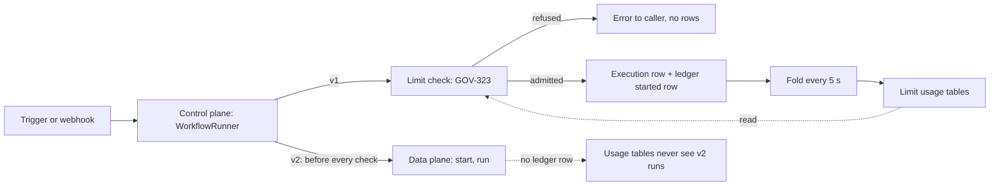
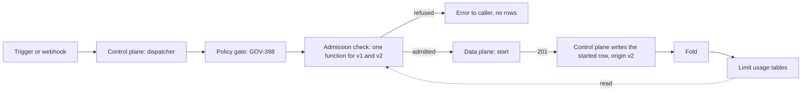
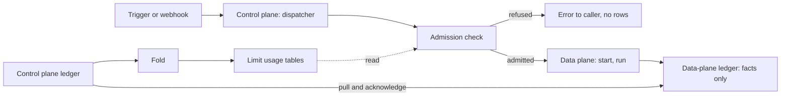

# GOV-405: Spike: Execution limits on engine v2

https://linear.app/n8n/issue/GOV-405/spike-execution-limits-on-engine-v2

## Goal

Select where the execution limit check runs for v2 executions, and who keeps the limit counts. Start with the simplest design that works, and list the gaps that it leaves. Tell the Core Execution Team (CET) what the engine must give.

## Acceptance criteria

| Criterion | Covered by | Status |
|-----------|------------|--------|
| Select the location of the limit check, with the GOV-398 decision | Recommendation | Covered |
| Divide the limits between our team and CET | Recommendation, CET contract | Covered |
| Give each open question an owner | Gaps and open questions | Covered |
| A tested approach for GOV-325 | Moved to GOV-325 | Not in this spike. The v1 admission function (GOV-323) does not exist yet, so a PoC now tests nothing that stays |
| A table of edge cases with "covered", "needs CET" or "needs product decision" | Gaps and open questions | Covered |
| A list of tickets for the execution limits project | Follow-ups | Covered |

**Input from GOV-398 (done):** the control plane runs the start policy before it sends the start request, and in the sub-workflow resolve step. So a v2 run that a policy blocks never reaches the data plane.

## How it works today

On v1, the control plane (the n8n main process) runs all checks before it writes the execution row. The limit check will run there too (GOV-323). The execution row and the ledger `started` row commit in one transaction. Every 5 s, a fold job adds the ledger rows to the limit usage tables (`execution_limit_usage`, `execution_limit_instance_usage`). The limit check reads these tables. A refused run writes no execution row and no ledger row.

On v2, the control plane sends a start request to the engine (the data plane) before any v1 check. The engine writes the execution row in its own database, which the control plane cannot read. Nothing writes a ledger row for a v2 run, so the usage tables never see it. No limit check runs.

## Facts from the code

- No admission function exists yet. The limit snapshot (limits in memory, reloaded through pub/sub) and the usage fold step exist. No code reads the usage yet.
- The limit is a soft count for each period: about 5 s late, and fail open. It is not a limit on active runs.
- The usage tables do not record runs. Only the fold writes them, and the fold reads only the control-plane `execution_ledger`.
- Only the limit rule counts `started` rows. Billing and Insights count `ended` rows only. So a `started` row with no `ended` row changes only the limit usage.
- The limit counts `started` rows for the modes `trigger`, `webhook`, `cli`, `retry`, `evaluation` and `agent`. It does not count sub-workflows, error workflows, `manual` or `internal`.
- The control plane creates the v2 execution id, and the start call is synchronous. A `201` answer means that the run exists. A refusal before save (429) means that no run exists.
- The engine starts a sub-execution itself, after the control plane resolves the sub-workflow.
- The engine sends no end event to the control plane for webhook and trigger runs.
- The `execution_ledger` table already has the `origin` and `eventId` columns for v2 rows.

## Facts from the ledger RFC and its discussions

- **Section 3.9 decision:** the data plane keeps a ledger of facts, and the control plane pulls it. The control plane runs the limit check before it calls the data plane. This plan keeps the check location. It moves the pull out of the limit path (see Recommendation).
- **Tomi (CET), on the ledger location:** the ledger and the counts must live on the control plane, because v1 and v2 run in parallel. Guillaume agreed. This plan follows this.
- **Tomi, on the data-plane ledger design:** he asks us to challenge and validate it. Without the pull in the limit path, the design can wait for billing and Insights.
- **Guillaume, on the check location:** run the check on the control plane before the call to the data plane, because the counter lives there.
- **Tomi, open thread:** a check on the control plane cannot apply to runs that the data plane starts by itself. Today these are only sub-executions, and they do not count.
- **Martin, on failures:** Redis is only a cache for the limit, and the check fails open.
- **Still open in the RFC:** the period (UTC day or rolling 24 h), and whether sub-workflows and error workflows count.

## Current features of execution limits and their place on v2

| Feature | What it needs | On v2 with option A |
|---------|---------------|---------------------|
| Instance limit and project limit | The limit snapshot on the control plane | The control plane checks before it calls the data plane. |
| Period (UTC day) | The event time | The control plane sets the time of the `started` row. |
| Counting rules (which modes count) | The mode and the project of each run | The control plane knows both at dispatch. The fold applies the same rules. |
| A refused run writes no rows | A check before the run exists | The check runs before the start request. |
| A blocked run uses no place | No `started` row for a blocked run | GOV-398 blocks before the start request, so no row exists. |
| Usage per project | A project on every row | The control plane knows the project of the workflow. No CET change. |
| Fail open | The check can read the usage | The same on v2. |
| Limit change applies at once | Pub/sub reload of the snapshot | The same on v2. |
| Agent messages | Agent ledger rows | Not applicable. The v2 host does not support agents yet. |

## Candidate options on v2

### A. The control plane checks and records the start (recommended)

The control plane runs the admission check before the start request. After the `201` answer, it writes the `started` ledger row itself, with `origin = v2`. The existing fold adds the row to the usage tables. No data from the data plane is necessary.

- Advantages:
  - The smallest change. It uses only the check, the ledger and the fold that exist on the control plane.
  - No CET work and no new contract for limits.
  - It does not wait for GOV-301 and GOV-302. The "v2 avoids the limit" gap closes with GOV-325.
  - One decision in one place for v1 and v2.
- Disadvantages:
  - The `started` row is not in the same transaction as the execution row, because the two rows are in different databases.
  - The control plane does not see the end of a v2 run.
- Risks:
  - When the pull ships for billing and Insights, the same run can get two `started` rows. One side must stop writing them (gap 4).

### B. The control plane checks, the counts come through the data-plane ledger pull

This is the design in RFC section 3.9. The data plane writes its own ledger in the same transaction as each state change. The control plane pulls the rows into `execution_ledger`.

- Advantages:
  - Each row commits with its state change, so no run is lost on a crash.
  - It also gives the `ended` rows that billing and Insights need.
- Disadvantages:
  - The limit waits for GOV-301, GOV-302 and GOV-300. Until then, v2 runs avoid the limit.
  - It needs CET work, a new table in the data plane, a puller and a receipt table, for a fact that the control plane already has at dispatch.
- Risks:
  - The data-plane ledger design is not validated yet (Tomi).

### Other options

- **The engine admittance enforces a state that the control plane pushes.** It adds a second place with limit state and a new push channel. It is necessary only if runs that the data plane starts by itself must count.
- **The engine admittance asks the control plane for each start.** It makes every v2 start depend on the control plane, and the data plane must not call the control plane for its own decisions.
- **A shared atomic counter (Redis) for both planes.** Product accepted a soft limit. It needs shared infrastructure across the planes.
- **The engine owns the counting rules and its own counter.** It reverses the RFC decision that the data plane stores facts only.

## Recommendation

Select option A.

- The limit counts only `started` events of top-level runs. The control plane knows each of these at dispatch: the run, the project, the mode and the time.
- GOV-398 blocks runs before the start request. So a blocked v2 run never exists, and no count must come back.
- Only the limit rule reads `started` rows. So a v2 `started` row with no `ended` row does not change billing or Insights.
- Option A needs no CET work, and it does not wait for the pull.
- The pull (option B) stays necessary for billing and Insights, which need the end of each run. It is a separate project, not a part of the limit path.

Ownership:

- **Governance & Observability:** the admission check and the `started` row at dispatch (GOV-325), and the usage and the fold.
- **CET:** nothing for limits now. The pull items stay with GOV-300 and GOV-301, for billing and Insights.
- **CET limits stay with CET:** work queue concurrency and the engine admittance protect the engine capacity. Our limits are a quota for each project.

## Contract that CET must provide

For option A, CET must confirm two behaviours that exist today:

1. **Each top-level v2 start goes through the control plane dispatcher.**
   - Why: the dispatcher is the only place that checks the limit and writes the `started` row. A start that skips it is not checked and not counted. GOV-398 asks for the same guarantee.
2. **A `201` answer means that the run exists. A refusal before save means that no run exists.**
   - Why: the control plane writes the `started` row only after a `201`. If the answer and the run disagree, the count is wrong.

For the pull later (billing and Insights, not limits): the required project (GOV-300), the data-plane ledger (GOV-301), a sub-execution marker, and an `ended` row from reconciliation. See the earlier version of this plan in the branch history.

## Fit with the engine rules

- **The core reaches for nothing.** Option A changes no engine code.
- **Dependencies point one way.** The counting rules stay on the control plane.
- **The control plane creates the execution id.** The control plane uses this id for the `started` row.
- **The data plane does not call the control plane.** Option A adds no call.
- **Crash recovery through reconciliation, not transactions.** Option A asks for no cross-store transaction. It accepts a small loss on a crash instead (gap 1).

## Spike output

This spike gives a plan only. It has no PoC, because execution limits are still in progress and the admission function (GOV-323) does not exist yet. The tested approach is GOV-325. Its tests prove that a v2 run over the limit gets the limit error with no start request, and that an admitted v2 run raises the usage within one fold cycle.

## Gaps and open questions

| # | Gap or edge case | Answer now | Status | Owner |
|---|---|---|---|---|
| 1 | The control plane stops between the `201` and the `started` row | The run is not counted. For a soft daily limit, the effect is small. The other order (row first, then a `blocked` row on refusal) counts too many runs instead | Needs product decision | Product, G&O |
| 2 | A v2 run fails in the data plane before its first node | The run uses a place, because the control plane does not see the failure. GOV-398 moves most blocks before the start request | Needs product decision | Product |
| 3 | Sub-executions and error workflows that the engine starts | Not checked and not counted. The rules do not count them today | Needs product decision. If they must count, select the admittance option | Product, CET |
| 4 | The pull ships, and both planes write a `started` row for one run | One side must stop. For example, the data-plane ledger sends `ended` rows only for top-level runs | Needs CET | G&O, CET |
| 5 | v2 runs have `started` rows with no `ended` rows | Only the limit reads `started` rows. A future check that pairs the rows must skip `origin = v2` until the pull ships | Covered | G&O |
| 6 | The engine refuses (429) after our check admits | No `started` row is written, so it does not count. The user message is not defined | Needs product decision | Product, CET |
| 7 | A top-level start that does not go through the dispatcher | Not checked and not counted | Needs CET (contract item 1) | CET |
| 8 | Wait and resume on v2 | A resume does not go through the dispatcher start, so it does not count again | Covered. Verify in GOV-325 | G&O |
| 9 | Manual v2 runs | A `started` row is written, and the rules do not count it | Covered | G&O |
| 10 | A future limit on active runs | Needs an end signal for each v2 run. Webhook and trigger runs send none today | Needs product decision first | Product |
| 11 | Limit period: UTC day or rolling 24 h | No CET impact | Needs product decision | Product |
| 12 | Calls from the data plane to the control plane | The host already calls the control plane (credentials, data tables, sub-workflow resolve). Option A adds no call. Agree the rule with CET | Needs CET | CET, G&O |

## Follow-ups

- GOV-325: run the admission check in the dispatcher before the start request, and write the `started` row after the `201`. Depends on GOV-323.
- GOV-301, GOV-302, GOV-300: keep them for billing and Insights. Add gap 4 to GOV-301.
- New, Product: decide gaps 1, 2, 3 and 6.
- GOV-404: the two CET confirmations above.
