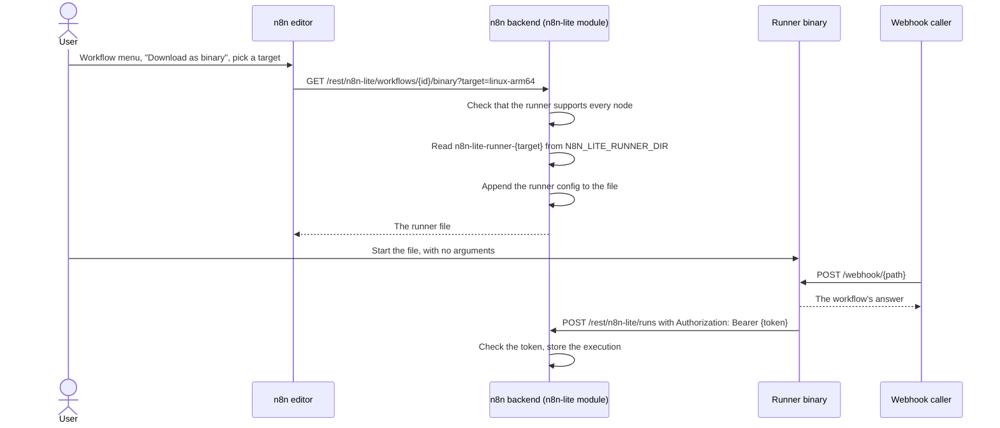

# n8n-mini: the n8n-lite runner

n8n-mini is a small Rust binary that runs one n8n workflow without an n8n instance. It reads the workflow in the JSON format that n8n uses on master, serves the workflow's webhook, runs every call as a separate execution, and reports each finished execution back to n8n.

The binary is the runner half of **n8n-lite**, a hackathon prototype. The other half is the `n8n-lite` backend module in n8n ([PR #44361](https://github.com/n8n-io/n8n/pull/44361)). In the n8n editor a user picks "Download as binary", and n8n returns this runner with the workflow embedded in it. The user starts the file on any machine, and its executions appear in n8n like any other execution.

This folder, `n8n-lite-runner/`, is at the root of the n8n repository on the PR branch `hackmation-n8n-lite`. The backend module is in `packages/cli/src/modules/n8n-lite/`. The folder is a standalone Cargo project: pnpm and the n8n build ignore it, and its own `.gitignore` keeps the Rust build output out of git.

## Contents

1. [How n8n-lite works](#how-n8n-lite-works)
2. [Set up the Rust environment](#set-up-the-rust-environment)
3. [Build, test and lint](#build-test-and-lint)
4. [Run a workflow](#run-a-workflow)
5. [Build the runners for n8n](#build-the-runners-for-n8n)
6. [Run the full prototype with n8n](#run-the-full-prototype-with-n8n)
7. [What the runner supports](#what-the-runner-supports)
8. [The contract with n8n](#the-contract-with-n8n)
9. [Project layout](#project-layout)
10. [Known limitations](#known-limitations)
11. [Troubleshooting](#troubleshooting)

## How n8n-lite works



The steps in words:

1. The n8n backend checks that the runner supports every node and setting in the workflow. If it finds an unsupported node, it refuses the download and lists the reasons.
2. The backend builds a runner config. The config holds the workflow with default parameter values filled in, the URL of the report endpoint, and a report token. The token is an HMAC of the workflow ID, so only that n8n instance can create it.
3. The backend reads the prebuilt runner for the chosen target from the folder in `N8N_LITE_RUNNER_DIR`. This folder builds those files.
4. The backend appends the config to the runner file and sends the result to the browser.
5. The user starts the file. The runner finds the config at the end of its own file, loads the workflow and serves its webhook.
6. After each execution, the runner sends a report with the status, the timing and the output of every node to n8n. n8n stores the report as an execution of the workflow, so it appears in the workflow's execution list.

## Set up the Rust environment

These steps target macOS on Apple silicon, which is the only system that can build all three runners. The Linux steps are at the end of this section.

### 1. Install the Rust toolchain

Install `rustup` with Homebrew, then install the stable toolchain:

```sh
brew install rustup
echo 'export PATH="$(brew --prefix rustup)/bin:$HOME/.cargo/bin:$PATH"' >> ~/.zshrc
source ~/.zshrc
rustup default stable
rustup component add rust-analyzer
```

Homebrew installs `rustup` as keg-only, so it does not link it into `/opt/homebrew/bin`. The `PATH` line makes `cargo`, `rustc` and the other tools available in every new shell. The second path holds tools that you install later with `cargo install`.

Check the installation:

```sh
cargo --version      # cargo 1.100.0 or newer
cargo clippy --version
cargo fmt --version
rust-analyzer --version
```

The stable toolchain includes `cargo`, `rustc`, `clippy` (the linter) and `rustfmt` (the formatter). `rust-analyzer` is the language server that editors use for type checking and navigation.

### 2. Set up the editor

In VS Code, install the `rust-lang.rust-analyzer` extension. Restart VS Code after you change `PATH`, so that the extension finds the toolchain.

### 3. Install the cross-compilation tools

You need these tools only to build the Linux runners for n8n:

```sh
brew install zig cargo-zigbuild
rustup target add aarch64-unknown-linux-musl x86_64-unknown-linux-musl
```

`cargo-zigbuild` uses zig as the linker for Linux targets, so you do not need a Linux toolchain or Docker to build. The musl targets produce static binaries that run on any Linux distribution.

### 4. Install Docker (optional)

Docker lets you run the Linux runners on a Mac to test them. Docker Desktop runs arm64 Linux containers natively and amd64 containers through emulation.

### On Linux

Install rustup with the official installer, then follow steps 1 to 3 without Homebrew:

```sh
curl --proto '=https' --tlsv1.2 -sSf https://sh.rustup.rs | sh
rustup component add rust-analyzer
```

On Linux you can build and test the project, and build the Linux runners. You cannot build the macOS runner, because it needs the macOS SDK.

## Build, test and lint

Run these commands from the `n8n-lite-runner` folder:

```sh
cargo build                                   # debug build of the library and the binary
cargo test                                    # unit tests and integration tests
cargo clippy --all-targets -- -D warnings     # lint; warnings count as errors
cargo fmt                                     # format the code
```

The tests do not need network access beyond localhost. The integration tests start real HTTP servers on free local ports:

| Test file | What it checks |
|---|---|
| `tests/end_to_end.rs` | A workflow with all five nodes answers two parallel webhook calls through real HTTP. |
| `tests/sample_workflow.rs` | The "Lead router" workflow, exported from n8n, routes leads and reports each execution to a stub of the n8n endpoint. |
| `tests/embedded_runner.rs` | A copy of the binary with an appended config starts with no arguments, answers its webhook and reports to n8n. |

Every report in the tests is checked against the rules of `liteRunReportSchema` from the n8n PR.

## Run a workflow

### From a workflow file

Pass a workflow JSON file, in the format that n8n exports:

```sh
cargo run -- --workflow tests/fixtures/sample-workflow.json --listen 127.0.0.1:5679
```

The runner prints the webhook address:

```text
listening for POST http://127.0.0.1:5679/webhook/leads
```

Call it like an n8n production webhook:

```sh
curl -X POST http://127.0.0.1:5679/webhook/leads \
  -H 'content-type: application/json' \
  -d '{"email": "ada@example.com", "score": 80}'
```

The runner prints one line per execution, for example `execution 1 finished in 0 ms, success`. Ctrl+C stops it.

The "Persist lead" node in the sample workflow sends cold leads to `webhook.site`, an external service. Change its URL in the file before you send a lead with a score under 50.

### From an embedded config

A runner that n8n built needs no arguments:

```sh
chmod +x ./lead-router-linux-arm64
LITE_PORT=5679 ./lead-router-linux-arm64
```

The runner reads the workflow and the report settings from the end of its own file. When you pass `--workflow`, the file replaces the embedded workflow, and the runner uses only the report settings from the options.

### Options

| Option | Environment variable | Default | Meaning |
|---|---|---|---|
| `--workflow`, `-w` | none | none | A workflow JSON file. Without it, the runner uses its embedded config. |
| `--port` | `LITE_PORT` | none | The port of the webhook server. The server then listens on all network interfaces, `0.0.0.0`, so containers and other machines can reach it. |
| `--listen` | none | `127.0.0.1:5678` | The full address of the webhook server. It takes precedence over `LITE_PORT`. Without either, the server accepts calls only from the same machine. |
| `--report-before-response` | `LITE_REPORT_BEFORE_RESPONSE` | off | Send the webhook answer only after the run ends and the report is sent. The variable accepts `1`, `true`, `yes` and `on`, or `0`, `false`, `no`, `off` and an empty value. |
| `--report-url` | `LITE_REPORT_URL` | none | The n8n report endpoint, for a workflow from `--workflow`. |
| `--report-token` | `LITE_REPORT_TOKEN` | none | The report token for that workflow. Prefer the environment variable, which keeps the token out of the shell history and the process list. |

`--report-url` and `--report-token` work only together. Reporting also needs a workflow with an `id` field. Without report settings, the runner only prints its log lines.

### When the caller receives the answer

By default the runner answers as soon as the workflow's response mode allows:

1. In the `onReceived` mode, when the call arrives.
2. In the `lastNode` mode, when the last node finishes.
3. In the `responseNode` mode, when the Respond to Webhook node runs. The nodes after it keep running after the answer.

The runner sends the report to n8n after the answer, so a slow n8n never delays the caller.

With `LITE_REPORT_BEFORE_RESPONSE=1`, the runner keeps the answer until the run has ended and the report request has finished, in every response mode. Use this setting on hosts that can freeze or stop the process after the answer, such as AWS Lambda. Without it, such a host can lose the report and the work of the nodes after Respond to Webhook. The answer still waits when n8n rejects the report or cannot be reached. The runner logs that failure and then answers. The caller waits longer, by the duration of the run after Respond to Webhook plus the report request, which times out after 10 seconds.

## Build the runners for n8n

The n8n backend reads one prebuilt runner per target from `N8N_LITE_RUNNER_DIR`. Build all three on macOS, from the `n8n-lite-runner` folder:

```sh
scripts/build-runners.sh                 # writes dist/runners/
scripts/build-runners.sh /some/folder    # writes to another folder
```

The script resolves the output folder from the directory where you run it. Run it from `n8n-lite-runner`, so that `dist/runners` is inside this folder and its `.gitignore` applies.

The script writes these files:

| File | Target | Notes |
|---|---|---|
| `n8n-lite-runner-linux-arm64` | `aarch64-unknown-linux-musl` | Static binary, about 6 MB. |
| `n8n-lite-runner-linux-x64` | `x86_64-unknown-linux-musl` | Static binary, about 7 MB. |
| `n8n-lite-runner-darwin-arm64` | `aarch64-apple-darwin` | About 8 MB. Built natively, so the script runs only on macOS. |

The file names match what the n8n backend expects. `dist/` is in `.gitignore`.

## Run the full prototype with n8n

Run these steps from the root of the n8n repository, on the `hackmation-n8n-lite` branch.

1. Build the runners. The subshell runs the script from `n8n-lite-runner`, so the files go to `n8n-lite-runner/dist/runners`:

   ```sh
   (cd n8n-lite-runner && scripts/build-runners.sh)
   ```

2. Build n8n as its `CONTRIBUTING.md` describes. The branch already contains the `n8n-lite` backend module and the editor menu entry:

   ```sh
   pnpm install
   pnpm build
   ```

3. Start n8n with the runner folder. The `n8n-lite` module is in n8n's default modules, so it needs no other setting:

   ```sh
   N8N_LITE_RUNNER_DIR="$PWD/n8n-lite-runner/dist/runners" pnpm start
   ```

   If the runner will run on another machine or in a container, also set `N8N_LITE_REPORT_BASE_URL` to an n8n address that the runner can reach. The default is the instance base URL. For a runner in Docker on the same Mac, use `N8N_LITE_REPORT_BASE_URL=http://host.docker.internal:5678`.

4. In the editor, build a workflow that starts with a Webhook node and uses only the supported nodes. Save it.

5. Open the workflow menu, choose "Download as binary", and pick a target: Linux (arm64), Linux (x64) or macOS (Apple Silicon). If the workflow uses something that the runner does not support, n8n shows the reasons instead of a file.

6. Start the downloaded file. n8n itself listens on port 5678, so give the runner another port:

   ```sh
   chmod +x ./my-workflow-darwin-arm64
   ./my-workflow-darwin-arm64 --listen 127.0.0.1:5679
   ```

   To run a Linux runner on a Mac, use a container:

   ```sh
   docker run --rm -p 127.0.0.1:5679:5679 -e LITE_PORT=5679 \
     -v "$PWD:/r:ro" alpine:3.20 /r/my-workflow-linux-arm64
   ```

7. Call the webhook at `http://127.0.0.1:5679/webhook/<path>`.

8. Open the workflow's executions in n8n. Each call appears as a webhook execution with the output of every node.

## What the runner supports

### Workflows

1. The workflow has exactly one trigger, and the trigger is a Webhook node.
2. The workflow has no loops. The runner refuses to load a workflow in which a node can reach itself.
3. The workflow has no Merge nodes. A node that receives connections from both branches of an If node runs once for each branch that has items.
4. Disabled nodes pass their input items through, as in n8n.
5. Nodes run one at a time, depth first, in n8n's `v1` execution order. The branch on output 0 finishes before the branch on output 1. A node runs only when it receives at least one item.
6. Calls run in parallel. Each call is its own execution, with its own data.

### Nodes

The runner checks every node when it loads the workflow. A setting that it does not support stops the runner with an error that names the node and the parameter. The runner ignores the parameters that it does not read, such as positions and notes, and some HTTP Request options. [Known limitations](#known-limitations) lists those options.

| Node | Versions | Supported | Rejected |
|---|---|---|---|
| Webhook | 1 to 2.2 | One HTTP method. Paths with parameters such as `orders/:id`. Response modes `onReceived`, `lastNode` and `responseNode`. | Authentication, multiple methods, the `streaming` mode, `lastNode` response data other than the first item's JSON. |
| If | 2 to 2.4 | AND and OR. String, number, boolean, array and object operators. `exists` and `notExists`. Strict and loose type validation. Ignore case. | Date and regex operators. |
| Edit Fields (Set) | 3.3 to 3.5 | Manual mapping with typed fields. "Include other input fields" with all, selected or all-except. Dot notation. "Ignore type conversion errors". | The JSON mode. |
| Respond to Webhook | 1 to 1.5 | First incoming item, all incoming items, JSON, text, no data, redirect. Response code, response headers and response key. | Binary and JWT responses. |
| HTTP Request | 3 to 4.5 | Any method and URL. Query parameters, headers and a JSON body, as fields or as JSON. Full response, never error, and the autodetect, JSON and text response formats. | Credentials, form and binary bodies, file responses. |

The Webhook node emits one item with `headers`, `params`, `query` and `body`, as in n8n. The webhook path is `/webhook/<path>`, the path of production webhooks in n8n.

### Expressions

The runner evaluates a subset of n8n expressions. It has no JavaScript engine.

1. `{{ $json.field }}` reads a field of the current item. Paths can use `.name`, `["name"]` and `[0]`.
2. `{{ $('Node name').item.json.field }}` reads the item at the same position in the output of an earlier node. When that node emitted one item, the runner uses that item for every position.
3. `.length` returns the length of an array or a string.
4. A parameter that is exactly one `{{ }}` block keeps the JSON type of the value. Any other template becomes a string. A missing field is `null`, and it renders as an empty string inside text.
5. Method calls, operators and other JavaScript fail with an error.

The n8n backend currently allows only `$json` paths, so `$('Node name')` references work only for workflow files.

## The contract with n8n

### The runner config

n8n appends the config to the runner file with this layout:

```text
[runner executable][config JSON][config length: u64, little-endian][N8NLITE1]
```

Executable formats ignore data after the program, so the file still runs. At startup the runner reads the last 16 bytes of its own file. If the last 8 bytes are `N8NLITE1`, it reads the length from the 8 bytes before them, then reads the JSON before the length.

The config JSON has this shape:

```json
{
  "version": 1,
  "workflow": { "id": "...", "name": "...", "nodes": [], "connections": {} },
  "report": { "url": "https://n8n.example.com/rest/n8n-lite/runs", "token": "..." }
}
```

The runner accepts only `version: 1`. The code is in `src/config.rs`, and the n8n side is `buildBinary` in `n8n-lite.service.ts`.

### The execution report

After each execution the runner sends `POST <report.url>` with `Authorization: Bearer <report.token>`. The body follows `liteRunReportSchema` in `n8n-lite.schemas.ts`:

```json
{
  "workflowId": "Ae8lrPpFGeSuJqN4",
  "status": "success",
  "startedAt": "2026-11-18T10:25:04.120Z",
  "stoppedAt": "2026-11-18T10:25:04.131Z",
  "lastNodeExecuted": "Respond sales",
  "runData": {
    "Webhook": [
      {
        "startTime": 1795003504120,
        "executionTime": 0,
        "executionIndex": 0,
        "executionStatus": "success",
        "source": [],
        "data": { "main": [[{ "json": { "body": {} } }]] }
      }
    ]
  }
}
```

1. `runData` follows n8n's `IRunData`: one list of runs per node. Each run has its start time, its duration, its position in the execution order, the run that produced its input, and its output items. n8n's execution view shows this data.
2. A failed execution has `"status": "error"` and `error.message`. The node that failed has `executionStatus: "error"` and an `error` instead of `data`.
3. By default the runner sends the report after the webhook answer, so a slow or unreachable n8n never delays the caller. With `LITE_REPORT_BEFORE_RESPONSE=1`, it answers only after the report request has finished. A failed report appears as a log line. The runner does not retry it.

The code is in `src/n8n_report.rs`.

## Project layout

| Path | Contents |
|---|---|
| `src/main.rs` | The binary: options, choice of embedded or file config, server start. |
| `src/config.rs` | Reads the config that n8n appends to the runner. |
| `src/workflow.rs` | The subset of the n8n workflow JSON that the runner reads. |
| `src/node.rs`, `src/context.rs` | The traits that nodes implement, and the calls that nodes make into the engine. |
| `src/registry.rs` | Maps n8n type names to the node implementations. |
| `src/engine/` | Loads and checks a workflow, runs executions, sends the webhook answer, records node runs. |
| `src/nodes/` | The five nodes, the shared condition logic of the If node, and the parameter helpers. |
| `src/expression.rs` | The expression evaluator. |
| `src/convert.rs` | n8n's type conversion rules, which the If and Set nodes use. |
| `src/server.rs` | The webhook HTTP server, built on axum. |
| `src/client.rs` | The HTTP client of the HTTP Request node, built on reqwest. |
| `src/http.rs`, `src/webhook.rs`, `src/wire.rs` | HTTP types that do not depend on a library, and the conversions to axum and reqwest types. |
| `src/reporter.rs` | The execution summary and the log reporter. |
| `src/n8n_report.rs` | The report to n8n. |
| `src/testing.rs` | Mocks for the unit tests. |
| `tests/` | Integration tests, their shared helpers, and the sample workflow. |
| `scripts/build-runners.sh` | Builds the three runners for n8n. |
| `spec.md` | The hackathon spec and plan. |

The engine depends only on the traits in `src/node.rs`, `src/context.rs` and `src/http.rs`. Each node has unit tests with a mock context and a mock HTTP client.

## Known limitations

1. **Triggers.** The n8n backend also accepts Schedule Trigger and Manual Trigger. The runner supports only the Webhook node, so a downloaded runner for such a workflow stops at startup.
2. **HTTP Request options.** The runner ignores the `timeout`, batching, pagination, redirect and proxy options, and uses no timeout. The n8n backend allows only `timeout`, so a downloaded runner never has the others.
3. **macOS downloads.** The macOS runner has only an ad-hoc signature, and the appended config is outside that signature. A file downloaded with a browser is quarantined, and macOS refuses to open it. Remove the quarantine with `xattr -d com.apple.quarantine <file>`. A file downloaded with curl is not quarantined.
4. **Item pairing.** The runner does not track n8n's `pairedItem` data. `$('Node name').item` uses the item position instead.
5. **Reports.** A report that fails is not retried.
6. **Default port.** The runner listens on port 5678 by default, the same port as n8n. Pass `--listen 127.0.0.1:<port>` or set `LITE_PORT` when both run on one machine.

## Troubleshooting

**`error: no workflow: pass --workflow <file>, or run a runner built by n8n`.** The binary has no embedded config. Pass `--workflow`, or download the runner from n8n.

**`Address already in use`.** Another program uses the port, often n8n on 5678. Pass `--listen 127.0.0.1:5679`, or set `LITE_PORT=5679` to listen on all interfaces.

**`invalid parameter ...` or `unsupported operator ...` at startup.** The workflow uses a setting that the runner does not support. The message names the node and the parameter. See [What the runner supports](#what-the-runner-supports).

**`cannot report execution: n8n answered 403 Forbidden`.** The token does not match the workflow ID. A token from one workflow does not work for another workflow or another n8n instance.

**`cannot report execution: n8n is not reachable`.** The runner cannot reach the report URL. A runner in Docker cannot reach `localhost` on the host. Set `N8N_LITE_REPORT_BASE_URL` in n8n and download the runner again.

**An empty answer from a runner in Docker.** Docker accepts connections before the runner listens. Wait for the `listening for` line in `docker logs`.

**Inspect the config of a downloaded runner.** This command prints the embedded config, including the report token, so do not share its output:

```sh
python3 -c 'import sys, json; d = open(sys.argv[1], "rb").read(); n = int.from_bytes(d[-16:-8], "little"); print(json.dumps(json.loads(d[-16 - n:-16]), indent=2))' ./my-workflow-linux-arm64
```
