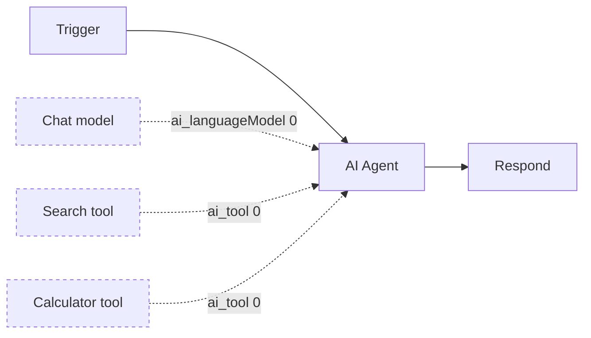

# Attach sub-nodes to the graph outside its edges

Date: 2026-11-09

Status: Active

Decision Owner: Core Execution

Source: https://linear.app/n8n/issue/CET-648

## Context

An engine v2 graph has nodes and edges. Each edge carries data and decides whether its target runs.
About a dozen algorithms read the edges on that basis: validation, loop rules, settlement, input
gathering, completion and successor queries.

In engine v1, sub-nodes such as a chat model, a memory or a tool connect to a root node, such as
an AI Agent, over typed connections (`ai_languageModel`, `ai_tool` and others). The root node
pulls them while it runs. The converter keeps only the nodes that the trigger reaches over `main`
connections, so it drops all sub-nodes, and the agent step fails at run time.

With ADR-20261109-steps-declare-actions-that-the-engine-runs-as-steps, a tool node runs as a
spawned step, so it must be a node of the graph.

## Decision

1. **The graph has a list of attachments next to its edges.** An attachment names a sub-node, the
   node it attaches to, a kind and an input index. The kind is the v1 connection type, and the
   engine treats it as an opaque string.
2. **A sub-node is a graph node of the new type `attached`.** It has the same configuration as a
   `v1-node`. The engine never plans it from edges, never uses it as a trigger and never seeds it.
   It runs as a step only when an action targets it. Other sub-nodes, such as a chat model or a
   memory, run inside the root node's step, as in engine v1 (decision 6).
3. **No algorithm that follows the edges changes.** Attachments are not edges. Code that picks nodes
   because no edge leaves them, such as the terminal nodes of a sub-execution, skips `attached`
   nodes.
4. **The engine validates attachments.** Both ends exist. An `attached` node has no edge. Each
   `attached` node leads, through attachments, to a node that the trigger reaches. Attachments
   have no cycles.
5. **An action must target an `attached` node that is attached to the declaring step's node.**
   Its attachment must also have a kind that the declaring node allows as a target. The shim gives
   the engine these kinds. The engine compares the strings and does not read them.
6. **The converter adds the sub-nodes of every node it keeps, recursively.** It drops disabled
   sub-nodes. The shim turns attachments back into v1 connections, so a root node reads its
   sub-nodes as in engine v1.
7. **A graph without attachments has none.** Graphs stored before this decision stay valid.

Solid arrows are edges. Dashed arrows are attachments.

## Alternatives Considered

- **Typed edges in the list of edges.** Rejected for three reasons. Settlement would wait forever
  for the agent, because a sub-node never gets a row. Validation would reject two tools on one
  input as converging branches. The loop rules would reject a tool on an agent inside a loop.
  Every edge algorithm would need a filter on the edge type.
- **Keep the sub-nodes inside the root node's configuration.** Rejected. Tool runs would have no
  graph node, so the engine could not check action targets or name the steps, and it would have
  to read node configuration.
- **Sub-nodes as graph nodes without edges, with the connections in the root's configuration.**
  Rejected. The relation between nodes would be outside the graph, so an action could target any
  node. It needs fewer changes, and it can migrate to attachments.

## Consequences

- The stored graph and the graph type in the API between the control plane and the data plane
  change.
- Chat model and memory nodes become graph nodes, but they are never action targets.
- A sub-node that two roots share is one node with two attachments.
- Pinned data on a sub-node is not supported, because only reachable nodes can be seeded.
- The read path shows a spawned step under its declaring node, with the output under the
  attachment kind, as engine v1 does.

## Links

RFC: -

Documentation: -

Related ADRs: ADR-20261109-steps-declare-actions-that-the-engine-runs-as-steps, ADR-20261109-store-turns-in-their-own-table-and-spawned-steps-with-the-graph-steps
