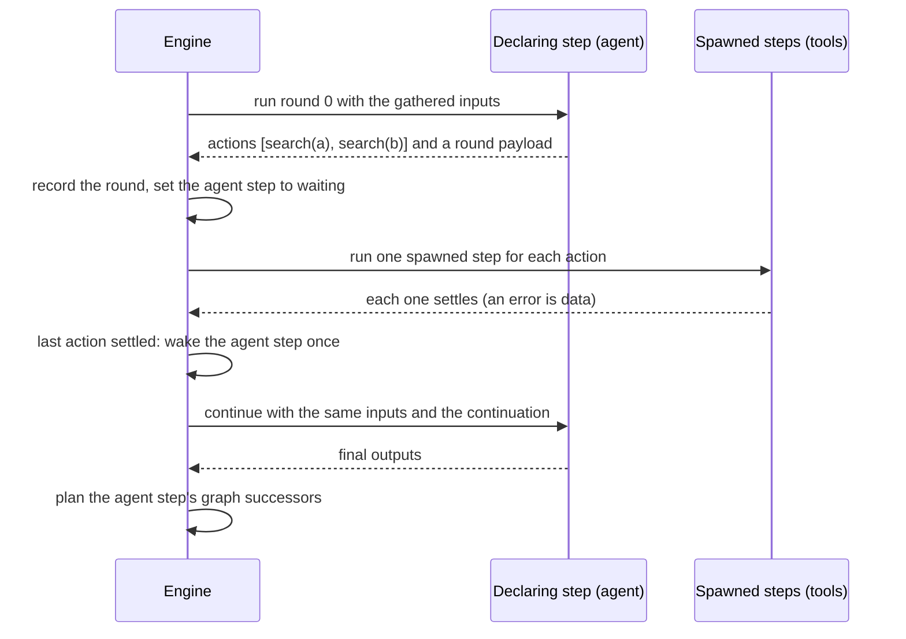

# Steps declare actions that the engine runs as steps

Date: 2026-11-09

Status: Active

Decision Owner: Core Execution

Source: https://linear.app/n8n/issue/CET-648

## Context

This record uses these terms:

- **Declaring step:** a step whose node asks the engine to run other nodes for it, for example
  an AI Agent that asks for tool calls.
- **Action:** one such request, for example one tool call.
- **Round:** one run of the declaring step's node. A round ends with outputs or with actions. For
  an agent, a round is one LLM call.
- **Turn:** in the AI Agent code, one user message and the agent's whole answer to it. A turn
  takes one or more rounds: every round but the last ends with actions. The engine does not know
  turns. It stores and counts rounds.
- **Spawned step:** the step that runs one action.

In engine v1, the AI Agent node runs one LLM round for each call of `execute`. When the LLM asks
for tools, the node returns an `EngineRequest`. Engine v1 runs each tool node and then calls
`execute` again with an `EngineResponse` that holds the results. Approvals by a human (HITL
tools), nested agents and sub-workflow tools use the same path.

Engine v2 plans steps only for nodes in the graph. An LLM decides at run time which tools run, how
often, and with which arguments. A step result can hold outputs, a wait, or a sub-execution. The
shim refuses an `EngineRequest`, so an agent with tools fails.

## Decision

1. **A step can declare actions.** This is a fourth kind of step result, next to outputs, a wait
   and a sub-execution. Each action names a target node, a call id, its position, the input item
   it belongs to, opaque arguments and opaque metadata. The declaration also carries an opaque
   round payload. The engine never reads what an action or a payload means. Only node types that
   opt in can declare actions. Any other node that returns an `EngineRequest` fails its step.
2. **The engine runs each action as a spawned step in the same execution.** A spawned step has the
   full step lifecycle. It can complete, fail, wait for a deadline or a resume request, declare its
   own actions, or declare a sub-execution. It uses the retry settings of its node, as a graph step
   does. Its outcome never plans graph successors.
3. **A step that waits for its actions is `waiting`, as a step that awaits a sub-execution is.**
   The engine writes this wait itself. The wait names the round, and it has no deadline and no
   resume binding. So no resume request and no deadline can end it. Only the engine ends it. The
   engine announces `step:waiting` only for a wait that something outside the execution ends: a
   deadline or a resume request. A wait for actions or for a sub-execution is not announced.
4. **The engine continues the declaring step when every action of the round has settled.** To
   continue is to run the node again, with the same inputs as the first round plus a continuation.
   The continuation lists every earlier round in order, each with its payload and the outcome of
   each of its actions. The engine derives the continuation from stored rows. It never stores it.
   The last action that settles wakes the declaring step once, the way a finished sub-execution
   wakes its parent: only if the declaring step is still `waiting`. A step that was cancelled with
   its execution is not woken.
5. **A failed action is data.** Its error goes into the continuation. It does not fail the declaring
   step or the execution. The node decides what the error means.
6. **A continue runs node code. A resume after a deadline or a resume request does not.** The rule
   of ADR-20260902-steps-declare-waits stays true for waits.
7. **All rounds share one step row and one iteration.** `step:started` is published once, before the
   first round. A retry or a timeout applies to one round, and the time a step waits for its actions
   does not count. The declaring step's graph successors run only after its final outputs.
8. **The engine and the shim know no AI library.** All AI knowledge stays in the node. The node
   counts its own rounds (for example `maxIterations`). The engine caps the number of rounds and
   spawned steps in one execution.

## Alternatives Considered

- **One sub-execution for each action.** Rejected, mainly because tool parameters use expressions
  such as `$('Webhook').item.json.email`. Those read the steps of the current execution, and a
  sub-execution has only its own steps. Also, the sub-execution path starts stored workflows, which
  a tool node is not. An execution for each tool call costs much more than a step, and it shows in
  the executions list. A sub-execution is still right for a tool that calls a stored workflow.
- **One kind of declaration for actions and sub-executions.** Rejected. A sub-execution is an
  execution, with its own graph, admittance, retention and cancellation. A failed sub-execution
  makes the node throw, and a failed action is data. They share only the suspend and continue
  mechanics.
- **Run the whole agent loop inside one step.** Rejected. A HITL tool cannot pause one tool call,
  the step holds a worker for the whole agent run, and tool runs do not appear as steps.
- **A new step status for waits that only the engine ends.** Rejected. A step that awaits a
  sub-execution is already `waiting` (ADR-20261020-run-a-sub-workflow-as-its-own-execution), and
  one status for both keeps the status machine and its consumers as they are. The wait declaration
  already tells an engine-internal wait from a wait for something outside the execution.
- **Put the results into the declaring step's resume cause or its inputs.** Rejected. Many actions
  settle at the same time and would race on one column, a later resume overwrites the cause, and
  inputs that change for each round would change what `$json` and paired items see.
- **Add one step row or one iteration for each round.** Rejected. Expressions such as `$('Agent')`
  and `$runIndex`, and loop passes, would see each round as a run of the node. Engine v1 also keeps
  one run index for all rounds.

## Consequences

- The number of steps in an execution no longer follows from the graph. Every rule that counts or
  reads graph steps must ignore spawned steps: the completion count, fail-fast, the expression data
  loader and successor planning. Without that, an execution can end early.
- Expressions cannot read the outputs of a spawned step, as in engine v1, where a tool's output
  is not on its `main` output.
- A `waiting` step does not always wait for something outside the execution. The `step:waiting`
  event already tells the two apart. Other code that reacts to a waiting step, for example to
  close a chat stream, must read its wait declaration.
- A crash during a round repeats one LLM call. The answer can differ, and stream chunks can repeat.
- Two open approvals in one execution need step-bound resume tokens
  (ADR-20260904-a-derived-token-authorizes-a-resume-request).
- Without concurrent steps, the actions of one round run one after the other.
- Cancelling an execution cancels its pending spawned steps.
- The continuation grows with each round. The node's own round limit and the engine cap bound it.
- A node can move from one AI library to another without a change in the engine or the shim.

## Links

RFC: -

Documentation: -

Related ADRs: ADR-20260902-steps-declare-waits, ADR-20261020-run-a-sub-workflow-as-its-own-execution, ADR-20260904-a-derived-token-authorizes-a-resume-request
