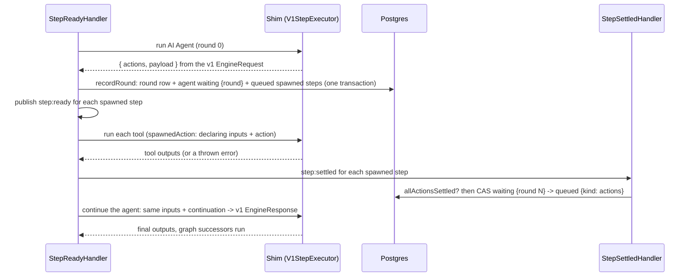

# Spike: agent nodes on engine v2 (CET-649)

Date: 2026-11-12. Source: https://linear.app/n8n/issue/CET-649. This is a spike. Do not merge it.

The spike implements the three ADRs of 2026-11-09 end to end:

- ADR-20261109-steps-declare-actions-that-the-engine-runs-as-steps (A)
- ADR-20261109-store-rounds-in-their-own-table-and-spawned-steps-with-the-graph-steps (R)
- ADR-20261109-attach-sub-nodes-to-the-graph-outside-its-edges (T)

It leaves out edge cases on purpose. The code marks each one with `SPIKE:`.

## What the spike built

- Engine core: `workflow_step_round` table, spawned steps in `workflow_step_execution` with `kind`, `declaring_step_id`, `round`, `call_id`, graph-only filters on the store queries, the `actions` result, the round wait `{ round }`, the `actions` resume cause and the continue dispatch, caps on rounds and spawned steps, `attached` nodes, attachment validation and the action target check (`graph/attachments.ts`).
- Shim: an `EngineRequest` becomes actions when the node has `actionTargetKinds`. A continuation becomes the v1 `EngineResponse`. A spawned tool gets the agent item merged with the arguments and `toolCallId`, and `$fromAI` reads the injected `inputOverride`.
- Converter: sub-nodes become `attached` nodes and attachments, recursively. Nodes with `ai_tool` attachments get `actionTargetKinds: ['ai_tool']`.
- Read path and live push: each tool call shows as its own run of the tool node under `ai_tool`, nested under the agent.
- Node side: `buildSteps` revives LangChain messages from the JSON payload.

## What works end to end

A local n8n with engine v2 and Postgres ran these workflows against a mock OpenAI server. Each one also ran on engine v1 for comparison.

| Scenario | Engine v2 |
|---|---|
| Agent + Calculator: one call, two parallel calls of one tool, two rounds | Same answer as v1 |
| Two different tools, one using `$fromAI` | Same answer as v1 |
| Agent Tool (nested agent) with its own model and tool, also with a failing inner tool | Same answer as v1 |
| Failing tools (HTTP 500, connection refused, 2 of 3 parallel calls fail) | The error reaches the LLM as data. The execution succeeds, as in v1 |
| HITL approval over email: approve, deny, stop while waiting, late click | Same as v1. The approval step waits with a step-bound resume URL |
| Simple Memory and Postgres Chat Memory across two calls | Same as v1 (Postgres memory needs the `buildSteps` fix) |
| Agent with two input items, agent inside Loop Over Items | Same answer as v1 |
| Stop while a tool call runs | The agent is cancelled and is not woken |

Tests: engine integration tests with a fake executor, and a shim acceptance test with the real AI Agent V3, the real Calculator and a scripted chat model.

## Findings

IDs are stable. "ADR gap" means the ADRs do not decide it yet.

### Decisions the ADRs must add

- **F1. Key spawned steps by position, not by call id.** Providers can send missing, empty or repeated tool call ids, and Agent V3 merges the calls of all items into one round. Today a bad id fails the agent step (before the fix it hung the step). Proposal: key by `(declaring step, round, position)` and keep `callId` as data. `execution/actions.ts`.
- **F2. A round with no actions.** Agent V3 drops a call to an unknown tool and can return an `EngineRequest` with no actions. Engine v2 fails the step after one LLM call, with an engine-internal message. Engine v1 runs the agent again, so a real LLM can recover. Decide who handles it: the node, the shim or the engine. `engine-actions.ts`.
- **F3. "A round holds only what is new" (R.2) does not hold for Agent V3.** The v1 protocol sends the last round only, and Agent V3 keeps its whole history in `metadata.previousRequests`. Each round row repeats all earlier rounds, so storage grows with rounds². The engine also loads all rounds on each continue, but the shim uses only the last. Either the node stores only the delta (a node change), or the continuation carries only the last round.
- **F4. Continuation on other resumes.** The continuation is passed only on an `actions` resume. A declaring step that later waits on a sub-execution or a resume request loses its rounds and would restart from round 0. Decide whether every re-run of a declaring step gets the continuation.
- **F5. `actionTargetKinds` has two meanings.** It allows a node to declare actions (A.1) and lists the kinds it accepts as targets (T.5). A HITL gate needs the second and so also gets the first.
- **F6. More than one valid target path.** When a tool attaches both to a HITL gate and to the agent, the first path in attachment order wins. Engine v1 uses the action's `metadata.parentNodeName`. T.5 does not say which wins.
- **F7. The loop pass of the declaring input.** A tool expression such as `$('Loop Over Items').item` resolves to the first pass's item in the second pass, with no error. Engine v1 fails that tool call. The shim needs the pass of the declaring step's input, and `SpawnedAction` does not carry it. This gives wrong data silently. `spawned-action.ts`.
- **F8. Tool error settings under A.5.** `onError: stopWorkflow` on a tool becomes data, not a stop. `continueErrorOutput` sends the error text to the LLM, where v1 sends `""`. The original error class and details (`httpCode`) are lost.
- **F9. `$runIndex` of a spawned step.** Every call in one pass gets the declaring step's iteration. Engine v1 counts runs per tool node. R.4 sets the iteration, but the effect on expressions is not written down.
- **F10. Pinned data on a sub-node.** T says "not supported". The spike ignores the pin and runs the tool. Engine v1 uses the pinned output. Decide between ignore and reject.
- **F11. A node that is reachable over `main` and is also a sub-node.** T.6 does not cover it. The converter rejects its non-main connection.
- **F12. Sub-node runs are not recorded.** Chat model runs and token usage do not show on engine v2 (T names this as a separate decision). Users notice this first in the logs panel.

### Correctness and operations

- **F13. Crash windows need reconciliation (CAT-2938).** (a) After the round commits and before the spawned steps are announced, they stay queued and the agent waits for ever. (b) After the last action settles and before the wake, the agent waits for ever. A says reconciliation repairs (b). (a) is new. Both are marked in the code.
- **F14. Unsupported tools look like success.** The Call n8n Workflow tool is refused inside its spawned step, so the refusal becomes tool data. The execution is green and the LLM answers around an engine message. Nothing rejects the workflow when it is published or started.
- **F15. A tool call that runs during a stop completes later.** The tool step is written `completed` in the cancelled execution, because `completeStep` checks only `running`. Graph steps behave the same today. No abort signal reaches the tool.
- **F16. Caps are soft and cost a scan.** Two rounds can count at the same time and overshoot by one. The count reads every round row of the execution. A counter on the execution row would be constant time. The caps are runtime options, not env vars yet.
- **F17. Read cost.** Each spawned step gathers the declaring step's inputs again (N actions, N identical reads). Each continue reads all rounds and all tool outputs.
- **F18. `step:started` repeats on other resumes.** It is skipped on an `actions` resume only. Deadline, request and sub-execution resumes still send it again.
- **F19. The step handler now publishes to the step queue.** It announces spawned steps. With a real queue, check back-pressure.
- **F20. Version skew gives a false success.** A shim that returns `actions` to an engine that does not know them completed the agent with `outputs: null`. The engine accepts a result without `outputs` in its last branch. `step-ready-handler.ts`.
- **F21. Errors before the run can still leave a step `running`.** `dispatchFor` and `spawnedActionFor` run outside the step's `try`.

### Schema and code shape

- **F22. Migrations are edited in place**, as the team did before. Every dev database that ran the old version must be dropped, and nothing warns.
- **F23. Graph-only filters hide inside old method names** (`countSettledSteps`, `loadAllSteps`). R.6 asks for named methods. Rename them so the filter shows at each call site. Make `StepRecord.kind` and the spawned fields required.
- **F24. The agent payload must be JSON.** Agent V3 keeps LangChain messages in its metadata. The spike revives them in `buildSteps`. A node that moves to another AI library must serialise its own state (R consequence).

### Read path and editor

- **F25. Parallel calls show in reverse order** in the logs panel, because `executionIndex` follows data plane order.
- **F26. A tool behind a HITL gate does not show under the agent**, because the gate node has no run of its own in engine v2.
- **F27. The live push is partial.** Step events carry no arguments or attachment kind, so live updates have no tool input. The full shape comes from the read after the execution ends.

### Tests and developer experience

- **F28. No scripted chat model exists** for tests that need tool calls. The spike adds a stateless test model that answers by counting tool messages.
- **F29. No contract test** checks that converter output passes engine graph validation, because `validateExecutableGraph` is not exported.
- **F30. A v2 workflow with unsupported parts activates without error.** Problems show only on the first execution.

## How to run it locally

The harness lives outside the repository on the spike machine (`tmp/repro-CET-649/`). It starts Postgres in Docker, a mock OpenAI server and n8n with `N8N_ENABLED_MODULES=engine-v2`, creates the workflows over REST, and compares v1 and v2 runs.
