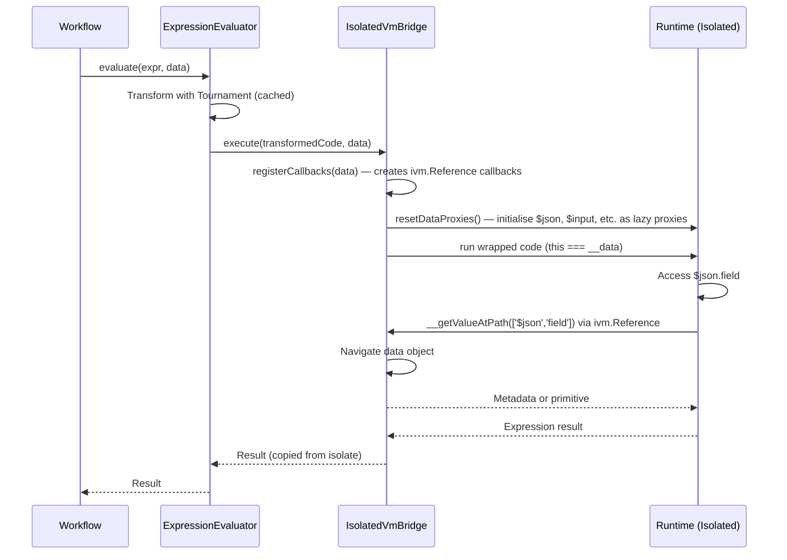
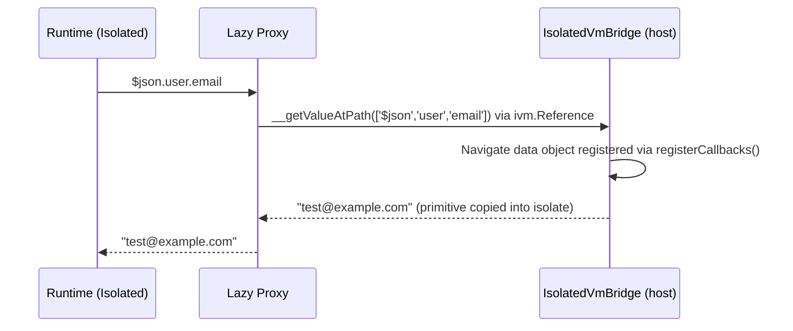

# Expression Runtime Architecture

This package provides a secure, isolated expression evaluation runtime that works across multiple execution environments (isolated-vm, QuickJS in WASM, and task runners).

## Design Goals

1. **Environment Agnostic**: Single codebase that works in Node.js (isolated-vm), browsers (QuickJS in WASM), and task runner processes
2. **Security**: Expressions run in isolated contexts with memory limits and timeouts
3. **Performance**: Lazy data loading, code caching, and efficient data transfer
4. **Observability**: Built-in metrics, traces, and logs
5. **Maintainability**: Clear separation of concerns with well-defined interfaces

## Three-Layer Architecture

The architecture is split into three distinct layers:

```
┌─────────────────────────────────────────────────────────┐
│                     Host Process                        │
│                                                         │
│  ┌────────────────────────────────────────────────┐     │
│  │         ExpressionEvaluator (Layer 3)          │     │
│  │  - Public API                                  │     │
│  │  - Tournament integration                      │     │
│  │  - Code caching                                │     │
│  │  - Observability                               │     │
│  └────────────────┬───────────────────────────────┘     │
│                   │                                     │
│  ┌────────────────▼───────────────────────────────┐     │
│  │           Bridge (Layer 2)                     │     │
│  │  - IsolatedVmBridge (Phase 1.1)                │     │
│  │  - QuickJsBridge (WASM)                        │     │
│  │  - Task Runner Integration (TBD)               │     │
│  └────────────────┬───────────────────────────────┘     │
│                   │ IPC/Message Passing                 │
└───────────────────┼─────────────────────────────────────┘
                    │
┌───────────────────▼─────────────────────────────────────┐
│              Isolated Context                           │
│                                                         │
│  ┌────────────────────────────────────────────────┐     │
│  │            Runtime (Layer 1)                   │     │
│  │  - Runs inside isolation                       │     │
│  │  - No Node.js dependencies                     │     │
│  │  - Lazy loading proxies                        │     │
│  │  - Helper functions ($json, $item, etc.)       │     │
│  │  - lodash, Luxon                               │     │
│  └────────────────────────────────────────────────┘     │
│                                                         │
└─────────────────────────────────────────────────────────┘
```

### Layer 1: Runtime (Isolated Context)

**Location**: Runs inside the isolated context (isolate, worker, subprocess)

**Purpose**: Provides the JavaScript execution environment for expressions

**Key Components**:
- **Lazy Loading Proxies**: Fetch data fields on-demand from host to avoid memory limits
- **Helper Functions**: `$json`, `$item`, `$input`, `$`, etc.
- **Libraries**: lodash, Luxon (bundled)
- **No Node.js APIs**: Pure JavaScript only

**Bundle**: IIFE format for both isolated-vm and QuickJS

### Value transfer

`src/runtime/prepare-object.ts` encodes each supported value type. It delegates child
values to the caller. It does not own traversal state.

`src/runtime/serialize.ts` prepares results for isolated-vm. It copies arrays with an
index loop. After 32 nested containers, it switches to the guarded traversal in
`src/runtime/prepare-transfer.ts`. This threshold starts cycle detection. It does not
set a maximum result depth. A plain cycle raises an error before it can exhaust
the native stack. Error traversal keeps its own cache and cycle rules.

`src/runtime/quickjs-transfer.ts` installs the QuickJS result encoder and host-value
decoder. These functions use the runtime bundle, so TypeScript checks them.
Only QuickJS calls the installer. `src/bridge/quickjs-value-transfer.ts` owns the
host side of the JSON transport. Both sides register a container before they
decode its children. This preserves references through collections.

### Layer 2: Bridge (Host Process)

**Location**: Runs in the host process

**Purpose**: Manages communication between host and isolated context

**Key Components**:
- **RuntimeBridge Interface**: Abstract interface for all bridge implementations
- **IsolatedVmBridge**: Uses isolated-vm API for Node.js backend (Phase 1.1)
- **QuickJsBridge**: Uses quickjs-emscripten (WASM) for Node.js and the browser
- **Task Runner Integration**: TBD - May use IsolatedVmBridge locally or direct evaluation (Phase 2+)

**Responsibilities**:
- Initialize isolated context
- Transfer code to context
- Handle data requests from runtime (lazy loading)
- Enforce memory limits and timeouts
- Dispose of context when needed

### Layer 3: Evaluator (Host Process)

**Location**: Runs in the host process

**Purpose**: Public API for expression evaluation

**Key Components**:
- **ExpressionEvaluator**: Main class used by workflow package
- **Tournament Integration**: AST transformation and security validation
- **Code Cache**: Cache transformed code (not evaluation results)
- **Observability**: Emit metrics, traces, and logs

**Responsibilities**:
- Accept expression strings and workflow data
- Transform expressions with Tournament
- Cache transformed code to avoid re-transformation
- Convert WorkflowData to WorkflowDataProxy for lazy loading
- Use bridge to evaluate in isolated context
- Handle errors gracefully
- Emit observability data

## Data Flow

### Expression Evaluation Flow



### Lazy Data Loading

Data access from inside the isolate goes through `ivm.Reference` callbacks
registered by the bridge — not through a method on `RuntimeBridge` itself.



### Batched reads

One host call for each key costs much more than one JSON copy. So the two
bridges read a batch of values of item data (`$json`) in one host call when the
expression shows that it reads many. A lazy proxy records how the expression
reads it, and the host never guesses.

| What the expression does | What the proxy asks the host for |
| --- | --- |
| Reads a value after it listed the keys (`JSON.stringify`, a returned item, a spread) | Every small field of the object. Every field whole after the expression read an earlier item of the same array in full |
| Reads the array index after the last one (`map`, `filter`, a `for` loop) | The next small items. The first item that is not small comes alone, as before. Each such read can be four times larger than the read before it |
| Read an earlier item in full: every field of an object after a key list, or an array in order to its last item | The next items whole, including items that are not small |
| Read fields by name on the item before (`row.name`) | Only these fields of the next items |
| Reads one field, or one item out of order | That one value, as before |

A value crosses whole when it is plain JSON data and its size is at most
`smallValueChars`. The size counts 8 for each value, object and array, plus the
length of each string and object key. The host counts while it copies and stops when
the size is too large. A larger object or array stays a lazy proxy with the same
rules. A whole value can be as large as `maxBatchChars`. All reads of one
evaluation share one character budget: half of the memory limit of the bridge,
in bytes, as characters. When the budget is spent, a proxy reads one value for
each host call. `BATCH_READ_LIMITS` holds the sizes.

`readBatchAtPath` in `src/bridge/batch-read.ts` is the host side. It copies
only data properties of `$json`. All other roots stay lazy. Both bridges pass it
to the runtime as the `readBatch` callback.

## Environment-Specific Implementations

### IsolatedVmBridge (Node.js Backend)

Uses [isolated-vm](https://github.com/laverdet/isolated-vm) for V8 isolate-based isolation:

```typescript
class IsolatedVmBridge implements RuntimeBridge {
  private isolate: ivm.Isolate;
  private context: ivm.Context;

  async initialize(): Promise<void> {
    this.isolate = new ivm.Isolate({
      memoryLimit: 128
    });
    this.context = await this.isolate.createContext();

    // Load runtime code
    await this.context.eval(runtimeCode);
  }

  async execute(code: string, dataId: string): Promise<unknown> {
    // Implementation...
  }
}
```

### QuickJsBridge (Browser Frontend)

The editor runs the same `QuickJsBridge` as Node.
The browser has no filesystem, so the host passes the runtime bundle in with the
`runtimeBundle` option. The vite stub in `packages/frontend/editor-ui/vite/` maps
`@n8n/expression-runtime` to the real bridge for the browser build.

### Task Runner Integration (TBD - Phase 2+)

Task runners already provide process-level isolation. When code nodes call `evaluateExpression()`, evaluation happens **inside the task runner** (not via IPC to worker).

**Architecture decision pending - two options**:

**Option A**: Task runner uses `IsolatedVmBridge` locally
```typescript
// Inside task runner process
const evaluator = new ExpressionEvaluator({
  bridge: new IsolatedVmBridge(config), // Evaluates locally
});

// Code node calls evaluateExpression()
const result = await evaluator.evaluate(expression, workflowData);
// ^ All happens inside task runner, no IPC, no lazy loading needed
```

**Option B**: Task runner evaluates directly (no extra sandbox)
```typescript
// Task runner already isolated at process level
// No need for isolated-vm sandbox on top
const result = evaluateExpressionDirectly(expression, workflowData);
```

**Key point**: Task runner already has all workflow data, so no lazy loading or IPC communication is needed for data access.

## Package Structure

```
packages/@n8n/expression-runtime/
├── ARCHITECTURE.md              # This file
├── README.md
├── package.json
├── tsconfig.json
├── tsconfig.build.json
├── vitest.config.ts
├── esbuild.config.js            # Bundles src/runtime/index.ts → dist/bundle/runtime.iife.js
│
├── src/
│   ├── index.ts                 # Public API exports
│   │
│   ├── types/                   # TypeScript interfaces (no implementations)
│   │   ├── index.ts
│   │   ├── bridge.ts            # RuntimeBridge, BridgeConfig
│   │   ├── evaluator.ts         # IExpressionEvaluator, EvaluatorConfig, error classes
│   │   └── runtime.ts           # RuntimeHostInterface, RuntimeGlobals, RuntimeError
│   │
│   ├── runtime/                 # Layer 1: runs inside the V8 isolate
│   │   └── index.ts             # Proxy system, resetDataProxies, __sanitize,
│   │                            # SafeObject, SafeError, Lodash/Luxon wiring,
│   │                            # all extension functions
│   │
│   ├── bridge/                  # Layer 2: host-process isolate management
│   │   └── isolated-vm-bridge.ts  # IsolatedVmBridge (ivm.Isolate, callbacks, script cache)
│   │
│   ├── evaluator/               # Layer 3: public-facing API
│   │   └── expression-evaluator.ts  # Tournament integration, expression code cache
│   │
│   ├── extensions/              # Expression extension functions (bundled into runtime)
│   │   ├── array-extensions.ts
│   │   ├── boolean-extensions.ts
│   │   ├── date-extensions.ts
│   │   ├── number-extensions.ts
│   │   ├── object-extensions.ts
│   │   ├── string-extensions.ts
│   │   ├── extend.ts
│   │   ├── extensions.ts
│   │   ├── expression-extension-error.ts
│   │   └── utils.ts
│   │
│   └── __tests__/
│       └── integration.test.ts
│
└── dist/
    ├── *.js / *.d.ts            # Compiled TypeScript (tsc output)
    └── bundle/
        └── runtime.iife.js      # Self-contained IIFE loaded into isolated-vm
```

## Key Design Decisions

### 1. Why Three Layers?

**Separation of Concerns**: Each layer has a single responsibility:
- Runtime: Execute expressions in isolation
- Bridge: Handle environment-specific communication
- Evaluator: Provide clean API with observability

**Environment Agnostic**: The Runtime and Evaluator layers are identical across all environments. Only the Bridge changes.

### 2. Why Lazy Loading?

**Memory Efficiency**: Large workflow data (100MB+) cannot fit in isolate memory limits (128MB). Lazy loading fetches only the fields that expressions actually access.

**Performance**: Transferring only accessed fields is faster than transferring entire objects.

**Limitation**: Lazy loading requires **synchronous** callbacks from runtime to host. This works for:
- ✅ **isolated-vm**: Uses `ivm.Reference` for true synchronous callbacks
- ✅ **Node.js vm**: Direct synchronous function calls
- ✅ **QuickJS**: host functions are plain synchronous calls in the WASM context

### 3. Why Bundle the Runtime?

**No Node.js Dependencies**: Runtime must work in environments without Node.js (browser, isolated-vm). Bundling produces a self-contained IIFE/ESM module.

**Immutability**: Bundled runtime is immutable and can be cached.

### 4. Why Abstract Bridge?

**Portability**: The backend uses isolated-vm. The browser uses QuickJS in WASM. The abstract bridge allows adding new environments without changing other layers.

**Testing**: Integration tests use `IsolatedVmBridge` directly (see `src/__tests__/integration.test.ts`).

### 5. Why Do Extension Functions Not Call the Host?

**Limits**: The time limit and the memory limit of an evaluation apply to the code that runs in the isolate. The work of a host function runs in the host process, outside these limits. On isolated-vm, the time limit does not stop an expression on time while it calls synchronous host functions in a loop.

**Rule**: An extension function does all its work in the runtime bundle. Host functions only read workflow data, and each call does a small, bounded quantity of work.

**Example**: `extractUrlPath()` uses a URL parser in the bundle (`src/extensions/url-pathname.ts`) and does not call `new URL()` on the host. The isolate has no `URL` class. The parser does not do the IDNA validation of the host name, because the IDNA tables are too large for the bundle. Thus its result differs from `new URL()` for some host names that are not ASCII.

## Known Limitations

### Lazy Loading with Async Boundaries

JavaScript Proxy trap handlers are **synchronous**, which creates a fundamental limitation:

```javascript
const proxy = new Proxy({}, {
  get(target, prop) {
    // This handler MUST be synchronous
    // Cannot use await or return Promise
    return someValue;
  }
});
```

**Impact by Environment**:

1. **isolated-vm** ✅
   - Uses `ivm.Reference` for true synchronous callbacks from isolate to host
   - Full lazy loading support

2. **Node.js vm** ✅
   - Direct synchronous function calls
   - Full lazy loading support (used for testing)

3. **QuickJS (WASM)** ✅
   - Host functions are plain synchronous calls in the QuickJS context
   - Full lazy loading support, in Node.js and in the browser

### Security Boundaries

The runtime has **no access** to:
- ❌ Node.js APIs (fs, net, child_process, etc.)
- ❌ Host process memory
- ❌ Other isolates/workers
- ❌ Cookies

The runtime **can only**:
- ✅ Call back to host via `ivm.Reference` callbacks to fetch workflow data
- ✅ Access lodash and Luxon libraries
- ✅ Execute pure JavaScript code

## Testing Strategy

**Integration Tests** (vitest):
- Use `IsolatedVmBridge` with real `isolated-vm`
- Test lazy loading, helpers, error handling, security wrappers

**Bridge Tests** (vitest):
- Test each bridge implementation
- Mock environment-specific APIs
- Test memory limits, timeouts, disposal

**Evaluator Tests** (vitest):
- Test Tournament integration (transformation and validation)
- Test code caching (transformed code, not results)
- Test WorkflowData to WorkflowDataProxy conversion
- Test observability emission
- Test error handling

**Integration Tests** (vitest in workflow package):
- Test full stack with real isolated-vm
- Test concurrent evaluations
- Test with real workflow data

## Observability

All layers emit metrics, traces, and logs:

**Metrics**:
- `expression.evaluation.count`
- `expression.evaluation.duration_ms`
- `expression.code_cache.hit` (transformed code cache)
- `expression.code_cache.miss`
- `expression.isolate.memory_mb`

**Traces**:
- `expression.evaluate` span wraps entire evaluation
- `expression.tournament` span for AST transformation
- `expression.isolate.execute` span for isolated execution

**Logs**:
- Errors at all levels
- Warnings for memory pressure
- Debug logs for development

See observability package documentation for details.

## Next Steps

1. Implement TypeScript interfaces (Phase 0.1)
2. Implement observability infrastructure (Phase 0.2)
3. Create comprehensive benchmarks (Phase 0.3)
4. Implement runtime package (Phase 1.1)
5. Implement isolate pooling (Phase 1.2)

## References

- [isolated-vm GitHub](https://github.com/laverdet/isolated-vm)
- [quickjs-emscripten GitHub](https://github.com/justjake/quickjs-emscripten)
- [n8n workflow package](../workflow/)
