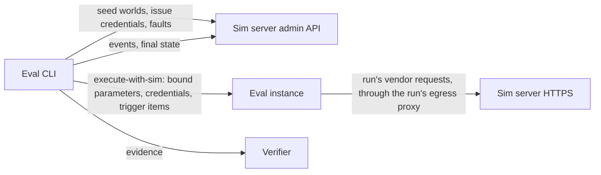

# Sim mode (`--mocking sim`)

Sim mode runs each execution scenario against simulated services instead of
the LLM mock. A sim server fakes vendor APIs behind their real hostnames and
keeps state. The scenario runs on the build instance, in the environment the
workflow was built in. The eval instance sends every vendor request of the run
to the sim server, which answers from the scenario's starting data.

The build does not change. Only the execution and the verification change.



## Run it

```bash
N8N_EVAL_SIM_TOKEN=<harness token> pnpm eval:instance-ai \
  --mocking sim \
  --sim-admin-url http://127.0.0.1:9193 \
  --sim-world-cache .data/sim-worlds \
  --filter <case>
```

| Flag | Default | Description |
|------|---------|-------------|
| `--mocking` | `llm` | `llm` uses the LLM mock. `sim` uses the sim server |
| `--sim-admin-url` | — | Admin API of the sim server. Required with `sim` |
| `--sim-world-cache` | `<output-dir>/sim-worlds` | Directory that keeps the written worlds |

The CLI reads the admin token from `N8N_EVAL_SIM_TOKEN` (or
`SIM_HARNESS_TOKEN`).

## The deployment contract

Each eval instance (lane) needs:

- **`N8N_INSTANCE_AI_EVAL_SIM_GATEWAY`**: `host:port` of the sim server's HTTPS
  listener, reachable from the instance. Without it, sim runs fail with a
  framework error.
- **Trust in the sim server's CA**: `NODE_EXTRA_CA_CERTS` points at the sim
  server's `ca.pem`. The run's requests keep their real hostnames, so n8n
  checks the sim server's certificate for those names.

The instance keeps its normal DNS. Only an eval run's own requests go to the
sim server, so builds, the builder's model calls and other runs on the same
instance do not change. One sim server can serve many lanes: every scenario run
uses its own tenant.

## What one scenario does

1. **Coverage.** The CLI reads the build instance's node descriptions and the
   sim server's manifests. For each node, it finds the service and the n8n
   credential type. There is no list of services in the harness.
2. **World.** An LLM writes each service's starting data from the user's
   request and the scenario only. It does not see the workflow. It creates
   the containers the case names or implies (the sheet a workflow logs to),
   and it models access for the identity n8n signs in as (a bot or a member).
   Records that come in during the scenario (an email that arrives, a row
   someone adds) are not starting data: the writer writes them as
   **arrivals**, the sim server's simulated-user events (`deliver_message`,
   `append_rows`). The CLI checks the worlds and the arrivals on a scratch
   tenant, and gives any error back to the writer.
   Faults (`force_429`, `force_status`, `revoke_tokens`) come from the
   scenario.
3. **Names and binding.** When the build names containers (a tab, a
   channel), the same LLM revises the world once for that build: a name that
   the case leaves open takes the workflow's name. The CLI finds the setup
   fields (empty resource locators, placeholders, ids the case never gives),
   and an LLM points each one at a seeded resource. An expression is never
   bound. A setup field left unbound is flagged as a harness issue.
4. **Seed and credentials.** Each service gets a fresh tenant, and the sim
   server issues the credentials.
5. **Trigger.** A polling trigger that the sim server serves (Gmail Trigger,
   Google Sheets Trigger) polls as a published workflow does. The instance
   polls it once (`POST /rest/instance-ai/eval/poll-with-sim/:id`), and the
   node records where it starts reading. Then the CLI sends the arrivals and
   the scenario's faults. The run polls again from that point, and the
   records that arrived start the run. For any other trigger, the CLI sends
   the arrivals first, and an LLM writes the trigger's output items, with
   seeded ids where a field names a resource.
6. **Run.** The CLI calls `POST /rest/instance-ai/eval/execute-with-sim/:id`
   with the changed node parameters, the issued credentials, the trigger
   items (or the first poll's state) and the sim server's host patterns. The
   instance:
   - stores the issued credentials in the workflow's project for the run
     only, so ids, OAuth2 refresh and permission checks work as in
     production;
   - prepares Data Tables, static data and Remove Duplicates history as in
     mock mode, and zeroes time-based waits;
   - starts a per-run egress proxy, and core sends every node request of
     the run through it, after credential auth and signing. AI SDK
     sub-nodes reach it through their credential's base URL;
   - refuses a host the sim server does not serve, and reports it.
7. **Evidence.** Node results come from the instance. Vendor requests come
   from the sim server's event log, matched to node runs by time. The
   verifier also gets the starting data and the final state of each
   service.
8. **Cleanup.** The instance deletes the run's credentials. The CLI deletes
   the tenants, unless you pass `--keep-workflows`.

## How the results read

| Result | Meaning |
|--------|---------|
| Pass or `builder_issue` | As in LLM mode |
| `mock_issue` | The simulation or its starting data is wrong. A call that the sim server does not implement is a simulation gap |
| `framework_issue` | The harness failed (seeding, binding, the run) |
| `verification_gap` | The verifier could not decide from the artifact. The result is not a builder, simulation or harness failure |
| `TRIGGER FOUND NOTHING` | A polling trigger found no record, so the run stopped at the trigger. The verifier compares the trigger's filters with the starting data |
| Not covered | The run needed a host or an AI client that the sim server cannot answer. The scenario is incomplete and is not scored |

## The world cache

The CLI writes each world once and keeps it in `--sim-world-cache`. The file
name is the scenario name and a hash of the writer's instructions, the
request, the scenario, the services and the credentials. A later run, another
iteration or a variant build of the same case uses the same world. A build
that names containers also gets an `.adopted` file, keyed by its resource
fields. A change to the writer's instructions writes new worlds. Delete a file
to write it again.

## Limits

- A host the sim server does not serve is not covered (made-up hosts, small
  public APIs).
- A send-and-wait node, or a Wait node that resumes on a webhook or a form,
  waits for a person or an event the run does not send.
- An AI credential without a base URL field (Mistral, Groq) cannot reach the
  sim server.
- Non-HTTP protocols (SMTP, IMAP, databases) are not routed yet.
- A polling trigger needs an event that brings its records (Gmail
  `deliver_message`, Sheets `append_rows`). With none, its second poll finds
  nothing.
- A container name that the case leaves open takes the workflow's name. So a
  wrong name for an open container (a tab, a channel) is not a failure.
- Standalone n8n Agents (the agents suite) still run on the LLM mock.
