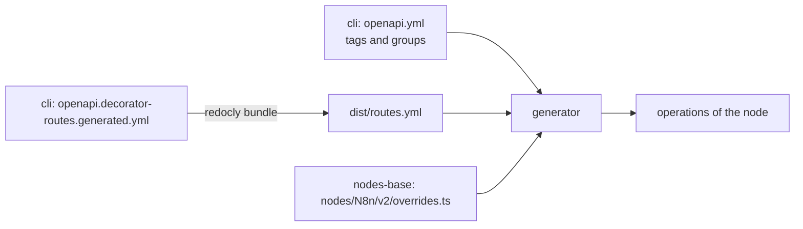

# @n8n/n8n-node-codegen

This package generates the [n8n node](../../nodes-base/nodes/N8n) from the
public API spec. The n8n node is the node that calls the public API of an n8n
instance.

At the moment, the generator reads the spec and the overrides, and prints the
operations of the node. It does not write the node files yet.

## Run the generator

```bash
pnpm --filter @n8n/n8n-node-codegen generate
```

The command prints one table for each resource. Each row shows the status of
the operation (`in node` or `excluded`), the operation ID, the summary, the
HTTP method, the path, and notes. The command fails when the node has errors.

To run the tests:

```bash
pnpm --filter @n8n/n8n-node-codegen test
```

## Inputs



- `packages/cli/src/public-api/v1/openapi.yml` gives the tags, their display
  names, and their groups.
- `packages/cli/src/public-api/v1/openapi.decorator-routes.generated.yml` gives
  the operations. The `bundle-spec` script bundles it with Redocly into
  `dist/routes.yml`. The `generate` and `test` scripts run `bundle-spec` first.
- `packages/nodes-base/nodes/N8n/v2/overrides.ts` gives the decisions about the
  node. The node contains all operations of the spec, except the operations in
  `exclude`.

## Add an operation to the node

1. Remove the line of the operation from `exclude` in `overrides.ts`.
2. Run the generator.
3. If the generator shows errors, correct them. See [Errors](#errors).

To keep an operation out of the node, add its `operationId` to `exclude` and
give a reason.

## Names

Each operation in the node has a resource and an operation. The workflow saves
their IDs. The user sees their display names.

|           | ID (saved in the workflow)                        | Display name                                              |
|-----------|---------------------------------------------------|-----------------------------------------------------------|
| Resource  | The tag name in the singular, first letter in lowercase: `Executions` → `execution` | The `x-displayName` of the tag in the singular: `Executions` → `Execution` |
| Operation | The `operationId`: `activateWorkflow`             | The `summary`: `Publish a workflow`                       |

The generator uses the `pluralize` library to make the singular.

Do not change an `operationId` or a tag name after the operation is in the
node. The saved workflows use these IDs.

## Errors

| Error | Cause | Action |
|-------|-------|--------|
| `exclude: "…" is not an operation in the spec.` | The spec does not contain this operation, or the ID is not correct. | Remove the line or correct the ID. |
| `exclude: "…" has no reason.` | The reason is empty. | Write a reason. |
| `"…" is not in exclude, but the generator cannot build it: …` | The operation has a blocker. | Add the operation to `exclude`, or add support to the generator. |
| `"…" is the resource of 2 tags: …` | Two tags have the same name in the singular. | Rename one of the tags in the spec, or exclude the operations of one tag. |
| `"…" is the name of 2 operations: …` | Two operations of one resource have the same `summary`. | Change one `summary` in the spec, or exclude one of the operations. |

Blockers:

- `no summary`: the operation has no `summary`.
- `header parameter "…"`: the operation has a header parameter.
- `… request body`: the request body is not JSON.
- `… response`: the successful response is not JSON.

The generator stops before the table when the spec has a structure that it
cannot read. For example: an operation with two tags, a tag without a group, or
two operations with the same `operationId`.

