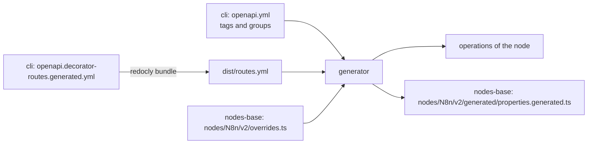

# @n8n/n8n-node-codegen

Generates version 2 of the [n8n node](../../nodes-base/nodes/N8n) from the
public API spec.

## Why

The n8n node calls the public API of an n8n instance. Version 1 is written
manually, and it falls behind the API. Version 2 comes from the spec, so a new
public API endpoint gets into the node with no manual node code.

## Commands

| Command | What it does |
|---------|--------------|
| `pnpm --filter @n8n/n8n-node-codegen generate` | Prints the operations of the node and writes `properties.generated.ts`. When the file is up to date, it does not change the file. |
| `pnpm --filter @n8n/n8n-node-codegen generate --check` | Fails when `properties.generated.ts` is out of date. It does not write the file. |
| `pnpm --filter @n8n/n8n-node-codegen test` | Runs the tests. |

Both `generate` commands fail when the node has errors, and then they do not
write the file. Do not edit `properties.generated.ts` manually.

## How it works



- `packages/cli/src/public-api/v1/openapi.yml` gives the tags, their display
  names, and their groups.
- `packages/cli/src/public-api/v1/openapi.decorator-routes.generated.yml` gives
  the operations. The `generate` script bundle it with Redocly into `dist/routes.yml`.
- `packages/nodes-base/nodes/N8n/v2/overrides.ts` gives the decisions about the node:
  - `exclude`: the operations that are not in the node, each with a reason.
  - `flatten`: the operations that send one item of a list. See
    [Send one item of a list](#send-one-item-of-a-list).

The generator makes these parts of the node:

| Spec | Node |
|------|------|
| Tag `Executions` | Resource `execution`, with the display name `Execution`. The generator makes the tag name and `x-displayName` singular |
| `operationId` | Operation ID |
| `summary` | Operation name. A deprecated operation gets ` (deprecated)` |
| Required parameter | Required field, with the parameter name |
| Optional parameter | Field in the `Options` collection. The node sends it only when the user adds it |
| Path parameter | Part of the URL, through `toPathSegment`. A number path parameter, for example `executionId`, becomes a string field with an empty default |
| `cursor` query parameter | `Return All` field. When it is off, `limit` sets the number of items |
| Successful response without a body | The node returns `{ "success": true }` |

The schema of a parameter gives the type and the default of its field. If the
schema has no default, a number gets its `minimum`, or `0` without a
`minimum`. Other fields get an empty value. A string enum becomes a dropdown,
except the enum `"true"`/`"false"`, which becomes a boolean. An object or an
array becomes a JSON field.
The tests in `src/__tests__/build-properties.test.ts` show each rule.

### Add an operation to the node

1. Remove the operation from `exclude` in
   `packages/nodes-base/nodes/N8n/v2/overrides.ts`.
2. Run `generate`. If it shows errors, correct them. See [Errors](#errors).
3. Commit `overrides.ts` and `properties.generated.ts` together.

To keep an operation out of the node, add its `operationId` to `exclude` and
give a reason.

### Send one item of a list

Some operations take a list of objects, but in a workflow each item is one
action. For example, `addUsersToProject` takes `relations`, a list of users and
roles. With `flatten: { addUsersToProject: 'relations' }`, the fields of one
list item (`userId` and `role`) become fields of the node. The node sends a
list with one item. To add two users, give the node two input items.

Flatten only a list of independent actions. Do not flatten a list that sets the
full new state, for example the tags of a workflow.

## Limits

### Errors

The generator stops and shows an error when it cannot build the node. Each
error tells you what to do. The most frequent error is an operation with a
blocker:

- `no summary`: the operation has no `summary`.
- `parameter name "…"`: a required parameter has the name of a node field
  (`resource`, `operation`, `returnAll`, or `options`).
- `header parameter "…"`: the operation has a header parameter.
- `… request body`: the request body is not JSON.
- `… response`: the successful response is not JSON.

To continue, add the operation to `exclude` with a reason, or add support to
the generator.

The generator also stops when it cannot read the spec, for example when an
operation has two tags or two operations have the same `operationId`.
`exclude` does not help here. Correct the spec.

### Breaking changes

A saved workflow stores the resource ID, the operation ID, and the field values
under the field names. It does not store a value that is equal to the default.
A change that alters one of these breaks the saved workflows.

These rules apply only to the operations in the node. You can change an
operation in `exclude` as necessary. Correct the spec of an operation before
you add it to the node.

| Change in the spec or in `overrides.ts` | Result in a saved workflow |
|------------------------------------------|----------------------------|
| Rename an `operationId` | The node cannot find the operation. |
| Rename a tag, or move an operation to another tag | The node cannot find the resource. |
| Rename a parameter | The field loses its value. |
| Make a required parameter optional, or the opposite | The field moves into or out of `Options` and loses its value. |
| Add a required parameter | The new field is empty. |
| Change the type of a parameter, or remove an enum value | The saved value does not fit the field. |
| Change the `default`, or the `minimum` of a number without a `default` | A workflow that kept the default gets the new value. |
| Add or remove the `cursor` parameter | `Return All` appears or disappears, and `limit` moves. |
| Add a body to an empty response, or the opposite | The node returns different data. |
| Add an operation to `flatten`, or remove it | The fields of the operation change. |
| Remove an operation from the node or from the spec | The node cannot find the operation. |

These changes are safe:

- Change a `summary`, an `x-displayName`, or a description.
- Mark an operation or a parameter as deprecated.
- Add an optional parameter or an enum value.
- Add an operation to the node.

A change in the generator can also break the saved workflows, for example a new
rule for defaults or an update of `pluralize`.


To make a breaking change, do not change the old operation or parameter. Add a
new one, and mark the old one as deprecated. For example, `publishWorkflow`
replaces `activateWorkflow`. If you cannot keep the old one, the node needs a
new version.

### Other limits

- The generator writes one version of the node.
- A field name is the API parameter name, and an operation name is the
  `summary`. To change a text in the node, change it in the spec.

### Test version 2 locally

The editor does not show version 2 yet. To test it on your computer:

1. In `packages/nodes-base/nodes/N8n/N8n.node.ts`, uncomment the import of
   `N8nV2` and the line `2: new N8nV2(baseDescription)`. Set `defaultVersion`
   to `2`.
2. Remove the operations that you want to test from `exclude` and run
   `generate`.
3. Build `n8n-nodes-base` and start n8n:

   ```bash
   pnpm --filter n8n-nodes-base build
   pnpm start
   ```

4. Add the n8n node to a workflow. The editor adds it with version 2.

Do not commit these changes.
