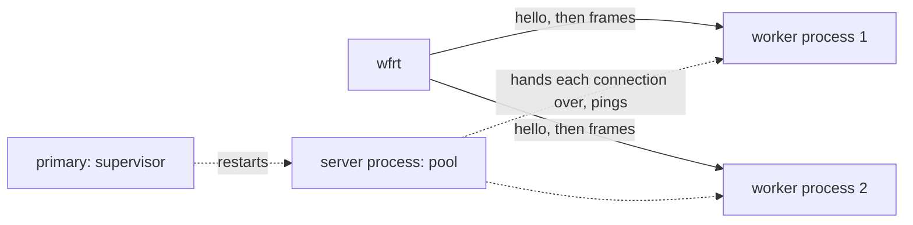

# @n8n/workflow-fallback-host

The fallback host runs the steps that the compiled workflow runtime (`wfrt`)
cannot run natively: Code steps and v1 n8n nodes. `wfrt` sends one frame for
each step over a Unix socket, and the host answers with the result or an
error (`src/protocol.ts`).

```
wf-fallback-host --socket /tmp/wf.sock [--workers 2]
```

`src/main.ts` lists the environment variables.

## Isolation and failure model

A step can fail in a bad way. It can throw from a timer, loop forever, use
all memory, call `process.exit`, or crash in a native module. The host keeps
each of these failures inside that one step. The other steps and executions
continue.



**Processes.** The primary process does not run steps. It starts one server
process and starts a new one when that process stops. The server process
supervises the worker processes (`worker-pool.ts`). Each worker runs many
steps at a time (`step-worker.ts`), because node steps wait on I/O most of
the time. `--workers 0` runs the steps in the server process, with no limits.

**Connections (protocol version 2, `hello.ts`).** `wfrt` starts each
connection with a hello. The server hands the connection to the worker with
the fewest connections, and that worker answers the hello with the number of
workers. `wfrt` then keeps one connection for each worker (at most 8), so a
step goes from `wfrt` to the worker that runs it, with no hop through the
server. A recycled worker sends `goaway` on its connections: `wfrt` sends no
new steps there and opens a new connection. A runtime of version 1 sends a
step first; the server then serves that connection itself, through the pool.
`WF_FALLBACK_DIRECT=0` makes the server answer the hello as a version 1 host
does, so all steps go through the server process again.

The server keeps its own copy of each connection that it hands over. When a
worker stops, the server writes `{"worker_lost":{"reason":"..."}}` on each
connection of that worker, then closes it. When the runtime or the worker
closes a connection, the worker tells the server, and the server closes its
copy.

The host uses processes, not worker threads. It can stop a process at any
time with SIGKILL, and a native crash stops only that process. A worker thread
gives neither: a crash in a native module (isolated-vm, for example) stops the
whole process. The cost is one hop between processes for each step.

The steps of a version 1 connection do not go over the IPC channel either.
Each worker has a socket pair next to it, and a step goes through it as one
frame: the length, a job number and the request JSON of the runtime, as the
server read it. The server does not parse the request, and the worker parses
it once. The IPC channel carries only pings, memory stats, connection hand-overs
and log lines.

Each worker keeps one expression isolate (`expression-engine.ts`), so each
step does not need a new one.

**Inside a worker.**

- Each step runs in its own async context (`AsyncLocalStorage`). An uncaught
  exception or an unhandled rejection comes with the context of the code that
  made it, also from a timer or socket of that step. While the step runs, the
  error fails that step. After the step has ended, the worker logs the error
  and continues. So a timer or a promise that a step leaves behind does not
  change a later step.
- `process.exit`, `process.abort` and `process.kill` of the own process throw
  in the step that calls them.
- Code steps have a time limit (`WF_FALLBACK_CODE_TIMEOUT_MS`).

**Limits that the pool sets for each step and worker.**

| Failure | Limit | Result |
|---|---|---|
| The step does not answer | `WF_FALLBACK_STEP_TIMEOUT_MS` (300 s), wall clock | The step fails with a timeout. The worker continues |
| Synchronous code that does not end | The worker does not answer pings for `WF_FALLBACK_BLOCKED_MS` (30 s) | The pool stops the worker |
| Memory | `WF_FALLBACK_WORKER_MEMORY_MB` (4096), V8 heap of the worker | The worker stops |
| A worker stops for another reason (native crash, SIGKILL) | – | The pool starts a new worker |
| A worker grows over a long run | `WF_FALLBACK_RECYCLE_STEPS` (20,000) or `WF_FALLBACK_RECYCLE_RSS_MB` (1,536) | A new worker takes the new steps. The old worker stops when its last step ends |

**Steps of a worker that stopped.** When a worker stops with one step in it,
that step caused the stop. The step fails with `The step stopped its host
worker: ...`, with the reason of `worker_lost`, and it is not retryable.
With protocol version 2, `wfrt` blames a step only when `worker_lost` came.
A connection that closes without it (the whole host or its server process
stopped) blames no step: a step alone on it fails as retryable. When more than one step was
in the worker, nobody knows which
step caused the stop. So each of those steps runs again, alone on a worker.
The step that stops its own worker again fails. The other steps get their
real result. A step can therefore run twice. The runtime already runs steps
at least once (crash recovery, idempotency keys). With protocol version 2,
`wfrt` does this: the worker's connection closes, and `wfrt` keeps a copy of
each frame in flight to send it again, alone on an idle connection. With
version 1, the pool does it.

**When the whole host is gone.** `wfrt` fails each step that the host had,
with a retryable error. `wfrt` also fails new host steps at once while no
host is connected, and connects again every 500 ms. A host that reads nothing
for 30 s counts as gone. A failed step then follows its retry setting, or the
execution goes to `needs_attention`, where an operator retry sends the step
again.

**Errors that the host marks `retryable`.** These errors mean that the step
did not fail by itself, for example because the host is stopping.

**What the host does not isolate.** Steps on one worker share the process.
A step can still change a global of the worker that another step reads, or
make a slow worker slower. The host does not limit file, network or
child-process access. `node:vm` and the n8n expression sandbox are not
security boundaries for code that the host must not trust.

## Community and custom nodes

The host runs the node types of community packages and of custom extension
folders, with their credential types, as n8n runs them. It loads them with
n8n-core's own loaders, the ones that n8n's `LoadNodesAndCredentials` uses
(`src/extensions.ts`):

| Source | Folder | Loader | Node type |
|---|---|---|---|
| Installed community packages | `<nodes folder>/node_modules/n8n-nodes-*` and `@scope/n8n-nodes-*`, with an `n8n` field in `package.json` | `PackageDirectoryLoader` | `<package name>.<node name>` |
| Custom extension folders | each folder: `*.node.js`, `*.credentials.js`, linked packages | `CustomDirectoryLoader` | `CUSTOM.<node name>` |

The host reads the folders from these variables:

- `WF_FALLBACK_NODES_DIR`: the nodes folder of the n8n instance
  (`InstanceSettings.nodesDownloadDir`, by default `~/.n8n/nodes`).
- `WF_FALLBACK_CUSTOM_EXTENSIONS`: the custom folders, separated by `;`
  (`LoadNodesAndCredentials.getCustomDirectories()`: `~/.n8n/custom` and
  `N8N_CUSTOM_EXTENSIONS`).

Without them, the host uses n8n's defaults for its own `N8N_USER_FOLDER`:
`<N8N_USER_FOLDER>/.n8n/nodes`, `<N8N_USER_FOLDER>/.n8n/custom` and
`N8N_CUSTOM_EXTENSIONS`. When n8n starts the host, n8n must set both
variables to its own folders, so the host sees the same extensions as the
instance. The host gives its own module folders to the extension code
(`NODE_PATH`), as n8n does, so a package can import `n8n-workflow`.

The extensions load once, before the first node step. A package that does not
load is left out with a message on stderr; the others load. A declarative node
runs through n8n's routing (`RoutingNode`), and a credential type of a package
signs requests with its `authenticate` as built-in types do.

The converter sends a node type that it does not know to the host as a node
step, with a warning. `test-fixtures/` has a small package with a programmatic
node, a declarative node and a credential type, and a custom-folder node.
`src/__tests__/extensions.test.ts` runs them in the host, and
`workflow-lang/scripts/custom-nodes-e2e.ts` converts, compiles and runs a
workflow with them on `wfrt` and the host.

## Checks before a run

`check-ready.ts` is n8n's check before a manual run
(`WorkflowExecute.checkReadyForExecution`): the parameter issues
(`NodeHelpers.getNodeParametersIssues`) of the start node and the nodes after
it, with the node type descriptions of the host. Disabled nodes and nodes that
the start node does not reach are not checked, as in n8n. The step type
`n8n-compiled.check` runs it at the start of a run (converter option
`checkReady`), so the run fails before any node runs, with the message of
n8n's `WorkflowHasIssuesError`. Without a start node,
`readinessIssues(workflow, nodeTypes)` checks every node; n8n can call it when
it publishes a workflow, to show the issues as a diagnostic.

## Binary data store

The host stores binary data as n8n does in its `filesystem` mode
(`binary-store.ts`). It runs n8n-core's own `BinaryDataService` with the binary
data settings of the instance: `N8N_DEFAULT_BINARY_DATA_MODE` and
`N8N_BINARY_DATA_STORAGE_PATH` (the default is `<n8n folder>/storage`). The n8n
cli gives the host the settings of its instance.

- A node that makes binary data writes a file under
  `workflows/<workflow id>/executions/<execution id>/binary_data/<uuid>`, and the
  entry has n8n's `id` (`filesystem-v2:…`). `wfrt` sends the workflow id in the
  step frame (`execution.workflowId`).
- A manual run uses the n8n execution id. A production run uses `wfrt-<id>`,
  because n8n gives the run its id only when it saves the run. The cli then moves
  the files to the n8n id (`compiled-binary-data.ts`), and n8n's hooks and pruning
  delete them as for any execution.
- An item that arrives with an `id` is read from the store.
- Until `wfrt` reads references everywhere, the host also gives the base64 data
  of a stored entry. `WF_FALLBACK_BINARY_REFS=1` gives references only.
  `WF_FALLBACK_BINARY_STORE=off`, or a mode other than `filesystem`, keeps the
  binary data in the items as base64.

## Tests

The end-to-end tests compile the host into `dist/test-build/`, not `dist/`, so
hosts that run from `dist/` do not change under them. `RuntimeClient`
(`src/__tests__/test-client.ts`) sends steps as `wfrt` does: one connection
for each worker after a hello, `goaway`, `worker_lost` and the blame rule.

- `src/__tests__/chaos.e2e.test.ts` tests each failure together with healthy
  steps on the same workers, through `RuntimeClient`. The failures are: a synchronous throw, a late
  rejection, a timer that throws, an endless loop, out of memory,
  `process.exit`, `process.abort`, a native crash, an open socket and a hung
  request.
- `src/__tests__/soak.e2e.test.ts` runs 6,000 mixed steps on one worker
  through `RuntimeClient` and checks that the heap after a full garbage
  collection does not grow. It also checks that recycling with `goaway` loses
  no step.
- `src/__tests__/direct.e2e.test.ts` tests the frames of protocol version 2 on
  one connection: hello, `goaway`, `worker_lost` and service calls.
- `workflow-runtime/bench/chaos-test.sh` runs the same failures end to end
  through `wfrt`. It also kills the server process while steps run, and it
  stops and starts the whole host.
