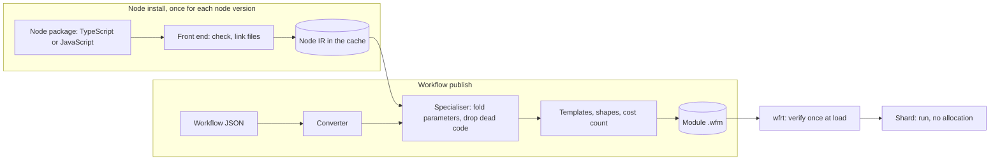

# Compiler plan: compile every workflow and every node at publish time

Status: plan, 2026-11-16. The first part is built (see "Built so far"). Numbers come from the corpus (147,671 workflows), the node sources
(3,803 files) and the runtime benchmarks of 2026-11-12 to 2026-11-16.

## Built so far (2026-11-16)

`src/node-compile/specialise.ts` is the first part of phases 1 and 2: the linker, the binding of `this`, the
folding of parameters and the removal of dead code. It writes a library module that the subset compiler
accepts with no change to that compiler.

- Input: the n8n source file of a node and the parameters of one node of a workflow. Output: a `defineNode`
  module for that node instance, or a list of the constructs that have no compiled form.
- Telegram (2,566 lines, 30 operations) for `message.sendMessage` becomes about 60 lines in 5 functions. On the
  three equivalence cases it sends the requests of v1, gives the output of v1, and the bytecode gives the result
  of the reference runner (`src/node-compile/__tests__/specialise.test.ts`).
- Compiled forms today: `getNodeParameter`, `getNode`, `getInputData`, `continueOnFail`, `getInstanceId`,
  `getCredentials` (fields become credential templates; the value as a whole is an error), the request helpers,
  `returnJsonArray`, `constructExecutionMetaData`, `helper.call(this, ...)`, `Object.assign` into an object,
  `delete` on a local, `list.push(...more)`, `pattern.test(text)`, `NodeApiError` and `NodeOperationError`.
- Weaker than v1, and listed in the `notes` of each result: the text of an HTTP error and of the two error
  classes; `delete` copies the object.
- The converter calls it (`ConvertOptions.nodeSources`). The order for a node is: a native lowering, then a
  library node (a hand port), then the node source, then the fallback host. The modules are in
  `ConvertResult.nodes`; give them to `compile` as `extraNodes`. Without `nodeSources` nothing changes.
- A credential field is a marker until the module is printed. Code that compares it or branches on it is an
  error. The check follows a field through the variables of one function, not into another function.
- More compiled forms: calls through a namespace (`import * as sheet`, the router layout of newer nodes),
  constant objects, `{ extractValue: true }` for the modes `id` and `list`, destructured credentials,
  `this.logger`, the error classes of n8n-workflow, `jsonParse`, `deepCopy`, lodash `isEmpty` and `get`.

### Rules adopted on 2026-11-16 (from the coding standards)

- **The v1 node is the reference model.** A node runs compiled only when its operation is in
  `src/node-compile/verified.generated.ts`. `scripts/verify-compiled-nodes.ts` makes that list: for each node
  type, version and operation it makes cases from the node description, runs the compiled node and n8n's real
  node code, and compares the requests, the output and the error message. A node instance must also set no
  parameter that the cases did not set. Each node is checked in a process of its own.
- **No approximation.** A form is exact or it is a compile error: `delete` is the `delete` of the subset; lodash
  `get` takes a constant path of names; a parameter that is an expression is a copy at each read; an HTTP error
  has the message of v1 for its status. A node with "continue on fail" or an error output stays in the host,
  because v1 gives the description of the error to the next node.
- **Credential fields.** The check follows a field through variables, members of objects, arguments and results
  of all functions of the module.
- **One translator.** The output of the node compiler goes through the translator of Code nodes
  (`src/convert/code-native/`, with `nodeCode`), which gives regular expressions, `Set`, `Map`, `for...in`,
  `var` and loose equality their subset forms.
- **Dates.** `DateTime` of Luxon uses the Luxon subset of the translator, with the workflow time zone as the
  default zone. A moment call chain that starts at `moment(x)`, `moment.utc(x)` or `moment.tz(x, zone)` and ends
  in `format`, `unix`, `valueOf`, `toISOString`, `isValid`, `isBefore`, `isAfter` or `isSame` becomes helper
  calls (`src/node-compile/moment.ts`). The zone and the format must be literals at compile time. The module
  gives its zones to the workflow option `zones`. The local zone of `moment(x)` is UTC, as for `Date`
  (spec 4.5): v1 uses the zone of its process. A moment in a variable, and each other method, is a compile
  error. At run time, a limit error stops a date that the helpers cannot prove equal: a date before 1970 in a
  time zone, a week date, a day-of-year date, a date with a month name and a time, and a local time less than
  two days after the first change of a zone offset in more than 400 days. The helpers agree with
  moment-timezone only where its zone data and the zone data of the runtime agree. The check runs v1 with a
  fixed clock when the compiled code reads the clock.

Result of the check over n8n-nodes-base (5,315 operations of all versions): 1,060 compile, and 734 of them
agree with v1 (79 node types). 278 compile and send other requests than v1: the gate keeps them in the host.

### Shipped JavaScript and n8n (2026-11-16)

- **The node compiler reads the JavaScript that ships.** n8n and node packages ship CommonJS (`dist/*.js`),
  and a custom node package often has no TypeScript source. `src/node-compile/commonjs.ts` reads the forms
  that `tsc` writes as a module. `scripts/verify-compiled-nodes.ts --dist` checks every node of
  n8n-nodes-base from its `dist`: 844 operations agree with v1 (854 from the TypeScript source).
- **n8n uses it behind a setting.** With `N8N_COMPILED_ENGINE_COMPILE_NODES=true`, the compiled-engine module
  gives the converter the file of each node class (from the module cache of Node.js, so community and custom
  packages count too), the node description and the public part of each credential, and gives the modules to
  `compile`. The key of the compile cache holds the public credential fields. The default is `false`.
- Not tested yet: a publish in a running n8n with the setting on. The unit tests of the module pass.

### Cost of a compiled node (2026-11-16)

`wfrt bench-node` on Telegram `message.sendMessage` with constant parameters, CPU for each execution on one
core (M5 Pro), against the hand port in `src/nodes/telegram.ts`:

| Module | CPU for each execution |
|---|---|
| Hand port | 1.5 to 2.0 µs |
| Compiled from the n8n code, first form | 21.8 µs |
| With constant arguments in helpers and pure calls evaluated at publish | 17.8 µs |
| With helpers inlined, the contents of new objects followed, and regular expression tests on constants evaluated at publish | 3.05 µs |

What the compiler does at publish, in `optimise` of `specialise.ts`:

- gives a helper the constant arguments that all its calls pass;
- evaluates a call of a pure function with constant arguments, and `pattern.test('text')`, in a sandbox that
  the caller gives (`evaluateInSandbox`, 100 ms);
- inlines a helper with one call, with new names for its variables;
- follows the members of an object that the function makes, through straight-line code, until the object goes
  to code that the compiler does not see.

After these, the check against v1 passes for 887 operations of 95 node types (854 of 88 before): the gate is
what makes an optimisation safe to add.

### Measured on real workflows (2026-11-16)

300 workflows of the corpus (3,702 nodes), converted with and without the node compiler, before the verified
list was a gate. With the gate, 5 nodes compile from their source in these workflows: the node types that real
workflows use most are the ones in the table of reasons below.

| | Without | With |
|---|---|---|
| Nodes in the fallback host | 739 | 722 |
| Nodes compiled from their source | 0 | 17 |
| Workflows with no host node | 94 | 95 |

The nodes that compile today are simple HTTP nodes (Telegram operations, Twilio, Facebook Graph, Monday).
The reasons for the others, by node count (a node can have several):

| Nodes | Reason | What closes it |
|---|---|---|
| 226 | A regular expression that is not `pattern.test(text)` | The regex helpers of the native Code path |
| 175 | The credential is used as a whole value (drivers, service accounts, signing) | Derived credentials; protocol clients |
| 146 | `Set` and `Map` | The subset or a helper type |
| about 190 | Binary data helpers and `Buffer` | Binary data handles in the runtime |
| 91 | `evaluateExpression` (SQL nodes) | Protocol clients, not the compiler |
| 91 | `this` passed as a value (helper classes such as `GoogleSheet`) | Classes as records of functions |
| about 100 | Luxon and moment-timezone | The date helpers of the native Code path |
| 66 | `new Promise` | Stays in the host |
| 48 | `getNodeParameter` with a name that is not a constant, or `extractValue` on a URL | Folding through loops; the patterns of the description |
| 41 | lodash `set` | A helper |

By type, the largest groups that stay in the host are Postgres, Microsoft SQL and MySQL (drivers), Gmail
and Email Send (MIME and binary data), Google Sheets (a helper class), Salesforce, Google Analytics and
BigQuery. These are also the candidates for a native port.

- Not built: lodash `set`, dates, crypto, `Map` and `Set`, other regular expression uses, binary data,
  classes, and the performance work of phase 3. n8n does not pass `nodeSources` yet.

## Goals

1. **Publish compiles everything.** When a user publishes a workflow, n8n compiles the workflow and each node
   that it uses to one module. The runner loads the module and runs only compiled code.
2. **New nodes compile when they are installed.** A node package goes through the same compiler. No node needs a
   hand port.
3. **100,000 workflows per second on one core** for `wfrt`.
4. **The runtime keeps the coding standards** (`workflow-runtime/docs/zig-standards.md`): all memory reserved at
   startup, data in tables, limits with counters, a deterministic core.

## The budget that decides the design

One core at 100,000 workflows per second gives 10 µs for each workflow.

| Item | Cost today | Source |
|---|---|---|
| W3: webhook, one outbound HTTP call, reply, no durable record | 8.87 µs | `progress.md` |
| The durable record on disk | about 2 µs (target with the ring: 1 µs) | `docs/ring-ingest.md` |
| One interpreted instruction | about 15 ns | `docs/aot-design.md` |
| Slack `message.post`, compiled into the binary | 14,000 cycles (about 3.5 µs) | `docs/aot-design.md` |
| Google Sheets read, compiled into the binary | 48,700 cycles (about 12 µs) | `docs/aot-design.md` |
| Google Sheets read, interpreted | 104,800 cycles (about 26 µs) | `docs/aot-design.md` |

Conclusions:

- The I/O of one HTTP call uses almost all of the 10 µs. The code of a node can use about 1 µs: about 70
  interpreted instructions, or about 4,000 cycles.
- Today's library nodes cost 4 to 25 times that, even when they are compiled into the binary.
- A node that is compiled at publish time cannot be in the binary. It runs in the interpreter. So the plan
  cannot depend on `wfrt aot-gen`.
- A workflow with two or more outbound calls cannot reach 100,000 per second on one core, whatever the
  compiler does. For those, the target is the I/O floor plus at most 1 µs for each node, and more shards.

So the compiler must remove work, not only translate it. The method is **specialisation at publish time**.

## Design

### 1. Front end: accept node source as it is written

- **Linker.** Follow relative imports (`GenericFunctions`, descriptions, `utils`) and keep only reachable code. A
  library module can import only from `@n8n/workflow-lang` today.
- **`this` is the context.** Compile `execute(this: IExecuteFunctions)` as a function with a context parameter.
  The class wrapper goes away (864 class declarations; 127 use `extends`).
- **Syntax to add:** `typeof` (1,446 uses), `delete` (991), `instanceof` (319), `Map` and `Set` (295), regular
  expression literals and `new RegExp` (435), `for...in`, labels, loose equality, `var`, getters.
- **Still rejected:** `eval`, `require`, dynamic `import`, `process`, file and network modules, timers, event
  emitters, streams, generators. A node that needs one does not compile (see "Nodes that do not compile").

### 2. Context calls become intrinsics

| Call | Uses | Compiled form |
|---|---|---|
| `getNodeParameter` | 11,600 | A constant, or the translated expression, at publish time |
| `getNode`, `getMode`, `getTimezone`, `continueOnFail` | about 3,200 | Constants at publish time |
| `getInputData`, `returnJsonArray`, `constructExecutionMetaData` | about 2,900 | Item tables of the runtime, with paired items |
| `helpers.request*`, `httpRequest*` | about 480 | The `http` effect |
| `getCredentials` | 383 | A credential template. Node code never reads a secret (see "Security") |
| `getWorkflowStaticData` | 246 | The static data table |
| `NodeOperationError`, `NodeApiError` | 2,240 throws | Error values with the messages and fields of v1 |

### 3. Specialiser: the step that makes 100,000 per second possible

A node is general code: 20 resources, 100 operations, all options. One node instance in one workflow uses one
operation with fixed parameters. At publish time the compiler knows the parameters, so it:

- folds each `getNodeParameter` to its value and removes the branches of the other operations;
- inlines the helpers that are left and runs constant folding again;
- builds **request templates**: the method, the URL, the headers and the body become constant bytes with
  numbered holes for the values that come from items. The runtime fills the holes. It builds no JSON tree;
- builds **response projections**: the list of paths that the rest of the workflow reads. The runtime reads
  only those paths from the response (`src/compiler/projection.ts` does this for workflow code today);
- gives each object literal a **shape** (a fixed key list), so that a property read is an index, not a key
  search.

Acceptance: the code that is left for one HTTP node instance is at most 70 instructions on the item path, with
no instruction that depends on the node's unused operations.

### 4. Two stages, so that publish is fast

- **Install time:** each node version compiles once to node IR (checked, linked, not yet specialised). The IR
  goes to a cache with the key `hash(node source, compiler version)`.
- **Publish time:** the converter and the specialiser read the IR. They parse no node source.
- Budgets: publish at most 250 ms at p50 and 1 s at p99 (today: 242 ms and 2.3 s, with a maximum of 36 s).
  Install at most 5 s for each node version. A compile over its budget fails with a message. It does not block
  the publish queue.
- The same input gives the same module bytes, so n8n can cache a module by the hash of the workflow version.

### 5. What the module must give the runtime (coding standards)

The runtime allocates nothing after startup. So the compiler computes the sizes, and the verifier checks them
at load:

| The compiler writes to the module | The runtime uses it to |
|---|---|
| Largest register window and call depth | Refuse a module that does not fit an execution region |
| Shape table: key lists, a fixed count | Fill a table that is reserved at startup; refuse at the limit (507) |
| Request templates and projections, with sizes | Write the request straight into the connection buffer |
| Constant pool, deduplicated | Share it across the executions of a module |
| A cost count for each step: instructions on the item path | Report it at publish; refuse or warn over the budget |
| Fuel for each basic block | Bound every loop |

- Every limit has a flag, a counter and a status at the limit, as the module table has today
  (`--max-modules`, `--module-store-mb`).
- The verifier stays the only trust point. It checks each template, shape and projection index. The
  interpreter then has no failure path except a limit.
- No new engine. The interpreter gets shape reads, template fills and projection reads as new instructions
  (a module format version bump). `aot-gen` stays as an optional gain for the nodes that ship with n8n.
- Item data moves towards columns: a projection gives the runtime a fixed set of fields for each item list, so
  it can hold a list as one column for each field (`src/core/columns.zig`), not as one object for each item.

### 6. Library that node code needs

- lodash (143 files): `get`, `set`, `omit`, `isEmpty`, `unset`, `pick`, `merge`, `isEqual` as prelude code.
- Dates (103 files use moment or Luxon): on the helpers of the native Code path.
- Crypto (83 files): hashes, HMAC and signatures as natives.
- Regular expressions: `test`, `match`, `replace` and `split` with a pattern, on the engine that exists.
- `Buffer` (137 files): with binary data handles (a separate plan).

### 7. Security

- A compiled program has no API of the system. It has values and `ctx` effects.
- Node code does not read credential values. The runtime puts them into requests.
- The outbound address rules, the limits for each execution and the verifier are in the runtime, because a
  module can be made by hand.

### 8. Nodes that do not compile

A node that uses a driver, a stream, a long-lived connection or an npm library does not compile. Publish then
gives one of two results, by a setting of the instance:

- **Native only:** the publish fails and names the node and the construct.
- **With the host:** that node runs in the fallback host, as today, and the publish result says so.

These nodes need runtime work, not compiler work: protocol clients (Postgres, SMTP first), binary data, poll
and webhook triggers, and the AI agent loop.

### 9. Binary data

**What the language has.** An item holds its files in the key `$binary` of its JSON, in the form of n8n:
`{ data, mimeType, fileName?, fileExtension?, fileSize?, bytes?, id? }`. `data` is base64 text, or the name of
the file store (`filesystem-v2`, `filesystem`) when `id` names a stored file. `ctx.http` sends files with
`multipart` and with `body: { $binary }` (spec 7.1). The runtime sends a stored file in pieces from the file store.
`responseBinary` stores the body of a response and gives a handle: metadata and an id, never the bytes.

**Built: uploads.** The compiler binds these calls. Each is exact, or stops with a `has no compiled form` error.

| v1 | Compiled form |
|---|---|
| `assertBinaryData(i, name)` | The entry of `$binary`, with the two error texts of v1 |
| `Buffer.from(text, 'base64')` | A handle `{ $bytes, data, length }`. No byte is decoded in the program |
| `getBinaryDataBuffer(i, name)` | The same handle. A stored file needs `bytes` for `length` |
| `getBinaryStream(id)` | A handle `{ $bytes, data: <store>, id }`, only for the file system stores |
| `getBinaryMetadata(id)` | The service call `binaryData.metadata` of the runtime: the JSON of the companion file |
| `formData` of `request` helpers | `multipart`, with the field rules of form-data 4 (below) |

- A handle is a value, not bytes. Code can read `length` and can put the handle into a form field. All other
  reads of a variable that holds a handle are compile errors (`toString`, an index, `slice`).
- Form fields: text and numbers are text parts. A handle is a file part. `options.filename` gives the base name.
  `options.contentType` gives the type. Without both, the type is `application/octet-stream`, as in form-data.
- These stop at run time: a file name without a content type (form-data reads a MIME table), a stored file
  without both options (form-data reads the path of the stream), `filepath`, `header`, and other value types.
- A handle as the whole `body` stops at run time. See "Raw bodies" below.
- `items[i].binary` reads `$binary`.

**Verification.** The v1 recorder gives an item its `$binary` as `binary`. For `formData` it calls the function
of n8n that makes the form-data, and it records each part from the bytes: name, file name, content type and
data. The check compares these with the `multipart` of the compiled node. An operation that reads a file gets
three cases: a file and a good answer, a file and status 400, and no file. v1 must succeed in the first case.

**Built: downloads (language, compiler and verifier).** `ctx.http` has `responseBinary` (spec 7.1): the
runtime stores the body of a 2xx response, and the body of the result is `{ $binary: <handle> }`.

| v1 | Compiled form |
|---|---|
| `encoding: null` (`request` helpers), `encoding: 'arraybuffer'` (`httpRequest` helpers) | `responseBinary: {}`. The result is a handle `{ $bytes, data, id, length }`, or `{ body, headers, statusCode }` with the full response |
| `Buffer.from(x)`, `Buffer.from(x, 'utf8')`, `binaryToBuffer(x)` | The same handle, when `x` is a handle. Only as the bytes of `prepareBinaryData` |
| `prepareBinaryData(bytes, fileName?, mimeType?)` | The entry of v1 for a Buffer: `mimeType`, `fileType`, `fileExtension`, `directory`, `fileName`, `fileSize`, `bytes`, with `id` and `data` of the handle |
| `lookup` of `mime-types` | The table of the package |
| An output item with `binary` | `$binary` in the JSON of the output item |

- The node code gives the names after the response, so the program makes the entry, not the runtime. The
  module holds the tables of `mime-types` (38 KB of text) only when it calls `prepareBinaryData` or `lookup`.
- These stop at run time: no MIME type and no known file extension (v1 reads the type from the bytes), a
  file name or a MIME type that is not text, a size of 1 TB or more (`pretty-bytes` rounds a logarithm
  there), and a MIME type with a character outside printable ASCII.
- `prepareBinaryData` of the bytes of an input item is a compile error. So is a `Buffer.from(x)` that does
  not go into `prepareBinaryData`.
- A request asks for bytes only in a module that makes binary data from a response (`prepareBinaryData`,
  or a Buffer for it). In another module `encoding: null` changes nothing, as before this work: the body is
  the JSON or the text that the runtime gives, and the verifier answers v1 in the same way.
- A handle inside the JSON of a request body or of an output item stops at run time (`__noBytes`). Only a
  module that holds file bytes has this check. A module without binary calls does not pay for it.
- The response of the compiled form has no `statusMessage`. v1 has it.
- The workflow setting `binaryMode: combined`: the converter keeps a node that uses binary data in the
  host (`tryCompiledNode`).
- A node that asks for response bytes stays in the host until the caller sets `NodeSources.storesResponses`.
  The n8n module sets it when the binary data mode is `filesystem`, the one store that the runtime has
  (`compiled-node-sources.ts`). In the other modes such a node stays in the host.

**Verification of downloads.** For a request that asks for bytes, the v1 recorder answers with a Buffer of
the body of the case. The recorded output of an item has its `binary` as `$binary`. The check replaces the
data of each entry with the SHA-256 of its bytes (v1: the base64 data; compiled: the hash in the `id`) and
compares the rest of the entry as it is. An operation that calls `prepareBinaryData` gets two more cases: a
file name with an extension and a `Content-Type`, and a file name without an extension.

**Built: the runtime stores a response (2026-11-16).** `workflow-runtime/src/shell/blob_store.zig`,
`src/core/binary_names.zig`.

- *Layout.* The file system backend writes what n8n's `BinaryDataBlobManager` and `FsByteStore` write:
  `workflows/<wf>/executions/<e>/binary_data/<uuid v4>`, written as `<uuid>.tmp.<pid>.<uuid>` and renamed,
  with no sync, then the companion `<uuid>.metadata` (`{"fileName","mimeType","fileSize"}`) in the same
  way. `<e>` is n8n's id for a manual run, else `wfrt-<runtime id>`, as the fallback host writes it: the
  n8n module moves the files when it saves the run (`compiled-binary-data.ts`).
  `compiled-binary-store-layout.test.ts` holds the texts of the real manager.
- *Paths.* An id from workflow data passes `binary_store.fileId` (six segments of `[A-Za-z0-9._-]`, never
  `.` or `..`). No operation takes a path: the store walks from the root one segment at a time with
  `openat` and `O_NOFOLLOW`. So no id leaves the root and no step follows a symbolic link. The read for
  an upload (`binary_store.read`) walks in the same way.
- *No blocking.* A transfer is a row with a phase. Each phase gives one file operation as data
  (`sys.FileOp`: mkdir, open, read, write, close, rename, unlink). On Linux the ring of the shard runs it
  (`uring.zig` `fileOp`), and the completion moves the row on. Without a ring (macOS, `--io poll`, a kernel
  that refuses the ring) `sys.fileOpNow` runs it at once: that path blocks the shard for the operation.
- *Names.* The rules of spec 7.1 are in the core: `Content-Disposition`, the MIME tables
  (`mime_tables.zig`, from the table of this package), the size text of `pretty-bytes`.
- *Limits.* `--binary-max-file-mb` (16), `--binary-max-transfers` (64), `--binary-buffer-mb` (32, the
  bodies that wait for their writes on the ring). Over a limit the step fails with an `http:` error. v1
  has no limit for a file of the file system store, so there is no v1 error to match.
- *A request without `responseBinary`* pays one branch at its start and one test at the head of its
  response (the kind of the body on HTTP/1.1, the row of the store on HTTP/2), and no memory. Without a
  storage path the shard has no store at all.

**Built: streaming in both directions (2026-11-16).** `blob_store.zig`, `egress.zig`, `request.zig`.

- *Downloads.* The body of a response goes to the store as it arrives, on HTTP/1.1 and on HTTP/2. No
  body is complete in a buffer of egress, so `--egress-max-body-mb` does not bound a stored file. When
  the store has no free block, an HTTP/1.1 connection is not read, and an HTTP/2 stream keeps the bytes
  that came in its response area and gets no window until the store has them.
- *Uploads.* A `$binary` body or a `multipart` part that names a stored file is not read into the
  request buffer. The request builder records the place of each file (`request.Files`, at most 8 for one
  body; more are read whole as before). The store opens each file for its size, so the request has its
  `Content-Length` before it goes out. Then the sender takes the file in pieces of one buffer
  (`sourcePeek`, `sourceTake`), on HTTP/1.1 and on HTTP/2. An upload has no size limit, as in v1. The
  read buffers are reserved at startup (8 for a shard); a file without a free buffer waits.
- *The limit that v1 does not have.* A response larger than `--binary-max-file-mb` fails its step, and
  the text ends with `(limit: binary-max-file)`. n8n reads that text: it keeps the node of that
  workflow in the fallback host, compiles the workflow again and loads the new module
  (`compiled-engine-sync.service.ts` `onRuntimeLimit`). So the next run has no limit. n8n stores the
  list of such nodes in one settings row (`compiledEngine.hostNodes`, at most 5,000 nodes), and reads
  it before the first compile after a restart. It also finds the text in an error item of a node
  under a "continue" setting.
- *The same run.* A compiled node that stores a response has its fallback-host form in the source too
  (`convert/steps.ts` `emitWithHostForm`). The module counts its requests: when every request before
  the failure was a GET, which v1 can send again, it marks the error (`RUNS_IN_HOST`), and the source
  runs the node in the host in the same run, under the step name `<node> (fallback host)`. When the
  node sent another request first, the error stays as it is: the run fails, or the node gives an
  error item, and n8n does not send the requests again. A node whose paired items a later node
  reads (`emitPairedStep`) runs in the host in the same run too: the host gives no paired items, so
  the later node pairs by position, as v1's engine does for a node that gives none. Only a module
  that can ask for the bytes of a response has this code (`marksFileLimit`). A node whose compiled
  form is a call for each item runs in the host: a call for one item does not know what the calls
  before it sent, and one call for all items needs its own check against v1 (`@oneCall`). The HTTP
  Request node of the library never stores a response: a file response runs in the host
  (`http-binary`), so it does not reach the limit.

**Not built.**

- *A retry in the fallback host of the step that reached the limit.* A compiled node is code of the
  module, not a step that the runtime can give to the host. The converter would have to write the host
  form of the node next to the compiled form, and run it only when every request that the node sent
  can go again (`GET`, `HEAD`, or a request with an idempotency key). Until then the first run fails.
- *A node under a "continue" setting* keeps the limit error in its item, so n8n does not see the text
  and the node stays compiled.
- *S3.* A second backend is another set of phases behind `reserve`, `put`, `nextDone` and `take`.
- *Sidecar names.* The runtime writes the companion file at the end of the download, with the names of the
  request. A compiled node gives its names later, in the program. Add an effect that writes the names of
  an entry (`ctx.binary`), or the UI of n8n shows the names of the request for such a file.
- *`getBinaryMetadata(id)` in the check against v1.* The compiled form is the service call
  `binaryData.metadata` (`blob_store.zig` `readMetadata`). The v1 recorder has no binary data store, so
  no case of the check has a stored file: the cases have base64 data, and they do not reach this call.
- *Raw bodies.* A handle as the whole `body` of a request stays a stop at run time in a compiled node.
  `ctx.http` has the form (`body: { $binary }`). First compare the content type that axios sends.

**Decisions that are open.**

1. Slack `file.upload` (2.2 and later) verifies with base64 data. With a stored file it reads the size
   with `binaryData.metadata`. That path has a unit test and no case in the check against v1.
2. `length` comes from the length of the base64 text. Text that is not valid base64 fails later, in the runtime.

## Proposal: fewer moves and undefined loads in the bytecode

Measured with `scripts/verify-compiled-nodes.ts --cost` (the counters of `src/testing/vm.ts`; one instruction
is one unit of fuel in `interp.zig`). GitHub `repository.get`, one item: 232 instructions. 53 are `MOV`, 27
are `LOADUNDEF`, 13 are `JMP`. These three are 40% of the run. The node compiler cannot remove them: they
come from `src/compiler/lower.ts`.

Where they come from:

1. **Call and inline staging.** An argument goes to a temporary, then to the argument window, then to the
   parameter register of an inlined function (`MOV r27, r12; MOV r29, r27; MOV r17, r29`).
2. **Results of inlined functions.** A `return` writes a result register, jumps to the end label and the
   caller copies the result again (`MOV r39, r20; JMP @155; MOV r18, r39`).
3. **Statement results and declarations.** Each statement and each `let` without a value emits `LOADUNDEF`,
   also when no instruction reads the register before the next write.
4. **Counter updates.** `i++` as a statement emits `MOV, TONUM, LOADI, ADD, MOV, MOV`: 6 instructions for 2.
5. **Jumps to the next instruction** after an `if` branch or an inlined `return` in tail position.

What the compiler must emit instead (the module format and the instruction set stay the same):

1. Copy propagation in each function after lowering. Replace the uses of a register that holds a copy with
   the source, when no write to the source or to the copy lies between. Then remove a `MOV` whose target is
   dead. `src/compiler/liveness.ts` has the liveness data.
2. Give an inlined parameter the register of its argument when the argument is a local that the callee does
   not write. Give the result of an inlined function the register that the caller wants.
3. Remove a `LOADUNDEF` when the register is dead, or when it is the first write to a register in a frame and
   the instruction is not in a loop. The interpreter sets all registers of a new frame to `undefined`
   (`interp.zig`, `@memset(... value.undef)`); the test VM does the same.
4. Emit `LOADI; ADD` for `i++` and `i += 1` when the value of the expression is not used and the operand is
   a number by its type.
5. Remove a `JMP` to the next instruction, and thread a `JMP` to a `JMP`.

Expected saving, from the same run: about 40 of 53 `MOV`, 22 of 27 `LOADUNDEF`, 5 of 13 `JMP` and 4 for each
loop turn. That is 65 to 70 of 232 instructions (28% to 30%) for a simple HTTP operation, and about the same
part for the hand-written library nodes, because the cause is in the lowering and not in the node code.

The Zig interpreter needs no change. The gate is the cost ratchet (`--check-cost`), the equality of the
reference runner and the bytecode in the existing tests, and the fuzz of the runtime. Item 3 needs one new
test: a register that a loop body reads before it writes must still get its `LOADUNDEF`.

**Status: done in `src/compiler/optimise.ts`**, a pass over each function after lowering. Differences from
the proposal:

- Item 2 has no change in the lowering. Copy propagation and the rule `OP t; MOV l, t` -> `OP l` give the
  same result.
- Item 3 uses data flow, not "not in a loop": a `LOADUNDEF` goes when the register is undefined on every
  path. The analysis forgets all at `CALL`, `SUSPEND`, `FORK` and `JOIN`.
- Item 4 does not trust the type. `TONUM` goes only when data flow proves that the operand is a number.
- No pass changes or removes `SUSPEND`, `FORK` or `JOIN`, and no copy crosses one. The named live registers
  of each resume point stay the same.
- `liveness.ts` had an error that the new code made reachable: a register that a handler reads was not live
  before an instruction of the try region that writes it. It is live now.
- The AOT table of the runtime finds a function by a hash of its code (`aot.zig` `hashFunc`). New code has a
  new hash, so `aot_gen.zig` must be made again (`scripts/aot-modules.ts`, then `wfrt aot-gen`). Until then
  the functions run in the interpreter.
- A module hash changes with the code. A parked execution holds the frames and the pcs of the module that
  started it, and its snapshot records that module hash (`core.zig` `SnapHeader`). It can resume only in
  that module. A publish of the new module is a new version.

## AI nodes: native library nodes (2026-11-17)

The AI nodes (`@n8n/n8n-nodes-langchain`) are built on LangChain classes, callbacks and closures. The node
compiler does not take them. Each AI node gets a hand-written library node (`src/nodes/`). The census and the
current coverage are in `docs/ai-node-coverage.md`.

### Shape

- **One call for all items.** The v1 AI nodes handle the items themselves: batches, "continue on fail", and
  n8n's "retry on fail" runs the whole node again. So a native AI node runs once for all input items. The
  converter gives the parameters of each item in `batch` (`input.map(...)`).
- **Vendor nodes** (`openAi`, `anthropic`, `googleGemini`; `VENDOR_NODES` in `src/convert/ai-cluster.ts`): the
  library node makes the `{ error }` item of an item that fails under a "continue" setting, as the v1 router
  does. The usual step code of the converter does the retry loop and the error output.
- **Cluster roots** (`chainLlm`, `agent`): a root gets its sub-nodes through `ai_*` connections. A library node
  has no connections. `nativeCluster` writes each supported sub-node into the parameters of the root: `aiModel`
  is the chat model. v1 reads the parameters of the model for the first input item only, so the converter
  evaluates them with the first item. `nativeCluster` accepts only the shapes that have a proof. For each
  other shape it gives a reason, and the whole cluster stays in the fallback host (`lowerAiNode`).
- **Result of a cluster root.** The library node gives one object: `items`, `runs` (the runs of the model
  sub-node, with the error of a failed run) and `error`. It does not throw for its own failure. The converted
  source traces the runs (`$subRuns`), runs v1's retry loop, then throws the error. So the run data has the
  failed run of the model as v1 records it.
- **Credential.** The credential of the call is the credential of the model sub-node. The LangChain client
  of OpenAI sends the key and the custom header of the credential, and no organization. Without an
  organization the injection of the credential type gives exactly that. With an organization the node names
  the key itself (`inject: false`). The node reads one credential flag for this (`ctx.credentialFlag`). A
  credential with an organization and a custom header has no proof: the guard of the flags names the node, and
  the caller runs it in the host (`unprovenFlagNodes`).
- **One file for two roots.** A library node is one file, and the compiler links one file for each node type.
  A Tools Agent without tools is one call of the model, as the chain is. So `chain-llm.ts` is the library node
  of both (`kind: 'agent'`), and the converter links it for the agent. When the agent gets tools, move the
  request builders to a shared library module (this needs imports between library files in the linker).

### What v1 does, part by part (read from the node sources and from recordings)

- **Parameters.** The `Workflow` constructor of n8n drops the parameters that the node type hides
  (`displayOptions`) and fills the defaults of the members of a fixed collection. The converter does the same
  for the root and for each sub-node (`hideParameters`).
- **Expressions.** An expression that finds no value gives undefined; so does an expression that throws a
  TypeError. The JSON value null stays null: a null prompt goes to the model as the text "null".
- **Basic LLM Chain.** For each item: the message list (system, AI, user), then the prompt as a user message.
  No template variable applies to the text. One model call. The output is `{ text }` with the text trimmed.
  From version 1.7 the items run in batches (default 5): a batch sends all its requests, then the first
  failure in item order stops the node. A wait follows each batch (`delayBetweenBatches`).
- **Tools Agent, versions 2 to 3.1, without tools.** The messages are: the system message when
  `options.systemMessage` has a value (no default text), then the prompt. One model call with `stream: false`.
  The output is `{ output }`: a Chat Completions answer as it is (not trimmed); the text parts of a Responses
  answer joined and trimmed. `intermediateSteps` is an empty list with `options.returnIntermediateSteps`.
  Batches as the chain, with a default size of 1. Before version 3 the agent refuses a model that asks for the
  Responses API. Version 3 also stores the first output as execution custom data
  (`autoSaveHighlightedData`); the native node does not (see the differences).
- **Tools Agent, versions 1.6 to 1.9.** They ask the model for a stream (`stream: true`). Not native.
- **Tools Agent with tools.** The system message, the chat history from the memory, the prompt, then the
  scratchpad (tool calls and results). Each tool is a function schema of the provider. With an output parser
  the agent adds the tool `format_final_json_response`. The loop stops at `options.maxIterations` (default 10)
  with "Max iterations (N) reached...". Version 3 gives the tool calls to n8n's engine as requests; versions
  1 and 2 run the tools inside LangChain's executor.
- **OpenAI chat model (`lmChatOpenAi`).** LangChain `ChatOpenAI` with `fetch`. Version 1.3 uses the Responses
  API by default (`POST /responses`: `input` messages, `text: {}`, `max_output_tokens`). Versions 1 to 1.2 use
  Chat Completions (`messages`, `max_tokens`), but LangChain picks the Responses API itself for some model
  names. For a reasoning model (`o1`, `gpt-5`, not `gpt-5-chat`) a system message has the role `developer` and
  Chat Completions gets `max_completion_tokens`. The headers are the bearer token and `openai-platform`.
- **OpenRouter chat model.** The same client with the URL and key of its credential, without `openai-platform`.
- **Failures of a model call.** Status 400 to 407, 409 and 413: no second try; the message is the message of
  n8n's `NodeApiError` for the status. Status 429: no second try; the rate-limit message of the OpenAI nodes.
  Other statuses: LangChain tries again `maxRetries` times (default 2). It waits 1 to 2 seconds (random)
  before the second try, and doubles the wait for each later try. Then the message of the client
  (`500 <message>`). The native node waits with `ctx.wait` and `ctx.random`.
- **Vendor nodes.** n8n's request helper with the credential type. A failed request gives the `NodeApiError`
  message for the status. The helper of `anthropic` and `googleGemini` sends a request again, once, after a
  401 answer. `anthropic` asks again after a paused turn (three times at most).
- **Token usage.** v1 records it on the run of the model sub-node, not in the output items. Not reported.

### The vendor simulator

The test bed answers the provider APIs from a simulator, so the native node must send the request that v1
sends. The simulator is not on this machine. The proof here is the recording of the real v1 node in n8n's
engine: for every case the test compares the method, the URL, the JSON body (key by key, with `stream`, the
message order and each default) and the headers after the credential is applied. Headers that name the client
library (`user-agent`, `x-stainless-*`, `accept`) are not compared; a compiled node does not send them.

### Memory: the window buffer memory (off by default; the store is a service, not built)

**What v1 keeps and where.** `memoryBufferWindow` keeps all messages of a session in the memory of the n8n
process that runs the node: a map with the key `<workflow id>__<session key>`. Nothing is in the database, and
a restart of n8n forgets it. At each use of a memory node (`getMemory`) v1 first drops every session that no
agent used for more than one hour, then makes the session when it is not there. The window
(`contextWindowLength`) is fixed when the session is made. The agent reads the memory sub-node once for a run,
with the first input item. For each item it reads the last `window` exchanges before the model call and adds
one exchange (prompt, answer) after it. Two runs that use one session at the same time share the one object
in the process: each reads at the start of its item and adds at its end, so the exchanges are in the order in
which the answers come. v1 has no limit on the count of sessions.

**The native form** (`chain-llm.ts`, parameter `aiMemory`) keeps nothing. It asks the service `chatMemory`
(`ctx.service`, spec 9.9): `open { sessionKey, window }` once for a run, `load { sessionKey }` (gives
`{ messages: [{ ai, text }] }`, the window) before the model call of an item, `save { sessionKey, input,
output }` after it. The node gives the runs of the memory sub-node (`memoryRuns`). Order for one item: the
prompt check, the read, the model, the write. Versions 3 and 3.1 do not write an empty answer; versions 2 to
2.2 do. A failed item writes nothing. An empty session key fails before `open` with "Error in sub-node <name>"
and the description "Key parameter is empty". The cases of `ai-cluster.test.ts` prove the requests, the
outputs, the errors and the runs against v1 recordings, with a store of the test that has the rules above.

**Switch.** `ConvertOptions.chatMemory` (default false). Without it the cluster runs in the fallback host,
as before: nothing ships with a store that differs from v1. The first form of this node kept the window in
the workflow static data (the database, kept over a restart, 1,024 sessions, last writer wins). It is gone.

**The store that the service needs (not built).** One session table in process memory, not in the log of the
runtime and not in static data:

- Key: workflow id (of the execution, never from the args) and session key. Value: the window of `open`, the
  time of the last `open`, and all messages, as v1 (the count of messages of a live session has no limit in
  v1; the table counts their bytes).
- `open`: drop every session whose last `open` is more than one hour ago, then make or touch the session.
  `load`: the last `2 * window` messages. `save`: add two messages. The table runs the calls in the order in
  which they come: that is the overlap rule of v1.
- A restart of the process that holds the table forgets it, as v1.
- **Bound.** The table has a byte limit. v1 has none, so the table must not fail and must not drop a live
  session. When the limit is reached, `open` of a session that is not in the table answers `{ host: true }`,
  and that run of the cluster goes to the fallback host, where the v1 node keeps the session in the host
  process. The table keeps one time: the last `open` that it sent to the host. It takes new sessions again
  only when that time is more than one hour ago; then every session of the host is idle for more than one
  hour, and v1 drops it at its next use. So no session has messages in two stores.
- **The gate is the missing part of the converter.** `lowerNativeCluster` must write both forms, the library
  call and the host call, and take the host call when `open` answers `{ host: true }`. Today it writes one
  form. Until then, set `chatMemory` only for a store without a limit.
- **Where.** Two choices; the first is the recommendation.
  1. In the client that answers services (n8n: a service next to `engine-data-tables.service.ts` in
     `packages/cli/src/modules/engine-v2/`; the test bed: the engine-test adapter). All shards of `wfrt`
     reach the one table, because every `service` event goes to the one client. A restart of n8n forgets the
     sessions, exactly as v1. `wfrt` needs no change: `startService` in
     `workflow-runtime/src/shell/server.zig` carries the call.
  2. In `wfrt` (the request of the project owner): a table in `workflow-runtime/src/shell/` that
     `startService` answers itself for `chatMemory`, with no event. With several shards, the table must be
     one for the process, behind a lock, or the call must go to the shard `hash(workflow id, session key) %
     shards`; a workflow lives on one shard, but two workflows never share a session, so one table for each
     shard is exact when the shard of a workflow does not change. A move of a workflow to another shard must
     move its sessions or wait one hour. A restart of `wfrt` then forgets the sessions; v1 forgets at a
     restart of n8n.
- **The host must use the same store** when a workflow has one agent in the host and one native agent with
  the same session key: v1 gives both the same session. The host can call a service
  (`packages/@n8n/workflow-fallback-host/src/service-calls.ts`, `hostService` in `server.zig`). Until the
  host does that, the converter must keep every agent of a workflow in the host when one memory cluster of
  the workflow is there. This check is not built.
- **Replay.** The result of a service call is in the log of the execution (`load` gives chat text: v1 has
  the same text in the run data of the memory sub-node of a saved execution). After a crash, `open` and
  `load` can go again (add them to the read-only list of spec 9.9); `save` cannot, and the execution ends with
  `needs_attention`, as each write of a service.

Native with the switch: agent 2 to 3.1, memory versions 1 to 1.3 with a session key (`customKey`, or
`sessionKey` before version 1.2), a window of 1 to 1000, batch size 1. In the host: the session of the chat
trigger (`fromInput`: v1 reads the trigger and adds the node name), a window of 0, a batch size above 1 (v1
reads for all items of a batch before the first write), a key expression with a retry or a "continue" setting
(no proof of the memory error there), `maxTokensFromMemory`, and the database memories.

### Known differences from v1 in the native nodes

- **Execution custom data (agent versions 3 and 3.1).** v1 stores the first output of the agent as execution
  custom data (`options.autoSaveHighlightedData`, default on; n8n shows it on the execution and
  `$execution.customData` reads it). The runtime has no execution custom data (spec 9.6: not built), and
  the fallback host gives a step an empty `customData` and drops what the step writes. So the agent in the
  host loses the value too: the host is not more exact than the native node. What the runtime lacks: an
  effect that sets a key of the execution custom data, and n8n that stores it on the execution.
- **A request without an answer.** The native nodes read the code of Node.js (`ECONNREFUSED`, ...) from the
  text of the effect error, as the HTTP Request library node does, and give the v1 message for it. This
  holds when the runtime writes that code in the text.
- The custom error texts that v1 makes from the code of an OpenAI error in the vendor node were not seen in
  the recorder (its failed answer has no error code at the place where the node looks).

Closed and proven against the engine: a tool call of the model for an agent without tools (version 3: the
engine runs the agent again, up to `maxIterations`; version 2: LangChain answers "... is not a valid tool" and
calls the model again), and a request without an answer under each error setting (the vendor nodes give
n8n's message for the code; the chain and the agent give "Connection error." or "Request timed out." after
the tries of LangChain). An agent before version 3 with `returnIntermediateSteps` stays in the host: a tool
call there is a step with LangChain objects in it.

### Not native yet, in order of workflows

1. Chat models `lmChatAnthropic`, `lmChatGoogleGemini`, Azure and others: a request builder and an answer
   reader each (the recorder catches `fetch` for all of them). `lmChatAnthropic` has thinking modes and a
   list of models that take no sampling parameters.
2. Structured output parser: the JSON schema check, the format instructions, and the auto-fix call.
3. Tools Agent versions 1.6 to 1.9: the answer is a stream (server-sent events).
4. Tools Agent with tools: see "Tools" below.
5. `informationExtractor`, `textClassifier` (a chain with a fixed prompt and a parser).
6. Other operations of the vendor nodes (image, audio, document, file).
7. `options.reasoningEffort`, `responseFormat`, `textFormat` and built-in tools of the OpenAI model.
8. Vector stores, document loaders and text splitters.

### Tools (plan; not built)

Facts of v1 from recordings (`TOOL_PROBE_CASES` in `ai-cases.ts`; the recorder now loads the tool form of a
node, `<type>Tool`, and gives the model and the tools one list of answers):

- **Schema** (OpenAI Chat Completions): `tools: [{ type: 'function', function: { name, description,
  parameters, strict: false } }]`. The name is the node name with `_` for each other character. The
  description is `toolDescription`. `parameters` is the JSON schema of the `$fromAI` calls of the node:
  `{ type: 'object', properties: { <key>: { type, description } }, required: [<keys without a default>],
  additionalProperties: false, $schema: 'http://json-schema.org/draft-07/schema#' }`. The Code tool without
  an input schema has `properties: { input: { type: 'string' } }` and no `required`.
- **Order**: the model, each tool of the answer, the model again with the same `tools`.
- **Messages of a call**: versions 2 to 2.2 send `{ role: 'assistant', content: '', tool_calls }`; versions 3
  and 3.1 send `content: []`. `arguments` is the JSON text of the parsed arguments. The result is
  `{ role: 'tool', content, tool_call_id }`; for the HTTP Request tool `content` is the JSON text of the
  output items of the node.
- **Steps** (3.1, `returnIntermediateSteps`): `{ action: { tool, toolInput, log: 'Calling <node name>',
  messageLog: [<the AI message as LangChain writes it>], toolCallId, type: 'tool_call' }, observation }`.
- **Runs**: one run of the tool sub-node for each call, with its error.

Work, in order:

1. **The loop in the converted source.** A library node cannot call a node. `lowerNativeCluster` must write the
   loop: a call of the library node for one turn of the model (new parameters: `tools`, the schemas, and
   `steps`, the calls and results so far, for each item), then one step for each tool call, then the next
   turn. Version 3 runs all items again after the tools, and counts `maxIterations` for the node; version 2
   loops for each item. `chain-llm.ts` must give the calls of a turn in place of `again`.
2. **`$fromAI` in the expression translator** (`src/convert/expression.ts`): in a tool step, `$fromAI(key,
   description, type, default)` reads `key` of the arguments of the call, or the default. The same parse gives
   the schema. v1 gives the tool node one item with the arguments.
3. **A tool as a step.** The tool node goes through its usual lowerer (library node, compiled node, native
   Code node) with the arguments as its input item. A tool that only the host can run keeps the whole cluster
   in the host.
4. **Recorder.** The Code tool needs a task runner (`startRunnerTask` of the recorder is not there), so it
   has no recording yet. The workflow tool needs `executeWorkflow`.
5. **Other providers.** The Responses API (`function_call` items and `function_call_output`), Anthropic
   (`tools` with `input_schema`, `tool_use` and `tool_result` blocks) and Gemini (`functionDeclarations`,
   `functionCall` and `functionResponse` parts; its schema has no `additionalProperties` and no `$schema`
   — to confirm with a recording). Each needs its probe case first.
6. **Memory with tools.** v1 keeps the calls and results of a turn in the session (`saveToMemory` with steps).

## Phases

| Phase | Work | Done when |
|---|---|---|
| 0 | Cost count for each step; `wfrt bench-node` as an instruction-count gate | Publish prints the count; CI fails on a 2% rise |
| 1 | Linker, `this` binding, `getNodeParameter` folding, dead-code removal | Slack, Airtable and Telegram compile from their n8n source and pass their equivalence cases |
| 2 | Request helpers, error classes, item helpers, the cheap syntax, lodash prelude | 50 HTTP-only nodes compile from source; requests equal v1 on recorded cases |
| 3 | Request templates, response projections, shapes; module format version 2 | One HTTP node instance costs at most 4,000 cycles in the interpreter |
| 4 | Node IR cache and the install-time step; publish budgets | Publish p99 under 1 s on the corpus; a custom node package compiles at install |
| 5 | Credential templates for `getCredentials` | No compiled node reads a secret; the 383 call sites compile or are listed |
| 6 | Regular expression methods, `Map` and `Set`, crypto, dates | The 150 HTTP-only nodes and the local data nodes compile |
| 7 | Column item lists from projections | Item path cost does not grow with the count of unused fields |

Each phase keeps `./ci.sh merge` green, adds no lint finding, and replays the certified bundles with no bundle
worse than before.

## Risks

- **v1 equivalence.** A specialised node must send the requests that v1 sends. The recorder
  (`scripts/record-v1-requests.ts`) is the oracle; it needs cases for each operation, made by a tool, not by hand.
- **Node versions.** A node has several versions with different behaviour. The IR is for one version each.
- **Publish-time expressions.** A parameter that is an expression is not a constant. The specialiser folds
  around it; a resource or an operation that is an expression keeps all its branches.
- **The 100,000 target.** It holds for a workflow with one outbound call. The plan does not change the cost of
  I/O; `docs/ring-ingest.md` and the egress work do that.
