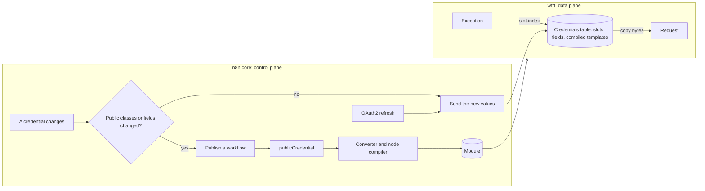
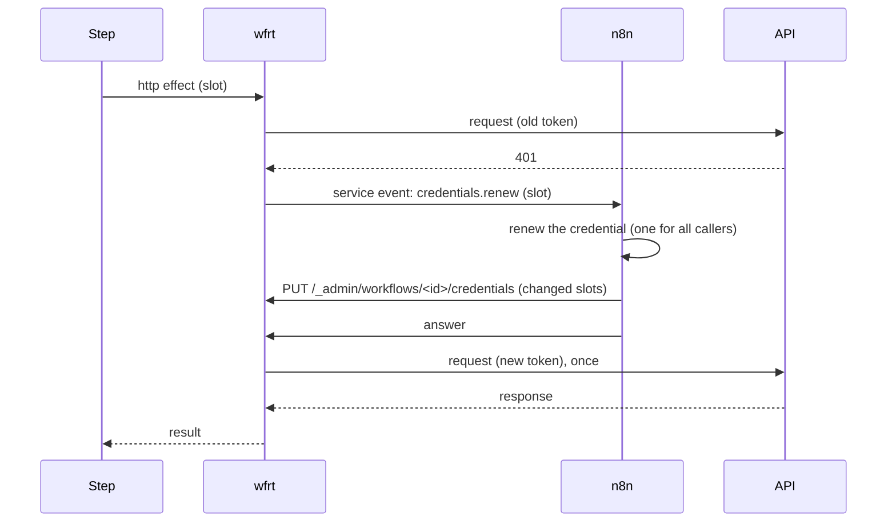

# Credentials in compiled nodes, and what n8n core does

Status: 2026-11-16. The compiler part is built (`src/credentials/public.ts`, `src/node-compile/`). The n8n and
runtime parts are a plan. This document adds to spec section 7; it does not change the credentials file.

## The rule

A compiled module never holds a secret, and node code never reads one. Each field of a credential is one of two
kinds:

| Kind | Which fields | What node code can do | Where the value is |
|---|---|---|---|
| Public | A choice (`options`), a flag (`boolean`), and text whose name is an address or a place (`baseUrl`, `subdomain`, `region`). Never a field that n8n marks as a password, and never a name with `key`, `token`, `secret`, `password`, `private` or `certificate` | Read it, compare it, branch on it | A constant in the module, set at publish |
| Template | Every other field | Put it into the URL, a header, the query or the body of a request | Only in the credentials table of the runtime |

- `publicCredential(type info, data)` gives the public fields and their classes. n8n calls it; the converter gets
  only its result (`NodeSources.publicCredential`), so the converter never sees a secret.
- The compiler folds a public field like a parameter. A branch on `authentication`, `useShared` or `environment`
  is gone from the module.
- A template field is a marker until the module is printed. A condition that has only template fields and
  constants becomes a flag (see "Credential flags"). Each other comparison, condition or `typeof` on a template
  field is a compile error. The check follows the field through variables, members, arguments and results.
- The verified list holds the classes of the public fields of each check (`@type.field=value`, text as `set` or
  `empty`). A node runs compiled only when its credential has classes that were checked against v1.

Result on n8n-nodes-base: 854 operations of 88 node types compile and agree with v1 (734 of 79 without public
fields).

## Credential flags

Some v1 nodes branch on a field that is not public. Examples: `if (apiToken.length < 64)`, `if (credentials.url)`,
`rejectUnauthorized: !credentials.allowUnauthorizedCerts`. The module cannot hold the outcome, because the
outcome changes when the credential changes. A flag gives the outcome to node code at run time.

- **What a flag is.** A flag is the boolean outcome of one condition. The condition has only credential fields,
  constants, comparisons, `!`, `&&`, `||`, `typeof`, `length` and a fixed list of text methods. The compiler
  writes the condition as code (`(c) => (c.apiToken.length < 64)`) and gives it a name: `f` and eight hex
  digits of the hash of the code. A derived text value has the prefix `d`, so the two names never collide.
- **Where n8n computes it.** `evaluateCredentialFlags` runs the code where the credential is stored, in the
  same sandbox as a derived value. The result must be a boolean. n8n writes it to
  `data.n8nDerived.<name>` of the credentials document. A condition that fails or gives another type has no
  flag. n8n logs the count of flags that it withholds. n8n does not log a name or a value.
- **How node code reads it.** `ctx.credentialFlag(credential, '<name>')` returns the boolean. The call throws
  when the flag is not there. This is the only read of a credential value in node code. The validator accepts
  the call only in a library node, and only with the slot variable and a constant name of the form
  `f` and eight hex digits (`WL012`). The META of the module lists each name (`credentialFlags`).
- **What a flag reveals.** A flag reveals the outcome of one condition, one bit, to node code. Node code can
  use the bit as a value: it can go into a request or the output. The module file holds the code of the
  condition and no bit of the credential. Thus a module stays valid when a secret changes.
- **Limits.** One node instance has at most 16 flags; more is a compile error. A flag is always a boolean. A
  `switch` on a field and a comparison of a field with a value of the run are not flags: they stay compile
  errors. A condition on a public field folds at publish and makes no flag.
- **Verification.** The verifier computes the flags from the test credential. It then changes one field of
  the test credential at a time (empty, long, absent, the other boolean) to get other flag values, and compares
  each with v1. The verified list holds each set of values that agrees with v1
  (`@flags=f2ad9326f:0`, `@flags=f2ad9326f:1`). The converter gives these sets to n8n as a guard. n8n writes
  the flags of a node instance only when their values are one of the sets. For other values, the node fails
  with "The credential has no value for a condition of this node".

What the runtime must do (not built, `workflow-runtime` is a different card):

- `src/core/lib.zig`: add the native `ctx.credentialFlag(slot, name)`. Accept a name only when it has the form
  `f` and eight hex digits and when the META list `credentialFlags` of the module has it. Return only a JSON
  boolean. Throw an Error with the message above for each other case.
- The core has no credentials. The shell must give the flags to the core when an execution starts (as it gives
  the static data): for each slot of the workflow, the members of `data.n8nDerived` that have a flag name and a
  boolean value. The execution keeps this copy, so a replay takes the same branches after a credential
  changes.
- A flag is not in a log. The copy of an execution is in the event log only as booleans by name.

## Control plane and data plane

The target is 100,000 workflows for each second on one core, 10 µs for each workflow. One call to n8n for a
credential costs more than that, so the runtime never asks n8n for a credential on the path of an execution.



### What n8n core does

| Event | n8n core | Cost |
|---|---|---|
| Publish | Decrypts each credential of the workflow, calls `publicCredential`, converts, compiles, loads the module, sends the credentials document (as today) | Once for each workflow version |
| A credential is saved | Compares the public fields with those of the last publish. Changed: republish every workflow that uses the credential. Not changed (a secret was rotated): send the new values only | Once for each change |
| A credential value expires (OAuth2 token, minted token, session token) | The runtime asks for a renewal (see "Renewal"). n8n renews the credential once and sends only the new values. Requests that wait for the same slot go again after one renewal | Once for each expiry, not for each request |
| An execution | Nothing | 0 |

n8n must keep, for each published workflow version, the hash of the public fields of each credential that it
used. That is what tells a rotation from a change of meaning. The module identity includes that hash, so two
workflows with the same node and other credential settings get other modules.

### Renewal (built)

One protocol renews every credential value that expires. The secret stays in n8n.

**Which slots.** n8n adds a `renewal` member to a slot of the credentials document when it can renew the slot:

```json
"<slot>": { "type": "…", "data": { … }, "inject": { … },
            "renewal": { "status": [401], "expiresAt": 1794845744000 } }
```

- `status`: the response statuses that mean "the value expired". For OAuth2 it is `tokenExpiredStatusCode` of
  the credential, else 401, as in `requestOAuth2` of n8n-core. For the other kinds it is 401. At most 8.
- `expiresAt`: the time in milliseconds at which the value expires. n8n sets it for minted tokens only.

| Kind | What n8n does for a renewal | v1 code with the same effect |
|---|---|---|
| OAuth2 (also the client-credentials grant) | `refreshOAuth2Token` of n8n-core, which saves the token | `requestOAuth2`, after a 401 |
| Minted Google service-account token | Signs and exchanges a new token | `getGoogleAccessToken`, for each request |
| Credential type with `preAuthentication` and an expirable property | `CredentialsHelper.preAuthentication` with `expired = true`, which saves the token | `httpRequestWithAuthentication`, after a 401 |

**When the runtime asks.**

1. Before a request: the value expires in less than 60 seconds. The check is one comparison of the clock with
   the first expiry of the document.
2. After a response with a status of `status`.

In both cases the request waits, the runtime sends a service call, and the request goes when the answer comes.
A request gets at most one renewal and one resend: a second expiry status goes to the step. A request with a
multipart body gets the renewal and no resend, as in v1. All other requests are sent again, also POST, as in v1.

**The call.** `{"service":"credentials","op":"renew","args":{"credentialId":"<slot>"}}` on the service channel
(spec section 9.9). The call id is the id of the `http` effect. The shard does not block: the request is a row
of a table (`renew.zig`) until the answer comes.

**What n8n does.**

1. It finds the credential of the slot in the loaded workflow. Another credential is refused.
2. It renews the credential. Calls for the same credential at the same time share one renewal.
3. For each loaded workflow that uses the credential (also a manual run), it builds the slots of that credential
   and sends them: `PUT /_admin/workflows/<id>/credentials`. The body has only these slots. The runtime puts
   them into the document of the workflow. The module and the other slots stay. Minted tokens are made once
   for a renewal and shared by the workflows.
4. It answers the call. On an error the answer has the message, and the step fails with it.

**The timer.** For a published workflow with minted tokens, n8n starts the same renewal 5 minutes before the
first expiry. This is an optimisation: requests do not wait. Without the timer the runtime asks by itself.

**Limits.** The runtime keeps at most `--max-renewals` requests (default 256) with args of at most
`--renewal-kb` KB (default 64). A request above a limit runs without a renewal. n8n runs at most 1,024
renewals at the same time. Requests in the runtime share a renewal for each workflow and slot; n8n shares it
for each credential.



### What the runtime does (plan)

Today `src/shell/creds.zig` keeps the document as a JSON tree and searches it by slot name and field path for
each template of each request. For the budget and for the coding standards it becomes a table:

- **Capacity at startup.** A fixed count of slots and a fixed size of value bytes, from flags, with a counter and
  a 507 answer at the limit, as the module table has.
- **Templates compiled at load.** When a module loads, each credential template of its requests and each `inject`
  entry becomes a list of segments: constant bytes, or a field of a slot by index. A request then copies bytes.
  It parses no template and searches no name.
- **Slots by index.** The module names a slot by a small integer that the loader checks. A module can read only
  the slots of its own workflow.
- **Replace without a stop.** New values for a slot go into free space, and one index write makes them current.
  An execution in flight keeps the bytes that it started with until its request is written.
- **No value in a log.** As today: messages name the slot and the field, never a value. The table is not in a
  snapshot or in the execution log.

## What is not solved

- **Flag values that are not checked.** When a credential changes to flag values that the verifier did not
  check, n8n withholds the flags and the node fails. n8n must instead publish the workflow again with the node
  in the fallback host.

- **Whole credentials.** 765 operations pass the credential object to a helper or read a field by a computed
  name. The compiler needs to follow the object into the helper, as it follows a field today.
- **Signing.** AWS signatures, JWT for service accounts and HMAC need the secret in a computation. They need a
  native signing step in the runtime that takes a slot and gives a header. Node code still does not see the key.
- **Drivers.** Postgres, MySQL, Redis and SMTP read the whole credential to open a connection. They need a
  protocol client in the runtime that takes a slot.
- **Encryption at rest** of the credentials table across restarts (card ENCRYPT in `progress.md`).
- **A wrong class.** A field that is a secret and has a public type and a harmless name would be in the module.
  The name rule is a second guard, not a proof. A review of the credential types that have public text fields is
  open.
