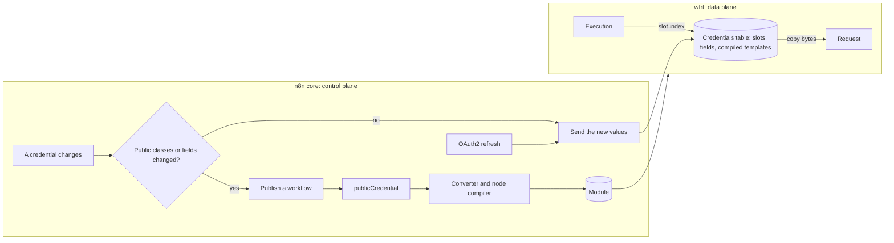

# Credentials in compiled nodes, and what n8n core does

Status: 2026-11-16. The compiler part is built (`src/credentials/public.ts`, `src/node-compile/`). The n8n and
runtime parts are a plan. This document adds to spec section 7; it does not change the credentials file.

## The rule

A compiled module never holds a secret, and node code never reads one. Each field of a credential is one of two
kinds:

| Kind | Which fields | What node code can do | Where the value is |
|---|---|---|---|
| Public | A choice (`options`), a flag (`boolean`), and text whose name is an address or a place (`baseUrl`, `subdomain`, `region`). Never a field that n8n marks as a password, and never a name with `key`, `token`, `secret`, `password`, `private` or `certificate` | Read it, compare it, branch on it | A constant in the module, set at publish |
| Template | Every other field | Put it into the URL, a header, the query or the body of a request | Only in the credentials table of the runtime |

- `publicCredential(type info, data)` gives the public fields and their classes. n8n calls it; the converter gets
  only its result (`NodeSources.publicCredential`), so the converter never sees a secret.
- The compiler folds a public field like a parameter. A branch on `authentication`, `useShared` or `environment`
  is gone from the module.
- A template field is a marker until the module is printed. A comparison, a condition or a `typeof` on it is a
  compile error. The check follows the field through variables, members, arguments and results.
- The verified list holds the classes of the public fields of each check (`@type.field=value`, text as `set` or
  `empty`). A node runs compiled only when its credential has classes that were checked against v1.

Result on n8n-nodes-base: 854 operations of 88 node types compile and agree with v1 (734 of 79 without public
fields).

## Control plane and data plane

The target is 100,000 workflows for each second on one core, 10 µs for each workflow. One call to n8n for a
credential costs more than that, so the runtime never asks n8n for a credential on the path of an execution.

### What n8n core does

| Event | n8n core | Cost |
|---|---|---|
| Publish | Decrypts each credential of the workflow, calls `publicCredential`, converts, compiles, loads the module, sends the credentials document (as today) | Once for each workflow version |
| A credential is saved | Compares the public fields with those of the last publish. Changed: republish every workflow that uses the credential. Not changed (a secret was rotated): send the new values only | Once for each change |
| An OAuth2 token expires | The runtime gets 401 (or the status in `tokenExpiredStatusCode`), calls `refreshOAuth2` with the credential id, n8n refreshes and sends the new token. Requests that wait for the same slot go again after one refresh | Once for each expiry, not for each request |
| An execution | Nothing | 0 |

n8n must keep, for each published workflow version, the hash of the public fields of each credential that it
used. That is what tells a rotation from a change of meaning. The module identity includes that hash, so two
workflows with the same node and other credential settings get other modules.

### What the runtime does (plan)

Today `src/shell/creds.zig` keeps the document as a JSON tree and searches it by slot name and field path for
each template of each request. For the budget and for the coding standards it becomes a table:

- **Capacity at startup.** A fixed count of slots and a fixed size of value bytes, from flags, with a counter and
  a 507 answer at the limit, as the module table has.
- **Templates compiled at load.** When a module loads, each credential template of its requests and each `inject`
  entry becomes a list of segments: constant bytes, or a field of a slot by index. A request then copies bytes.
  It parses no template and searches no name.
- **Slots by index.** The module names a slot by a small integer that the loader checks. A module can read only
  the slots of its own workflow.
- **Replace without a stop.** New values for a slot go into free space, and one index write makes them current.
  An execution in flight keeps the bytes that it started with until its request is written.
- **No value in a log.** As today: messages name the slot and the field, never a value. The table is not in a
  snapshot or in the execution log.

## What is not solved

- **Whole credentials.** 765 operations pass the credential object to a helper or read a field by a computed
  name. The compiler needs to follow the object into the helper, as it follows a field today.
- **Signing.** AWS signatures, JWT for service accounts and HMAC need the secret in a computation. They need a
  native signing step in the runtime that takes a slot and gives a header. Node code still does not see the key.
- **Drivers.** Postgres, MySQL, Redis and SMTP read the whole credential to open a connection. They need a
  protocol client in the runtime that takes a slot.
- **Encryption at rest** of the credentials table across restarts (card ENCRYPT in `progress.md`).
- **A wrong class.** A field that is a secret and has a public type and a harmless name would be in the module.
  The name rule is a second guard, not a proof. A review of the credential types that have public text fields is
  open.
