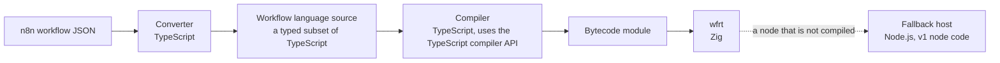
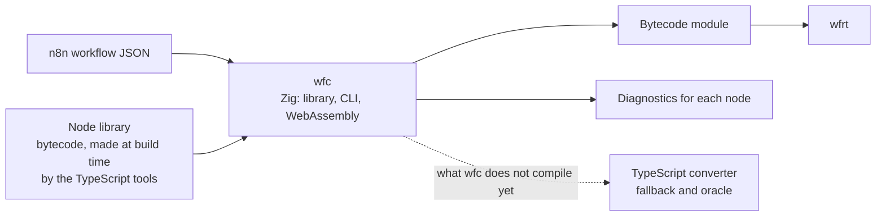

# Plan: compile workflows to bytecode in Zig

Status: proposal for assessment, 19 November 2026. Nothing in this plan is decided.

## 1. Why

Today the Zig runtime `wfrt` runs bytecode, and TypeScript makes the bytecode. The TypeScript side needs
Node.js, and it costs about one CPU-second for a workflow (20 CPU-hours for 74,000 workflows).

The proposal: a compiler in Zig, `wfc`, takes the JSON of an n8n workflow and gives bytecode and a list of
diagnostics. It builds as a library, as a command-line tool and as WebAssembly, and TypeScript calls it.
A cache keyed by the hash of the JSON gives the same bytecode for the same workflow.

What this gives:
- One compile step in one binary, without a separate convert service.
- A compile time far below one second, so that "compile on save" and a full recompile are cheap.
- Diagnostics for each node from one place, for the UI.

What this does not give: more workflows a second. A workflow is compiled once for each version, not for each run.

## 2. What exists today

| Part of `packages/@n8n/workflow-lang` | Lines without tests | Reads JavaScript or TypeScript? |
| --- | --- | --- |
| `src/compiler`: language source to bytecode | 9,500 | Yes: the language is TypeScript |
| `src/convert` (top level): graph, core nodes, parameters, paired items | 20,400 | Only through expressions |
| `src/convert/code-native`: Code nodes and expressions | 14,600 | Yes: user JavaScript |
| `src/node-compile`: app nodes from the TypeScript source of n8n | 18,500 | Yes: the node source |
| `src/nodes`: hand-written library nodes | 20,900 | They are language source |
| Tests | 67,800 | They run v1 as the oracle |

The reason for TypeScript was the input. Expressions, Code nodes and node sources are JavaScript or
TypeScript, and the TypeScript compiler API gave a parser, name resolution and a type checker at once.
The oracle (v1, the task runner, the node code) also runs on Node.js.

## 3. The target

Three pieces of work, which differ much in size and risk:

| Piece | Work | Size | Risk |
| --- | --- | --- | --- |
| A. Graph, core nodes and fixed parameters | Port the rules of the converter that work on JSON. Emit bytecode directly with the module writer of the runtime (`src/core/asm.zig`). | Medium: about 20,000 lines of rules to port | Low: no JavaScript to read |
| B. Expressions and Code nodes | A JavaScript parser and name resolution in Zig, then the translation rules (dates, Luxon, hand-over to the host, error texts of V8). | Large: 14,600 lines of rules plus a front end | High: each rule is a parity rule, and user code has a long tail |
| C. App nodes and library nodes | Do not port. The TypeScript tools compile each node operation ONCE at build time to a library of bytecode functions that take the node parameters as data. `wfc` links a workflow against the library. | Medium, but it is a redesign: today each node INSTANCE is specialised with its parameters at compile time | Medium: the verified list (3,659 operations) must be proven again for the new form, and a generic function can cost more instructions than a specialised one |

The compiler of the language (`src/compiler`, 9,500 lines) stays for piece C and is not ported.

## 4. Rules that do not change

- Parity: a result, an error, a request and the saved run data equal v1, or the node runs in the fallback
  host with a diagnostic.
- The TypeScript converter is the oracle for `wfc`: the two modules of one workflow must give the same run
  result on the same trigger. Each rule that moves to Zig moves with a differential test.
- `wfc` handles input that a user controls. It has bounded memory and bounded time, makes no system call,
  and never crashes on bad input (fuzzed).
- A module never holds a secret.

## 5. Phases

Each phase ends with a measurement on the full set of 74,000 real workflows: the share that `wfc` compiles
alone, the share that still goes to the TypeScript converter, and zero differences against the oracle.

| Phase | Content | Exit test | Decision after it |
| --- | --- | --- | --- |
| 0 (started) | Skeleton: `compile(json)`, diagnostics with node, type, version and parameter; CLI; WebAssembly; the TypeScript binding; triggers, No Operation, Edit Fields with literal values, linear chains | Differential test on generated workflows; fuzz test; size of the WebAssembly file and compile time | Is the interface right for the UI and for the n8n module? |
| 1 | A cache in the n8n module keyed by the hash of the workflow JSON (works with either compiler) | A second compile of the same JSON does no work | None: this is useful in every outcome |
| 2 | Piece A: If, Switch, Filter, Merge, Set forms, Loop Over Items, sub-workflows, error outputs, retry, paired items, the engine form of a workflow; a node in the host as a host step | The share of the 74,000 with no expression and no Code node compiles with `wfc` alone | Measure that share first (section 7). If it is small, piece A alone does not pay |
| 3 | Piece C, design and proof: the node library with parameters as data, for 5 app nodes | The 5 nodes pass the node verifier in the new form; instruction cost against the specialised form | Go or no-go for all nodes |
| 4 | Piece B, expressions: a JavaScript expression parser in Zig, the simple forms first (`$json.a.b`, `$('Node').item.json.x`, string and number methods, ternaries) | The share of expressions of the 74,000 that it handles, with zero differences | How far to take the long tail |
| 5 | Piece B, Code nodes | The share of Code nodes of the 74,000 | Retire the TypeScript converter, or keep it as the fallback for the tail |

Phases 2, 3 and 4 do not depend on each other and can run at the same time.

## 6. Costs and risks

- Two compilers for a long time. Until phase 5 ends, every parity fix can need a change in both. The
  differential test finds a drift, but the work is double.
- Coverage work slows. The same people and agents that raise coverage (55% of workflows compile fully
  today, 94% run on the compiled engine in some form) would port rules.
- Piece B is the unknown. The translator of Code nodes has rules for the error texts of V8, for Dates and for
  values that must hand over to the host. A JavaScript front end in Zig that is exact enough is months of work.
- Piece C can raise the run-time cost of a node. A specialised node has its parameters folded in; a generic
  one reads them at run time. The runtime target is 10 µs for a workflow, so this must be measured in phase 3.
- WebAssembly: the compiler is small without piece B. With a JavaScript front end and the node library the
  file grows; measure it in each phase.

## 7. What to measure before the decision

These numbers decide whether the plan pays, and none needs new code in Zig:

1. Where the one CPU-second of the TypeScript path goes (a profile of the converter on 300 workflows). If
   most of it is program creation in the TypeScript compiler, a long-lived program and a cache by content
   can take most of the cost away without a port.
2. From the census of the 74,000 workflows: the share with no Code node and no expression; the share with
   only simple expressions; the share of distinct node instances and Code snippets (how much a cache by
   content saves).
3. The compile time and file size of phase 0.

## 8. Options to compare

| Option | Work | Result |
| --- | --- | --- |
| 1. Keep TypeScript, add the cache and make the converter faster | Small | Needs Node.js to compile; a compile takes tens of milliseconds at best |
| 2. Hybrid: `wfc` for graph, core nodes and simple expressions; node library from the TypeScript tools; TypeScript converter for Code nodes and the tail | Phases 0 to 4 | Most workflows compile in Zig in under a millisecond; Node.js still needed for the tail |
| 3. Full port | Phases 0 to 5 | No Node.js in the compile path; the largest cost and the largest parity risk |

Option 2 is the proposal to assess. It keeps the proven rules for the hard part, and it can stop after any
phase with a working system.
