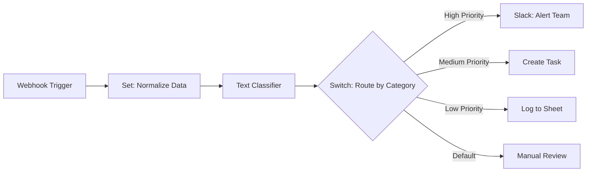
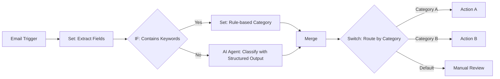
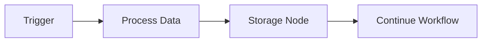
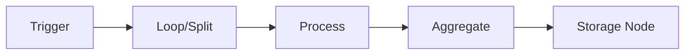
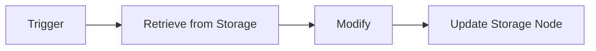
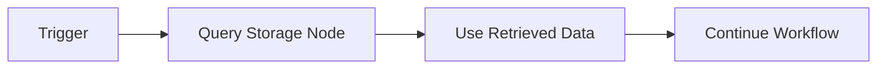
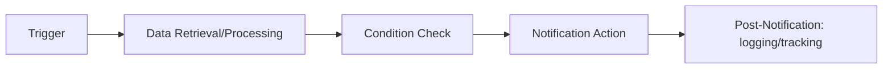
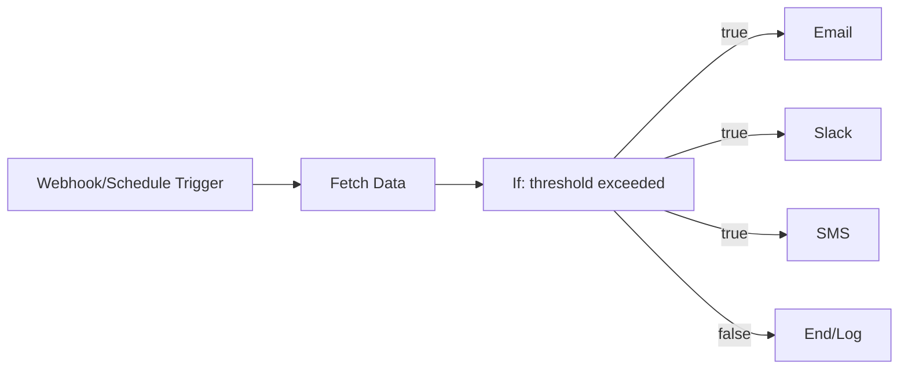

# n8n workflow best practices

<!-- Generated from the SDK source by `pnpm generate:docs`. Do not edit this file. -->

Design guidance for common workflow techniques: recommended nodes, patterns, and common pitfalls. Read the guide for each technique that a workflow uses. The `get_workflow_best_practices` tool of the n8n MCP server returns the same guides. The SDK reference is in the [package README](https://unpkg.com/@n8n/workflow-sdk/README.md).

**Version:** this copy is from the n8n source repository. The copy in each published npm package states the SDK version that it documents.

## Techniques

- `scheduling`: Running an action at a specific time or interval
- `chatbot`: Receiving chat messages and replying (built-in chat, Telegram, Slack, MS Teams, etc.)
- `form_input`: Gathering data from users via forms
- `scraping_and_research`: Methodically collecting information from websites or APIs to compile structured data
- `monitoring`: Repeatedly checking service/website status and taking action when conditions are met (no detailed guide yet)
- `enrichment`: Adding extra details to existing data by merging information from other sources (no detailed guide yet)
- `triage`: Classifying data for routing or prioritization
- `content_generation`: Creating text, images, audio, video, etc.
- `document_processing`: Taking action on content within files (PDFs, Word docs, images)
- `data_extraction`: Pulling specific information from structured or unstructured inputs
- `data_analysis`: Examining data to find patterns, trends, anomalies, or insights (no detailed guide yet)
- `data_transformation`: Cleaning, formatting, or restructuring data (including summarization)
- `data_persistence`: Storing, updating, or retrieving records from persistent storage (Google Sheets, Airtable, built-in Data Tables)
- `notification`: Sending alerts or updates via email, chat, SMS when events occur
- `knowledge_base`: Building or using a centralized information collection (usually vector database for LLM use) (no detailed guide yet)
- `human_in_the_loop`: Pausing for human decision/input before resuming (no detailed guide yet)
- `web_app`: Serving a single-page application (HTML + JS) from a webhook — dashboards, admin UIs, forms that need custom rendering

## Grouping

Node groups are named visual frames on the canvas, and they are how the person who opens this workflow reads it. Grouping is part of the build, not a finishing touch.

Every workflow needs an explicit grouping decision, taken while you write the code: declare groups, or conclude this one does not warrant any. Deciding against groups is fine; skipping the decision is not.

- **When:** count top-level items with no groups (trigger + every node or existing group). More than 7 → you must group. A linear pipeline is the normal case for grouping, not an exemption: stages run in sequence (ingest → transform → deliver). 7 or fewer serving one objective → leave it ungrouped.
- **How many:** one per stage or high-level objective, typically 3-5, aiming for at most 7 top-level items after grouping. Staying above 7 is only acceptable when every item still at the top level is either a group already, or a node that cannot join one without breaking a validity rule — check each one before you settle. Never split one objective to hit the number. When in doubt, fewer and larger.
- **What belongs together:** one business outcome ("Fetch new recordings"), never a technical category ("HTTP requests", "Database operations"). Cut where the objective changes; merge groups serving the same outcome. Stages of one or two nodes mean the boundaries are too fine — widen them: merge the small stage into its neighbour rather than keeping three groups.
- **Groups vs sub-workflows:** a group organises one canvas; a sub-workflow is separately executed and reusable. Group to make one canvas readable; extract a sub-workflow to reuse logic or isolate execution.

**Boundaries:** a group takes one member receiving from outside and one member sending outside; any number of connections may reach those two members.

- A branch that stops one way and continues the other: keep the branch node inside with both its paths outside, end the group before it, or leave it and its stop path outside.
- Work that fans out into parallel branches: the node they fan out from and the node they reconverge on both belong inside, or every branch faces outward on its own. Several IF nodes in a row: each IF sits inside a stage; the node where their paths join is inside that stage or the first node of the next group, never loose.
- When the node at either end cannot be a member — the trigger, or a node already in another group — the stage needs its own step there to serve as the single entry or exit. Use a step the stage already has; add a plain pass-through only when the stage would otherwise stay ungrouped.
- A rejected group never closes the stage: try a smaller slice that is valid — one branch, or the linear run before or after the split — before leaving anything ungrouped.

Groups are created collapsed, so title + description is all the user sees.

**Titles:** outcome-first, 2-4 words, naming one outcome. "Fetch new recordings", not "HTTP + Drive"; "Generate call summary", not "Claude + Edit Fields". No node, credential, or API names. Two verbs joined by "and" or "&" mean you named the steps instead of the outcome — find the outcome they add up to: "Create & invite" is really "Provision new hire". This one is a preference, not a rule: a two-verb title beats splitting a coherent stage or leaving it ungrouped. If someone who has never seen the workflow cannot tell what it does from the title alone, fix the title or the boundary. If the purpose does not fit in 2-4 words, the group is doing too much — split it.

**Descriptions:** one per group, at most 145 characters, plain language a non-technical reader follows, no node types or parameter values. It must add to the title — never restate it or open by repeating it ("Validates the shipping address against the Google API…" under the title "Validate via Google"), and never open on the parts list ("AI agent with Postgres chat memory drafts a reply" says only what the reader can already see). Collapsed groups clip the text, so spend the first words on the trigger/input, the destination/output, or the scope boundary.

Examples:

- "Fetch new recordings" → "Polls Gong every 15 min for fresh calls, downloads audio, stores raw files in Google Drive"
- "Generate call summary" → "Transcribes the audio, then extracts action items, sentiment, and key topics"
- "Draft support reply" → "Turns the email and the customer's plan and open tickets into a draft, citing our docs"

Read the node groups reference for the exact rules before creating groups.

# Best Practices: Scheduling Workflows

## Workflow Design

Structure scheduled workflows to perform focused, well-defined tasks.

For recurring tasks, use Schedule Trigger node with clear naming (e.g., "Daily 08:00 Trigger", "Every 6h Cron").

Prevent overlapping executions by ensuring worst-case execution time < schedule interval. For frequent schedules, implement mutex/lock mechanisms using external systems if needed.

## Scheduling Patterns

### Recurring Schedules

Use Schedule Trigger in two modes:
- **Interval Mode**: User-friendly dropdowns for common schedules (every X minutes, daily at 09:00, weekly on Mondays)
- **Cron Expression Mode**: Complex patterns using 5-field syntax (m h dom mon dow) with optional seconds field. Example: `0 9 * * 1` triggers every Monday at 09:00

Multiple schedules can be combined in single Schedule Trigger node using multiple Trigger Rules. Useful when same logic applies to different timings.

### One-Time Events

For event-relative scheduling, use Wait node to pause workflow until specified time/date.

Note: Cron expressions with specific dates (e.g., `0 12 22 10 *` for Oct 22 at 12:00) will repeat annually on that date.

### Conditional Scheduling

PREFER conditional logic over complex cron expressions. Use IF/Switch nodes after Schedule Trigger for runtime conditions:
- Check if today is last day of month before running monthly reports
- Skip execution on holidays by checking against a holiday list in a data table
- Route to "weekday" vs "weekend" processing based on current day

This approach is more readable and maintainable than complex cron patterns.

## Time Zone Handling

When building scheduled workflows:
- If user specifies a timezone, set it in the Schedule Trigger node's timezone parameter
- If user mentions times without timezone, use the schedule as specified (instance default will apply)
- For Wait nodes, be aware they use server system time, not workflow timezone

## Recommended Nodes

### Schedule Trigger (n8n-nodes-base.scheduleTrigger)

Primary node for running workflows on schedule. Supports interval mode for simple schedules and cron mode for complex patterns.

### Wait (n8n-nodes-base.wait)

Pause workflow execution until specified time or duration.

Use Cases:
- Delay actions relative to events
- One-off timers per data item
- Follow-up actions after specific duration

Best Practices:
- Use n8n Data Tables for waits longer than 24 hours (store scheduled time, check periodically)
- Avoid wait times longer than 7 days - use a polling pattern instead

### IF (n8n-nodes-base.if)

Add conditional logic to scheduled workflows.

Use Cases:
- Check date conditions (last day of month using expression: `{{ $now.day === $now.endOf('month').day }}`)
- Skip execution based on external data (e.g., holiday check)
- Route to different actions conditionally

Best Practices:
- Enable "Convert types where required" for comparisons
- Prefer IF nodes over complex cron expressions for readability

### Switch (n8n-nodes-base.switch)

Multiple conditional branches for complex routing.

Use Cases:
- Different actions based on day of week (e.g., `{{ $now.weekday }}` returns 1-7)
- Time-based routing (morning vs afternoon processing)
- Multi-path conditional execution

### n8n Data Tables (n8n-nodes-base.n8nTables)

Purpose: Store scheduling state and pending tasks

Use Cases:
- Track last execution time for catch-up logic
- Store list of pending one-time tasks with scheduled times
- Implement custom scheduling queue with polling

Best Practices:
- Query efficiently with proper filters
- Clean up completed tasks periodically

## Common Pitfalls to Avoid

### Missed Schedules During Downtime

**Problem**: Scheduled runs missed when n8n instance is down. No automatic catch-up for missed triggers.

**Solution**: Design idempotent workflows with catch-up logic:
- Store last successful run timestamp in n8n Data Tables
- On each run, check if enough time has passed since last run
- Example: For a task that should run once per 24 hours, schedule it every 4 hours but only execute if last run was >20 hours ago

### Overlapping Executions

**Problem**: Next scheduled run starts before previous completes, causing race conditions or resource conflicts.

**Solution**:
- Increase interval to exceed worst-case execution time
- Implement mutex/lock using n8n Data Tables (check/set "running" flag at start, clear at end)
- Add execution check at workflow start

### Wait Node Timezone Confusion

**Problem**: Wait node uses server system time, ignoring workflow timezone setting. Wait until "10:00" may not match expected timezone.

**Solution**:
- Account for server timezone when setting Wait times
- Use relative durations (e.g., "wait 2 hours") instead of absolute times when possible
- Prefer Schedule Trigger for timezone-aware scheduling

### First Execution Timing

**Problem**: First execution after activation doesn't match expected schedule. Activation time affects next run calculation.

**Solution**:
- Use manual execution for immediate first run if needed
- Understand that schedule recalculates from activation moment

### Cron Syntax

n8n supports both 5-field and 6-field (with seconds) cron syntax. Use 6 fields if you want to specify seconds (e.g., prefix with 0 for seconds: `0 0 9 * * *` for 9 AM daily).

For simple schedules, prefer Interval mode over cron for better readability.


# Best Practices: Chatbot Workflows

## Workflow Design

Break chatbot logic into manageable steps and use error handling nodes (IF, Switch) with fallback mechanisms to manage unexpected inputs.

Most chatbots run through external platforms like Slack, Telegram, or WhatsApp rather than through the n8n chat interface - if the user requests a service like this don't use the built in chat interface nodes. But, the n8n chat node is easier to get started with tests. If the user mentions chatting but does not mention a service then use the built in n8n chat node.

CRITICAL: The user may ask to be able to chat to a workflow as well as trigger it via some other method, for example scheduling information gathering but also being able to chat with the agent - in scenarios like this the two separate workflows MUST be connected through shared memory, vector stores, data storage, or direct connections.

Example pattern:
- Schedule Trigger → News Gathering Agent → [memory node via memory()]
- Chat Trigger → Chatbot Agent → [SAME memory node via memory()]
- Result: Both agents share conversation/context history, enabling the chatbot to discuss gathered news

For the chatbot always use the same chat node type as used for response. If Telegram has been requested trigger the chatbot via telegram AND
respond via telegram - do not mix chatbot interfaces.

## Context & Memory Management

Always utilise memory in chatbot agent nodes - providing context gives you full conversation history and more control over context.
Memory nodes enable the bot to handle follow-up questions by maintaining short-term conversation history.

Include information with the user prompt such as timestamp, user ID, or session metadata. This enriches context without relying solely on memory and user prompt.

If there are other agents involved in the workflow you should share memory between the chatbot and those other agents where it makes sense.
Connect the same memory node to multiple agents to enable data sharing and context continuity.

### Memory Session Keys

Memory session keys must uniquely identify the user or chat. In AI Agent memory subnodes, do not use $json for a custom session key because the memory subnode does not have the same immediate predecessor context as a main-flow node.

Use nodeJson(triggerNode, 'field.path') for external chat platforms:
- Telegram: sessionIdType = customKey, sessionKey = nodeJson(telegramTrigger, 'message.chat.id')
- Slack: sessionIdType = customKey, sessionKey = nodeJson(slackTrigger, 'event.channel')
- WhatsApp: sessionIdType = customKey, sessionKey = nodeJson(whatsAppTrigger, 'messages.0.from')

For the built-in n8n Chat Trigger, prefer memory parameters sessionIdType = fromInput and omit a custom sessionKey, because the Chat Trigger provides the session ID directly to the AI Agent.

## Context Engineering & AI Agent Output

It can be beneficial to respond to the user as a tool of the chatbot agent rather than using the agent output - this allows the agent to loop/carry out multiple responses if necessary.
This will require adding a note to the system prompt for the agent to tell it to use the tool to respond to the user.

## Message Attribution

n8n chatbots often attach the attribution "n8n workflow" to messages by default - you must disable this setting which will
often be called "Append n8n Attribution" for nodes that support it, add this setting and set it to false.

## Recommended Nodes

### Chat Trigger (@n8n/n8n-nodes-langchain.chatTrigger)

Purpose: Entry point for user messages in n8n-hosted chat interfaces

Pitfalls:

- Most production chatbots use external platforms (Slack, Telegram) rather than n8n's chat interface

### AI Agent (@n8n/n8n-nodes-langchain.agent)

Purpose: Orchestrates logic, tool use, and LLM calls for intelligent responses.

Unless user asks for a node by name, always use the AI Agent node over provider-specific nodes (like OpenAI, Google Gemini) or use-case-specific AI nodes (like Message a model) for chatbot workflows. The AI Agent node provides better orchestration, tool integration, and memory management capabilities essential for conversational interfaces.
For example, for "create a chatbot using OpenAI", implement: AI Agent -- OpenAI Chat Model.

### Chat Model Nodes

- OpenAI Chat Model (@n8n/n8n-nodes-langchain.lmChatOpenAi)
- Google Gemini Chat Model (@n8n/n8n-nodes-langchain.lmChatGoogleGemini)
- xAI Grok Chat Model (@n8n/n8n-nodes-langchain.lmChatXAiGrok)
- DeepSeek Chat Model (@n8n/n8n-nodes-langchain.lmChatDeepSeek)

Purpose: Connect to LLMs for natural, context-aware responses

### Simple Memory (@n8n/n8n-nodes-langchain.memoryBufferWindow)

Purpose: Maintains short-term conversation history for context continuity

### HTTP Request (n8n-nodes-base.httpRequest)

Purpose: Fetches external data to enrich chatbot responses with real-time or organizational information

### Database Nodes & Google Sheets

- Data Table (n8n-nodes-base.dataTable)
- Postgres (n8n-nodes-base.postgres)
- MySQL (n8n-nodes-base.mySql)
- MongoDB (n8n-nodes-base.mongoDb)
- Google Sheets (n8n-nodes-base.googleSheets)

Purpose: Store conversation logs, retrieve structured data, or maintain user preferences

### IF / Switch

- If (n8n-nodes-base.if)
- Switch (n8n-nodes-base.switch)

Purpose: Conditional logic and error handling for routing messages or managing conversation state

### Integration Nodes

- Slack (n8n-nodes-base.slack)
- Telegram (n8n-nodes-base.telegram)
- WhatsApp Business Cloud (n8n-nodes-base.whatsApp)
- Discord (n8n-nodes-base.discord)

Purpose: Multi-channel support for deploying chatbots on popular messaging platforms

## Common Pitfalls to Avoid

### Leaving Chatbot Disconnected

When a workflow has multiple triggers (e.g., scheduled data collection + chatbot interaction), the chatbot MUST have access to the data
generated by the workflow. Connect the chatbot through shared memory, vector stores, data storage, or direct data flow connections.


# Best Practices: Form Input Workflows

## Workflow Design

### Critical: Always Store Raw Form Data

ALWAYS store raw form responses to a persistent data storage destination even if the primary purpose of the workflow is
to trigger another action (like sending to an API or triggering a notification). This allows users to monitor
form responses as part of the administration of their workflow.

Required storage destinations include:
- Google Sheets node
- Airtable node
- n8n Data Tables
- PostgreSQL/MySQL/MongoDB nodes
- Any other database or spreadsheet service

IMPORTANT: Simply using Set or Merge nodes is NOT sufficient. These nodes only transform data in memory - they do not
persist data. You must use an actual storage node (like Google Sheets, Airtable, or Data Tables) to write the data.

Storage Requirements:
- Store the un-edited user input immediately after the form steps are complete
- Do not store only a summary or edited version of the user's inputs - store the raw data
- For single-step forms: store immediately after the form trigger
- For multi-step forms: store immediately after aggregating all steps with Set/Merge nodes
- The storage node should appear in the workflow right after data collection/aggregation

## Message Attribution

n8n forms attach the attribution "n8n workflow" to messages by default - you must disable this setting which will
often be called "Append n8n Attribution" for the n8n form nodes, add this setting and set it to false.

## Multi-Step Forms

Build multi-step forms by chaining multiple Form nodes together. Each Form node represents a page or step in your form
sequence. Use the n8n Form Trigger node to start the workflow and display the first form page to the user.

## Data Collection & Aggregation

Collect and merge all user responses from each form step before writing to your destination (e.g., Data Table). Use
Set or Merge nodes to combine data as needed. Make sure your JSON keys match the column names in your destination for
automatic mapping.

## Conditional Logic & Branching

Use IF or Switch nodes to direct users to different form pages based on their previous answers. This enables dynamic
form flows where the path changes based on user input, creating personalized form experiences.

## Dynamic Form Fields

For forms that require dynamic options (e.g., dropdowns populated from an API or previous step), generate the form
definition in a Code node and pass it to the Form node as JSON. You can define forms using JSON for dynamic or
conditional fields, and even generate form fields dynamically using a Code node if needed.

## Input Validation

Validate user input between steps to ensure data quality. If input is invalid, loop back to the relevant form step with
an error message to guide the user to correct their submission. This prevents bad data from entering your system.

## Recommended Nodes

### n8n Form Trigger (n8n-nodes-base.formTrigger)

Purpose: Starts the workflow and displays the first form page to the user

Pitfalls:

- Use the Production URL for live forms; the Test URL is for development and debugging only
- Ensure the form trigger is properly configured before sharing URLs with users

### n8n Form (n8n-nodes-base.form)

Purpose: Displays form pages in multi-step form sequences

Pitfalls:

- Each Form node represents one page/step in your form
- You can define forms using JSON for dynamic or conditional fields
- Generate form fields dynamically using a Code node if needed for complex scenarios

### Storage Nodes

Purpose: Persist raw form data to a storage destination, preference should be for built-in n8n tables
but use the most applicable node depending on the user's request.

Required nodes (use at least one):
- Data table (n8n-nodes-base.dataTable): Built-in n8n storage for quick setup - preferred
- Google Sheets (n8n-nodes-base.googleSheets): Best for simple spreadsheet storage
- Airtable (n8n-nodes-base.airtable): Best for structured database with relationships
- Postgres (n8n-nodes-base.postgres) / MySQL (n8n-nodes-base.mySql) / MongoDB (n8n-nodes-base.mongoDb): For production database storage

Pitfalls:

- Every form workflow MUST include a storage node that actually writes data to a destination
- Set and Merge nodes alone are NOT sufficient - they only transform data in memory
- The storage node should be placed immediately after the form trigger (single-step) or after data aggregation (multi-step)

### Code (n8n-nodes-base.code)

Purpose: Processes form data, generates dynamic form definitions, or implements custom validation logic

### Edit Fields (Set) (n8n-nodes-base.set)

Purpose: Aggregates and transforms form data between steps (NOT for storage - use a storage node)

### Merge (n8n-nodes-base.merge)

Purpose: Combines data from multiple form steps into a single dataset (NOT for storage - use a storage node)

Pitfalls:

- Ensure data from all form steps is properly merged before writing to destination
- Use appropriate merge modes (append, merge by key, etc.) for your use case
- Remember: Merge prepares data but does not store it - add a storage node after Merge

### If (n8n-nodes-base.if)

Purpose: Routes users to different form pages based on their previous answers

### Switch (n8n-nodes-base.switch)

Purpose: Implements multi-path conditional routing in complex forms

Pitfalls:

- Include a default case to handle unexpected input values
- Keep routing logic clear and maintainable

## Common Pitfalls to Avoid

### Missing Raw Form Response Storage

When building n8n forms it is recommended to always store the raw form response to some form of data storage (Googlesheets, Airtable, etc)
for administration later. It is CRITICAL if you create a n8n form node that you store the raw output with a storage node.

### Data Loss in Multi-Step Forms

Aggregate all form step data using Set/Merge nodes before writing to your destination. Failing to merge data from multiple steps
can result in incomplete form submissions being stored. After merging, ensure you write the complete dataset to a storage node.

### Poor User Experience

Use the Form Ending page type to show a completion message or redirect users after submission.
Without a proper ending, users may be confused about whether their submission was successful.

### Invalid Data

Implement validation between form steps to catch errors early. Without validation, invalid data can
propagate through your workflow and corrupt your destination data.

### Complex Field Generation

When generating dynamic form fields, ensure the JSON structure exactly matches what the Form
node expects. Test thoroughly with the Test URL before going live.

### Mapping Errors

When writing to Google Sheets or other destinations, ensure field names match exactly. Mismatched names
will cause data to be written to wrong columns or fail entirely.


# Best Practices: Scraping & Research Workflows

## Performance & Resource Management

Batch requests and introduce delays to avoid hitting API rate limits or overloading target servers. Use Wait nodes and
batching options in HTTP Request nodes. When 429 rate limiting errors occur due to receiving too many requests,
implement batching to reduce request frequency or use the "Retry on Fail" feature to automatically handle throttled
responses.

Workflows processing large datasets can crash due to memory constraints. Use the Split In Batches node to process 200
rows at a time to reduce memory usage, leverage built-in nodes instead of custom code, and increase execution timeouts
via environment variables for better resource management.

## Looping & Pagination

Implement robust looping for paginated data. Use Set, IF, and Code nodes to manage page numbers and loop conditions,
ensuring you don't miss data or create infinite loops. Leverage n8n's built-in mechanisms rather than manual approaches:
use the $runIndex variable to track iterations without additional code nodes, and employ workflow static data or node
run indexes to maintain state across loop cycles.

## Recommended Nodes

### HTTP Request (n8n-nodes-base.httpRequest)

Purpose: Fetches web pages or API data for scraping and research workflows

Pitfalls:

- Depending on the data which the user wishes to scrape/research, it maybe against the terms of service to attempt to
fetch it from the site directly. Using scraping nodes is the best way to get around this
- Double-check URL formatting, query parameters, and ensure all required fields are present to avoid bad request errors
- Be aware of 429 rate limiting errors when the service receives too many requests - implement batching or use "Retry on
Fail" feature
- Refresh expired tokens, verify API keys, and ensure correct permissions to avoid authentication failures

### SerpAPI (@n8n/n8n-nodes-langchain.toolSerpApi)

Purpose: Give an agent the ability to search for research materials and fact-checking results that have been retrieved
from other sources.

### Perplexity (n8n-nodes-base.perplexityTool)

Purpose: Give an agent the ability to search utilising Perplexity, a powerful tool for finding sources/material for
generating reports and information.

### HTML Extract (n8n-nodes-base.htmlExtract)

Purpose: Parses HTML and extracts data using CSS selectors for web scraping

Pitfalls:

- Some sites use JavaScript to render content, which may not be accessible via simple HTTP requests. Consider using
browser automation tools or APIs if the HTML appears empty
- Validate that the CSS selectors match the actual page structure to avoid extraction failures

### Split Out (n8n-nodes-base.splitOut)

Purpose: Processes lists of items one by one for sequential operations

Pitfalls:
- Can cause performance issues with very large datasets - consider using Split In Batches instead

### Loop Over Items (Split in Batches) (n8n-nodes-base.splitInBatches)

Purpose: Processes lists of items in batches to manage memory and performance

Pitfalls:
- Ensure proper loop configuration to avoid infinite loops or skipped data. The index 0
(first connection) of the loop is treated as the done state, while the index 1 (second connection)
is the connection that loops.
- Use appropriate batch sizes (e.g., 200 rows) to balance memory usage and performance

### Edit Fields (Set) (n8n-nodes-base.set)

Purpose: Manipulates data, sets variables for loop control and state management

### Code (n8n-nodes-base.code)

Purpose: Implements custom logic for complex data transformations or pagination

Pitfalls:

- Prefer built-in nodes over custom code to reduce memory usage and improve maintainability
- Avoid processing very large datasets in a single code execution - use batching

### If (n8n-nodes-base.if)

Purpose: Adds conditional logic for error handling, loop control, or data filtering

Pitfalls:
- Validate expressions carefully to avoid unexpected branching behavior

### Wait (n8n-nodes-base.wait)

Purpose: Introduces delays to respect rate limits and avoid overloading servers

### Data Tables (n8n-nodes-base.dataTable)

Purpose: Stores scraped data in n8n's built-in persistent data storage

### Google Sheets (n8n-nodes-base.googleSheets)

Purpose: Stores scraped data in spreadsheets for easy access and sharing

### Microsoft Excel 365 (n8n-nodes-base.microsoftExcel)

Purpose: Stores scraped data in Excel files for offline analysis

### Airtable (n8n-nodes-base.airtable)

Purpose: Saves structured data to a database with rich data types and relationships

### AI Agent (@n8n/n8n-nodes-langchain.agent)

Purpose: For research, summarization, and advanced data extraction. AI agents can autonomously gather information
from websites, analyze content, and organize findings into structured formats, integrating tools for web scraping,
content analysis, and database storage

### Scraping Nodes

- Phantombuster (n8n-nodes-base.phantombuster)
- Apify (use HTTP Request or community node)
- BrightData (use HTTP Request or community node)

Purpose: If the user wishes to scrap data from sites like LinkedIn, Facebook, Instagram, Twitter/X, Indeed, Glassdoor
or any other service similar to these large providers it is better to use a node designed for this. The scraping
nodes provide access to these datasets while avoiding issues like rate limiting or breaking terms of service for
sites like these.

## Common Pitfalls to Avoid

Bad Request Errors: Double-check URL formatting, query parameters, and ensure all required fields are present to
avoid 400 errors when making HTTP requests.

Rate Limits: Use batching and Wait nodes to avoid 429 errors. When the service receives too many requests, implement
batching to reduce request frequency or use the "Retry on Fail" feature.

Memory Issues: Avoid processing very large datasets in a single run; use batching and increase server resources if
needed. Use Split In Batches node to process 200 rows at a time, leverage built-in nodes instead of custom code, and
increase execution timeouts via environment variables.

Empty or Unexpected Data: Some sites use JavaScript to render content, which may not be accessible via simple HTTP
requests. Standard HTTP and HTML parsing nodes fail because sites load data asynchronously via JavaScript, leaving the
initial HTML empty of actual content. Web scraping nodes can be used to avoid this.


# Best Practices: Triage Workflows

## Workflow Design

Triage workflows automatically classify incoming data and route it based on priority or category. Common use cases include sorting support tickets by urgency, categorizing emails for follow-up, or scoring leads for sales routing.

Define clear categories and outcomes before building. Design in logical stages:

1. **Trigger & Input**: Capture incoming items (webhook, email trigger, form submission, schedule)
2. **Preprocessing**: Fetch additional data if needed (CRM lookup, field normalization)
3. **Classification**: Assign categories via rules or AI
4. **Routing**: Direct items to appropriate branches using Switch node or Text Classifier Node
5. **Actions**: Execute category-specific tasks (create tasks, send alerts, update records)
6. **Logging**: Track outcomes for monitoring and analysis

Include a default/fallback path to catch unclassified items so data is tracked rather than dropped silently.

## Classification Strategies

### Rule-Based Classification
Use IF/Switch nodes for keyword detection, sender addresses, or numeric thresholds. Chain multiple conditions or use Switch for multi-way branching.

Example: IF email contains "urgent" → High Priority branch

### AI-Powered Classification
For unstructured text or nuanced decisions, use AI nodes with clear prompts and defined output labels.

Example prompt: "Classify this email as INTERESTED, NOT_INTERESTED, or QUESTION"

Best practices:
- Use structured output format (JSON with specific fields)
- Set low temperature parameter of the model (0-0.2) for consistency
- Include few-shot examples of input + classification
- Implement error handling for unexpected outputs

#### Text Classifier Node
Use the Text Classifier node (@n8n/n8n-nodes-langchain.textClassifier) for straightforward text classification tasks. Configure with predefined category labels and descriptions for accurate results.

Example workflow pattern:


### Combined Approach
For robust triage, combine rule-based and AI classification. Use AI Agent node with structured output to assign categories, scores, or tags, then route with Switch nodes.
When using AI with structured output, always add reasoning field alongside category or score to aid debugging.

Example workflow pattern:


**Structured Output Schema Example:**
```json
{
  "category": "INTERESTED | NOT_INTERESTED | QUESTION",
  "confidence": 0.95,
  "reasoning": "Customer asked about pricing and availability"
}
```

## Routing & Branching

Use Switch node as primary traffic controller:
- Configure cases for each classification value
- Always configure an extra fallback output for unexpected values
- Each item follows exactly one branch

Avoid parallel IF nodes that could match multiple conditions - use Switch node.

## Recommended Nodes

**IF** (n8n-nodes-base.if):
- Purpose: Simple binary decisions
- Use when: Two-way branching based on conditions
- Example: Check if priority field equals "high"

**Switch** (n8n-nodes-base.switch):
- Purpose: Multi-way branching based on field values
- Use when: Multiple categories (3+ outcomes)
- Configure options.fallbackOutput: 'extra' for unmatched items

**Merge** (n8n-nodes-base.merge):
- Purpose: Consolidate branches for unified logging
- Use after: Category-specific actions before final logging step

**Text Classifier** (@n8n/n8n-nodes-langchain.textClassifier):
- Purpose: AI-powered text classification with predefined labels
- Use when: Need to assign categories to unstructured text
- Configure "When No Clear Match" option to output items to "Other" branch

**AI Agent** (@n8n/n8n-nodes-langchain.agent):
- Purpose: Complex classification or scoring requiring multiple steps or tool use
- Use when: Classification needs context lookup, multi-step reasoning with tools, numerical scoring or other complex outputs
- Use structured output format (JSON schema)

For all AI nodes (Text Classifier, AI Agent):
	- Set low temperature of the model (0-0.2) for consistency
	- Include few-shot examples in prompts

## Common Pitfalls to Avoid

### No Default Path
**Problem**: Switch nodes do not create a default output unless options.fallbackOutput is set to 'extra'. Unmatched items should go to manual review or logging, never drop silently.

**Solution**: Configure options.fallbackOutput: 'extra' and wire that fallback output to a fallback action (e.g., manual review queue, admin notification).

### No "Other" Branch in Text Classifier
**Problem**: Items that don't match any category get dropped if "When No Clear Match" isn't set.

**Solution**: In Text Classifier node, set "When No Clear Match" to "Output on Extra, 'Other' Branch" to capture unmatched items.

### Overlapping Conditions
**Problem**: Categories must be mutually exclusive. Items matching multiple conditions cause unpredictable routing.

**Solution**:
- Order checks from most specific to general
- Use Switch with distinct values instead of multiple IF nodes


# Best Practices: Content Generation Workflows

## Workflow Design

Break complex tasks into sequential steps (e.g., generate text, create image, compose video) for modularity and easier troubleshooting.

## Node Selection Guidelines

Always prefer built-in n8n nodes over HTTP Request nodes when a dedicated node exists for the service or API you need to integrate with. Built-in nodes provide:
- Pre-configured authentication handling
- Optimized data structures and field mappings
- Better error handling and user experience
- Simplified setup without manual API configuration

Only use HTTP Request nodes when no built-in node exists for the service, or when you need to access an API endpoint not covered by the built-in node's operations.

## Multi-Modal Content Generation - MANDATORY

When the user's request involves specific generative AI models or media-focused platforms, the workflow MUST include the appropriate media generation node from a
provider-specific node. The finished workflow MUST contain the relevant video, audio, or image generation capability.

Prompts that require multi-modal generation nodes:

Video Generation:
- Model mentions: Sora, Nano Banana, Veo, Runway, Pika
- Platform mentions: YouTube content, TikTok videos, Instagram Reels, video ads, short-form video
- Task mentions: generate video, create video, video from text, animate

Image Generation:
- Model mentions: DALL-E, Midjourney, Stable Diffusion, Imagen
- Platform mentions: thumbnails, social media graphics, product images, marketing visuals
- Task mentions: generate image, create artwork, design graphic, visualize

Audio Generation:
- Model mentions: ElevenLabs, text-to-speech, TTS
- Platform mentions: podcast audio, voiceovers, narration, audio content
- Task mentions: generate voice, create audio, synthesize speech, clone voice

If anything like the examples above are mentioned in the prompt, include the appropriate
provider node (OpenAI for DALL-E/Sora, Google Gemini for Nano Banana/Imagen, etc.)
with the media generation operation configured.

## Content-Specific Guidance

For text generation, validate and sanitize input/output to avoid malformed data. When generating images, prefer binary data over URLs for uploads to avoid media type errors.

## Recommended Nodes

### OpenAI (@n8n/n8n-nodes-langchain.openAi)

Purpose: GPT-based text generation, DALL-E image generation, text-to-speech (TTS), and audio transcription, SORA for video generation

### xAI Grok Chat Model (@n8n/n8n-nodes-langchain.lmChatXAiGrok)

Purpose: Conversational AI and text generation

### Google Gemini Chat Model (@n8n/n8n-nodes-langchain.lmChatGoogleGemini)

Purpose: Image analysis and generation, video generation from text prompts using nano banana, multimodal content creation

### ElevenLabs

Purpose: Natural-sounding AI voice generation

Note: Use HTTP Request node or a community node to integrate with ElevenLabs API

### HTTP Request (n8n-nodes-base.httpRequest)

Purpose: Integrating with other LLM and content generation APIs (e.g., Jasper, Writesonic, Anthropic, HuggingFace)

### Edit Image (n8n-nodes-base.editImage)

Purpose: Manipulating images - resize, crop, rotate, and format conversion

Pitfalls:

- Ensure input is valid binary image data
- Check output format compatibility with downstream nodes

### Markdown (n8n-nodes-base.markdown)

Purpose: Formatting and converting text to HTML or Markdown reports

### Facebook Graph API (n8n-nodes-base.facebookGraphApi)

Purpose: Uploading videos and images to Instagram and Facebook

Pitfalls:

- Use binary data fields rather than URLs for media uploads to prevent "media type" errors
- Verify page IDs and access tokens have correct permissions

### Wait (n8n-nodes-base.wait)

Purpose: Handling delays in video processing/uploading and respecting API rate limits

## Common Pitfalls to Avoid

Binary Data Handling: For media uploads, use binary fields rather than URLs to prevent "media type" errors, especially with Facebook and Instagram APIs. Download media to binary data first, then upload from binary rather than passing URLs.

Async Processing: For long-running content generation tasks (especially video), implement proper wait/polling mechanisms. Don't assume instant completion - many AI services process requests asynchronously.


# Best Practices: Document Processing Workflows

## Workflow Design

Document processing workflows extract and act on content from files like PDFs, images, Word documents, and spreadsheets. Design your workflow following these core patterns:

### Core Architecture Pattern
Trigger → Capture Binary → Extract Text → Parse/Transform → Route to Destination → Notify

### Common Flow Patterns

**Simple Document Processing:**
- Gmail Trigger → Check file type → Extract from File → DataTable → Slack notification
- Best for: Basic text-based PDFs with straightforward data extraction

**Complex Document Processing with AI:**
- Webhook → File Type Check → OCR (if image) → AI Extract → Validate → CRM Update → Multiple notifications
- Best for: Varied document formats requiring intelligent parsing

**Batch Document Processing:**
- Main workflow: Schedule Trigger → Fetch Files → Split In Batches → Sub-workflow → Merge Results → Bulk Update
- Sub-workflow When Executed by Another Workflow -> Process result
- Best for: High-volume processing with API rate limits

**Multi-Source Document Aggregation:**
- Multiple Triggers (Email + Drive + Webhook) → Set common fields → Standardize → Process → Store
- Best for: Documents from various channels needing unified processing

### Branching Strategy

Always branch early based on document characteristics:
- **File Type Branching**: Use IF/Switch nodes immediately after ingestion to route PDFs vs images vs spreadsheets
- **Provider Branching**: Route documents to provider-specific processing (e.g., different invoice formats)
- **Quality Branching**: Separate high-confidence extractions from those needing manual review

## Binary Data Management
Documents in n8n are handled as binary data that must be carefully preserved throughout the workflow.

### Referencing Binary Data from Other Nodes
When you need to reference binary data from a previous node, use this syntax:
- Expression: '{{ $('Node Name').item.binary.property_name }}' or {{ $binary.property_name }} if previous item
- Example for Gmail attachments: '{{ $('Gmail Trigger').item.binary.attachment_0 }}' or {{ $binary.attachment_0 }} if previous item
- Example for webhook data: '{{ $('Webhook').item.binary.data }}' or {{ $binary.data }} if previous item
- Important: The property name depends on how the previous node names the binary data

### Preserving Binary Data
- Many nodes (Code, Edit Fields, AI nodes) output JSON and drop binary data by default
- Use parallel branches: one for processing, one to preserve the original file
- Rejoin branches with Merge node in pass-through mode
- Alternative: Configure nodes to keep binary (e.g., Edit field node's "Include Other Input Fields" option ON)

### Memory Optimization
For high-volume processing:
- Process files sequentially or in small batches
- Drop unnecessary binary data after extraction to free memory

### File Metadata
Documents uploaded via a form trigger will have various bits of metadata available - filename, mimetype and size.
These are accessible using an expression like {{ $json.documents[0].mimetype }} to access each of the document's details.
Multiple files can be uploaded to a form which is the reason for the documents array.

## Text Extraction Strategy

Choose extraction method based on document type and content:

### Critical: File Type Detection
**ALWAYS check the file type before using Extract from File node** (unless the file type is already known):
- Use IF node to check file extension or MIME type first
- The Extract from File node has multiple operations, each for a specific file type:
  - "Extract from PDF" for PDF files
  - "Extract from MS Excel" for Excel files (.xlsx, .xls)
  - "Extract from MS Word" for Word documents (.docx, .doc)
  - "Extract from CSV" for CSV files
  - "Extract from HTML" for HTML files
  - "Extract from RTF" for Rich Text Format files
  - "Extract from Text File" for plain text files
- Using the wrong operation will result in errors or empty output

### Decision Tree for Extraction
1. **Check file type** → Route to appropriate extraction method
2. **Scanned image/PDF?** → Use OCR service (OCR.space, AWS Textract, Google Vision)
3. **Structured invoice/receipt?** → Use specialized parser (Mindee) or AI extraction
4. **Text-based document?** → Use Extract from File with the correct operation for that file type

### Fallback Strategy
Always implement fallback for extraction failures:
- Check if text extraction returns empty
- If empty, automatically route to OCR
- If OCR fails, send to manual review queue

## Data Parsing & Classification

### AI-Powered Extraction Pattern
For varied or complex documents:

Option 1 - Using Document Loader (Recommended for binary files):
1. Pass binary data directly to Document Loader node (set Data Source to "Binary")
2. Connect to AI Agent or LLM Chain for processing
3. Validate extracted fields before processing

Option 2 - Using text extraction:
1. Extract raw text using Extract from File or OCR
2. Pass to AI Agent or LLM Chain with structured prompt
3. Validate extracted fields before processing

Example system prompt structure:
"Extract the following fields from the document: [field list]. Return as JSON with this schema: [schema example]"

### Document Classification Flow
Classify before processing for better accuracy:
1. Initial AI classification (Invoice vs Receipt vs Contract)
2. Route to specialized sub-workflow based on type
3. Use type-specific prompts and validation rules
4. This reduces errors and improves extraction quality

## Error Handling Strategy

Build resilience at every step:

### Validation Checkpoints
- After extraction: Verify text not empty
- After AI parsing: Validate JSON schema
- Before database insert: Check required fields
- After API calls: Verify success response

## Performance Optimization

### Batch Processing Strategy
- Use Split In Batches node: process 5-10 files at a time
- Implement delays between batches for rate-limited APIs
- Monitor memory usage and adjust batch size accordingly

## Recommended Nodes

### Triggers & Input

**Gmail Trigger (n8n-nodes-base.gmailTrigger)**
Purpose: Monitor Gmail for emails with attachments (Recommended over IMAP)
Advantages: Real-time processing, simpler authentication, better integration with Google Workspace
Critical Configuration for Attachments:
- **MUST set "Simplify" to FALSE** - otherwise attachments won't be available
- **MUST set "Download Attachments" to TRUE** to retrieve files
- Set appropriate label filters
- Set "Property Prefix Name" (e.g., "attachment_") - attachments will be named with this prefix plus index
- Important: When referencing its binary data, it will be referenced "attachment_0", "attachment_1", etc., NOT "data"

**Email Read (IMAP) (n8n-nodes-base.emailReadImap)**
Purpose: Alternative email fetching if there's no specialized node for email provider
Configuration:
- Enable "Download Attachments" to retrieve files
- Set "Property Prefix Name" (e.g., "attachment_") - attachments will be named with this prefix plus index
- Important: When referencing binary data, it will be referenced "attachment_0", "attachment_1", etc., NOT "data"

**HTTP Webhook (n8n-nodes-base.webhook)**
Purpose: Receive file uploads from web forms
Configuration: Enable "Raw Body" for binary data

**Google Drive Trigger (n8n-nodes-base.googleDriveTrigger)**
Purpose: Monitor folders for new documents
Configuration: Set appropriate folder and file type filters

### Text Extraction

**Extract from File (n8n-nodes-base.extractFromFile)**
Purpose: Extract text from various file formats using format-specific operations
Critical: ALWAYS check file type first with an IF or Switch before and select the correct operation (Extract from PDF, Extract from MS Excel, etc.)
Critical: If the user requests handling of multiple file types (PDF, CSV, JSON, etc) then a Switch (n8n-nodes-base.switch) node should be used
to check the file type before text extraction. Multiple text extraction nodes should be used to handle each of the different file types. For example,
if the workflow contains a form trigger node which receives a file, then a Switch node MUST be used to split the different options out to different extraction nodes.
Output: Extracted text is returned under the key set by destinationKey (default "data", so access with {{ $json.data }})
Pitfalls:
- Returns empty for scanned documents - always check and fallback to OCR; Using wrong operation causes errors
- If connecting to a document upload form (n8n-nodes-base.formTrigger) use a File field type and then connect it to the extract from file node using the field name.
For example if creating a form trigger with field "Upload Document" then set the extract from file input binary field to "Upload_Document"

**AWS Textract (n8n-nodes-base.awsTextract)**
Purpose: Advanced OCR with table and form detection
Best for: Structured documents like invoices and forms

**Mindee (n8n-nodes-base.mindee)**
Purpose: Specialized invoice and receipt parsing
Returns: Structured JSON with line items, totals, dates

### Data Processing

**AI Agent (@n8n/n8n-nodes-langchain.agent)**
Purpose: Intelligent document parsing and decision making
Configuration: Include structured output tools for consistent results

**LLM Chain (@n8n/n8n-nodes-langchain.chainLlm)**
Purpose: Document classification and data extraction

**Document Loader (@n8n/n8n-nodes-langchain.documentLoader)**
Purpose: Load and process documents directly from binary data for AI processing
Critical: Use the "Binary" data source option to handle binary files directly - no need to convert to JSON first
Configuration: Select "Binary" as Data Source, specify the binary property name (by default data unless renamed in a previous node)
Best for: Direct document processing in AI workflows without intermediate extraction steps

**Structured Output Parser (@n8n/n8n-nodes-langchain.outputParserStructured)**
Purpose: Ensure AI outputs match expected JSON schema
Critical for: Database inserts and API calls

### Vector Storage (for RAG/Semantic Search)
**Simple Vector Store (@n8n/n8n-nodes-langchain.vectorStore) - RECOMMENDED**
Purpose: Easy-to-setup vector storage for document embeddings
Advantages:
- No external dependencies or API keys required
- Works out of the box with local storage
- Perfect for prototyping and small to medium datasets
Configuration: Just connect and use - no complex setup needed
Best for: Most document processing workflows that need semantic search

### Flow Control

**Split In Batches (n8n-nodes-base.splitInBatches)**
Purpose: Process multiple documents in controlled batches
Configuration: Set batch size based on API limits and memory
Outputs (in order):
- Output 0 "done": Executes after all batches are processed - use for final aggregation or notifications
- Output 1 "loop": Connect processing nodes here - executes for each batch
Important: Connect processing logic to the second output (loop), completion logic to the first output (done)

**Merge (n8n-nodes-base.merge)**
Purpose: Combine data from multiple branches that need to execute together
Critical: Merge node waits for ALL input branches to complete - do NOT use for independent/optional branches
Modes: Use "Pass Through" to preserve binary from one branch

**Edit Fields (Set) (n8n-nodes-base.set)**
Purpose: Better choice for combining data from separate/independent branches
Use for: Adding fields from different sources, preserving binary while adding processed data
Configuration: Set common fields and use "Include Other Input Fields" ON to preserve existing data including binary

**Execute Workflow Trigger (n8n-nodes-base.executeWorkflowTrigger)**
Purpose: Start point for sub-workflows that are called by other workflows
Configuration: Automatically receives data from the calling workflow including binary data
Best practice: Use for modular workflow design, heavy processing tasks, or reusable workflow components
Pairing: Must be used with Execute Workflow node in the parent workflow

**Execute Workflow (n8n-nodes-base.executeWorkflow)**
Purpose: Call and execute another workflow from within the current workflow
Critical configurations:
- Workflow ID: Use expression "{{ $workflow.id }}" to reference sub-workflows in the same workflow
- Choose execution mode: "Run Once for All Items" or "Run Once for Each Item"
- Binary data is automatically passed to the sub-workflow
Best practice: Use for delegating heavy processing, creating reusable modules, or managing memory in large batch operations

### Data Destinations

**DataTable (n8n-nodes-base.dataTable)**
Purpose: Store extracted data in n8n's built-in data tables
Operations: Insert, Update, Select rows without external dependencies
Best for: Self-contained workflows that don't require external storage

**Google Sheets (n8n-nodes-base.googleSheets)**
Purpose: Log extracted data in external spreadsheet
Operations: Use "Append" for new rows, "Update" with key column for existing
Best for: Collaborative review and manual data validation

**Database Nodes**
- Postgres (n8n-nodes-base.postgres)
- MySQL (n8n-nodes-base.mySql)
- MongoDB (n8n-nodes-base.mongoDb)
Purpose: Store structured extraction results in production databases
Best Practice: Validate data schema before insert

### Utilities

**IF/Switch (n8n-nodes-base.if, n8n-nodes-base.switch)**
Purpose: Route based on file type, extraction quality, or classification

**Function/Code (n8n-nodes-base.function, n8n-nodes-base.code)**
Purpose: Custom validation, data transformation, or regex extraction

**HTTP Request (n8n-nodes-base.httpRequest)**
Purpose: Call external OCR APIs (OCR.space, Google Vision, Mistral OCR)
Configuration: Set "Response Format: File" for downloads
Critical: NEVER set API keys directly in the request - user can set credentials from the UI for secure API key management

## Common Pitfalls to Avoid

### Binary Data Loss

**Problem**: Binary file "disappears" after processing nodes
**Solution**:
- Use Merge node to reattach binary after processing
- Or configure nodes to explicitly keep binary data
- In Code nodes: copy items[0].binary to output

### Incorrect OCR Fallback

**Problem**: Not detecting when text extraction fails
**Solution**:
- Always check if extraction result is empty
- Implement automatic OCR fallback for scanned documents
- Don't assume all PDFs have extractable text

### API Format Mismatches

**Problem**: Sending files in wrong format to APIs
**Solution**:
- Check if API needs multipart/form-data vs Base64
- Use "Extract from File" and "Convert to File" format conversion

### Memory Overload

**Problem**: Workflow crashes with large or multiple files
**Solution**:
- Process files sequentially or in small batches
- Enable filesystem mode for binary data storage
- Drop unnecessary data after extraction
- Create a sub-workflow in the same workflow using "When Executed by Another Workflow" and "Execute Workflow". Delegate the heavy part of the workflow to the sub-workflow.

### Duplicate Processing

**Problem**: Same documents processed repeatedly
**Solution**:
- Configure email triggers to mark as read
- Use "unseen" filters for email fetching
- Implement deduplication logic based on file hash or name

# Best Practices: Data Extraction Workflows

## Node Selection by Data Type

Choose the right node for your data source. Use Extract From File for CSV, Excel, PDF, and text files to convert binary data to JSON for further processing.

Use Information Extractor or AI nodes for extracting structured data from unstructured text such as PDFs or emails using LLMs.

For binary data, ensure you use nodes like Extract From File to handle files properly.

### Referencing Binary Data from Other Nodes
When you need to reference binary data from a previous node, use this syntax:
- Expression: '{{ $('Node Name').item.binary.property_name }}' or {{ $binary.property_name }} if previous item
- Example for Gmail attachments: '{{ $('Gmail Trigger').item.binary.attachment_0 }}' or {{ $binary.attachment_0 }} if previous item
- Example for webhook data: '{{ $('Webhook').item.binary.data }}' or {{ $binary.data }} if previous item
- Important: The property name depends on how the previous node names the binary data

## Data Structure & Type Management

Normalize data structure early in your workflow. Use transformation nodes like Split Out, Aggregate, or Set to ensure your data matches n8n's expected structure: an array of objects with a json key.
Not transforming incoming data to n8n's expected format causes downstream node failures.

When working with large amounts of information, n8n's display can be hard to view. Use the Edit Fields node to help organize and view data more clearly during development and debugging.

## Large File Handling

Process files in batches or use sub-workflows to avoid memory issues. For large binary files, consider enabling filesystem mode (N8N_DEFAULT_BINARY_DATA_MODE=filesystem) if self-hosted, to store binary data on disk instead of memory.

Processing too many items or large files at once can crash your instance. Always batch or split processing for large datasets to manage memory effectively.

## Binary Data Management

Binary data can be lost if intermediate nodes (like Set or Code) do not have "Include Other Input Fields" enabled, especially in sub-workflows. Always verify binary data is preserved through your workflow pipeline.

## AI-Powered Extraction

Leverage AI for unstructured data using nodes like Information Extractor or Summarization Chain to extract structured data from unstructured sources such as PDFs, emails, or web pages.

## Recommended Nodes

### Loop Over Items (n8n-nodes-base.splitInBatches)

Purpose: Looping over a set of items extracted from a data set, for example if pulling a lot of data
from a Google Sheet or database then looping over the items is required. This node MUST be used
if the user mentions a large amount of data, it is necessary to batch the data to process all of it.

### Extract From File (n8n-nodes-base.extractFromFile)

Purpose: Converts binary data from CSV, Excel, PDF, and text files to JSON for processing

Pitfalls:

- Ensure the correct binary field name is specified in the node configuration
- Verify file format compatibility before extraction

### HTML Extract (n8n-nodes-base.htmlExtract)

Purpose: Scrapes data from web pages using CSS selectors

### Split Out (n8n-nodes-base.splitOut)

Purpose: Processes arrays of items individually for sequential operations.
Example: If retrieving a JSON array using a HTTP request, this will return a single item,
containing that array. If you wish to use a Loop Over Items (n8n-nodes-base.splitInBatches) node]
then you will need to split out the array into items before looping over it. In a scenario like
this a split out node MUST be used before looping over the items.

### Edit Fields (Set) (n8n-nodes-base.set)

Purpose: Data transformation and mapping to normalize structure

Pitfalls:

- Enable "Include Other Input Fields" to preserve binary data
- Pay attention to data types - mixing types causes unexpected failures

### Information Extractor (@n8n/n8n-nodes-langchain.informationExtractor)

Purpose: AI-powered extraction of structured data from unstructured text

Pitfalls:

- Requires proper schema definition for extraction

### Summarization Chain (@n8n/n8n-nodes-langchain.chainSummarization)

Purpose: Summarizes large text blocks using AI for condensed information extraction

Pitfalls:

- Context window limits may truncate very long documents
- Verify summary quality matches requirements

### HTTP Request (n8n-nodes-base.httpRequest)

Purpose: Fetches data from APIs or web pages for extraction

### Code (n8n-nodes-base.code)

Purpose: Custom logic for complex data transformations

## Common Pitfalls to Avoid

Data Type Confusion: People often mix up data types - n8n can be very lenient but it can lead to problems. Pay close attention to what type you are getting and ensure consistency throughout the workflow.

Binary Data Loss: Binary data can be lost if intermediate nodes (Set, Code) do not have "Include Other Input Fields" enabled, especially in sub-workflows. Always verify binary data preservation.

Large Data Display Issues: n8n displaying large amounts of information can be hard to view during development. Use the Edit Fields node to help organize and view data more clearly.


# Best Practices: Data Transformation

## Workflow Design

### Core Principles
- **Structure**: Always follow Input → Transform → Output pattern
- **Optimization**: Filter and reduce data early to improve performance

### Design Best Practices
- Plan transformation requirements in plain language before building
- Use Modular Design: Create reusable sub-workflows for common tasks like "Data Cleaning" or "Error Handler"
- Batch datasets over 100 items using Split In Batches node to prevent timeouts

## Recommended Nodes

### Essential Transformation Nodes

#### Edit Fields (Set) (n8n-nodes-base.set)

**Purpose**: Create, modify, rename fields; change data types

**Key Setting**: "Keep Only Set" - drops all fields not explicitly defined (default: disabled)

**Use Cases**:
- Extract specific columns
- Add calculated fields
- Convert data types (string to number)
- Format dates using expressions

**Pitfalls**:
- Not understanding "Keep Only Set" behavior can lead to data loss
- Enabled: Drops all fields not explicitly defined (data loss risk)
- Disabled: Carries forward all fields (potential bloat)
- Always verify output structure after configuration

**Testing tip**: When transforming data from a workflow trigger, you can set values with a fallback default e.g. set name to {{$json.name || 'Jane Doe'}} to help test the workflow.

#### IF/Filter Nodes

**IF Node** (n8n-nodes-base.if):
- **Purpose**: Conditional processing and routing
- **Best Practice**: Use early to validate inputs and remove bad data
- **Example**: Check if required fields exist before processing

**Filter Node** (n8n-nodes-base.filter):
- **Purpose**: Filter items based on conditions
- **Best Practice**: Use early in workflow to reduce data volume

#### Merge Node (n8n-nodes-base.merge)

**Purpose**: Combine two data streams

**Modes**:
- Merge by Key (like database join)
- Merge by Index
- Append

**Pitfalls**:
- **Missing Keys**: Trying to merge on non-existent fields
- **Field Name Mismatch**: Different field names in sources
- **Solution**: Use Edit Fields node to normalize field names before merging

#### Code Node (n8n-nodes-base.code)

**Execution Modes**:
- "Run Once per Item": Process each item independently
- "Run Once for All Items": Access entire dataset (for aggregation)

**Return Format**: Must return array of objects with json property
```javascript
return items; // or return [{ json: {...} }];
```

**Pitfalls**:
- Wrong return format: Not returning array of objects with json property
- Overly complex: Stuffing entire workflow logic in one Code node
- Keep code nodes focused on single transformation aspect

#### Summarize Node (n8n-nodes-base.summarize)

**Purpose**: Pivot table-style aggregations (count, sum, average, min/max)

**Configuration**:
- Fields to Summarize: Choose aggregation function
- Fields to Split By: Grouping keys

**Output**: Single item with summary or multiple items per group

### Data Restructuring Nodes

- **Split Out** (n8n-nodes-base.splitOut): Convert single item with array into multiple items
- **Aggregate** (n8n-nodes-base.aggregate): Combine multiple items into one
- **Remove Duplicates** (n8n-nodes-base.removeDuplicates): Delete duplicate items based on field criteria
- **Sort** (n8n-nodes-base.sort): Order items alphabetically/numerically
- **Limit** (n8n-nodes-base.limit): Trim to maximum number of items

### Batch Processing

**Split In Batches** (n8n-nodes-base.splitInBatches):
- **Purpose**: Process large datasets in chunks
- **Use When**: Handling 100+ items with expensive operations (API calls, AI)

## Input Data Validation
- Validate external data before processing: check for nulls, empty values, and edge cases (special chars, empty arrays)

## Common Pitfalls to Avoid

### Critical Mistakes

#### Edit Fields Node Issues
- **Mistake**: Not understanding "Keep Only Set" behavior
  - Enabled: Drops all fields not explicitly defined (data loss risk)
  - Disabled: Carries forward all fields (potential bloat)
- **Solution**: Always verify output structure after configuration

#### Code Node Errors
- **Wrong Return Format**: Not returning array of objects with json property
- **Fix**: Always return `items` or `[{ json: {...} }]`
- **Overly Complex**: Stuffing entire workflow logic in one Code node
- **Fix**: Keep code nodes focused on single transformation aspect

#### Merge Node Problems
- **Field Name Mismatch**: Different field names in sources
- **Fix**: Normalize field names with Edit Fields before merging

### Performance Pitfalls
- Processing large datasets without batching → timeouts
- Not filtering early → unnecessary processing overhead
- Excessive node chaining → visual clutter and slow execution

### Data Validation Pitfalls
- Assuming input data is always perfect → runtime errors


# Best Practices: Data Persistence

## Overview

Data persistence involves storing, updating, or retrieving records from durable storage systems. This technique is essential when you need to maintain data beyond the lifetime of a single workflow execution, or when you need to access existing data that users have stored in their spreadsheets, tables, or databases as part of your workflow logic.

## When to Use Data Persistence

Use data persistence when you need to:
- Store workflow results for later retrieval or audit trails
- Maintain records that multiple workflows can access and update
- Create a centralized data repository for your automation
- Archive historical data for reporting or compliance
- Build data that persists across workflow executions
- Track changes or maintain state over time
- Store raw form inputs

## Choosing the Right Storage Node

### Data Table (n8n-nodes-base.dataTable) - PREFERRED

**Best for:** Quick setup, small to medium amounts of data

Advantages:
- No credentials or external configuration required
- Built directly into n8n
- Fast and reliable for small to medium datasets
- Ideal for prototyping and internal workflows
- No additional costs or external dependencies

When to use:
- Internal workflow data storage
- Temporary or staging data
- Admin/audit trails
- Simple record keeping
- Development and testing

### Google Sheets (n8n-nodes-base.googleSheets)

**Best for:** Collaboration, reporting, easy data sharing

Advantages:
- Familiar spreadsheet interface for non-technical users
- Easy to share and collaborate on data
- Built-in visualization and formula capabilities
- Good for reporting and dashboards
- Accessible from anywhere

When to use:
- Data needs to be viewed/edited by multiple people
- Non-technical users need access to data
- Integration with other Google Workspace tools
- Simple data structures without complex relationships
- Workflow needs access to existing spreadsheets in Google Sheets

Pitfalls:
- API rate limits can affect high-volume workflows
- Not suitable for frequently changing data
- Performance degrades with very large datasets (>10k rows)

### Airtable (n8n-nodes-base.airtable)

**Best for:** Structured data with relationships, rich field types

Advantages:
- Supports relationships between tables
- Rich field types (attachments, select, links, etc.)
- Better structure than spreadsheets

When to use:
- Data has relationships or references between records
- Need structured database-like features
- Managing projects, tasks, or inventory
- Workflow needs access to existing data in Airtable

Pitfalls:
- Requires Airtable account and API key
- Schema changes require careful planning

## Storage Patterns

### Immediate Storage Pattern

Store data immediately after collection or generation:



Best for: Raw data preservation, audit trails, form submissions

### Batch Storage Pattern

Collect multiple items and store them together:



Best for: Processing lists, batch operations, scheduled aggregations

### Update Pattern

Retrieve, modify, and update existing records:



Best for: Maintaining state, updating records, tracking changes

### Lookup Pattern

Query storage to retrieve specific records:



Best for: Enrichment, validation, conditional logic based on stored data

## Key Considerations

### Data Structure

- **Plan your schema ahead:** Define what fields you need before creating storage
- **Use consistent field names:** Match field names across your workflow for easy mapping
- **Consider data types:** Ensure your storage supports the data types you need
- **Think about relationships:** If data is related, consider Airtable or use multiple tables

### Performance

- **Batch operations when possible:** Multiple small writes are slower than batch operations
- **Use appropriate operations:** Use "append" for new records, "update" for modifications
- **Consider API limits:** Google Sheets has rate limits; plan accordingly for high-volume workflows

### Data Integrity

- **Store raw data first:** Keep unmodified input before transformations
- **Handle errors gracefully:** Use error handling to prevent data loss on failures
- **Validate before storing:** Ensure data quality before persistence
- **Avoid duplicates:** Use unique identifiers or upsert operations when appropriate

## Referencing Documents, Sheets, or Tables

When configuring storage nodes, use ResourceLocator mode "list". This will allow users to select from existing documents, sheets, or tables rather than passing IDs dynamically.
Use modes "id", "url" or "name" only when user specifically mentions it in their prompt.

## Important Distinctions

### Storage vs. Transformation

- **Set/Merge nodes are NOT storage:** They transform data in memory only
- **Storage happens explicitly:** Data won't persist unless you explicitly write it to storage

### Temporary vs. Persistent Storage

- **NOT covered by this technique:** Redis, caching, session storage, in-memory operations
- **This technique covers:** Durable storage that persists beyond workflow execution
- **Focus on permanence:** Use these nodes when you need data to survive restarts and be queryable later

## Common Pitfalls to Avoid

### Not Handling Duplicates

Without proper unique identifiers or upsert logic, you may create duplicate records. Use unique IDs or check for existing records before inserting.

### Ignoring Storage Limits

Each storage system has limits (row counts, API rates, file sizes). Design your workflow to work within these constraints or implement pagination/batching.


# Best Practices: Notification Workflows

## Workflow Design

Structure notification workflows in a clear sequence. Keep each part modular with nodes dedicated to specific purposes.



Choose between event-based triggers (webhooks, form submissions, CRM events) for immediate notifications or scheduled triggers (Cron) for periodic condition monitoring.

CRITICAL: Multi-channel notifications should branch from a single condition check to multiple notification nodes in parallel, not duplicate the entire workflow. This enables easy extension and maintenance.

Example pattern:

Result: Single workflow handles all channels efficiently with consistent logic

## Condition Logic & Filtering

Use IF nodes for simple checks without code. For complex conditions (multiple fields, array filtering), use Code nodes to script the logic and filter items that need alerts.

Always include empty notification prevention - check that alert-worthy items exist (items.length > 0) before proceeding to notification nodes. Route the false branch to end the workflow or log "no alert needed".

## Message Construction

Use expressions to inject dynamic data into messages. The expression `{{ $json.fieldName }}` pulls data from input items.

Format messages appropriately for each channel:
- Email: Support HTML or plain text, use clear subject lines
- Slack: Use markdown-like formatting, \n for newlines
- SMS: Keep concise due to character limits, plain text only

## Alert Management

Consider alert aggregation - send one message listing multiple items rather than individual alerts.

Add logging nodes to track sent notifications for audit trails and duplicate prevention. Consider using error handling paths with Continue on Fail settings for redundancy.

## Recommended Nodes

### Trigger Nodes

**Service-specific triggers** (e.g., n8n-nodes-base.googleSheetsTrigger, n8n-nodes-base.crmTrigger):
- Purpose: Direct integration with specific services for event-based notifications
- Use cases: New row in Google Sheets, CRM record updates
- When to use: When specific trigger node is available

**Webhook** (n8n-nodes-base.webhook):
- Purpose: Event-based notifications triggered by external systems
- Use cases: Form submissions, CRM events, API webhooks
- When to use: When there is no dedicated trigger node and external service supports webhooks

**Schedule Trigger** (n8n-nodes-base.scheduleTrigger):
- Purpose: Periodic monitoring and batch notifications
- Use cases: Daily reports, threshold monitoring, scheduled alerts
- When to use: For regular checks rather than immediate alerts, or as a polling mechanism when webhooks are not available

**Form Trigger** (n8n-nodes-base.formTrigger):
- Purpose: User-submitted data triggering notifications
- Use cases: Contact forms, feedback submissions
- When to use: For workflows initiated by user input via forms

### Notification Nodes

**Send Email** (n8n-nodes-base.emailSend):
- Purpose: Detailed alerts with attachments and HTML formatting
- Use cases: Reports, detailed notifications, formal communications
- Configuration: SMTP settings, use App Passwords for Gmail
- Best practice: Use clear subject lines with key information

**Slack** (n8n-nodes-base.slack):
- Purpose: Team notifications in channels or direct messages
- Use cases: Team alerts, status updates, incident notifications
- Configuration: Bot token with chat:write scope, bot must be invited to channel
- Best practice: Use markdown formatting, channel IDs (starting with C) not names

**Telegram** (n8n-nodes-base.telegram):
- Purpose: Instant messaging alerts to individuals or groups
- Use cases: Personal notifications, bot interactions
- Configuration: Bot token from BotFather
- Best practice: Use chat ID for direct messages

**Twilio** (n8n-nodes-base.twilio):
- Purpose: SMS/WhatsApp critical alerts
- Use cases: High-priority alerts, two-factor authentication, critical incidents
- Configuration: Account SID, Auth Token, verified phone numbers
- Best practice: Keep messages concise, use international format (+1234567890)

**HTTP Request** (n8n-nodes-base.httpRequest):
- Purpose: Custom webhooks (Microsoft Teams, Discord, custom APIs)
- Use cases: Integration with services without dedicated nodes

### Logic & Processing

**IF** (n8n-nodes-base.if):
- Purpose: Simple threshold checks and condition routing
- Use cases: Check if notification criteria met
- Best practice: Include empty notification prevention (items.length > 0)

**Switch** (n8n-nodes-base.switch):
- Purpose: Route notifications based on severity/type
- Use cases: Different channels for different alert levels
- Best practice: Always define Default case for unexpected values

**Set** (n8n-nodes-base.set):
- Purpose: Prepare alert messages and structure data
- Use cases: Format notification content, add metadata
- Best practice: Use to centralize message construction logic


# Best Practices: Web App Workflows (SPA served from a webhook)

## Architecture

Webhook (responseNode) → Code node (build HTML) → respondToWebhook (Content-Type: text/html).

Serve a single-page application from an n8n webhook. The workflow fetches data, then renders a full HTML page with a client-side framework (Alpine.js + Tailwind via CDN is the default stack — no build step needed).

## File-based HTML (REQUIRED for pages > ~50 lines)

Write the HTML to a separate file (e.g., `chunks/dashboard.html`), then in the SDK TypeScript code use `readFileSync` + `JSON.stringify` to safely embed it in a Code node. This eliminates ALL escaping problems:

1. Write your full HTML (with CSS, JS, Alpine.js/Tailwind) to `chunks/page.html`.
2. In `src/workflow.ts`: `const htmlTemplate = readFileSync(join(__dirname, '../chunks/page.html'), 'utf8');`
3. Use `JSON.stringify(htmlTemplate)` to create a safe JS string literal for the Code node's `jsCode`.
4. For data injection, embed a `__DATA_PLACEHOLDER__` token in the HTML and replace it at runtime.

**Do not embed large HTML directly in `jsCode`** — neither as template literals nor as arrays of quoted lines. Both break for real-world pages (20KB+). Always use the file-based pattern.

For small static HTML (< 50 lines), you may inline as an array of quoted strings + `.join('\n')`, but the file-based approach is still preferred.

## Data injection patterns

- **Static page (no server data):** embed HTML directly, no placeholder needed.
- **Dynamic data:** put `<script id="__data" type="application/json">__DATA_PLACEHOLDER__</script>` in the HTML. At runtime the Code node replaces `__DATA_PLACEHOLDER__` with base64-encoded JSON. Client-side: `JSON.parse(atob(document.getElementById('__data').textContent))`.
- Do not place bare `{{ $json... }}` expressions inside an HTML string parameter — they won't be evaluated.

## Multi-route SPA (dashboard with API endpoints)

Use multiple webhooks in one workflow — one serves the HTML page, others serve JSON API endpoints. The HTML's JavaScript uses `fetch()` to call sibling webhook paths.

## Responding correctly

Use `respondToWebhook` with `respondWith: "text"`, put the HTML in `responseBody` via expression, and set the `Content-Type` header to `text/html; charset=utf-8`.

## Example: Multi-route dashboard with DataTable API

**chunks/dashboard.html** — the full HTML page (write this file first):

```html
<!DOCTYPE html>
<html lang="en">
<head>
  <meta charset="UTF-8">
  <meta name="viewport" content="width=device-width, initial-scale=1.0">
  <title>Dashboard</title>
  <script src="https://cdn.tailwindcss.com"></script>
  <script defer src="https://cdn.jsdelivr.net/npm/alpinejs@3/dist/cdn.min.js"></script>
</head>
<body class="bg-gray-50 min-h-screen p-8">
  <h1 class="text-2xl font-bold mb-6">Dashboard</h1>
  <div x-data="app()" x-init="loadItems()">
    <template x-for="item in items" :key="item.id">
      <div class="bg-white rounded-lg shadow p-4 mb-3 flex items-center gap-3">
        <input type="checkbox" :checked="item.completed" @change="toggle(item)">
        <span x-text="item.title" :class="item.completed && 'line-through text-gray-400'"></span>
      </div>
    </template>
    <form @submit.prevent="addItem()" class="mt-4 flex gap-2">
      <input x-model="newTitle" placeholder="New item..." class="border rounded px-3 py-2 flex-1">
      <button type="submit" class="bg-blue-600 text-white px-4 py-2 rounded">Add</button>
    </form>
  </div>
  <!-- Server data injected at runtime (base64-encoded JSON) -->
  <script id="__data" type="application/json">__DATA_PLACEHOLDER__</script>
  <script>
    function app() {
      return {
        items: JSON.parse(atob(document.getElementById('__data').textContent)),
        newTitle: '',
        async toggle(item) {
          await fetch('/webhook/app/items/toggle', {
            method: 'POST', headers: {'Content-Type': 'application/json'},
            body: JSON.stringify({ id: item.id, completed: !item.completed })
          });
          item.completed = !item.completed;
        },
        async addItem() {
          if (!this.newTitle.trim()) return;
          const res = await fetch('/webhook/app/items/add', {
            method: 'POST', headers: {'Content-Type': 'application/json'},
            body: JSON.stringify({ title: this.newTitle })
          });
          const created = await res.json();
          this.items.push(created);
          this.newTitle = '';
        },
        loadItems() { /* items already loaded from __data */ }
      };
    }
  </script>
</body>
</html>
```

**src/workflow.ts** — the workflow with 4 webhook routes:

```javascript
import { workflow, node, trigger, expr } from '@n8n/workflow-sdk';
import { readFileSync } from 'fs';
import { join } from 'path';

// Read the HTML template at build time — eliminates all escaping issues
const htmlTemplate = readFileSync(join(__dirname, '../chunks/dashboard.html'), 'utf8');

// ── Webhooks ──────────────────────────────────────────────
const pageWebhook = trigger({
  type: 'n8n-nodes-base.webhook', version: 2.1,
  config: { name: 'GET /app', parameters: { httpMethod: 'GET', path: 'app', responseMode: 'responseNode', options: {} } }
});
const getItemsWebhook = trigger({
  type: 'n8n-nodes-base.webhook', version: 2.1,
  config: { name: 'GET /app/items', parameters: { httpMethod: 'GET', path: 'app/items', responseMode: 'responseNode', options: {} } }
});
const toggleWebhook = trigger({
  type: 'n8n-nodes-base.webhook', version: 2.1,
  config: { name: 'POST /app/items/toggle', parameters: { httpMethod: 'POST', path: 'app/items/toggle', responseMode: 'responseNode', options: {} } }
});
const addWebhook = trigger({
  type: 'n8n-nodes-base.webhook', version: 2.1,
  config: { name: 'POST /app/items/add', parameters: { httpMethod: 'POST', path: 'app/items/add', responseMode: 'responseNode', options: {} } }
});

// ── Route 1: Serve HTML page with pre-loaded data ─────────
const fetchAllItems = node({
  type: 'n8n-nodes-base.dataTable', version: 1.1,
  config: { name: 'Fetch Items', parameters: { resource: 'row', operation: 'get', dataTableId: { __rl: true, mode: 'name', value: 'items' }, returnAll: true, options: {} } }
});
const aggregateItems = node({
  type: 'n8n-nodes-base.aggregate', version: 1,
  config: { name: 'Aggregate', parameters: { aggregate: 'aggregateAllItemData', destinationFieldName: 'data', options: {} } }
});
// JSON.stringify in the SDK code creates a safe JS string literal — no escaping issues
const buildPage = node({
  type: 'n8n-nodes-base.code', version: 2,
  config: {
    name: 'Build Page',
    parameters: {
      mode: 'runOnceForAllItems',
      jsCode: 'var data = $input.all()[0].json.data || [];\n'
        + 'var encoded = Buffer.from(JSON.stringify(data)).toString("base64");\n'
        + 'var html = ' + JSON.stringify(htmlTemplate) + '.replace("__DATA_PLACEHOLDER__", encoded);\n'
        + 'return [{ json: { html: html } }];'
    }
  }
});
const respondHtml = node({
  type: 'n8n-nodes-base.respondToWebhook', version: 1.1,
  config: { name: 'Respond HTML', parameters: { respondWith: 'text', responseBody: expr('{{ $json.html }}'), options: { responseHeaders: { entries: [{ name: 'Content-Type', value: 'text/html; charset=utf-8' }] } } } }
});

// ── Route 2: GET items as JSON ────────────────────────────
const fetchItemsJson = node({
  type: 'n8n-nodes-base.dataTable', version: 1.1,
  config: { name: 'Get Items JSON', parameters: { resource: 'row', operation: 'get', dataTableId: { __rl: true, mode: 'name', value: 'items' }, returnAll: true, options: {} } }
});
const respondItems = node({
  type: 'n8n-nodes-base.respondToWebhook', version: 1.1,
  config: { name: 'Respond Items', parameters: { respondWith: 'allEntries', options: {} } }
});

// ── Route 3: Toggle item completion ───────────────────────
const updateItem = node({
  type: 'n8n-nodes-base.dataTable', version: 1.1,
  config: { name: 'Update Item', parameters: { resource: 'row', operation: 'update', dataTableId: { __rl: true, mode: 'name', value: 'items' }, matchingColumns: ['id'], columns: { mappingMode: 'defineBelow', value: { id: expr('{{ $json.body.id }}'), completed: expr('{{ $json.body.completed }}') }, schema: [{ id: 'id', displayName: 'id', required: false, defaultMatch: true, display: true, type: 'string', canBeUsedToMatch: true }, { id: 'completed', displayName: 'completed', required: false, defaultMatch: false, display: true, type: 'boolean', canBeUsedToMatch: false }] }, options: {} } }
});
const respondToggle = node({
  type: 'n8n-nodes-base.respondToWebhook', version: 1.1,
  config: { name: 'Respond Toggle', parameters: { respondWith: 'allEntries', options: {} } }
});

// ── Route 4: Add new item ─────────────────────────────────
const insertItem = node({
  type: 'n8n-nodes-base.dataTable', version: 1.1,
  config: { name: 'Insert Item', parameters: { resource: 'row', operation: 'insert', dataTableId: { __rl: true, mode: 'name', value: 'items' }, columns: { mappingMode: 'defineBelow', value: { title: expr('{{ $json.body.title }}'), completed: false }, schema: [{ id: 'title', displayName: 'title', required: false, defaultMatch: false, display: true, type: 'string', canBeUsedToMatch: true }, { id: 'completed', displayName: 'completed', required: false, defaultMatch: false, display: true, type: 'boolean', canBeUsedToMatch: false }] }, options: {} } }
});
const respondAdd = node({
  type: 'n8n-nodes-base.respondToWebhook', version: 1.1,
  config: { name: 'Respond Add', parameters: { respondWith: 'allEntries', options: {} } }
});

// ── Wire it all together ──────────────────────────────────
export default workflow('id', 'Item Dashboard')
  .add(pageWebhook).to(fetchAllItems).to(aggregateItems).to(buildPage).to(respondHtml)
  .add(getItemsWebhook).to(fetchItemsJson).to(respondItems)
  .add(toggleWebhook).to(updateItem).to(respondToggle)
  .add(addWebhook).to(insertItem).to(respondAdd);
```

**Key takeaway:** `JSON.stringify(htmlTemplate)` at build time produces a perfectly escaped JS string. The Code node's `jsCode` is just four lines. No escaping problems, no matter how large the HTML.

