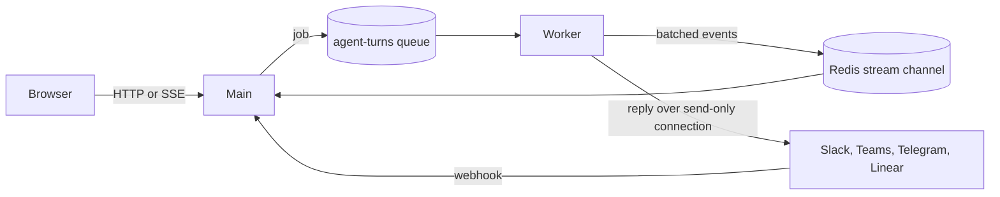

# Agents in queue mode

This document tells self-hosting operators and engineers how agent turns run
when n8n runs in queue mode (`EXECUTIONS_MODE=queue`).

## Without agent workers (default)

Main instances run every agent turn. Workers run no agent turns. Pub/sub
relays stops, config changes, and chat streams between main instances. A turn
whose process stops is marked interrupted. n8n does not run it again.

## With agent workers

Set these variables to run agent turns on workers:

| Variable | Set on | Default | Effect |
|---|---|---|---|
| `N8N_AGENTS_QUEUE_MODE_ENABLED` | every main | `false` | Mains send agent turns to agent workers. Use the same value on every main. |
| `N8N_AGENTS_WORKER_ENABLED` | workers | `false` | The worker takes agent turns from the `agent-turns` Bull queue. |
| `N8N_AGENTS_WORKER_CONCURRENCY` | workers | `5` | Maximum agent turns on one worker. Background sub-agents count toward it. |
| `N8N_AGENTS_TURN_TIMEOUT` | all | `0` | Maximum seconds for one turn. `0` means no limit. |

Use `database` or `s3` for `N8N_DEFAULT_BINARY_DATA_MODE`. With filesystem
storage, workers cannot read files that a main wrote. n8n logs a warning at
startup in this case.

### Where each turn runs

| Turn | Runs on |
|---|---|
| Preview chat and n8n chat, and their tool approvals | worker |
| Responses API webhook channel and approval decisions | worker |
| App agent chat and resume | worker |
| Slack, Teams, Telegram, Linear | worker |
| Workflow-tool resume, scheduled tasks, wakes | worker when the platform allows it |
| Discord, WhatsApp | main |
| n8n Assistant (system agents) | main |

Discord needs the Gateway connection hook of a main. WhatsApp keeps a send
rate guard for each connection. n8n Assistant registers its provider and tool
closures only on mains.

### Fallback and failure rules

- When no agent worker is registered, mains run the turns.
- When no worker claims a turn in 30 seconds, a main runs it.
- Each turn is claimed once in the database, so it runs at most once.
- When a worker stops, its turns are marked interrupted. Chat platforms get a
  notice. n8n does not run the turn again.
- On shutdown, a process lets turns finish for 70% of
  `N8N_GRACEFUL_SHUTDOWN_TIMEOUT`. Then it fails its background sub-agents and
  marks its turns interrupted.
- A cluster check reports an error when mains use different values of
  `N8N_AGENTS_QUEUE_MODE_ENABLED`.

## Metrics

With Prometheus metrics on, each process exports these metrics. Each name
starts with `N8N_METRICS_PREFIX` (default `n8n_`).

- `agent_turns_started_total{location}`: turns started on `main` or `worker`.
- `agent_turn_fallbacks_total{path}`: worker turns that a main ran.
- `agent_relays_dropped_total{channel}`: updates too large to relay.
- `agent_turns_timed_out_total`: turns stopped by `N8N_AGENTS_TURN_TIMEOUT`.
- `agent_active_turns` and `agent_active_background_runs`: work in this process.
- `agent_turn_queue_jobs{state}`: waiting and active jobs in the agent queue.

Telemetry adds `worker_turn_count` to agent session metrics.
