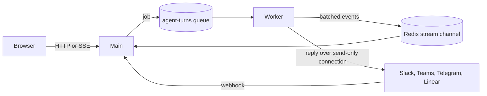
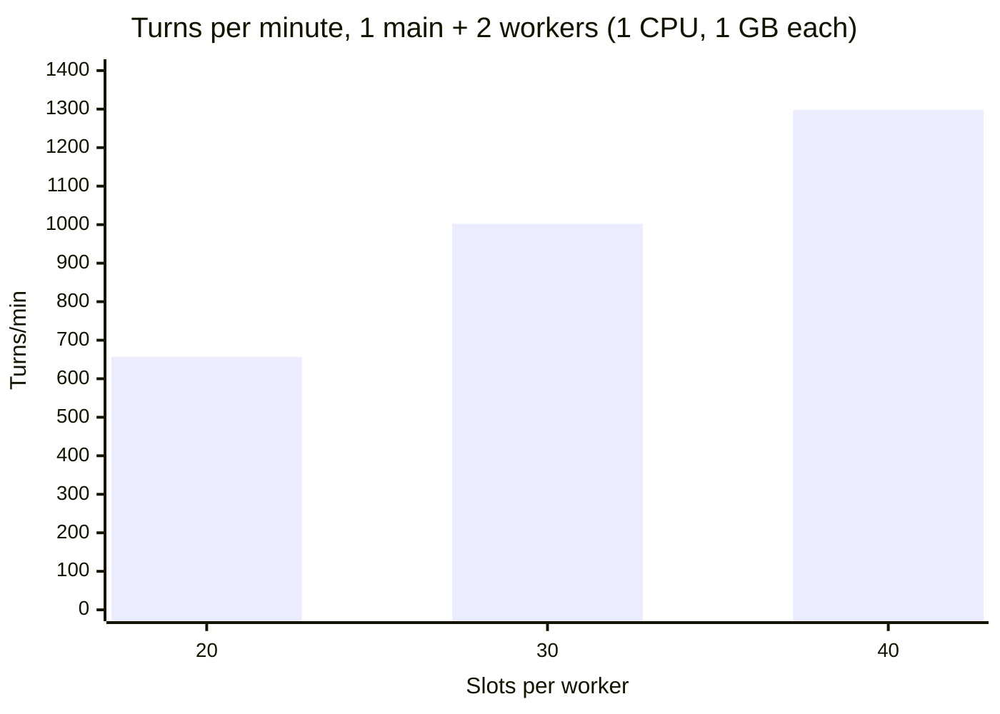

# Agents in queue mode

This document tells self-hosting operators and engineers how agent turns run
when n8n runs in queue mode (`EXECUTIONS_MODE=queue`).

## Without agent workers (default)

Main instances run every agent turn. Workers run no agent turns. Pub/sub
relays stops, config changes, and chat streams between main instances. A turn
whose process stops is marked interrupted. n8n does not run it again.

## With agent workers

Set these variables to run agent turns on workers:

| Variable | Set on | Default | Effect |
|---|---|---|---|
| `N8N_AGENTS_QUEUE_MODE_ENABLED` | every main | `false` | Mains send agent turns to agent workers. Use the same value on every main. |
| `N8N_AGENTS_WORKER_ENABLED` | workers | `false` | The worker takes agent turns from the `agent-turns` Bull queue. |
| `N8N_AGENTS_WORKER_CONCURRENCY` | workers | `30` | Maximum agent turns on one worker. Background sub-agents count toward it. |
| `N8N_AGENTS_TURN_TIMEOUT` | all | `0` | Maximum seconds for one turn. `0` means no limit. |
| `N8N_AGENTS_QUEUE_MAX_WAITING` | every main | `200` | Maximum turns that wait for a worker. Over the limit, mains reject new turns as busy. `0` means no limit. |
| `N8N_AGENTS_QUEUE_MAX_WAIT` | every main | `60` | Maximum seconds that an app chat or webhook channel request waits for a worker. Then the main rejects it as busy. `0` means no limit. |
| `N8N_AGENTS_MAIN_MAX_TURNS` | every main | `20` | Maximum agent turns that one main runs at the same time. |
| `N8N_AGENTS_MAIN_MAX_INTAKE` | every main | `20` | Maximum chat messages that one main accepts at the same time. |
| `N8N_AGENTS_MAIN_MAX_STREAMS` | every main | `200` | Maximum live chat streams on one main. Over the limit, the chat loads the reply when it is ready. |
| `N8N_AGENTS_MAIN_MEMORY_HOLD_LEVEL` | every main | `0.8` | Share of the memory limit above which a main starts no new turns or streams. |

Use `database` or `s3` for `N8N_DEFAULT_BINARY_DATA_MODE`. With filesystem
storage, workers cannot read files that a main wrote. n8n logs a warning at
startup in this case.



### Where each turn runs

| Turn | Runs on |
|---|---|
| Preview chat and n8n chat, and their tool approvals | worker |
| Responses API webhook channel and approval decisions | worker |
| App agent chat and resume | worker |
| Slack, Teams, Telegram, Linear | worker |
| Workflow-tool resume, scheduled tasks, wakes | worker when the platform allows it |
| Discord, WhatsApp | main |
| n8n Assistant (system agents) | main |

Discord needs the Gateway connection hook of a main. WhatsApp keeps a send
rate guard for each connection. n8n Assistant registers its provider and tool
closures only on mains.

### Fallback and failure rules

- When no agent worker is registered, mains run the turns.
- When no worker claims a turn in 30 seconds, a main runs it.
- Each turn is claimed once in the database, so it runs at most once.
- When a worker stops, its turns are marked interrupted. Chat platforms get a
  notice. n8n does not run the turn again.
- On shutdown, a process lets turns finish for 70% of
  `N8N_GRACEFUL_SHUTDOWN_TIMEOUT`. Then it fails its background sub-agents and
  marks its turns interrupted.
- A cluster check reports an error when mains use different values of
  `N8N_AGENTS_QUEUE_MODE_ENABLED`.

## Overload

When too many turns wait, a main rejects new turns instead of queuing them
without limit. This keeps waiting times bounded and keeps the main responsive.

| Entry point | Reject when | Caller gets |
|---|---|---|
| Preview chat and n8n chat | queue full, or main intake full for 10 seconds | chat error `queue_full` or `main_busy` |
| App agent chat | queue full, no worker starts it in `N8N_AGENTS_QUEUE_MAX_WAIT`, or no worker and main at `N8N_AGENTS_MAIN_MAX_TURNS` | chat error `queue_full` or `main_busy` |
| Responses API webhook channel | queue full, or no worker starts it in `N8N_AGENTS_QUEUE_MAX_WAIT` | `503` `server_busy` with `Retry-After: 15` |
| Slack, Teams, Telegram, Linear | never | the turn queues |

Chat platforms always queue. They retry deliveries that fail, and a rejected
message would be lost to the user.

Clients of the webhook channel must respect `Retry-After`. A client that
retries at once makes the overload worse.

## Sizing

These numbers come from the agent bench
(`packages/quality/testing/playwright/scripts/agent-bench`). Each run used
1 main and 2 workers, each container with 1 CPU and 1 GB of memory, Postgres,
Redis, and the real Anthropic API with Claude Haiku 4.5. The workload is a
production-like mix: plain chat, tool calls, two tools in one turn, a 5-second
slow tool, a data table, long replies, multi-turn chats, the Responses API
webhook, and the Message an Agent node. A schedule-triggered workflow messages
the agent every 30 seconds. A probe calls `/healthz`, a REST endpoint, and a
plain webhook on the main every second.

### Default: 1 main and 2 workers

A turn spends most of its time waiting for the model, so one worker CPU can
run many turns. The bench held the load at 1.5 times the slot count for
4 minutes:

| Slots per worker | In flight | Turns/min | Turn p50 / p95 | Worker CPU p50 / max | Worker memory max | Main REST probe p95 |
|---|---|---|---|---|---|---|
| 20 | 60 | 657 | 4.1 s / 13.5 s | 52% / 87% | 501 MB | 330 ms |
| **30 (default)** | 90 | 1,002 | 4.0 s / 13.4 s | 59% / 83% | 540 MB | 55 ms |
| 40 | 120 | 1,298 | 4.1 s / 13.6 s | 74% / 99% | 554 MB | 126 ms |



Throughput grows with the slot count, and turn latency does not change. At 40
slots the worker CPU reaches its limit. The default is 30 slots. This leaves
room for tools that use more CPU than the bench tools, such as Code nodes. No
container used more than 56% of its memory.

The main used 23% to 41% CPU at p50 and about 520 MB in every run. All turns
ran on workers.

### How to scale

- Workers with more CPU: raise `N8N_AGENTS_WORKER_CONCURRENCY` by about 30 for
  each CPU. Keep the worker CPU p50 under 70%.
- More throughput: add workers. Each worker with 1 CPU adds about 500 turns a
  minute at the default.
- Slower models: a turn holds its slot while it waits for the model. With a
  slower model, the same slots give fewer turns a minute but use less CPU. You
  can raise the slot count.
- Model rate limits: the model provider limits tokens a minute. At about
  1,000 turns a minute, this workload used about 7 million tokens a minute.
  Check your provider tier before you add workers.
- `N8N_AGENTS_QUEUE_MAX_WAITING`: set it to about 3 times the total worker
  slots. A higher value gives longer waits before n8n rejects a turn.

### Overload

The bench ramped the load to 10 times the capacity of 2 workers with 20 slots
each. The phases were 40, 80, 200, and 400 turns in flight, then 20. A client
whose turn was rejected waited for `Retry-After` and sent it again.

| In flight | Limits off: turn p50 / p95 | Limits on: turn p50 / p95 | Limits on: rejected |
|---|---|---|---|
| 40 | 3.0 s / 12.2 s | 2.8 s / 12.2 s | 0 |
| 80 | 6.0 s / 16.5 s | 5.8 s / 15.9 s | 0 |
| 200 | 16.7 s / 48.1 s | 16.1 s / 26.9 s | 18 of 1,181 |
| 400 | 33.6 s / 53.1 s (max 94 s) | 19.6 s / 33.8 s (max 73 s) | 724 of 1,489 |
| 20 | 3.1 s / 22.1 s | 3.0 s / 12.5 s | 0 |

With the limits on, accepted turns wait less, and the system recovers faster
after the peak. In both runs no process restarted, no container ran out of
memory, and the probe never failed. At 400 turns in flight with the limits on,
the main REST probe p95 rose to 1.7 s. This comes from the extra requests that
rejected clients send again.

### Losing a worker

The bench killed one of 2 workers at 120 seconds with 80 turns in flight. The
other worker took all new turns, and throughput fell from about 600 to about
470 turns a minute. 16 turns that ran on the killed worker ended with
"Stream ended without a reply". The main ran no turns, and the probe stayed
under its limits.

### Run the bench

```bash
pnpm build:docker
pnpm --filter n8n-playwright bench:agents -- \
  --config scripts/agent-bench/qm-sweep-load.config.json --image n8nio/n8n:local
pnpm --filter n8n-playwright bench:agents -- \
  --config scripts/agent-bench/qm-overload.config.json --image n8nio/n8n:local
```

Set `ANTHROPIC_API_KEY` in the environment first. Each config costs about
100 USD in Haiku tokens.

## Metrics

With Prometheus metrics on, each process exports these metrics. Each name
starts with `N8N_METRICS_PREFIX` (default `n8n_`).

- `agent_turns_started_total{location}`: turns started on `main` or `worker`.
- `agent_turn_fallbacks_total{path}`: worker turns that a main ran.
- `agent_relays_dropped_total{channel}`: updates too large to relay.
- `agent_turns_timed_out_total`: turns stopped by `N8N_AGENTS_TURN_TIMEOUT`.
- `agent_active_turns` and `agent_active_background_runs`: work in this process.
- `agent_turn_queue_jobs{state}`: waiting and active jobs in the agent queue.
- `agent_turns_rejected_total{reason}`: turns rejected as busy, by
  `queue-full`, `wait-too-long`, or `main-at-limit`.

Telemetry adds `worker_turn_count` to agent session metrics.
