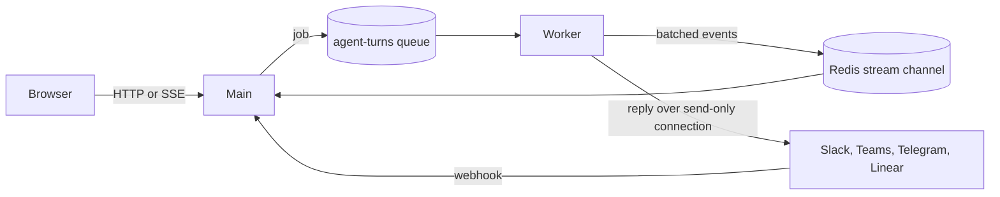
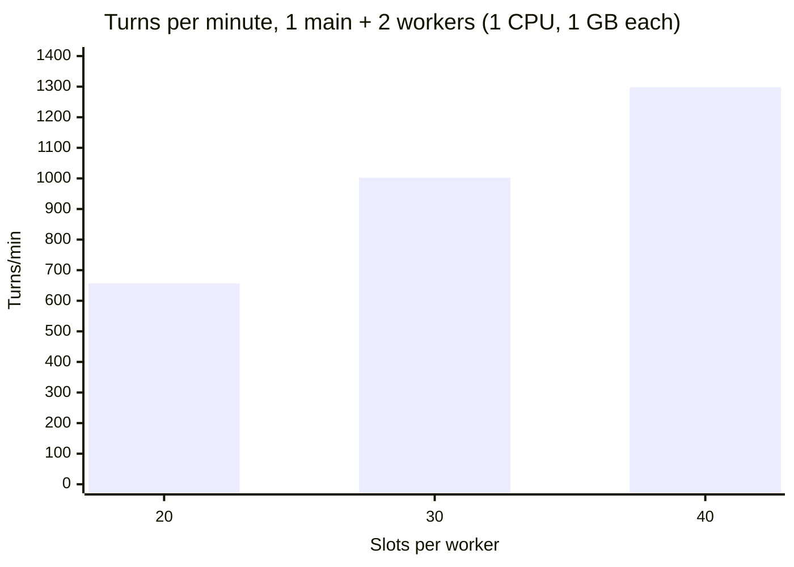

# Agents in queue mode

This document tells self-hosting operators and engineers how agent turns run
when n8n runs in queue mode (`EXECUTIONS_MODE=queue`).

## Without agent workers (default)

Main instances run every agent turn. Workers run no agent turns. Pub/sub
relays stops, config changes, and chat streams between main instances. A turn
whose process stops is marked interrupted. n8n does not run it again.

The same limits apply in regular mode and in queue mode without agent
workers. A main runs at most `N8N_AGENTS_MAIN_MAX_TURNS` turns at the same
time. Other turns wait for room. When a turn waits too long, or when too many
turns wait, the main rejects it as busy. See [Overload](#overload).

## With agent workers

Set these variables to run agent turns on workers:

| Variable | Set on | Default | Effect |
|---|---|---|---|
| `N8N_AGENTS_QUEUE_MODE_ENABLED` | every main | `false` | Mains send agent turns to agent workers. Use the same value on every main. |
| `N8N_AGENTS_WORKER_ENABLED` | workers | `false` | The worker takes agent turns from the `agent-turns` Bull queue. |
| `N8N_AGENTS_WORKER_CONCURRENCY` | workers | `30` | Maximum agent turns on one worker. Background sub-agents count toward it. |
| `N8N_AGENTS_TURN_TIMEOUT` | all | `0` | Maximum seconds for one turn. `0` means no limit. |
| `N8N_AGENTS_QUEUE_MAX_WAITING` | every main | `200` | Maximum turns that wait for a worker. Over the limit, mains reject new turns as busy. `0` means no limit. |
| `N8N_AGENTS_QUEUE_MAX_WAIT` | every main | `60` | Maximum seconds that an app chat or webhook channel request waits for a worker. Then the main rejects it as busy. `0` means no limit. |
| `N8N_AGENTS_MAIN_MAX_TURNS` | every main | `20` | Maximum agent turns that one main runs at the same time. `0` means no limit. |
| `N8N_AGENTS_MAIN_FALLBACK_TURNS` | every main | `0` | A main takes over turns from stuck workers only while it runs fewer agent turns than this. All turns on the main count. `0` turns off the takeover. |
| `N8N_AGENTS_MAIN_MAX_INTAKE` | every main | `20` | Maximum chat messages that one main accepts at the same time. |
| `N8N_AGENTS_MAIN_MAX_STREAMS` | every main | `200` | Maximum live chat streams on one main. Over the limit, the chat loads the reply when it is ready. |
| `N8N_AGENTS_MAIN_MEMORY_HOLD_LEVEL` | every main | `0.8` | Share of the memory limit above which a main starts no new turns or streams. |

Use `database` or `s3` for `N8N_DEFAULT_BINARY_DATA_MODE`. With filesystem
storage, workers cannot read files that a main wrote. n8n logs a warning at
startup in this case.



### Where each turn runs

| Turn | Runs on |
|---|---|
| Preview chat and n8n chat, and their tool approvals | worker |
| Responses API webhook channel and approval decisions | worker |
| App agent chat and resume | worker |
| Slack, Teams, Telegram, Linear | worker |
| Workflow-tool resume, scheduled tasks, wakes | worker when the platform allows it |
| Discord, WhatsApp | main |
| n8n Assistant (system agents) | main |

Discord needs the Gateway connection hook of a main. WhatsApp keeps a send
rate guard for each connection. n8n Assistant registers its provider and tool
closures only on mains.

### Fallback and failure rules

- When no agent worker is registered, mains run the turns, within the limits
  of the main.
- While an agent worker is registered, a main does not run worker turns.
  Turns wait in the agent queue. When no worker starts a turn in
  `N8N_AGENTS_QUEUE_MAX_WAIT`, the main rejects it as busy.
  `N8N_AGENTS_MAIN_FALLBACK_TURNS` lets a main take over turns from workers
  that stopped making progress. The default of 0 turns this off. Accepted chat
  messages wait in the message queue and `N8N_AGENTS_QUEUE_MAX_WAIT` does not
  apply to them.
- Each turn is claimed once in the database, so it runs at most once.
- A worker sends the events of a turn to the main over a Redis channel. When a
  started turn sends nothing for 30 seconds, the main ends it as lost.
- When a worker stops, its turns are marked interrupted. Chat platforms get a
  notice. n8n does not run the turn again.
- On shutdown, a process lets turns finish for 70% of
  `N8N_GRACEFUL_SHUTDOWN_TIMEOUT`. This includes turns that have no execution
  yet. Then it fails its background sub-agents and marks its turns
  interrupted.
- A cluster check reports an error when mains use different values of
  `N8N_AGENTS_QUEUE_MODE_ENABLED`.

## Overload

When too many turns wait, n8n rejects new turns instead of queuing them
without limit. This keeps waiting times bounded and keeps the main responsive.
These rules apply in every mode. Without agent workers, "queue" means the
turns that wait for room on this main.

| Entry point | Reject when | Caller gets |
|---|---|---|
| Preview chat and n8n chat | queue full, main intake full for 10 seconds, or main memory high | chat error `queue_full`, `main_busy`, or `low_memory` |
| App agent chat | queue full, or the turn does not start in `N8N_AGENTS_QUEUE_MAX_WAIT` | chat error `queue_full` or `main_busy` |
| Responses API webhook channel | queue full, or the turn does not start in `N8N_AGENTS_QUEUE_MAX_WAIT` | `503` `server_busy` with `Retry-After` |
| Scheduled tasks | queue full, or no room for 5 minutes | the run is skipped and logged |
| Wakes and workflow-tool resumes | never | the turn waits for room |
| Slack, Teams, Telegram, Linear | never | the turn queues |

Chat platforms always queue. They retry deliveries that fail, and a rejected
message would be lost to the user. A wake or a workflow-tool resume continues
work that already started, so n8n does not drop it.

The `Retry-After` time is between 5 and 120 seconds. It grows with the number
of waiting turns, with a random spread of 20%. The chat shows it as a
countdown. When n8n rejected the message before it accepted it, the message
stays in the chat box.

Clients of the webhook channel must respect `Retry-After`. A client that
retries at once makes the overload worse.

## Sizing

These numbers come from the agent bench
(`packages/quality/testing/playwright/scripts/agent-bench`). Each run used
1 main and 2 workers, each container with 1 CPU and 1 GB of memory, Postgres,
Redis, and the real Anthropic API with Claude Haiku 4.5. The workload is a
production-like mix: plain chat, tool calls, two tools in one turn, a 5-second
slow tool, a data table, long replies, multi-turn chats, the Responses API
webhook, and the Message an Agent node. A schedule-triggered workflow messages
the agent every 30 seconds. A probe calls `/healthz`, a REST endpoint, and a
plain webhook on the main every second.

### Default: 1 main and 2 workers

A turn spends most of its time waiting for the model, so one worker CPU can
run many turns. The bench held the load at 1.5 times the slot count for
4 minutes:

| Slots per worker | In flight | Turns/min | Turn p50 / p95 | Worker CPU p50 / max | Worker memory max | Main REST probe p95 |
|---|---|---|---|---|---|---|
| 20 | 60 | 657 | 4.1 s / 13.5 s | 52% / 87% | 501 MB | 330 ms |
| **30 (default)** | 90 | 1,002 | 4.0 s / 13.4 s | 59% / 83% | 540 MB | 55 ms |
| 40 | 120 | 1,298 | 4.1 s / 13.6 s | 74% / 99% | 554 MB | 126 ms |



Throughput grows with the slot count, and turn latency does not change. At 40
slots the worker CPU reaches its limit. The default is 30 slots. This leaves
room for tools that use more CPU than the bench tools, such as Code nodes. No
container used more than 56% of its memory.

The main used 23% to 41% CPU at p50 and about 520 MB in every run. All turns
ran on workers.

### How to scale

- Workers with more CPU: raise `N8N_AGENTS_WORKER_CONCURRENCY` by about 30 for
  each CPU. Keep the worker CPU p50 under 70%.
- More throughput: add workers. Each worker with 1 CPU adds about 500 turns a
  minute at the default.
- Slower models: a turn holds its slot while it waits for the model. With a
  slower model, the same slots give fewer turns a minute but use less CPU. You
  can raise the slot count.
- Model rate limits: the model provider limits tokens a minute. At about
  1,000 turns a minute, this workload used about 7 million tokens a minute.
  Check your provider tier before you add workers.
- `N8N_AGENTS_QUEUE_MAX_WAITING`: set it to about 3 times the total worker
  slots. A higher value gives longer waits before n8n rejects a turn.

### Overload

The bench ramped the load to 10 times the capacity of 2 workers with 20 slots
each. The phases were 40, 80, 200, and 400 turns in flight, then 20. A client
whose turn was rejected waited for `Retry-After` and sent it again.

| In flight | Limits off: turn p50 / p95 | Limits on: turn p50 / p95 | Limits on: rejected |
|---|---|---|---|
| 40 | 3.0 s / 12.2 s | 2.8 s / 12.2 s | 0 |
| 80 | 6.0 s / 16.5 s | 5.8 s / 15.9 s | 0 |
| 200 | 16.7 s / 48.1 s | 16.1 s / 26.9 s | 18 of 1,181 |
| 400 | 33.6 s / 53.1 s (max 94 s) | 19.6 s / 33.8 s (max 73 s) | 724 of 1,489 |
| 20 | 3.1 s / 22.1 s | 3.0 s / 12.5 s | 0 |

With the limits on, accepted turns wait less, and the system recovers faster
after the peak. In both runs no process restarted, no container ran out of
memory, and the probe never failed. At 400 turns in flight with the limits on,
the main REST probe p95 rose to 1.7 s. This comes from the extra requests that
rejected clients send again.

### Losing a worker

The bench killed one of 2 workers at 120 seconds with 80 turns in flight. The
other worker took all new turns, and throughput fell from about 600 to about
470 turns a minute. 16 turns that ran on the killed worker ended with
"Stream ended without a reply". The main ran no turns, and the probe stayed
under its limits.

### Regular mode: 1 main and no workers

The main runs every turn. The bench ramped the load from 10 to 160 turns in
flight, then back to 10. The table compares n8n before the turn gate (no turn
limit) with n8n after it (`N8N_AGENTS_MAIN_MAX_TURNS=20`, the default):

| In flight | No limit: turns/min | No limit: turn p50 / p95 | Limit 20: turns/min | Limit 20: turn p50 / p95 |
|---|---|---|---|---|
| 10 | 165 | 2.8 s / 12.6 s | 170 | 2.6 s / 12.2 s |
| 20 | 311 | 2.9 s / 12.2 s | 273 | 3.5 s / 12.9 s |
| 40 | 388 | 5.1 s / 16.6 s | 193 | 12.3 s / 35.7 s |
| 80 | 389 | 11.6 s / 31.3 s | 221 | 26.5 s / 83.1 s |
| 160 | 390 | 23.7 s / 44.6 s | 240 | 55.3 s / 81.3 s |

| Whole run | No limit | Limit 20 |
|---|---|---|
| Main CPU p50 / p95 | 94% / 105% | 63% / 89% |
| Main memory max | 729 MB | 629 MB |
| Main REST probe p95 | 2,464 ms | 348 ms |
| Main webhook probe p95 | 3,458 ms | 418 ms |

Without a limit, the main runs every turn at once. It uses all of its CPU,
and other requests to the main, such as the editor and webhooks, wait for
seconds. With the limit, the main stays responsive, but it runs fewer turns
a minute, and turns over the limit wait longer. Raise
`N8N_AGENTS_MAIN_MAX_TURNS` when the main CPU p50 stays under 70%. For more
throughput, add agent workers.

The main rejected no turns in this run. A chat message that the main accepted
waits in the message queue, and `N8N_AGENTS_QUEUE_MAX_WAIT` does not apply to
it. The main rejects new chat messages only when
`N8N_AGENTS_QUEUE_MAX_WAITING` messages wait. At 160 turns in flight, fewer
than 200 messages waited.

### Before and after the turn gate, with agent workers

The turn gate and the queued runner do not change the throughput of the
workers. The differences between the two runs are in the range of the run to
run spread of the bench host:

| Slots per worker | Before: turns/min | After: turns/min | Before: turn p50 / p95 | After: turn p50 / p95 |
|---|---|---|---|---|
| 20 | 657 | 676 | 4.1 s / 13.5 s | 3.4 s / 12.2 s |
| 30 | 1,002 | 913 | 4.0 s / 13.4 s | 3.9 s / 12.8 s |
| 40 | 1,298 | 1,066 | 4.1 s / 13.6 s | 5.0 s / 14.3 s |

The overload run after the change used the same phases as the run in
[Overload](#overload):

| In flight | Limits off: turn p50 / p95 | Limits on: turn p50 / p95 | Limits on: rejected |
|---|---|---|---|
| 40 | 4.3 s / 15.7 s | 3.6 s / 13.5 s | 0 |
| 80 | 7.4 s / 24.4 s | 3.5 s / 20.3 s | 24 of 1,088 |
| 200 | 16.1 s / 131.3 s | 6.1 s / 58.6 s | 126 of 1,107 |
| 400 | 20.2 s / 85.4 s | 6.1 s / 35.6 s | 335 of 1,125 |
| 20 | 3.2 s / 12.3 s | 2.7 s / 11.9 s | 0 |

With the limits on, the main REST probe p95 was 74 ms for the whole run. With
the limits off, it was 2.0 s. With the limits on, the system did 559 turns a
minute. With the limits off, it did 490. No container ran out of memory. When
the bench killed a worker, the main ran no turns, 2 turns were rejected, and
the probe stayed under its limits.

### Run the bench

```bash
pnpm build:docker
pnpm --filter n8n-playwright bench:agents -- \
  --config scripts/agent-bench/qm-sweep-load.config.json --image n8nio/n8n:local
pnpm --filter n8n-playwright bench:agents -- \
  --config scripts/agent-bench/qm-overload.config.json --image n8nio/n8n:local
```

Set `ANTHROPIC_API_KEY` in the environment first. Each config sends real
turns to Haiku, so check the turn count in the config before you run it.

## Metrics

With Prometheus metrics on, each process exports these metrics. Each name
starts with `N8N_METRICS_PREFIX` (default `n8n_`).

- `agent_turns_started_total{location}`: turns started on `main` or `worker`.
- `agent_turn_fallbacks_total{path}`: turns that a main took over because no
  worker started them in time, by `queued-message` or `request`.
- `agent_turns_held_total{reason}`: checks in which a main left a turn in the
  queue, by `workers-progressing`, `main-at-limit`, or `main-memory-high`.
- `agent_streams_skipped_total{reason}`: chat messages accepted without a live
  stream, by `main-memory-high` or `main-at-stream-limit`.
- `agent_messages_rejected_total`: chat messages rejected because
  `N8N_AGENTS_MAIN_MAX_INTAKE` stayed full for too long.
- `agent_relays_dropped_total{channel}`: updates too large to relay.
- `agent_turns_timed_out_total`: turns stopped by `N8N_AGENTS_TURN_TIMEOUT`.
- `agent_active_turns` and `agent_active_background_runs`: work in this process.
- `agent_turn_queue_jobs{state}`: waiting and active jobs in the agent queue.
- `agent_turns_rejected_total{reason}`: turns rejected as busy, by
  `queue-full`, `wait-too-long`, `main-at-limit`, `main-memory-high`, or
  `queue-unavailable` (the database or Redis failed). `main-memory-high` can
  come from low memory on the server, not only from agent load.

Telemetry adds `worker_turn_count` to agent session metrics.
