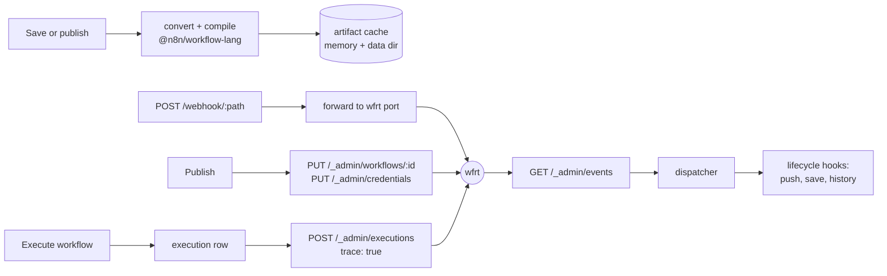

# compiled-engine (proof of concept)

This module runs workflows whose setting `engineType` is `compiled` on the
Zig runtime `wfrt`. The contract with `wfrt` is section 9 of
`packages/@n8n/workflow-lang/docs/spec.md`.

## Flow



- **Compile.** n8n converts the workflow JSON to the workflow language and
  compiles it. The result is kept by a hash of the input, in memory and in
  `<data dir>/artifacts`. `GET /rest/compiled-engine/workflows/:id/compile`
  returns the diagnostics and where each node runs (`native`, `code`, `host`).
- **Publish.** n8n keeps the webhook rows of the workflow so that it can
  route requests, but it does not start v1 triggers or pollers, and it records
  the triggers as `persisted`, so the publication reconciler does not look for
  them in memory. It loads the module into `wfrt` with `active: true` and the
  workflow's own credentials document; `wfrt` runs schedules itself and gives
  the fallback host the credential of each step. Unpublish and delete unload
  it. A changed credential reloads the workflows that use it. Credentials are
  decrypted in memory and never written to disk.
- **Manual runs.** `WorkflowRunner` sends the run to the dispatcher. It
  creates the execution row, loads the draft module as `<id>~manual` (no
  triggers), and starts the execution with `trace: true`. Events become the
  normal lifecycle hooks, so the canvas gets `executionStarted`,
  `nodeExecuteBefore`, `nodeExecuteAfter` and `executionFinished`, and the
  execution is saved with the workflow's save settings. Partial runs and
  "execute step" run the whole workflow (the log says so).
- **Production.** n8n forwards requests to `/webhook/<path>` of a compiled
  workflow to `wfrt` and returns its response. A `started` event of a trigger
  run creates the execution row; `finished` completes it. A repeated
  `finished` changes nothing.
- **Waiting.** A `waiting` event saves the execution as waiting. A timed wait
  keeps its `waitTill`; `wfrt` resumes it, and the next event claims the row
  back. For an approval (Wait on a webhook call or a form, Form pages, send
  and wait), the waiting node becomes the head of the stack and gets a
  `waiting` run, as in v1. `$execution.resumeUrl` and `.resumeFormUrl` are
  `<webhook base>/webhook-waiting/<id>?signature=<s>` and
  `/form-waiting/<id>?signature=<s>`, where `<id>`
  is the `wfrt` id (`wfrt-<n>`, or the n8n id of a manual run). n8n's normal
  waiting-webhook and form routes serve them: the form page renders on GET,
  the waiting node's v1 webhook runs, and its output item becomes the resume
  value that n8n sends to `wfrt`.
- **Static data.** Each load sends the workflow's `staticData`, n8n's copy,
  also for the draft of a manual run. `wfrt` reports each change of a
  production run on the event stream (`staticData`). n8n stores it with
  `WorkflowStaticDataService`, in the order of the events, so a switch back
  to v1 keeps it. After a gap in the stream (on connect, and after `dropped`
  events), n8n reads the copy of `wfrt` (`GET …/static-data`) and stores it
  before it sends its own copy again. With several `wfrt` processes, each
  workflow must have one owner process (spec 9.7).
- **Variables.** n8n sends the instance variables (`$vars`) to `wfrt` on
  connect and when a variable changes. Project variables are not sent.
- **Uploads.** `wfrt` reads multipart and binary bodies; the trigger item
  gets the files as binary data. The limit is n8n's `N8N_PAYLOAD_SIZE_MAX`.
- **Stop.** Stopping an execution sends `DELETE /_admin/executions/<id>`;
  the `finished` event with status `cancelled` saves it as canceled.
- **Restart.** On connect, n8n unloads workflows in `wfrt` that are no longer
  published, and marks in-progress compiled executions as crashed when `wfrt`
  has no live execution of their workflow. Other executions are adopted from
  their rows when their next event, a resume, or the wait tracker comes. The
  `wfrt` id of a trigger run is in the execution metadata
  (`compiledEngineExecutionId`).
- **Sub-workflows.** n8n loads the workflows that Execute Workflow nodes call
  and gives the converter `resolveWorkflow(id)`.

## Run the demo locally

1. Build the runtime: `cd workflow-runtime && zig build -Drelease=true`.
2. Build the fallback host and the compiler:
   `pnpm --filter @n8n/workflow-fallback-host --filter @n8n/workflow-lang build`.
3. Build n8n (`pnpm build > build.log 2>&1`), then start the backend with the
   module:

   ```bash
   N8N_ENABLED_MODULES=compiled-engine pnpm dev:be
   # or: N8N_ENABLED_MODULES=compiled-engine ./packages/cli/bin/n8n start
   ```

4. In the editor, open the workflow settings, set the engine to "compiled",
   save, and run or publish the workflow.
5. Scripted check (webhook -> IF -> Set -> HTTP Request -> Respond):

   ```bash
   N8N_URL=http://localhost:5678 N8N_EMAIL=<owner> N8N_PASSWORD=<password> \
     node packages/cli/scripts/compiled-engine-demo.mjs
   ```

## Settings

| Variable | Default | Use |
|---|---|---|
| `N8N_COMPILED_ENGINE_WFRT_PATH` | `workflow-runtime/zig-out/bin/wfrt` in the checkout | The runtime binary |
| `N8N_COMPILED_ENGINE_FALLBACK_HOST_PATH` | the built fallback host in the checkout | The host start script |
| `N8N_COMPILED_ENGINE_PORT` | `5690` | Webhook port of `wfrt` |
| `N8N_COMPILED_ENGINE_ADMIN_PORT` | `5691` | Admin port of `wfrt` (loopback) |
| `N8N_COMPILED_ENGINE_ADMIN_SECRET` | random at each start | Admin secret |
| `N8N_COMPILED_ENGINE_MANAGE_PROCESSES` | `true` | `false` to use a `wfrt` that you start |
| `N8N_COMPILED_ENGINE_DATA_DIR` | `<n8n folder>/compiled-engine` | Log, artifacts, host folder |
| `N8N_COMPILED_ENGINE_MAX_CONNECTIONS` | `0` (runtime default) | `--max-conns` of `wfrt` |

n8n starts `wfrt` with `--profile embedded` (about 32 MB idle RSS) and
`--max-request-mb` equal to `N8N_PAYLOAD_SIZE_MAX` (16 by default). Large
requests use a small pool of big buffers, so a 10 MB upload works; the demo
saw about 100 MB RSS afterwards. The base64 text of the files must fit in the
execution memory (32 MB), so files up to about 20 MB work.

The fallback host gets the n8n URLs in `WF_FALLBACK_INSTANCE_BASE_URL`,
`WF_FALLBACK_WEBHOOK_BASE_URL`, `WF_FALLBACK_WEBHOOK_WAITING_BASE_URL`,
`WF_FALLBACK_FORM_BASE_URL` and `WF_FALLBACK_FORM_WAITING_BASE_URL`.

## Limits of the PoC

- Waiting URLs are signed. `wfrt` signs each execution
  (`HMAC-SHA256` with a key from the system's random source, 128 bits), and
  `$execution.resumeUrl` and `.resumeFormUrl` end in `?signature=<32 hex>`.
  The `waiting` event carries the signature; n8n stores it as the
  execution's resume token. n8n's waiting-webhook and form routes check it
  (401 when it is missing or wrong) and use it in the URLs they make (form
  page, status poll). n8n then sends it with the resume, and `wfrt` checks it
  again (403). One signature serves all the waits of an execution.
- Main instance in regular mode only.
- `finished` with `needs_attention` saves the execution as an error, while
  `wfrt` keeps it parked. Retry is not wired to `wfrt`.
- Events that `wfrt` drops while n8n does not read them are lost (the log
  warns); `wfrt` does not send `finished` again from a replay.
- Partial runs and "execute step" run the whole workflow.
