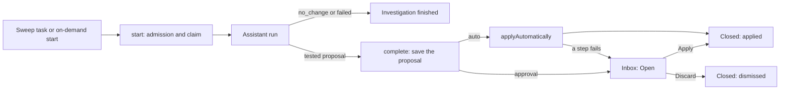

# Self-healing

This directory runs internal investigations and stores accepted results inside `instance-ai`.
It also provides the result review API.

## Automatic investigations

The `workflowExecuteAfter` hook starts self-healing after a saved production failure.
Trigger, webhook, and chat executions qualify. Manual tests, evaluations, Assistant verification,
user retries, child workflows, and error-handler executions do not qualify.
Wait/resume and existing crash recovery use the same hook and saved source metadata.

The trigger respects workflow and instance settings for saving failed executions.
Normal execution pruning still applies. It creates no snapshots or retention exceptions.
Workers relay only the workflow and execution IDs through the existing pubsub channel.
Worker and webhook processes wait for relay publication before the hook returns.
Main processes start admission in the background after the execution save finishes.
Admission does not delay execution completion and can be lost during shutdown.
Main processes call the investigation service. Each workflow can have one unfinished investigation
or open result. Different workflows can have investigations at the same time, subject to the
existing Assistant concurrency limits. The database claim prevents duplicate investigations.
The agent runs in the background after admission.

Set `N8N_INSTANCE_AI_WORKFLOW_SUGGESTIONS_ENABLED=true` on each process before startup.
The Assistant runtime loads only on main processes.
If a notification is lost or an Assistant concurrency limit refuses the run, no retry is queued.
A later eligible production failure can start a new investigation. Free capacity alone does not start one.
Trigger errors do not interrupt execution completion or normal error workflows.
There is no catch-up queue or recovery of agent output that failed to save.

## Run an investigation

Call `SelfHealingInvestigationService.start(input)` from backend code.
Set `N8N_INSTANCE_AI_WORKFLOW_SUGGESTIONS_ENABLED=true` before startup.
Supply `projectId`, `workflowId`, and the original failed `executionId`.
The producer selects the project configuration and checks the enabling user’s current access.
A selected-workflow configuration takes precedence over all-workflow coverage, even when paused.
The call returns `null` when no enabled configuration authorizes the investigation.
It also returns `null` for a new failure during a Could not fix cooldown. See [Investigate again](#investigate-again).
It captures the baseline with `WorkflowSuggestionService.captureBaseline()`.
The run keeps the captured baseline in memory. The investigation stores only the published version
ID, which the cooldown reads.
The workflow must be fully published. The failure must belong to its current published version.
Manual and evaluation executions are ineligible.
Credential and network failures can still need investigation.

The producer checks execution metadata without loading execution data.
It passes the execution ID to the agent. The agent reads details through the existing execution tools.
Execution reads use the normal Assistant access checks. The agent can inspect other executions
that the actor can access, including executions from related workflows.
The execution must remain saved and readable. Investigation inputs contain no execution payload.

The call returns `{ kind: 'investigation', investigationId }` or
`{ kind: 'result', resultId }` for an existing open result.
A workflow can have one unfinished investigation or open result.
An unfinished investigation blocks the workflow across projects and configurations.
An open result blocks investigations only in the workflow's current project.
An open result also blocks investigations of each workflow that has a pending suggestion in it.
This also applies when the result belongs to another configuration, whose reviewers are the only ones who see it.
Repeated starts for the same failed execution return the original investigation, including after completion.
Automatic triggers and eligibility for a new failure remain the caller's responsibility.
When an access check fails, the producer pauses the configuration. Another eligible user must
explicitly enable it before new work can start.
User deletion also removes that user's investigations and results.
Leaving the project does not delete those records or necessarily remove globally granted access.
The user who re-enables self-healing becomes the background user for new investigations.
Re-enablement does not change the background user recorded on an existing investigation.

The producer calls `InstanceAiService.startSelfHealingRun()` with its stored thread and run IDs.
This uses the existing Assistant run lifecycle. It does not create another job runner.

The backend binds `verify_candidate({ workflowId, filePath, validationOnly?, triggerNodeName?, inputData? })` to this investigation.
It checks current access before it reads and compiles the candidate against the captured baseline.
The workflow ID selects the baseline. The run tries to admit a workflow that is not a target yet.
A workflow that the run cannot admit fails validation. The error gives the reason.
The file must declare the same workflow ID. Otherwise, validation fails with `candidate_workflow_mismatch`.
With `validationOnly: true`, it returns structural checks without execution.
For execution checks, the agent selects the failed trigger and supplies its test input.
The tool passes these options to the existing verification runner. Each call tests one trigger.

`SelfHealingAgentService` does not write workflow files. The starting message gives the name and ID
of the triggering workflow. The agent opens a workflow with the `get_workflow_as_code` tool.
This tool writes the source to a workspace file. All files use one sandbox.
Reads of a target return its captured baseline. The agent cannot select another version.
The triggering workflow is always a target. Sub-workflows become targets when the agent reads or verifies them.
See [Sub-workflows](#sub-workflows). Reads of other workflows are for context only.
The agent edits the workflow that causes the failure. This can be a sub-workflow.

The dedicated `self-healing-v1` agent can read workflows, executions, data tables, and node metadata.
It can read and edit workspace files, run sandbox commands, and call `verify_candidate`.
Self-healing respects blocked web search and URL fetching permissions.
Other research permission modes do not need interactive approval.
The agent has no save, publish, credential setup, MCP, browser, or delegation tools.
It does not request user confirmation or start follow-up runs.

The runtime returns technical `status`, finish information, `usage`, and validated `output`
when available. Output requires `outcome`, `summary`, `report`, and `candidateWorkflowIds`.
`candidateWorkflowIds` lists the IDs of the changed workflows. It is empty when there is no candidate.
`fix_ready` requires at least one ID. `could_not_fix` excludes them.
The run remembers the last file of each target that passed validation in `verify_candidate`.
It returns a candidate compiler for each listed ID with that file and the baseline of the target.
The run removes duplicate IDs. An ID without such a file returns no candidates. The investigation then fails and stores no result.
Final compilation compiles every candidate. One failure fails the whole investigation.
If a candidate has mocked credentials or placeholders, the producer changes `fix_ready` to `needs_you`.
It keeps the candidates and replaces the report with setup instructions for all of them.
Each changed candidate becomes one suggestion of the result. Unchanged candidates are omitted
and do not add setup instructions.
A `fix_ready` result without a changed candidate is rejected.
Before it saves the result, completion locks every target workflow in ID order.
It rechecks each baseline and edit access in the same transaction.
A stale member or a pending suggestion of another result rolls back the whole group.
Unknown usage measurements stay null. The invocation claims measured credits once.
Callers must not claim those credits again.

Each invocation has a separate thread under `ia-self-healing:<actorId>`.
The database thread record keeps this resource identity for ownership and cleanup.
SDK conversation history and checkpoints stay in process memory.
Each invocation starts with empty conversation history.
Run events remain in the database. These events can include text and tool results.
Server metadata records the actor, project, workflow, and execution IDs.
The conversation stays hidden from every user, including the actor.
Account credit updates omit its thread ID and thread total.
Deleting the actor also removes these internal threads.

The host uses its existing admission limits, run registry, sandbox, tracing, and shutdown drain.
An unexpected suspension stops the invocation.
A crashed invocation becomes `crash_interrupted`. It cannot resume as ordinary chat.
Workspace retention follows the existing sandbox lifecycle.
The awaited completion hook saves the result before the host releases the run.

`SelfHealingInvestigationService` owns admission, final candidate compilation, and acceptance.
When parameter sharing is disabled, candidate source omits node parameters and verification is unavailable.
`compileCandidateWorkflow()` reuses the builder compiler, credential resolution, and save preparation.
It uses the captured baseline for existing IDs, setup values, and layout. It keeps baseline workflow
fields outside the candidate graph. Verification also runs the builder's credential permission check.
Suggestions only change nodes and connections. Node-group edits are not supported.
Apply runs the normal save validation on the retained groups.
Unchanged candidates can be checked. Final acceptance must require a useful change for a suggestion.
Recheck the baseline before saving the result. A successful execution is not required to store useful changes.
There is no public launch endpoint.

## Investigate again

Admission blocks new investigations while a Fix ready or Needs attention result is Open.
The result stores its `reviewState`. A Fix ready or Needs attention result starts `open`. A Could
not fix result starts `closed`. When the first suggestion of a result closes, the result gets the
same state: `applied`, `outdated`, or `dismissed` for a discarded suggestion. The state stays when a
workflow deletion removes the suggestions.

For a Fix ready or Needs attention result, dismissal, discard, or outdated reconciliation permits
another eligible production failure on the same published version. Apply saves a draft.
Another investigation requires successful publication and a new eligible failure. Closing a
result, opening the editor, changing a configuration, and publishing do not start an investigation.

A Needs attention report without a suggestion stays Open until dismissed, even after a new publication.

A Could not fix result blocks investigations for 24 hours after its completion. The block applies
to the workflow, its owning project, and the investigated published version. Admission checks
the workflow's current published version before it captures a baseline. A saved draft does not
change that version, so admission skips the failure without an error. The claim transaction checks
again after it confirms that the captured version is still published. Skipped failures do not
extend the cooldown.
Another accepted Could not fix result starts a new cooldown. A different successfully published
version becomes eligible immediately. Both cases require another eligible production failure.
Republishing the same version does not reset the cooldown. No background job clears it.

Pause, resume, and configuration edits do not clear either block. Configuration deletion removes
its history and resets the block. Results from a previous owning project do not block the new project.

Crashes, interruptions, and turn limits without an accepted result release the running claim.
A different eligible failed execution can then start an investigation. The same execution remains
deduplicated. There is no retry cap for runs that finish without a result.

## Configure self-healing

Project Settings provides configuration management for team projects under the existing `project:update` permission.
Only the owner of a personal project can manage the configurations of that project. `project:update` from a global role does not give access.
This check uses the current `project:personalOwner` relation. Chat users have only the viewer role on their personal project, so they cannot manage its configurations.
Personal configurations use `includeAllProjectMembers` with no individual reviewers.
The owner is the only member of a personal project. The shared reviewer rules require current membership and workflow edit access.
Instance owners and admins do not review, list, or open results of another user's personal project. A saved reviewer row for another user has no effect there.
This exception applies only to self-healing configurations. It does not grant `project:update`.
Personal projects show the configurations on their own Self-healing tab, not in Project Settings.
The same rollout flag controls settings, investigations, and reviews.
Each project can have one all-workflows configuration and multiple selected-workflow configurations.
Explicit workflow selections cannot overlap, including when configurations are paused.
A configuration can also cover agents. See [Agent coverage](#agent-coverage).
Moving a workflow to another project removes its explicit selections. The destination project's
configuration applies to later failures. Moving between folders in the same project keeps selections.
New configurations created in Project Settings start enabled.
The form selects the creator as the initial reviewer when the creator can be selected.
Enabling a configuration records the user whose access authorizes subsequent investigations.

### Agent coverage

A configuration covers workflows, agents, or both. The reviewer list is the same for both kinds.
These fields set the agent coverage:

| Field                        | Values                              | Meaning                                                    |
| ---------------------------- | ----------------------------------- | ---------------------------------------------------------- |
| `agentScope`                 | `none`, `all`, `selected`           | The agents that the configuration covers.                  |
| `agentIds`                   | Agent IDs                           | The selection for `selected`. Other scopes store no agent. |
| `agentGoals`                 | List of `quality`, `cost`, `latency` | What an investigation tries to improve. The server always stores `quality` first. `cost` and `latency` are optional additions. |
| `agentScheduleIntervalHours` | 1 to 720, or `null`                 | Start an investigation after this number of hours.         |
| `agentTraceThreshold`        | 1 to 10000, or `null`               | Start an investigation after this number of production sessions have new activity. |
| `agentPublicationMode`       | `approval`, `auto`                  | Wait for a reviewer, or apply each proposal.               |

A `null` trigger is off. A configuration that covers agents must have one trigger or both. The API
rejects a save without a trigger with a 400 response. With the two triggers on, the first one that
is due starts the investigation. The form shows the triggers as one choice: on a schedule, after new
sessions, or whichever comes first.
`POST /projects/:projectId/self-healing-configurations/:configurationId/agent-investigations`
starts an investigation of one covered agent on demand. It uses the same access check as the other
configuration routes. The configuration form does not call this endpoint.

Each project can have one all-agents configuration and multiple selected-agent configurations.
Explicit agent selections cannot overlap, including when configurations are paused.
An explicit selection takes precedence over all-agent coverage.
The selection accepts agents of the project that are not archived.
A configuration that covers agents can have `scope: selected` with no workflows. It then covers agents only.
The telemetry of such a configuration reports `scope: selected` with no selected workflows.

Agent coverage needs the Agents feature. The options response has an empty `agents` list when Agents are off.
Then a new configuration cannot cover agents, and an edit must keep the stored `agentScope` and `agentIds`.
An edit can change all other fields, so the owner can continue to manage workflows and reviewers.

Enabling a configuration that covers agents needs `agent:read`, `agent:update`, and `agent:execute` in the project.
`agentPublicationMode: auto` also needs `agent:publish`. Workflow access is necessary only when the
configuration covers workflows.
An edit of an enabled configuration that adds agent coverage, or that changes the mode to `auto`,
needs the same access. The edit then records the editing user as the enabling user.
Agent investigations and automatic publication use the access of the enabling user. When that user
loses the access, or when no reviewer can edit agents, the next check pauses the configuration.

`includeSubWorkflows` lets investigations repair sub-workflows of covered workflows. It does not
start investigations for sub-workflow failures. It defaults to `false`.
When it is set, the agent run tries to admit a sub-workflow when the agent reads its current version
or calls `verify_candidate` for it. Historical version reads do not admit a workflow. The run admits
a workflow only when all of these conditions are true:

- The published version of a target calls it. The run reads `workflowCall` rows of the dependency index.
  Sub-workflows of admitted sub-workflows can also become targets.
- It has no pending suggestion.
- The actor has the same workflow and execution access to it as to the triggering workflow.
- A reviewer can edit it and all current targets, so a reviewer can always see the result.
- The baseline capture succeeds. The workflow must have edit access and no unpublished changes.
- It is in the project of the triggering workflow.
- The run has fewer than `MAX_SUB_WORKFLOW_TARGETS` sub-workflow targets.

The run captures the baseline of an admitted workflow and serves all its later reads from it.
Reads of a workflow that is not admitted return the live workflow. The agent cannot verify it.
`get_workflow_as_code` returns its source inline without a file, with the reason in the note.
The run admits one workflow at a time. It checks a workflow that is not admitted again on each
read, because a new target can make it eligible.
Sub-workflows get no admission reservation.

### Reviewers

Only current members of the configuration's project are reviewers.
In team projects, instance owners and admins are implicit members, as Project Settings shows.
They do not need a project relation. Other global roles do not make a user a member.
Personal projects have no implicit members.
A configuration can select individual members, the project members group, or both.
The group stores the `includeAllProjectMembers` flag, not a list of users.
Each check reads current project membership and global roles. A user who joins the project, or who
becomes an instance owner or admin, joins the group. A reviewer who loses one membership source
stays a member while the other source remains. A user with no explicit or implicit membership
stops being a reviewer, also when selected individually.
The individual picker offers enabled members who can edit a project workflow. The access can come
from a project role, a global role, or a workflow share. Save accepts the same members, so a
selected reviewer stays valid after a role change while a share still gives edit access.
The picker also offers members whose project role or global role can edit agents (`agent:read` and `agent:update`).
Existing permissions still apply. A reviewer reviews a result only with edit access to its
workflow, from a project role, a global role, or a workflow share.
Admins can manage and enable a team configuration without being selected as a reviewer.
The configuration must have at least one enabled reviewer with edit access to a covered workflow.
A configuration that covers agents must also have one enabled reviewer who can edit agents.
Save and enable reject the configuration otherwise. When an access check finds no
such reviewer, the configuration pauses.
`GET /self-healing/status` also reports a reviewer of a configuration that covers agents, when the
reviewer can edit agents in its project.

Pause stops new investigations and prevents results from being saved while paused.
After an explicit pause commits, the service requests cancellation of its unfinished investigations,
of workflows and of agents.
The Assistant runtime routes cancellation to local runs and runs on other main processes.
Re-enabling permits future investigations. It does not resume canceled agents.
Saved results remain available to assigned reviewers while the configuration is paused.

A result groups its suggestions, one for each changed workflow. Reports without changes have no suggestion.
Removal deletes the configuration. Foreign keys cascade deletion to selections, reviewers,
investigations, results, their suggestions, and suggestion activity.
Removal collects unfinished thread IDs before deletion and requests cancellation after commit.
Cancellation is best-effort. A failed request does not fail a committed pause or removal.
A rolled-back pause or removal does not request cancellation.
Cancellation can arrive late, so result acceptance still checks the configuration and abort signal.
If cancellation misses a run and the configuration resumes before completion, its result can be saved.
Late completion skips missing configurations and investigations.
Already applied workflow changes remain saved.
Admission and result acceptance coordinate with pause and removal through a short configuration
row lock. Agent execution stays outside database transactions.

## Verify a candidate

Each call compiles the current workspace file. `candidateChecksum` identifies the compiled candidate.
Verification uses the captured baseline even if the saved workflow changes. Completion rejects outdated results.
Validation and execution evidence are separate. Edits require another check.
The tool reuses the builder simulation planner, execution adapter, and coverage analysis.
Credential changes use the normal builder rules. The response includes resolved and missing credentials.
Nodes with mocked credentials use the same simulation rules as builder verification.
It returns node previews, failures, simulated nodes, and nodes that the run did not reach.
Some nodes execute against external services under the existing simulation rules.

Full verification creates an archived, unpublished temporary workflow with a backend-assigned ID.
It copies the candidate graph and the original runtime state. Execution writes affect this copy.
The saved workflow, its history, and its published version remain unchanged.

The service copies findings into the tool response before cleanup. It stops unfinished executions
and deletes terminal executions and their temporary workflow. Canceled executions remain for
24 hours after their stop time. If the stop time is missing, cleanup uses the temporary workflow's
creation time. The existing prune task retries records older than 24 hours.
A namespaced resource record keeps cleanup ownership after the investigation thread is deleted.
No suggestion row is created by verification.

## Store a result

The runtime validates final output. The producer compiles the current content of the file that last passed validation for each listed workflow.
It applies the shared text filter to the final summary and report before storage.
It keeps both fields within their output limits after replacement.
It passes the report, runtime usage, and compiled graph directly to the result service.
A credit-claim failure leaves unknown credits and does not discard valid output.

`SelfHealingResultService.complete(...)` receives the captured baseline from the run and prepares
the optional suggestion through `WorkflowSuggestionService`. It rejects a baseline from another
investigation. It rechecks access and the captured baseline, then saves the result, its
suggestions with `selfHealingResultId`, submission activity, and investigation completion in one
transaction. Cancellation before acceptance rolls back the result and its suggestions.
Once the completion commits, a later cancellation does not change it to a canceled run.
A repeated completion returns the saved result.
A failed transaction releases the investigation claim. The report is not saved for retry.
Changed baselines and lost access stop completion without creating a result.

Startup releases interrupted claims after the interrupted-run sweep.
A separate scheduled task checks unfinished claims every minute, even when data pruning is disabled.
Investigation cleanup failures do not block Assistant data pruning or temporary workflow cleanup.
Investigation cleanup remains available when new investigations are disabled.
Technical status and termination reasons stay in the existing Assistant run events.
Completion releases the investigation claim. An open result then prevents new investigations.
Apply, discard, dismissal, and outdated reconciliation use the existing suggestion lifecycle.
Call `complete()` only for accepted investigation outcomes. Technical failures without an accepted result stay
in internal run records and do not create a report or suggestion.
The investigation instructions must keep sensitive values out of reports, summaries,
suggestion explanations, and error context. The text filter handles recognized patterns.
It does not remove arbitrary private information.

| Outcome         | Suggestion | Actions                                                    |
| --------------- | ---------- | ---------------------------------------------------------- |
| `fix_ready`     | Required   | Apply and publish, Continue in Assistant or editor, Discard |
| `needs_you`     | Optional   | Continue in Assistant or editor, Discard                    |
| `could_not_fix` | None       | None. The result closes automatically                       |

The summary is a plain-language title with at most 80 characters.
The agent writes the report as one Markdown string with two sections: **What happened**
and **What changed**. The prompt asks for fewer than 150 words. Verification limits,
blockers, and next steps belong under **What changed**. The stored report size limit
remains 50,000 characters. Existing reports remain readable.

Usage contains `turns` and `durationSeconds`.
The runtime selects the usage shape before setup from the AI service proxy setting.
Credit usage contains `credits` and no token counts.
Token usage contains `promptTokens`, `completionTokens`, and `totalTokens`, with no `credits` field.
Each variant requires all its fields. Individual measurements can be null when unknown.
A failed credit claim keeps `credits: null`. The presence of the field identifies credit usage.
The runtime passes token measurements to the existing credit service in both cases.
The credit service decides whether to bill the run.
The producer uses one runtime invocation. Persistence stores its usage without charging it again.
Credit billing still uses token counts from the existing runtime billing path.
Recovery closes interrupted investigations without a result. It does not infer a new usage shape.

Configuration, workflow, original-project, and background-user deletion cascade to the result.
Result deletion cascades to its suggestions. Suggestion deletion keeps the result.
Execution pruning and private-thread deletion do not remove reports or the stored execution ID.
Execution references can point to either execution engine. Reads check current workflow and
execution read access and workflow association. Missing or inaccessible execution references
return `unavailable` without an ID. Execution lookups use the normal transport timeout.
The review UI owns loading feedback while result details are fetched.

## Review a result

Routes use `/projects/:projectId/workflows/:workflowId/self-healing-results`:

- `GET /:resultId`
- `POST /:resultId/approve-and-publish`
- `POST /:resultId/apply`
- `POST /:resultId/dismiss`

Project members who are assigned reviewers or, when selected, part of the project members group
can review results with current edit access to the triggering workflow and every suggestion
workflow. Approval also requires publish access. Approval accepts only Fix ready results. Apply
accepts Fix ready and Needs attention results that have a suggestion. Apply and approval save every
suggestion of the result in one transaction. Approval then requests publication of each saved
workflow, sub-workflows first. Reviewer filtering applies to Inbox lists, counts, details,
and actions. Each action resolves its suggestions from the result and returns the updated review.
The detail lists the suggestions with the triggering workflow first.
The detail and action responses also return `workflows` and `calls` for the call hierarchy.
`workflows` contains the triggering workflow, each changed workflow, and each unchanged workflow on a
call path between them. `calls` contains the calls between these workflows.
The calls come from the workflow dependency index, so they show the current draft and published
calls, not the versions that the agent read. The walk starts at the triggering workflow. It stays in
the project of the result and stops after 10 levels or 100 workflows. Unchanged workflows that the
reviewer cannot read are left out. A changed workflow without a path to the triggering workflow is
listed without a caller.
Send the editor client ID in `push-ref` for Apply actions.
Read the returned review state before navigating. A competing action can close the suggestion first.
The first successful action closes the result. Later Apply, approval, and dismissal requests return
a conflict and do not save or publish again. An outdated suggestion returns `outdated`.
Apply saves the proposed fix without publishing; the UI opens the editor when `reviewState` is `applied`.
Detail reads do not change suggestion state. Workflow events reconcile stale suggestions, and actions
check the current workflow before writing. When one suggestion becomes outdated, every pending
suggestion of its result closes as outdated. When a sub-workflow with a pending suggestion is deleted,
the result and its other pending suggestions also close as outdated. Deletion of the triggering
workflow removes the result. When the triggering workflow or a
workflow with a pending suggestion moves to another project, the open result closes as outdated. If Apply fails, keep the review open and show the error.

The Discard and close button calls `POST /:resultId/dismiss`.
Dismissal discards every pending suggestion of the result in one transaction, and the result gets the
`dismissed` state. If one suggestion is outdated, dismissal closes all of them as outdated and
discards none, and the result gets the `outdated` state. An open result without a suggestion gets the
`dismissed` state directly.
Dismissal leaves automatically closed Could not fix results unchanged and returns `closed`.
Already applied, discarded, or outdated suggestions keep their existing closure.
Apply uses the existing suggestion action service. An applied result stays applied if publication
returns an error. After the first publication request error, approval stops. For a result with
more than one suggestion, it requests the previous published version of each workflow whose active
version is still the applied version. The first restoration request error stops restoration.
`publishError` describes the first error. `restorationError` describes the restoration request
that returned an error. The response
includes the workflow ID and the recorded applied version of each suggestion. Open the normal editor
for publication status and recovery.

Continuation applies a suggestion to the workflow draft, or dismisses a result without one.
It opens the destination only when the result becomes `applied` or `dismissed`.
For the Assistant, pass `report` to the normal Assistant handoff. Build a workflow attachment
from `workflowId`. Include `execution.id` only when `execution.status` is `available`.
The normal handoff opens a new chat in the clicking user's personal project.
Use the reviewer's personal project, not the result's `projectId`, for this chat.
Load the personal project before the review action. If it cannot load, keep the result open.
Normal chat ownership and tool permissions apply. Do not copy the background conversation or grants.

## Telemetry

The events are in the `SELF_HEALING` domain of `@n8n/telemetry`.
Run `pnpm --filter @n8n/telemetry catalog` for the event names and properties.
Each service calls `Telemetry.track()` at the place where the change occurs.

| Event                                          | Sender                                                             |
| ---------------------------------------------- | ------------------------------------------------------------------ |
| `Self healing evaluated failure`               | `SelfHealingInvestigationService.start()`.                         |
| `Self healing finished investigation`          | `SelfHealingInvestigationService`, also from reconciliation.       |
| `Self healing changed result state`            | `SelfHealingResultService`: `complete()`, `act()` and `dismiss()`. |
| `Instance changed self healing configuration`  | `SelfHealingConfigurationService`.                                 |
| `Instance reported self healing configuration` | `SelfHealingConfigurationSnapshotTask`, one time each day.         |
| `User viewed self healing result`              | The Inbox result view.                                             |
| `User clicked self healing action`             | The Inbox result view, before the request.                         |

- Each main evaluates a relayed failure. Only the leader reports a skip. The main that
  creates the investigation reports it.
- A main that is not the leader can handle a failure without a relay, for example a webhook
  run that fails before a worker starts it. A skip of that failure sends no event.
- A rare repeat is possible. Analytics keeps one row for each `execution_id`,
  `investigation_id`, or `result_id` with `new_state`.
- Events are sent after the transaction commits. Code in a transaction registers the call
  with `afterCommit()`, and `runInTransaction()` runs it after the commit (`../after-commit.ts`).
- The workflow suggestion code closes a result as outdated. It does not import the result
  service. It emits `self-healing-result-outdated`, and `SelfHealingTelemetryEventRelay`
  reports the result.
- A result sends one state event for each change, also when its fix changes more than one
  workflow. `changed_workflow_count` has the number of changed workflows.
- A chat that starts from a result adds `result_id` and `result_kind` to
  `User launched Instance AI thread`. This links the chat to the result.
- Events never carry an error message, a node name or report text.

## Availability

Set `N8N_INSTANCE_AI_WORKFLOW_SUGGESTIONS_ENABLED=true` before startup to enable investigations
and load review routes. The flag defaults to `false`. Restart n8n after changing it.
The `instance-ai` module must be loaded. Entities and migrations do not depend on this rollout flag.
Saved review services do not require Assistant model availability. Recovery of existing
investigations remains available when the flag is off.

The shared Inbox reads result rows through `SelfHealingResultService.listForInbox()`.
It reads counts through `countForInbox()`. Both use current reviewer membership, editor access, and original-project ownership of every
suggestion workflow.
The source selects rows before applying the shared pagination boundary and limit.
The shared API uses `GET /inbox` and `GET /inbox/summary`.
`GET /self-healing/status` tells the Inbox whether a configuration can send results to the current user.
It applies the reviewer and workflow edit access rules of the result list.
It also returns the ID of the user's personal project, where the Inbox offers the setup.
Open and Closed derive from `reviewState`.
Could not fix results are Closed. Inbox reads do not change either state.
The review UI will provide review screens and chat and editor navigation.

## Agent improvements

A configuration that covers agents starts investigations of published agents. An investigation reads
the published agent, its eval suite and its production sessions. It can propose edits to the agent,
changes to the eval suite, or the two together. The code is in `agents/`. It does not use the workflow
tables.

### Start an investigation

`SelfHealingAgentInvestigationService.start()` has two callers: the on-demand route (trigger `manual`)
and `SelfHealingAgentSweepTask`. It returns a `StartSelfHealingAgentInvestigationResponse` and does
not wait for the run. The checks run in this order:

1. The rollout flag is on. If Agents are off, the answer is `testing_unavailable`.
2. `findForAgent` returns this configuration and it is enabled. If not, the answer is `not_covered`.
3. The enabling user has the agent access. If not, the configuration pauses and the answer is `no_access`.
4. The instance can test a proposal: the `agent-evals` and `data-table` modules are active and the
   instance does not use queue mode. If not, the answer is `testing_unavailable`.
5. The agent has no unfinished investigation (`already_running`) and no open proposal (`open_proposal`).
   The investigation check comes first, because a completion changes an unfinished investigation
   into an open proposal in one commit.
6. `AgentProposalService.readBase()` returns the published version, and the draft has no changes.
   If not, the answer is `not_published` or `unpublished_changes`.
7. One transaction locks the configuration, repeats checks 3 and 5, and inserts the investigation.
   The partial unique index on `agentId` for unfinished rows is the claim. A unique violation
   gives `already_running`.
8. `InstanceAiService.startAgentImprovementRun()` starts the run. If the Assistant refuses the run,
   the investigation finishes as `failed` with `not_started` and the answer is `busy`.

Check 5 closes an open proposal as `outdated` when no part of it is applied and its base version is
not the published version. No person is told about an open proposal, so without this step such a
proposal blocks the agent.

The trace window is `(traceWindowStart, traceWindowEnd]`. The end is the admission time. The start is
the newest of these times: the end of the last window that an investigation of the agent used, the
publication of the current version, and 30 days before the admission. An investigation with the
outcome `proposal` or `no_change` uses its window. A `failed` investigation does not, so the next
investigation reads the same sessions again. Later activity stays for the next investigation.

A production trace is one production session: one conversation that has a minimum of one settled
top-level turn from a production source in the window. Eval runs and test chats are not production
sessions. A session with new turns in two windows counts in the two windows. The investigator reads
the full conversation of a session, also the turns from before the window, so that it can see a user
correction that follows a failure. The fields `agentTraceThreshold`, `traceWindowStart`,
`traceWindowEnd` and `traceCount` count sessions. The count has these accepted inexact cases:

- A turn that is still running at the end of the window does not make its session count.
- For an agent that was published before publication history existed, the publication time is the
  save time of the version.

### The sweep

`SelfHealingAgentSweepTask` runs every 5 minutes on one main. It is registered only when the rollout
flag is on. It first calls `reconcile()`. It stops there when Agents are off or the instance cannot
test a proposal. For each enabled configuration that has a trigger, it resolves the enabling user one
time, and then checks each covered agent. For `agentScope: all`, the covered agents are the published
agents of the project that no other configuration selects.

An agent is skipped when it has unpublished changes, an unfinished investigation, an open proposal
that can be applied, or an investigation that failed in the last hour. The triggers are:

| Trigger    | Due when                                                                                    |
| ---------- | ------------------------------------------------------------------------------------------- |
| `schedule` | `agentScheduleIntervalHours` have passed since the newest of: the last used trace window, the last change of the configuration, and the publication of the current version. |
| `traces`   | The trace window has `agentTraceThreshold` production sessions or more.                     |
| `both`     | The two triggers are due in the same sweep. One investigation starts.                       |

The schedule does not start an investigation that has nothing new to read. When the last investigation
that used its window read the current published version, and no production session has new activity
since the end of that window, the schedule is not due. The first investigation of a version starts
on schedule, also without sessions. This rule does not change the `traces` trigger.

One sweep starts 5 investigations at most. An error for one agent is logged and the sweep continues.
The task does not retry a failed sweep, because the next sweep does the same work.

### Finish an investigation

Each finish writes `outcome`, `failureReason`, `usage` and `finishedAt` with a compare-and-set on
`finishedAt IS NULL`.

| Outcome     | When                                                                              |
| ----------- | --------------------------------------------------------------------------------- |
| `no_change` | The investigator found nothing worth changing. There is no Inbox item.            |
| `proposal`  | `SelfHealingAgentResultService.complete()` saved a proposal.                      |
| `failed`    | All other cases. `failureReason` has a code, never an error message.              |

The failure codes are `not_started`, the run status (`cancelled`, `errored`, `suspended`), the finish
reason of the model, `invalid_output`, `untested_proposal`, `agent_changed`, `configuration_paused`,
`save_failed` and `crash_interrupted`.

The proposal is the input of the last `test_proposal` call that succeeded. A `proposal` answer without
such a call fails as `untested_proposal`. `complete()` first checks that the agent is the same as at
admission when the proposal has agent edits (`agent_changed` if not). It removes secrets from the
summary and the report. Then one transaction locks the configuration, checks the enabling user
again (`configuration_paused` if the configuration was paused during the run), inserts the
`self_healing_agent_result` row as `open`, and finishes the investigation with the result ID.

The report is 3 or 4 short plain paragraphs for a reader who is not technical. The investigator
calls `check_report` before it answers. The input schema of that tool accepts 900 characters at
most and no headings or lists, and a rejected input goes back to the model. The output schema keeps
its 50,000 character limit, because an answer that fails the output schema ends the run as
`invalid_output` and the tested proposal is lost.

`reconcile()` closes the claim of a run that a crash or a restart interrupted (`crash_interrupted`).
It runs at startup, also when the rollout flag is off, and in each sweep. It does not release apply claims.

### Review and apply a proposal

| Route                                                                    | Scope          | Action                 |
| ------------------------------------------------------------------------ | -------------- | ---------------------- |
| `GET /projects/:projectId/self-healing-agent-results/:resultId`          | `agent:read`   | Read the proposal.     |
| `POST /projects/:projectId/self-healing-agent-results/:resultId/apply`   | `agent:update` | Apply the proposal.    |
| `POST /projects/:projectId/self-healing-agent-results/:resultId/dismiss` | `agent:update` | Discard the proposal.  |

Each route returns a `SelfHealingAgentResultDetail`. The user must be a reviewer of the configuration
and must have `agent:read` and `agent:update` in the project. Other users get `404`. Apply also needs
`agent:publish` when the proposal has agent edits.

Apply takes a claim first: one conditional update sets `applyStartedAt` on an open proposal that has
no claim, or a claim that is older than 10 minutes. A second apply and a dismiss get `409` while the
claim is live. Each exit of the apply releases the claim. The steps are:

1. If the proposal has agent edits and no part of them is saved, `AgentProposalService.checkApplicable()`
   must return `ok`. Each other value closes the proposal as `outdated` and applies nothing.
2. `AgentEvalProposalService.applyCases()` adds or updates the eval cases, unless
   `applyProgress.evalsApplied` is set.
3. `AgentProposalService.apply()` saves the edits and publishes the agent. An `outdated` answer closes
   the proposal as `outdated`.

`applyProgress` is stored after each step. A step that fails keeps the proposal `open`, stores the
reason in `applyError`, and returns `200`. A later Apply does the remaining steps. A proposal that has
only followed-skill edits publishes without a saved agent version, so `savedVersionId` stays `null`.
A dismiss does not revert the parts that an earlier apply saved.

`closedAt` is set for each closure. `closedBy` is the reviewer for `applied` and `dismissed`. It is
`null` for `outdated` and for an automatic apply.

With `agentPublicationMode: auto`, the investigation calls `applyAutomatically()` after `complete()`
commits. It uses the access of the enabling user and not the reviewer rule. It needs `agent:read`,
`agent:update` and `agent:publish`. A success sets `appliedAutomatically`. If the access is missing or
a step fails, the proposal stays `open` for the reviewers.

### Inbox

The Inbox source `self_healing_agent_result` is enabled when the rollout flag is on and Agents are on.
`listForInbox()` and `countForInbox()` use one query: the user is a reviewer of the configuration and
has a global role, or a role in the project, with `agent:read` and `agent:update`. A proposal is Open
while `reviewState` is `open`. All other states are Closed. No notification is sent for a new proposal.
