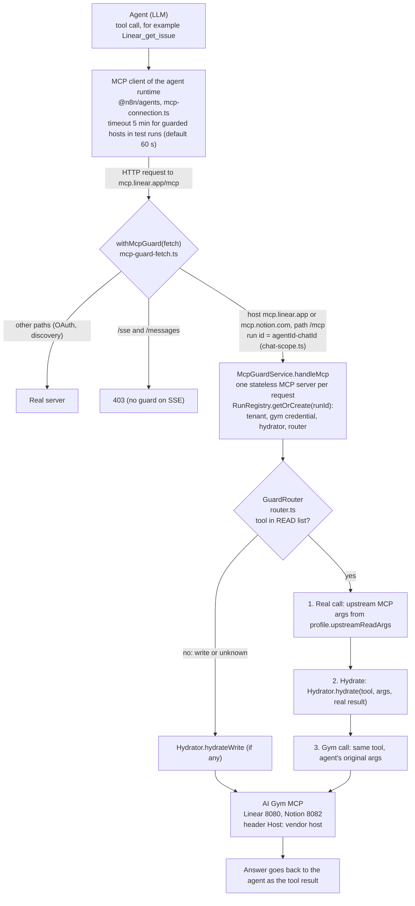
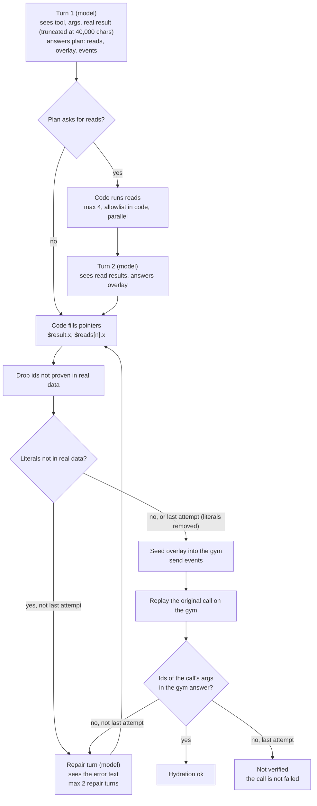

# mcp-guard: how a call flows, and test scenarios

Ticket: TRUST-1173 (guard), TRUST-1178 (Notion real ids in AI Gym).
This file explains the path of one MCP call in a preview-mode chat. It ends with 10 scenarios to test it.
`CONTEXT.md` has the setup notes. This file has the flow.

## 1. Goal

When an agent runs in the Agent Builder preview chat (`runType === 'test'` and `previewChat`), its Linear and Notion MCP calls must never change real data.

| Kind of call | Real MCP | AI Gym |
|---|---|---|
| Read | Called | Answers the agent |
| Write | Never called | Answers the agent |
| Unknown tool | Never called | Answers the agent (treated as a write) |

AI Gym is a simulator of vendor services. It holds one tenant per chat. Before a read is answered, its real result is copied into the tenant under the real ids ("hydration"). This makes the gym answer with data the agent can use.

## 2. Flow of one call

Rules of the router:
- A failed real read never turns into a write.
- If the gym lacks a read tool, the real result goes back to the agent.
- Errors become tool errors. They do not crash the chat.
- Hydration failure never fails the call. The gym then answers with what it has.

### 2.1 Hydration (`MCP_GUARD_HYDRATION`)

`MCP_GUARD_HYDRATION=plan` turns the guard on. Any other value, or no value, leaves it off.

| Value | Class | How it works |
|---|---|---|
| `plan` | `PlanHydrator` | Plan and execute. See section 3. |

`PlanHydrator` implements the `Hydrator` interface (`hydrate`, optional `hydrateWrite`). A hydration stops after 4 minutes.

## 3. Plan and execute (`plan-hydrator.ts`, `plan-template.ts`)

The model has no tools. It answers with one JSON plan. Code runs it.

Why pointers: the model writes `$result.title` instead of the full text. This cuts the model output. The model still reads the real result.

Safety checks in code (the model can not sneak a value in):
- An `id` must be a UUID that exists in real data, or it is dropped.
- A text value must appear in real data or in the call's args. Structure keys (`ref`, `type`, `color`, `parent`, `team`, ...), type names and short refs are free.
- Real data is untrusted. The prompt tells the model to ignore instructions inside it.

Linear detail: the real call omits the agent's `fields` list (`upstreamReadArgs`). Linear then returns its default fields, which include `uuid`. The gym still gets the agent's original args.

### 3.1 Dedupe, tenants, cleanup

- `OnceByKey`: one hydration per key at a time. A retry of the MCP client after a timeout joins the running job. A failed job is forgotten.
- Tenant per chat: `guard-<agentId>-<chatId>` (lowercase). Outside a chat (build-time `tools/list`) the run id is `<agentId>`.
- `RunRegistry` has an in-flight map for creation, so two calls do not create two tenants. A tenant idle for 6 h is deleted when a new one is created.
- The gym tenant is checked before each call and built again if it is gone.

## 4. What the gym does that matters for tests

- Linear: identifier = team key + number (`TRUST-1209` = key `TRUST`, number 1209). Priority is an integer. A default team `TRUST` exists in each tenant.
- Linear seed is atomic. One bad entity rejects the whole overlay. Seeding an existing project gives "Entity with this id already exists".
- Notion: ids are stored dashed and lowercase. A seed skips existing refs and does not update them. A page with no parent needs an OAuth bearer (the guard uses `mcp_oauth`).
- Both: a call on an id that is not in the tenant gives "not found" style errors.

## 5. Where to look when a test goes wrong

| Question | Where |
|---|---|
| Which path did a call take? | n8n log: `mcp-guard <tool> -> gym` or `-> upstream+hydrate+gym` |
| Did the model run, how long? | `mcp-guard plan model turn N: X ms ...` |
| Pointers used? | `mcp-guard plan turn N uses K pointers` |
| Why did a hydration fail? | `mcp-guard plan problem: ...; overlay shape ...` |
| Result of a hydration | `mcp-guard plan hydration <tool>: ok / not verified, N model turns, M reads, T ms` |
| Shape of the real result | `mcp-guard plan real result of <tool>: <shape>` (keys and types only) |
| What is in the gym? | `GET <admin>/_sim/v1/tenants/<tenant>` (Linear: `refs`; Notion: `pages`, `databases`) |
| What did the gym do? | `GET <admin>/_sim/v1/tenants/<tenant>/monitor` |

Admin ports used locally: Linear 9090, Notion 9092 (MCP on 8080 and 8082).

## 6. Scenarios

Each scenario is a prompt for the agent under test. The agent needs the Linear and Notion MCP servers.
Before you start: use real ids from the workspace (ticket, project, page ids). Replace the `<…>` values.

Pass rule for all: no change in real Linear or Notion. Check in the real UI after the run. Then check the gym state.

### S1. Query with a sub query (Linear)

Prompt: "List the open issues of project `<project>` that are assigned to me. For each one, get its comments and tell me which ones have no reply."

- Tools: `list_issues` (filter by project, assignee), `get_issue` or `list_comments` per issue.
- Forces: a list read, then reads that depend on the first result.
- Expect: each read goes `upstream+hydrate+gym`. The comment reads find the issues the list seeded.
- Look for: ids from the list used in the sub query. Hydration of many issues in one overlay.

### S2. Create a resource, then link it (Linear)

Prompt: "Create an issue in team TRUST titled `Guard test S2` with priority High and label `Bug`. Then create a second issue that is a sub-issue of the first."

- Tools: `list_issue_labels` or `list_teams` (reads), `save_issue` (twice, the second with `parentId`).
- Forces: write with a label that may not exist yet, then a write that depends on the id the gym returned.
- Expect: both creates go to the gym only. The second uses the id from the first answer.
- Look for: label or state seeded before the create. No id invented by the model.

### S3. Partial update (Linear)

Prompt: "Take `<ticket>` and change only its priority to Urgent. Do not touch the title, description, assignee or labels."

- Tools: `get_issue` (read), `save_issue` with `id` and `priority`.
- Forces: a write on a real id that was never read in this chat. The guard must hydrate the target (`hydrateWrite`) so the update does not give "not found".
- Expect: after the run, `get_issue` on the gym shows the new priority and the same title and labels as the real issue.
- Look for: the real issue unchanged.

### S4. Update with a related resource (Linear)

Prompt: "Move `<ticket>` to the state `In Review`, assign it to `<user name>`, and add the label `needs-docs`."

- Tools: `list_issue_statuses`, `list_users`, `list_issue_labels`, `save_issue`.
- Forces: three lookups by name and one write with ids from them.
- Expect: the write carries state, assignee and label that exist in the gym.
- Look for: the "Argument Validation Error" from the gym (invented ids or a wrong team key).

### S5. Comment thread (Linear)

Prompt: "Read the comments on `<ticket>`. Reply to the newest comment with a summary of the ticket. Then edit your reply to add the line `Checked by agent`. Then delete it."

- Tools: `list_comments`, `save_comment` (create, update with `id`), `delete_comment`.
- Forces: create, update and delete of one child resource, in order.
- Expect: the gym shows the comment created, changed, then gone. The real thread is unchanged.
- Look for: the update and delete use the id from the create answer, not a made-up one.

### S6. Project with milestones and a status update (Linear)

Prompt: "Create a project `Guard test S6` in team TRUST. Add two milestones to it, then post a status update on the project saying it is on track. Then list the project's milestones."

- Tools: `save_project`, `save_milestone` (twice), `save_status_update`, `list_milestones`, `get_project`.
- Forces: a chain of three resource types, each child pointing to the parent.
- Expect: all writes in the gym. The final list shows two milestones.
- Look for: "Entity with this id already exists" if the agent retries the project create.

### S7. Notion: query a database, then read a row (Notion)

Prompt: "In the Notion database `<database url>`, find the rows where Status is `In progress`. Open the first one and summarize its content."

- Tools: `notion-fetch` (database), `notion-query-data-sources`, `notion-fetch` (page).
- Forces: a read of a database and its data source, a query on it, then a read of a row. This is the Notion read path through the plan hydrator. It was not tested live yet.
- Expect: the gym answers the query with the rows seeded from the real result. Row ids are the real ones.
- Look for: a database seeded with property types the gym does not support (only simple types are covered). A fetch result that is markup inside a JSON `text` field, where pointers do not apply.

### S8. Notion: create under a parent, then update part of it (Notion)

Prompt: "Create a page `Guard test S8` under the page `<parent page url>` with a heading, a bullet list of 3 items and a short paragraph. Then replace only the paragraph with the text `Updated by agent`, and add a new bullet at the end."

- Tools: `notion-fetch` (parent), `notion-create-pages` with `parent`, `notion-update-page` (partial content update).
- Forces: a write whose parent was never read (the parent must be seeded first), then a partial update of page content.
- Expect: the create returns a page id. The update changes only the paragraph and adds one bullet. The real parent has no new child.
- Look for: "Could not find page with ID" on the create (parent not seeded). A full replace instead of a partial change.

### S9. Notion: comments, move and delete (Notion)

Prompt: "On the page `<page url>`, add a comment `Needs review`. Reply to your own comment. Then move the page under `<other page url>` and finally delete the page."

- Tools: `notion-create-comment` (twice, one in a discussion), `notion-get-comments`, `notion-move-pages`, `notion-delete-pages`.
- Forces: a sub resource (comment and reply), a move that touches two real pages, and a delete.
- Expect: nothing changes in real Notion. The gym shows the page deleted at the end.
- Look for: `notion-move-pages` is not write-hydrated yet. The gym may give "not found" if the target page was never seeded. Note this as a known gap, not as a new bug.

### S10. Cross tool workflow (Linear and Notion)

Prompt: "Read `<ticket>` and its comments. Create a Notion page with a summary and a table of the comments (author, date, text). Add the page link to the ticket as a comment. Then change the ticket's state to `In Review` and add a Notion link to its description, keeping the rest of the description."

- Tools: `get_issue`, `list_comments`, `notion-create-pages`, `save_comment`, `list_issue_statuses`, `save_issue` (update description and state).
- Forces: both services in one chat, a write that needs the output of a write on the other service, and a partial update of a long text field.
- Expect: two gym tenants for the chat (one per service). The comment on the ticket holds the gym page URL. The description keeps the old text plus the link.
- Look for: total time (target: under 25 s added by hydration per read). The description is not cut. This is the scenario already run with TRUST-1209 (without the last step).

## 7. How to run a scenario

1. Start the gyms and n8n as in `CONTEXT.md`.
2. Open the agent in the Agent Builder test chat. Paste the prompt. Approve the human-in-the-loop prompts.
3. Read the n8n log with the greps in section 5.
4. Read the gym state (section 5) and check the expectations.
5. Check the real Linear and Notion UI. Nothing must have changed.

Record for each run: scenario, chat id, tools called, hydration turns and time, pass or fail, notes.

## 8. Known limits (do not report these as new bugs)

- Pointers work on JSON results only. A Notion fetch result is markup inside a JSON `text` field.
- The planner does not know what is already in the gym. A re-seed of an existing item costs a repair turn.
- Notion SQL mode of `notion-query-data-sources` is not supported by the gym.
- Notion property types people, relation, formula, rollup and files are not seeded.
- `notion-move-pages` and `notion-duplicate-page` are not write-hydrated.
- One tenant is also created at runtime build, for the `tools/list` call outside a chat.
- Tenant ownership has no multi-process support.
